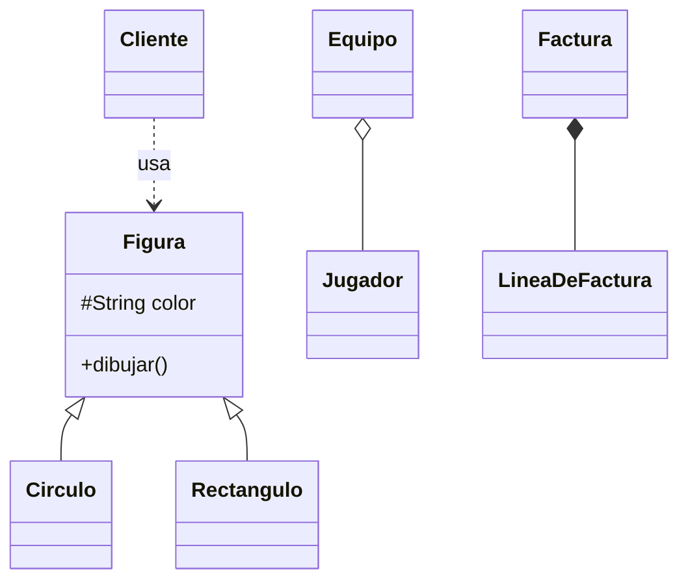
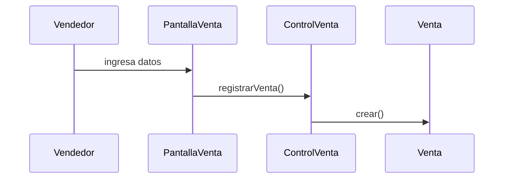
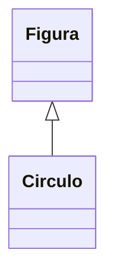
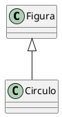

**user**: Dame ejemplois de requisitos no funcionales
[Timestamp: 2026/11/03 19:33:17]

**ai**: # Ejemplos de requisitos no funcionales (RNF)

Los requisitos no funcionales describen **cómo** debe comportarse el sistema, no **qué** hace. Los agrupo por categoría de calidad. Los ejemplos son medibles, porque un RNF sin métrica no se puede verificar.

## Rendimiento
- El sistema debe responder a las consultas de búsqueda en menos de 2 segundos para el 95% de los casos.
- Debe soportar 500 usuarios concurrentes sin degradar el tiempo de respuesta.
- El proceso de facturación mensual debe terminar en menos de 10 minutos para 50.000 registros.

## Seguridad
- Las contraseñas deben almacenarse cifradas (hash con sal).
- El sistema debe bloquear la cuenta tras 5 intentos fallidos de inicio de sesión.
- Toda comunicación entre cliente y servidor debe usar HTTPS/TLS.
- Solo los usuarios con rol "Administrador" pueden modificar datos de otros usuarios.

## Disponibilidad y confiabilidad
- El sistema debe estar disponible el 99,5% del tiempo (24/7), excepto ventanas de mantenimiento programado.
- Ante una caída, el sistema debe recuperarse en menos de 30 minutos.
- Debe hacerse un backup automático de la base de datos todos los días a las 03:00.

## Usabilidad
- Un usuario nuevo debe poder completar una operación básica (por ejemplo, registrar una venta) en menos de 5 minutos sin capacitación.
- La interfaz debe ser accesible según WCAG 2.1 nivel AA.
- Los mensajes de error deben indicar claramente la causa y cómo corregirla.

## Mantenibilidad
- El código debe seguir un estándar de codificación definido y estar documentado.
- Una modificación menor debe poder implementarse en menos de 2 días.
- Debe tener una cobertura de pruebas unitarias de al menos 80%.

## Portabilidad y compatibilidad
- La aplicación web debe funcionar en las últimas dos versiones de Chrome, Firefox y Edge.
- Debe ser ejecutable en Windows y Linux sin cambios en el código.
- Debe integrarse con el sistema de pagos externo mediante una API REST.

## Escalabilidad
- La arquitectura debe permitir duplicar la cantidad de usuarios sin rediseñar el sistema, solo agregando recursos.

## Restricciones legales y de estándares
- El sistema debe cumplir con la ley de protección de datos personales vigente.
- Los comprobantes deben cumplir con el formato exigido por el organismo fiscal.

## Cómo redactarlos bien
- **Medible:** "rápido" no sirve. "Menos de 2 segundos" sí.
- **Verificable:** debe poder probarse con una prueba o una métrica concreta.
- **Específico:** indicá el contexto, como "en la búsqueda de productos" o "con 500 usuarios".

Si querés, puedo armarte ejemplos aplicados al caso del TP (por ejemplo CU020 y CU028) o agregarlos como sección en tu resumen de la unidad.
[Timestamp: 2026/11/03 19:33:17]

**user**: **Objetivos** (según el apunte):
1. Comprender en profundidad los **requisitos no funcionales** y las restricciones (lenguaje, BD, sistema operativo, concurrencia, distribución…).
2. Generar el **punto de partida** de la implementación.
3. **Descomponer** la implementación en partes más manejables.
4. Crear una **abstracción de la implementación** del sistema. explicame esto
[Timestamp: 2026/11/03 19:35:11]

**ai**: # Objetivos del flujo de Diseño (Proceso Unificado)

Estos objetivos corresponden al **flujo de trabajo de Diseño** del UP. Si el Análisis responde "qué debe hacer el sistema", el Diseño responde **"cómo lo vamos a construir"**, pensando ya en la tecnología real.

## 1. Comprender en profundidad los requisitos no funcionales y las restricciones

En el análisis se trabaja de forma ideal, sin pensar en tecnología. En el diseño hay que tener en cuenta las condiciones reales:

- **Lenguaje de programación**, por ejemplo Java, que condiciona cómo se modelan las clases (herencia simple o múltiple, interfaces).
- **Base de datos**, por ejemplo relacional, que obliga a pensar en el mapeo de objetos a tablas.
- **Sistema operativo y plataforma**, que afectan lo que se puede usar.
- **Concurrencia**, es decir, qué pasa si dos usuarios modifican lo mismo a la vez.
- **Distribución**, o sea si el sistema corre en varios nodos y cómo se comunican.
- **Rendimiento, seguridad, reutilización de componentes existentes**, etc.

Dicho de otro modo, antes de diseñar hay que saber con qué "reglas del juego" técnicas se cuenta, porque un diseño que ignora esas restricciones no se puede implementar.

## 2. Generar el punto de partida de la implementación

El diseño produce el material con el que los programadores empiezan a trabajar:

- Diagramas de clases de diseño.
- Diagramas de interacción (secuencia o comunicación).
- Definición de operaciones y atributos con sus tipos.

Con esto, la etapa de **Implementación** no arranca desde cero ni a ciegas. Tiene un plano detallado para seguir.

## 3. Descomponer la implementación en partes más manejables

Un sistema grande no se programa de una sola vez. El diseño lo divide en:

- **Subsistemas** o paquetes.
- **Capas**, por ejemplo presentación, lógica de negocio y persistencia.
- **Interfaces** entre esas partes.

Esto permite repartir el trabajo entre equipos, desarrollar y probar por partes, y reducir el acoplamiento (cada parte depende poco de las demás).

## 4. Crear una abstracción de la implementación del sistema

El **modelo de diseño** es una versión simplificada del código final. Conserva la estructura y el comportamiento, pero omite los detalles de bajo nivel. Es casi un "código dibujado".

La relación con la implementación es directa: cada clase de diseño se corresponde con una clase en el código. Por eso se dice que el modelo de diseño es una **abstracción** de la implementación, y por eso sirve para razonar sobre el sistema sin leer miles de líneas de código.

## Resumen para estudiar

| Objetivo | Idea clave |
| --- | --- |
| Entender RNF y restricciones | Conocer las condiciones técnicas reales antes de diseñar |
| Punto de partida | Entregar a los programadores un plano claro |
| Descomponer | Dividir en subsistemas y capas para manejar la complejidad |
| Abstracción | El modelo de diseño representa al código sin ser el código |

Si querés, lo adapto al formato de tus resúmenes de la Unidad 4 o te lo conecto con lo que dice [[U4.1 - Modelos de UP y Diagrama de Clases]].
[Timestamp: 2026/11/03 19:35:11]

**user**: En el modelo de Analisis se analiza cada caso de uso y en el modelo de CUs es una vision mas bien general de los casos de uso
[Timestamp: 2026/11/03 19:43:46]

**ai**: Tu idea va bien encaminada, pero conviene afinar una parte: el modelo de CUs **no es solo una visión general**. La diferencia real es la **perspectiva**, no el nivel de detalle.

## Modelo de Casos de Uso: el sistema como caja negra
- Muestra **qué** hace el sistema desde afuera, desde el punto de vista del actor.
- Incluye el diagrama de CUs (actores, casos de uso y relaciones `include`, `extend` y generalización).
- Incluye también la **descripción detallada de cada CU**: flujo básico, flujos alternativos, precondiciones y postcondiciones.
- El lenguaje es el del cliente y el usuario.

La visión general es el diagrama, pero el modelo también tiene detalle: cada CU está especificado paso a paso.

## Modelo de Análisis: el sistema como caja blanca
- Muestra **cómo se organiza internamente** el sistema para cumplir cada CU, todavía sin pensar en la tecnología.
- Se toma **cada caso de uso** y se hace su **realización de análisis**. Es decir, se identifican las clases de análisis que lo cumplen:
  - **Clases de interfaz (boundary):** lo que toca el actor.
  - **Clases de control:** coordinan la lógica del CU.
  - **Clases de entidad:** la información que se guarda.
- Se muestran sus colaboraciones con diagramas de comunicación o secuencia.
- El lenguaje es el de los desarrolladores.

## Comparación

| | Modelo de CUs | Modelo de Análisis |
| --- | --- | --- |
| Pregunta | ¿Qué hace el sistema? | ¿Cómo se estructura para hacerlo? |
| Perspectiva | Externa (actor) | Interna (clases) |
| Elementos | Actores, CUs, relaciones, flujos | Clases boundary, control y entidad, y sus colaboraciones |
| Audiencia | Cliente y usuario | Desarrolladores |
| Relación con los CUs | Los define | Los **realiza**, uno por uno |

## Cómo corregiría tu frase

> El modelo de CUs especifica **qué** hace el sistema desde la perspectiva externa del actor. El modelo de Análisis toma cada CU y lo **realiza internamente** con clases de análisis, para entender cómo se construiría.

Así que la parte de "en el Análisis se analiza cada CU" es correcta. Lo que sumaría es que el modelo de CUs también describe cada CU, pero hacia afuera y no hacia adentro.
[Timestamp: 2026/11/03 19:43:46]

**user**: | Modelo de casos de uso | Modelo de análisis |
| --- | --- |
| En el **lenguaje del cliente** | En el **lenguaje de los desarrolladores** |
| **Vista externa** del sistema | **Vista interna** del sistema |
| Estructurado en **casos de uso** | Estructurado en **clases estereotipadas** (clases de análisis) |
| **"Contrato"** entre cliente y desarrolladores sobre qué debe y qué no debe hacer el sistema | Lo usan los desarrolladores para entender **cómo diseñar e implementar** |
| **Puede tener** redundancias e inconsistencias | **No debería tener** redundancias ni inconsistencias |
| **Captura** la funcionalidad | **Define cómo realizar** la funcionalidad (primera aproximación al diseño) |
| Define **casos de uso** | Define **realizaciones** de casos de uso |
 explicame cada uno cortito
[Timestamp: 2026/11/03 19:45:34]

**ai**: # Modelo de CUs vs. Modelo de Análisis, fila por fila

**1. Lenguaje**
- **CUs:** se escribe con palabras del cliente ("el cliente paga la factura"), sin tecnicismos.
- **Análisis:** se escribe con términos de desarrollo (clases, objetos, colaboraciones).

**2. Vista**
- **CUs:** ve el sistema desde afuera, como lo ve el actor.
- **Análisis:** ve el sistema desde adentro, con las partes que lo componen.

**3. Estructura**
- **CUs:** se organiza en casos de uso, cada uno una funcionalidad completa.
- **Análisis:** se organiza en clases estereotipadas, es decir, **boundary** (interfaz), **control** y **entidad**.

**4. Para qué sirve**
- **CUs:** es el "contrato". El cliente y los desarrolladores acuerdan qué hace y qué **no** hace el sistema.
- **Análisis:** lo usan los desarrolladores para entender cómo diseñar e implementar.

**5. Redundancias e inconsistencias**
- **CUs:** pueden tenerlas. Está escrito en lenguaje natural y varios CUs repiten pasos parecidos (por ejemplo, validar el usuario en varios CUs).
- **Análisis:** no debería tenerlas. Lo repetido se unifica en una sola clase y no se permiten contradicciones.

**6. Qué hace**
- **CUs:** captura la funcionalidad. Dice **qué** debe hacer el sistema.
- **Análisis:** define cómo realizarla. Es una **primera aproximación al diseño**, todavía sin tecnología.

**7. Qué define**
- **CUs:** define los casos de uso.
- **Análisis:** define las **realizaciones** de los casos de uso, o sea cómo colaboran las clases para cumplir cada CU.

## Idea para recordar
El modelo de CUs es el **"qué"** para el cliente, y el modelo de Análisis es el **"cómo" conceptual** para el desarrollador. Entre ambos hay una relación de **realización**: cada CU tiene su realización en el análisis.
[Timestamp: 2026/11/03 19:45:34]

**user**: Digamos que en el analisis el caso de uso pasa a ser una clase esterotipada?
[Timestamp: 2026/11/03 19:46:19]

**ai**: No exactamente. El caso de uso **no se convierte en una clase**, sino que se **descompone en varias clases estereotipadas** que colaboran entre sí.

## Cómo es la relación

- El **caso de uso** sigue existiendo en el modelo de CUs. No desaparece ni se transforma.
- En el análisis se crea la **realización del caso de uso**: un conjunto de clases de análisis, con sus colaboraciones, que muestra cómo se cumple ese CU.
- La relación entre ambos es de **realización**: la realización del CU "realiza" al CU.

## Ejemplo: CU "Registrar venta"

El CU, como un solo bloque, se reparte en estas clases de análisis:

| Estereotipo | Clase | Rol |
| --- | --- | --- |
| Boundary | `PantallaVenta` | Interactúa con el actor (vendedor) |
| Control | `ControlRegistrarVenta` | Coordina el flujo del CU |
| Entidad | `Venta`, `Producto`, `Cliente` | Guardan la información |

El flujo sería: el vendedor usa `PantallaVenta`, esta le pasa los datos a `ControlRegistrarVenta`, y el control trabaja con `Venta` y `Producto`.

## Cómo corregiría tu frase

> En el análisis, cada caso de uso se **realiza** mediante un conjunto de clases estereotipadas (boundary, control y entidad) que colaboran entre sí.

Un detalle: en el UP existe una clase de control "típica" por CU, pero eso no significa que el CU sea esa clase. El CU es la funcionalidad completa y las clases son las piezas que la hacen posible.
[Timestamp: 2026/11/03 19:46:19]

**user**: Claro digamos que en el modelo de casos de uso defino las funcionalidades y en el modelo de analisis uso eso creado para construir la primer aproximacion al diseño en base de como se implementarian esas funcionalidades atraves de diagramas de clases con entidades gestores de logica y boundarys , diagramas de secuencia y estado
[Timestamp: 2026/11/03 20:00:44]

**ai**: Sí, tu idea es correcta. Solo ajustaría algunos detalles de vocabulario y qué diagramas se usan.

## Lo que está bien
- **Modelo de CUs:** define las funcionalidades (el qué).
- **Modelo de Análisis:** parte de esos CUs y plantea una primera aproximación al diseño, es decir, cómo se cumplirían esas funcionalidades.
- Las clases se dividen en **entidad**, **control** (lo que llamás "gestores de lógica") y **boundary**.

## Qué ajustaría

**1. "Gestores de lógica" es la clase de control.** Coordina el flujo de un CU y, en la práctica, es lo que describís. Conviene usar el nombre del apunte (clase de control) para el parcial.

**2. Los diagramas de interacción en análisis suelen ser de colaboración (comunicación).** El UP privilegia ese diagrama en análisis porque muestra qué clases se relacionan. El de secuencia es válido y se usa mucho, pero tiene más peso en el diseño, cuando importa el orden preciso de los mensajes. Verificá en tu apunte cuál prioriza, porque puede variar según la cátedra.

**3. El diagrama de estado no se hace para todo.** Se usa solo para clases con un ciclo de vida interesante (por ejemplo, un pedido que pasa de "pendiente" a "pagado" y a "enviado"). No es obligatorio por cada CU.

**4. Faltan los paquetes de análisis.** Además de las clases, el análisis agrupa todo en paquetes para organizar el modelo.

## Versión pulida de tu frase

> En el modelo de CUs defino las funcionalidades. En el modelo de análisis tomo cada CU y hago su realización: una primera aproximación al diseño, donde identifico clases de entidad, control y boundary, y muestro cómo colaboran mediante diagramas de interacción (comunicación o secuencia), usando diagramas de estado cuando una clase lo requiere.

Si querés, revisamos qué dice [[U4.1 - Modelos de UP y Diagrama de Clases]] sobre qué diagramas usa cada modelo.
[Timestamp: 2026/11/03 20:00:44]

**user**: explicame cada uno 
| Modelo de análisis | Modelo de diseño |
| --- | --- |
| Modelo **conceptual** | Modelo **físico** |
| **Genérico** (sirve para varios diseños) | **No genérico** (específico de la implementación) |
| **3 estereotipos conceptuales:** interfaz, control y entidad | **Cualquier número** de estereotipos |
| **Menos formal** | **Más formal** |
| **Menos capas** | **Más capas** |
| Un **bosquejo** del sistema | Un **manifiesto** del sistema |
| Surge de **reuniones y talleres** | Surge de **"programación visual"**, en ingeniería de ida y vuelta con la implementación |
| **Puede no mantenerse** durante todo el ciclo de vida | **Debe mantenerse** durante todo el ciclo de vida |
[Timestamp: 2026/11/03 20:06:01]

**ai**: # Modelo de Análisis vs. Modelo de Diseño, fila por fila

**1. Conceptual vs. físico**
- **Análisis:** representa ideas y conceptos del problema, sin pensar en cómo se programa.
- **Diseño:** representa lo que realmente existirá en el código (clases concretas, tipos de datos, tecnología).

**2. Genérico vs. no genérico**
- **Análisis:** como no depende de la tecnología, un mismo análisis puede dar lugar a varios diseños (en Java, en .NET, con otra base de datos).
- **Diseño:** está atado a una implementación concreta. Sirve para una sola forma de construir el sistema.

**3. Estereotipos**
- **Análisis:** solo tres: **interfaz** (boundary), **control** y **entidad**.
- **Diseño:** tantos como haga falta (por ejemplo, DAO, servicio, repositorio, controlador web, etc.), según la tecnología elegida.

**4. Formalidad**
- **Análisis:** más flexible. Puede tener atributos u operaciones sin tipos ni firmas completas.
- **Diseño:** más riguroso. Cada clase tiene atributos con tipo, operaciones con parámetros, visibilidad, etc.

**5. Capas**
- **Análisis:** pocas capas, una estructura simple.
- **Diseño:** más capas, porque se agregan las necesarias para la tecnología (por ejemplo, persistencia, servicios, acceso a datos).

**6. Bosquejo vs. manifiesto**
- **Análisis:** es un borrador, un boceto de cómo sería el sistema.
- **Diseño:** es la descripción fiel y completa del sistema. Dice cómo está hecho.

**7. Origen**
- **Análisis:** surge de conversaciones con el cliente, reuniones y talleres, mucha discusión.
- **Diseño:** surge de la programación visual: se modela y se genera o ajusta el código, y a la inversa. Esa **ingeniería de ida y vuelta** (*round-trip engineering*) mantiene el modelo y el código sincronizados.

**8. Mantenimiento**
- **Análisis:** puede abandonarse después de cumplir su función, porque era un paso intermedio.
- **Diseño:** debe mantenerse actualizado durante toda la vida del sistema, porque es la documentación real del código.

## Idea para recordar
El **análisis** es un boceto conceptual y flexible para entender el problema. El **diseño** es el plano técnico, formal y definitivo, atado a la tecnología y que hay que mantener al día.
[Timestamp: 2026/11/03 20:06:01]

**user**: en las clases de analisis tambien tenian nombre , atributos y operaciones
[Timestamp: 2026/11/03 20:09:13]

**ai**: Sí, tienen las tres cosas. Lo que cambia respecto al diseño es el **nivel de detalle**, no la presencia de esos elementos.

## Qué tienen las clases de análisis

**Nombre**
- Es obligatorio y expresa un concepto del dominio (`Venta`, `Cliente`).
- Debe tener sentido para el cliente.

**Atributos**
- Se incluyen los que son conceptualmente relevantes, por ejemplo `fecha` o `total` en `Venta`.
- Normalmente no llevan tipos de datos detallados ni visibilidad, porque eso corresponde al diseño.

**Operaciones**
- En análisis se las trata como **responsabilidades**: qué debe hacer la clase, por ejemplo "calcular el total" o "validar el stock".
- No tienen firma completa (parámetros, tipo de retorno) ni visibilidad, porque eso se define en el diseño.

## Comparación

| | Clase de análisis | Clase de diseño |
| --- | --- | --- |
| Nombre | Concepto del dominio | Nombre definitivo en el código |
| Atributos | Los relevantes, sin tipos precisos | Con tipo, visibilidad y valor inicial |
| Operaciones | Responsabilidades en términos generales | Firma completa con parámetros y retorno |

Esto me lleva a corregir mi respuesta anterior: dije que en análisis "puede tener atributos u operaciones sin tipos ni firmas completas". Eso es correcto, pero la frase pudo sonar como si no los tuvieran, y no es así. La diferencia con el diseño es la formalidad, que es justo lo que dice la fila "menos formal / más formal" de tu tabla.

Un dato más: las clases de análisis también tienen **relaciones** (asociación, agregación, generalización), pero en forma simple y sin entrar en detalles de implementación.
[Timestamp: 2026/11/03 20:09:13]

**user**: En una asociacion simple es bidireccional la navegabilidad?
[Timestamp: 2026/11/03 20:18:22]

**ai**: Por convención, **sí**. Una asociación simple, sin flechas, se interpreta como **bidireccional**: cada clase conoce a la otra y puede navegar hacia ella.

## Matiz importante

La especificación de UML dice que, sin flechas, la navegabilidad está **sin especificar**. En la práctica, la mayoría de los apuntes y cátedras lo toman como bidireccional, que es lo más probable que te pidan en el parcial. Verificá en tu apunte cuál criterio usa tu cátedra.

## Cómo se ve cada caso

| Notación | Significado |
| --- | --- |
| `A ——— B` | Asociación simple: bidireccional (A conoce a B y B conoce a A) |
| `A ———> B` | Navegabilidad unidireccional: A conoce a B, pero B no conoce a A |
| `A <———> B` | Bidireccional indicada explícitamente |

## Cuándo importa

- **En análisis** se suele dejar la asociación simple (bidireccional), porque todavía no interesa quién navega hacia quién. Solo importa que las clases están relacionadas.
- **En diseño** se **define la navegabilidad**, porque tiene impacto en el código. Una flecha de A a B significa que A tendrá un atributo (referencia) hacia B, y B no tendrá nada de A. Una bidireccional obliga a mantener las dos referencias consistentes, lo que es más costoso.

Por eso, en diseño se prefiere la navegabilidad **unidireccional** siempre que alcance, para reducir el acoplamiento.
[Timestamp: 2026/11/03 20:18:22]

**user**: Para que sirve la agregacion que no haga una asociacion simple
[Timestamp: 2026/11/03 20:19:01]

**ai**: La agregación **no agrega capacidad técnica** respecto de una asociación simple: en código se implementa casi igual. Lo que aporta es **semántica**: comunica una intención de modelado.

## Qué expresa

- Una asociación simple dice solo que "A y B están relacionadas".
- Una agregación dice que **A es un todo y B es una parte de A** (relación "tiene un" o "está compuesto por").

Ejemplos: `Equipo` agrega `Jugador`, `Biblioteca` agrega `Libro`, `Departamento` agrega `Empleado`.

## Qué diferencia práctica tiene

1. **Jerarquía todo-parte:** deja claro cuál es el todo y cuál la parte. En la asociación simple las dos clases están al mismo nivel.
2. **Ciclo de vida independiente:** en la agregación la parte puede existir sin el todo. Si se elimina el `Equipo`, los `Jugador` siguen existiendo. (Si la parte muriera con el todo, sería **composición**, que es la versión fuerte.)
3. **Una parte puede compartirse:** un mismo `Jugador` puede pertenecer a más de un `Equipo`.
4. **Se evitan ciclos:** una agregación no puede ser circular (A contiene a B y B contiene a A), cosa que una asociación simple no impide.
5. **Documentación:** quien lee el diagrama entiende la estructura sin leer la descripción.

## Una aclaración honesta

Muchos autores, incluido Martin Fowler, consideran que la agregación es **conceptualmente vaga** y se solapa con la asociación simple. En la práctica, las diferencias reales son las de la composición. Por eso en el parcial conviene saber definirla tal como la plantea el apunte, aunque en proyectos reales mucha gente directamente usa asociación o composición.

## Comparación rápida

| | Asociación | Agregación | Composición |
| --- | --- | --- | --- |
| Relación | "Se relaciona con" | "Tiene un" (todo-parte) | "Está formado por" (todo-parte fuerte) |
| Partes sin el todo | Sí | Sí | No |
| Partes compartibles | Sí | Sí | No |
| Notación | Línea | Rombo vacío | Rombo lleno |
[Timestamp: 2026/11/03 20:19:01]

**user**: En composicion las partes no pueden tener mas de un todo
[Timestamp: 2026/11/03 20:20:20]

**ai**: Sí, es correcto. En la composición cada parte pertenece a **un solo todo** a la vez, y su ciclo de vida depende del todo.

## Qué implica

- **Un único dueño:** una parte no puede estar compuesta en dos todos distintos al mismo tiempo. La multiplicidad del lado del todo es `1` (o `0..1` en algunas variantes).
- **Ciclo de vida dependiente:** si se elimina el todo, se eliminan también sus partes. Una parte no tiene sentido sin su todo.
- **Responsabilidad del todo:** el todo crea y destruye a sus partes.

## Ejemplo

`Factura` se compone de `LineaDeFactura`. Cada línea pertenece a una única factura, y si se borra la factura, desaparecen sus líneas.

Una línea de factura no puede estar en dos facturas a la vez, y tampoco existe sola.

## Contraste con la agregación

| | Agregación | Composición |
| --- | --- | --- |
| ¿Partes en más de un todo? | Sí, pueden compartirse | No |
| ¿La parte vive sin el todo? | Sí | No |

## Una precisión

Que una parte no pueda tener más de un todo **a la vez** no impide que se transfiera: en algunos modelos, una parte puede pasar de un todo a otro (se mueve, no se comparte). Lo que no se permite es que pertenezca a dos al mismo tiempo.
[Timestamp: 2026/11/03 20:20:20]

**user**: En dependencia el ejemplo , Cliente recibe por parametro Figura ? como seria eso
[Timestamp: 2026/11/03 20:26:44]

**ai**: Sí, es el ejemplo típico de **dependencia**. `Cliente` usa a `Figura` solo de forma transitoria, dentro de un método, y no la guarda como atributo.

## Cómo se ve en código

```java
class Cliente {
    void dibujar(Figura f) {   // Figura llega por parámetro
        f.dibujar();           // la usa y listo
    }
}
```

`Cliente` no tiene ningún atributo de tipo `Figura`. La recibe, la usa durante la ejecución del método y después se "olvida" de ella.

## Cómo se ve en UML

Una flecha **punteada** con punta abierta, de `Cliente` hacia `Figura`:

```
Cliente - - - - -> Figura
```

La flecha apunta hacia la clase de la que se depende, es decir, la que se usa.

## Qué significa la dependencia

- Si `Figura` cambia (por ejemplo, se renombra `dibujar()`), `Cliente` puede verse afectado y quizás haya que modificarlo.
- Lo contrario no es cierto: `Figura` no sabe nada de `Cliente`.

## Diferencia con la asociación

| | Dependencia | Asociación |
| --- | --- | --- |
| Relación | Uso temporal | Relación estructural, duradera |
| En código | Parámetro, variable local o valor de retorno | Atributo (referencia guardada) |
| Notación | Flecha punteada | Línea continua |

Ejemplo de asociación, para contrastar:

```java
class Cliente {
    private Figura figura;   // la guarda: relación duradera
}
```

Como regla práctica: si `Cliente` **guarda** a `Figura`, es asociación. Si solo la **recibe, usa o devuelve** en un método, es dependencia.

Otras formas de dependencia, además de recibirla por parámetro:

- Crear una instancia de `Figura` dentro de un método.
- Declararla como variable local.
- Devolverla como resultado de un método.
[Timestamp: 2026/11/03 20:26:44]

**user**: Y en herencia hereda todos los atributos y metodos
[Timestamp: 2026/11/03 20:28:11]

**ai**: Casi: la subclase **hereda** todos los atributos y métodos de la superclase, pero no necesariamente puede **acceder** a todos. Depende de la visibilidad.

## Qué se hereda y qué se puede usar

| Visibilidad en la superclase | ¿Lo hereda la subclase? | ¿Puede acceder directamente? |
| --- | --- | --- |
| Pública (`+`) | Sí | Sí |
| Protegida (`#`) | Sí | Sí |
| Privada (`-`) | Sí (existe en el objeto) | No, solo mediante métodos públicos o protegidos |

Un atributo privado forma parte del objeto, pero la subclase no lo ve. Para usarlo necesita un getter u otro método de la superclase. Algunos autores y lenguajes dicen directamente que lo privado "no se hereda"; es una cuestión de enfoque, así que conviene usar la definición de tu apunte.

## Qué más puede hacer la subclase

- **Agregar** atributos y métodos propios.
- **Redefinir (sobrescribir)** métodos heredados para cambiar su comportamiento (polimorfismo).

## Ejemplo

```java
class Figura {
    protected String color;
    private int id;
    public void dibujar() { ... }
}

class Circulo extends Figura {
    private double radio;          // propio
    public void dibujar() { ... }  // redefine el heredado
}
```

`Circulo` tiene `color`, `id` y `dibujar()` por herencia, pero solo puede usar `color` directamente. Para `id` necesita un método de `Figura`.

## Lo que no se hereda

- **Constructores:** no se heredan; la subclase define los suyos (aunque puede invocar el de la superclase).

## Idea para recordar

La herencia expresa la relación **"es un"**: un `Circulo` es una `Figura`. Por eso la subclase tiene todo lo que tiene la superclase, más lo suyo.
[Timestamp: 2026/11/03 20:28:11]

**user**: Que es mermaid
[Timestamp: 2026/11/03 20:30:34]

**ai**: # Mermaid

Mermaid es un lenguaje basado en texto para crear **diagramas** escribiendo código simple, que luego se renderiza como imagen. No dibujás con el mouse: describís el diagrama y la herramienta lo dibuja.

## Qué podés hacer con Mermaid

- Diagramas de flujo
- Diagramas de secuencia
- **Diagramas de clases** (útil para tu materia)
- Diagramas de estado
- Diagramas entidad-relación
- Gantt, mapas mentales, etc.

## Ejemplo: diagrama de clases

````markdown

````

Con esto se generan las clases, la herencia, la dependencia, la agregación y la composición que vimos antes:

- `<|--` es herencia.
- `..>` es dependencia.
- `o--` es agregación.
- `*--` es composición.

## Ejemplo: diagrama de secuencia

````markdown

````

## Mermaid y Obsidian

Obsidian **renderiza Mermaid de forma nativa**. Si escribís un bloque de código con el lenguaje `mermaid`, se ve el diagrama directamente en la vista de lectura, sin plugins. Es práctico para tus resúmenes porque:

- El diagrama queda dentro de la nota, como texto editable.
- Se versiona con git sin problemas.
- Podés modificarlo rápido sin abrir otra herramienta.

## Limitaciones

- Tenés poco control sobre la posición exacta de los elementos, porque el layout es automático.
- Los diagramas muy complejos se vuelven difíciles de leer.
- Para entregas formales del TP quizás convenga una herramienta dedicada de UML (StarUML, Visual Paradigm, draw.io), según lo que pida la cátedra.

Si querés, puedo armarte un diagrama Mermaid de alguno de los ejemplos que vimos, como el de análisis con boundary, control y entidad.
[Timestamp: 2026/11/03 20:30:34]

**user**: es como plant text?
[Timestamp: 2026/11/03 20:31:12]

**ai**: Sí, la idea es la misma: **diagramas a partir de texto**. Cambian el soporte y la sintaxis.

## Parecido

- Los dos describen el diagrama con código y lo renderizan automáticamente.
- Los dos cubren diagramas de clases, secuencia, estado, etc.
- Los dos son fáciles de versionar, porque son texto.

## Diferencias

| | Mermaid | PlantUML |
| --- | --- | --- |
| Tecnología | JavaScript, se renderiza en el navegador | Java, requiere un motor (o servidor) para renderizar |
| Integración | Nativa en Obsidian, GitHub, GitLab | Necesita plugin o servidor en Obsidian; GitHub no lo renderiza directo |
| Sintaxis | Más simple y compacta | Más extensa y expresiva |
| Cobertura UML | Parcial | Muy completa (casos de uso, componentes, despliegue, actividad, etc.) |
| Control de estilo y layout | Limitado | Más control y personalización |

## Cuál conviene

- **Mermaid:** para tus notas en Obsidian, porque funciona sin instalar nada.
- **PlantUML:** si necesitás UML más completo o formal, por ejemplo diagramas de casos de uso o de componentes. Mermaid no tiene diagrama de casos de uso propiamente dicho.

## Comparación de sintaxis

Mismo diagrama de clases en ambos:

````markdown

````

````markdown

````

La sintaxis de relaciones es muy parecida, así que si sabés una, la otra se aprende rápido.
[Timestamp: 2026/11/03 20:31:12]

**user**: Cuando creo clase abstracta genero menos dependencia?
[Timestamp: 2026/11/03 20:34:48]

**ai**: No por sí sola. Crear una clase abstracta no elimina la dependencia, pero sí puede **reducir el acoplamiento** si los clientes dependen de la abstracta y no de las clases concretas.

## Dónde está la ventaja

La dependencia sigue existiendo, pero cambia **de qué** se depende.

Sin abstracción:

```java
class Cliente {
    void dibujar(Circulo c) { c.dibujar(); }
}
```

`Cliente` depende de `Circulo`. Si querés usar `Rectangulo`, hay que modificar `Cliente`, o agregar otro método.

Con abstracción:

```java
class Cliente {
    void dibujar(Figura f) { f.dibujar(); }   // Figura es abstracta
}
```

`Cliente` depende solo de `Figura`. Puede recibir `Circulo`, `Rectangulo` o cualquier figura futura **sin cambiar**. Si agregás una subclase nueva, `Cliente` no se entera.

Es el principio de **depender de abstracciones, no de concreciones** (la "D" de SOLID, inversión de dependencias) y se apoya en el polimorfismo.

## Qué se gana

- **Menor acoplamiento con las clases concretas:** los cambios en `Circulo` no afectan a `Cliente`.
- **Extensibilidad:** podés agregar subclases sin tocar a los clientes (principio abierto/cerrado).
- **Flexibilidad:** podés cambiar la implementación en tiempo de ejecución.

## Qué no se gana

- `Cliente` sigue dependiendo de `Figura`. Si cambia el contrato de `Figura` (por ejemplo, se renombra `dibujar()`), `Cliente` se rompe.
- La ventaja depende de que la abstracción sea **estable**. Una abstracta mal pensada que cambia seguido no reduce nada.
- Usarla sin necesidad real agrega complejidad innecesaria.

## Clase abstracta vs. interfaz

Para reducir acoplamiento, la **interfaz** suele ser mejor:

| | Clase abstracta | Interfaz |
| --- | --- | --- |
| Herencia | Una sola (en Java) | Se pueden implementar varias |
| Estado y código compartido | Puede tenerlos | Normalmente solo el contrato |
| Acoplamiento | Mayor (la subclase queda atada a la jerarquía) | Menor |

Una clase abstracta tiene sentido cuando además del contrato querés compartir código o atributos entre las subclases.

## Idea para recordar

La abstracción no elimina la dependencia: la **traslada** hacia algo más estable y general, y eso hace que el sistema soporte mejor los cambios.
[Timestamp: 2026/11/03 20:34:48]

**user**: y que quiere decir en el resumen Clase abstracta + dependencia
[Timestamp: 2026/11/03 20:35:41]

**ai**: Voy a buscar esa frase en tu resumen para no adivinar.En tu resumen, [[U4.1 - Modelos de UP y Diagrama de Clases]], la sección 7 dice:

> Una **clase abstracta** (nombre en *cursiva*) **no se puede instanciar**. Define operaciones **abstractas** que las subclases implementan.
> En el ejemplo, `Cliente` **depende** de `Figura` (la recibe por parámetro) y usa **polimorfismo**: no sabe si es un `Rectangulo` o un `Circulo`.

El título "Clase abstracta + dependencia" resume dos ideas que aparecen juntas en un mismo ejemplo.

## Las dos ideas

**1. Clase abstracta**
- `Figura` es abstracta: no se puede hacer `new Figura()`.
- Declara operaciones abstractas, como `dibujar()` o `area()`, sin código.
- Las subclases (`Rectangulo`, `Circulo`) las implementan.
- En UML el nombre va en *cursiva*.

**2. Dependencia**
- `Cliente` recibe una `Figura` por parámetro, la usa y no la guarda. Eso es una dependencia (flecha punteada).
- `Cliente` solo conoce a `Figura`, la abstracta.

## Cómo se combinan

`Cliente` depende de la abstracta y no de las concretas. Gracias al **polimorfismo**, cuando llama a `figura.area()`, se ejecuta la versión de `Rectangulo` o de `Circulo` según el objeto real que le pasaron. `Cliente` no necesita saber cuál es.

```java
class Cliente {
    void procesar(Figura f) {   // dependencia: recibe Figura por parámetro
        f.dibujar();            // polimorfismo: se ejecuta el dibujar() de la subclase real
    }
}
```

Esto es lo que vimos antes: depender de la abstracción baja el acoplamiento con las clases concretas. El resumen lo plantea como ejemplo, sin entrar en ese análisis.

## Para el parcial

Si te preguntan algo sobre este tema, los puntos clave son:
- La clase abstracta no se instancia.
- La relación de `Cliente` con `Figura` es **dependencia**, no asociación, porque la recibe por parámetro y no la guarda.
- Se aprovecha el **polimorfismo**.
[Timestamp: 2026/11/03 20:35:41]

**user**: La interfaz define un contrato , conjunto de firmas que una clase que la implemente debe definir
[Timestamp: 2026/11/03 20:37:17]

**ai**: Sí, esa definición es correcta. Una interfaz es un **contrato**: un conjunto de firmas (nombre, parámetros y tipo de retorno de cada operación) que toda clase que la implemente está obligada a definir.

## Qué incluye y qué no

- **Incluye:** solo las firmas de las operaciones, es decir, **qué** se puede hacer.
- **No incluye:** el cuerpo de las operaciones, o sea **cómo** se hace. Eso lo decide cada clase que la implementa.
- Tampoco tiene atributos de instancia ni estado propio (a lo sumo constantes).

## Ejemplo

```java
interface ServicioAutenticacion {
    boolean autenticar(String usuario, String clave);
}

class AutenticadorLDAP implements ServicioAutenticacion {
    public boolean autenticar(String usuario, String clave) { ... }
}

class AutenticadorBD implements ServicioAutenticacion {
    public boolean autenticar(String usuario, String clave) { ... }
}
```

Ambas clases cumplen el contrato con implementaciones distintas. Si una clase dice `implements` y no define todas las operaciones, no compila.

## Detalles de UML que suelen preguntar

- Se representa con el estereotipo `<<interface>>`.
- La relación con la clase que la implementa se llama **realización**: flecha **punteada** con punta triangular hueca, desde la clase hacia la interfaz.
- La relación de una clase cliente con la interfaz es una **dependencia**, igual que en el caso de la clase abstracta.

## Comparación con la clase abstracta

| | Clase abstracta | Interfaz |
| --- | --- | --- |
| Qué define | Contrato y, opcionalmente, código y atributos | Solo el contrato |
| Relación con las clases | Herencia (generalización) | Realización |
| Cantidad por clase | Una sola superclase | Se pueden implementar varias |

Como los lenguajes modernos permiten métodos con código en interfaces (por ejemplo `default` en Java), la definición "solo firmas" es la del enfoque clásico de UML. Es la que corresponde usar para el parcial.
[Timestamp: 2026/11/03 20:37:17]

**user**: una clase abstracta puede ser heredada solo por una clase?
[Timestamp: 2026/11/03 20:38:58]

**ai**: No, una clase abstracta puede ser heredada por **todas las subclases que quieras**. Esa es justamente su razón de ser.

Lo que está limitado es lo contrario: en Java (y en la mayoría de los lenguajes), una clase solo puede heredar de **una** superclase.

## Dos sentidos distintos

| | ¿Se permite? |
| --- | --- |
| Una abstracta con **muchas subclases** | Sí, sin límite |
| Una clase que hereda de **varias superclases** (herencia múltiple) | No en Java; en C++ y Python sí |

## Ejemplo

```java
abstract class Figura { abstract double area(); }

class Circulo extends Figura { ... }
class Rectangulo extends Figura { ... }
class Triangulo extends Figura { ... }
```

`Figura` tiene tres subclases, y eso es lo normal. Lo que `Circulo` no puede hacer en Java es extender además otra clase, por ejemplo `extends Figura, Dibujable`.

## Relación con tu resumen

Esto es lo que dice la tabla "abstracta vs. interfaz" de tu apunte en la fila de herencia:

- **Clase abstracta:** una sola (por clase, en Java).
- **Interfaz:** una clase puede implementar varias.

Ahí "una sola" se refiere a cuántas superclases puede tener una clase, no a cuántas subclases puede tener la abstracta.
[Timestamp: 2026/11/03 20:38:58]

**user**: digamos que una clase puede heredar de esa clase abstracta pero no de otra mas
[Timestamp: 2026/11/03 20:39:54]

**ai**: Exacto, eso es lo que significa: en Java, una clase puede extender **una sola** superclase, ya sea abstracta o concreta.

```java
class Circulo extends Figura { ... }              // válido
class Circulo extends Figura, Dibujable { ... }   // NO compila
```

## Cómo se resuelve si necesitás más

Una clase puede combinar **una superclase y varias interfaces**:

```java
class Circulo extends Figura implements Dibujable, Comparable<Circulo> { ... }
```

Por eso las interfaces son más flexibles: no ocupan el único "lugar de herencia" que tiene la clase.

## Dos aclaraciones

- **Herencia en cadena sí se puede.** Si `Figura` extiende a `Objeto`, y `Circulo` extiende a `Figura`, `Circulo` hereda de ambas de forma indirecta. Lo que no se permite es tener dos superclases **directas**.
- **Es una restricción de Java**, no de UML ni de la herencia en general. En C++ y Python existe la herencia múltiple. Java la evita para no tener el "problema del diamante": si dos superclases definen el mismo método, no queda claro cuál hereda la subclase.
[Timestamp: 2026/11/03 20:39:54]

**user**: Nosotros en nuestro tp creo que no modelamos las boundary solo las <<interfaces>> como contratos
[Timestamp: 2026/11/03 20:41:44]

**ai**: Es posible y bastante común, pero conviene no mezclar dos cosas que se llaman parecido.

## Dos conceptos distintos

| | Clase de interfaz (boundary) | `<<interface>>` |
| --- | --- | --- |
| Dónde aparece | Modelo de **análisis** | Modelo de **diseño** (UML) |
| Qué es | Una clase que representa el contacto con el actor, como una pantalla o un formulario | Un contrato: solo firmas de operaciones |
| Se instancia | Sí, es una clase real | No, la implementan otras clases |
| Relación con el actor | Interactúa con él | Ninguna, es un concepto de programación |

"Interfaz" en el análisis significa interfaz de usuario. `<<interface>>` en UML significa contrato. Son ideas distintas.

## Por qué puede ser que no las modelaran

En el diseño, la boundary de análisis se traza (`<<traza>>`) hacia clases de diseño concretas, que dependen de la tecnología. Hay varias razones válidas para no dibujarlas:

- La capa de presentación suele ser lo más variable y se deja afuera del diagrama de clases de diseño.
- El framework o el diseño de pantallas se documenta aparte (prototipos, mockups).
- La cátedra puede pedir centrarse en las capas de lógica y persistencia.

Usar `<<interface>>` como contrato entre capas o componentes es una decisión de diseño distinta y totalmente compatible con eso. Por ejemplo, una interfaz de servicio que implementan los gestores.

## Qué verificar

Que no las hayan modelado es una decisión que tiene que poder justificarse. Si la cátedra pide la trazabilidad de análisis a diseño, cada clase de análisis (incluidas las boundary) debería tener su correspondiente o una explicación de por qué se omite.

No sé qué pide tu cátedra ni qué hay en el TP, así que no puedo confirmar si está bien o mal. Si querés, miro el diagrama de clases de diseño del TP y te digo qué hay y qué falta respecto de lo que dice [[U4.1 - Modelos de UP y Diagrama de Clases]].
[Timestamp: 2026/11/03 20:41:44]

**user**: entonces en una diagrama de clases no se diagrama una interface?
[Timestamp: 2026/11/03 20:42:50]

**ai**: Sí se diagrama. Te expliqué mal o se entendió al revés, así que lo aclaro.

## Lo que sí aparece en un diagrama de clases

Las **`<<interface>>` (contratos)** son un elemento normal del diagrama de clases de diseño. Tu propio resumen las incluye en la sección 7 junto a las clases abstractas. Se dibujan como una caja con el estereotipo `<<interface>>` y la lista de firmas:

```
┌─────────────────────────────┐
│ <<interface>>               │
│ ServicioAutenticacion       │
├─────────────────────────────┤
│ + autenticar(usuario,       │
│     clave): boolean         │
└─────────────────────────────┘
```

Las clases que la implementan se conectan con una flecha punteada de realización.

## Lo que quizás no modelaron

Las **clases boundary** (pantallas, formularios) de la capa de presentación. Eso es lo que, según lo que contás, no aparece en tu TP.

## Resumen

| Elemento | ¿En el diagrama de clases de diseño? |
| --- | --- |
| `<<interface>>` como contrato | Sí, siempre que haya contratos en tu diseño |
| Clase boundary (pantalla) | Depende: puede modelarse o dejarse afuera |

Lo que cuentas de tu TP (que modelaron las `<<interface>>` y no las boundary) es coherente: modelaron los contratos y dejaron fuera la capa de pantallas. Ambas cosas pueden convivir.
[Timestamp: 2026/11/03 20:42:50]