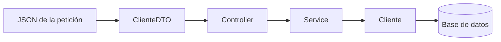

**user**: El DOM de js sirve para mandar las peticiones?
[Timestamp: 2026/11/05 18:03:57]

**ai**: **No.** El DOM no manda peticiones: sirve para leer y modificar la página que ya está cargada en el navegador. Las peticiones al servidor se hacen con **`fetch`** (o `XMLHttpRequest`, o librerías como Axios).

- **DOM (Document Object Model):** es la representación del HTML como un árbol de objetos. Con él podés buscar elementos, cambiar su contenido o estilo y escuchar eventos como clics.
- **`fetch`:** es una API del navegador que envía peticiones HTTP y recibe la respuesta. No forma parte del DOM.

Suelen confundirse porque en una página típica trabajan juntos:

```js
// 1. DOM: escucha el clic y lee el dato del input
document.querySelector("#btnBuscar").addEventListener("click", async () => {
  const dni = document.querySelector("#dni").value;

  // 2. fetch: manda la petición al servidor
  const respuesta = await fetch(`/api/clientes/${dni}`);
  const cliente = await respuesta.json();

  // 3. DOM: muestra el resultado en la página
  document.querySelector("#nombre").textContent = cliente.nombre;
});
```

**Excepción:** un `<form>` de HTML con `action` y `method` puede mandar una petición sin usar `fetch`, y también podés dispararlo desde JS con `form.submit()`. Aun así, quien envía la petición es el navegador; el DOM solo te da acceso al formulario.
[Timestamp: 2026/11/05 18:03:57]

**user**: Cuando yo apreto un boton en la web que pasa con el HTTP cuando envia algun dato o algo
[Timestamp: 2026/11/05 18:06:59]

**ai**: Apretar el botón no genera HTTP por sí solo: el clic es un **evento** dentro del navegador. Solo hay una petición HTTP si ese clic dispara el envío de un formulario o un `fetch`. Por ejemplo, un botón que abre un menú no toca la red.

Cuando sí se envían datos, pasa esto:

**1. Se arma la petición HTTP.** El navegador junta los datos y crea un mensaje de texto como este:

```http
POST /api/clientes HTTP/1.1
Host: www.ejemplo.com
Content-Type: application/json
Cookie: sesion=abc123

{"nombre": "Ana", "dni": "40123456"}
```

| Parte | Qué indica | En el ejemplo |
| --- | --- | --- |
| Método | Qué querés hacer | `POST` (crear o enviar datos) |
| Ruta | A qué recurso va | `/api/clientes` |
| Headers | Información sobre la petición | Formato de los datos, cookies |
| Body | Los datos en sí | El JSON con nombre y DNI |

**2. Viaja al servidor.** El navegador averigua la IP del dominio (DNS) y abre o reutiliza una conexión con el servidor. Si es HTTPS, el mensaje viaja cifrado.

**3. El servidor la procesa.** Según el método y la ruta, ejecuta el código que corresponde: por ejemplo, valida los datos y los guarda en la base de datos.

**4. El servidor responde.** Devuelve otro mensaje HTTP, con un código que indica cómo salió todo:

```http
HTTP/1.1 201 Created
Content-Type: application/json

{"id": 15, "nombre": "Ana", "dni": "40123456"}
```

Los códigos más comunes son:

- **`200` / `201`:** salió bien o se creó el recurso.
- **`400`:** los datos enviados son inválidos.
- **`401` / `403`:** no estás autenticado o no tenés permiso.
- **`404`:** el recurso no existe.
- **`500`:** hubo un error en el servidor.

**5. El navegador usa la respuesta.** Lo que pasa acá depende de cómo se envió:

- **Con `<form>` clásico:** la página se recarga o navega a la que devuelve el servidor.
- **Con `fetch`:** la página no se recarga. El JS recibe la respuesta y actualiza lo que haga falta usando el DOM.

Para verlo en vivo, abrí las herramientas de desarrollador con `F12`, andá a la pestaña **Network** (Red) y apretá el botón. Vas a ver cada petición con su método, headers, body, respuesta y código de estado.
[Timestamp: 2026/11/05 18:06:59]

**user**: Y ese dato que se ingresa al servidor va directo a la clase cliente o pasa por el DTO
[Timestamp: 2026/11/05 18:13:27]

**ai**: **Lo normal es que pase primero por un DTO**, sobre todo en una aplicación por capas, aunque no es obligatorio. El DTO recibe los datos crudos de la petición y después se usan para crear o modificar el objeto `Cliente`.

## Recorrido del dato



1. **Llega el JSON:** el framework (por ejemplo, Spring) lo convierte en un `ClienteDTO`.
2. **El Controller lo recibe:** es la puerta de entrada, y le pasa el DTO al Service.
3. **El Service aplica el caso de uso:** coordina las validaciones y crea o busca el `Cliente` con los datos del DTO.
4. **Se guarda el `Cliente`:** normalmente a través de un Repository.

## Ejemplo

```java
// Solo transporta datos, sin lógica de negocio
public record ClienteDTO(String nombre, String dni) {}

// Clase de dominio: tiene datos y reglas de negocio
public class Cliente {
    private Long id;
    private String nombre;
    private String dni;
    private boolean activo;

    public Cliente(String nombre, String dni) {
        if (dni == null || dni.isBlank()) {
            throw new IllegalArgumentException("El DNI es obligatorio");
        }
        this.nombre = nombre;
        this.dni = dni;
        this.activo = true;
    }
}

@PostMapping("/api/clientes")
public ResponseEntity<Void> crear(@RequestBody ClienteDTO dto) {
    clienteService.crear(dto); // adentro hace: new Cliente(dto.nombre(), dto.dni())
    return ResponseEntity.status(201).build();
}
```

## Por qué no ir directo a `Cliente`

- **Seguridad:** el usuario solo puede enviar los campos que define el DTO. Si la petición llegara directo a `Cliente`, alguien podría agregar `"activo": false` o un `id` al JSON y modificar datos que no debería.
- **Independencia:** podés cambiar la clase `Cliente` sin cambiar lo que recibe o devuelve la API.
- **Datos a medida:** cada operación usa solo los campos que necesita. Por ejemplo, un DTO de alta puede pedir una contraseña, y el de respuesta nunca debería devolverla.

El camino de vuelta suele ser igual pero al revés: el `Cliente` se convierte en un DTO de respuesta y ese DTO se envía como JSON.

En un proyecto chico puede funcionar sin DTO, recibiendo directamente `Cliente`, pero se pierden estas ventajas.
[Timestamp: 2026/11/05 18:13:27]

**user**: que seria el service , el controller seria como el gestor de cliente pero service?
[Timestamp: 2026/11/05 18:14:23]

**ai**: **Es casi al revés: el Gestor de tu materia se parece más al Service que al Controller.** Se confunde porque en Análisis la clase de control se llama `Controlador`, pero no es lo mismo que el `Controller` de una aplicación web.

## Qué hace cada uno

- **Controller web:** es la puerta de entrada HTTP. Recibe la petición, le pasa los datos al Service y devuelve la respuesta. No debería tener lógica de negocio.
- **Service:** lleva adelante el caso de uso. Coordina los pasos, aplica las validaciones del proceso y usa las entidades y los DAO o Repository.

| Tu materia (UP) | Aplicación web por capas | Responsabilidad |
| --- | --- | --- |
| Pantalla (`PaginaCliente`) | Frontend (HTML y JS) | Mostrar y capturar datos |
| `HandlerCliente` | Controller | Recibir la petición y devolver la respuesta |
| `GestorCliente` | **Service** | Coordinar el caso de uso |
| `Cliente` | Entidad | Datos y reglas propias del cliente |
| DAO | DAO o Repository | Guardar y buscar en la base de datos |

En [[U4.1 - Modelos de UP y Diagrama de Clases]] esto se ve en el paso de Análisis a Diseño: un solo `Controlador clientes` puede dar varias clases de diseño, como el `HandlerCliente` en la capa web y el `Gestor Cliente` con `guardarCliente()`, `buscarCliente()` y `borrarCliente()`. Es decir, el control de Análisis abarca lo que en una aplicación web suele repartirse entre Controller y Service. La equivalencia con los términos web es mía, porque la nota no habla de Service ni de Controller web.

## Ejemplo

```java
// Controller: solo se ocupa de HTTP
@PostMapping("/api/clientes")
public ResponseEntity<Void> crear(@RequestBody ClienteDTO dto) {
    gestorCliente.guardarCliente(dto);
    return ResponseEntity.status(201).build();
}

// Service, o sea el Gestor: coordina el caso de uso
public class GestorCliente {
    private final ClienteDAO clienteDAO;

    public GestorCliente(ClienteDAO clienteDAO) {
        this.clienteDAO = clienteDAO;
    }

    public void guardarCliente(ClienteDTO dto) {
        if (clienteDAO.existePorDni(dto.dni())) {
            throw new IllegalArgumentException("Ya existe un cliente con ese DNI");
        }
        Cliente cliente = new Cliente(dto.nombre(), dto.dni());
        clienteDAO.guardar(cliente);
    }
}
```

Una forma simple de distinguirlos es preguntarte si el código seguiría sirviendo sin la web. Si mañana cambiás la página por una aplicación de escritorio, el Controller web se reemplaza, pero el Gestor sigue igual porque no depende de HTTP.

Para el parcial, usá los términos de la materia: **interfaz, control y entidad** en Análisis, y **Gestor** en Diseño. "Service" es el nombre habitual en frameworks como Spring.
[Timestamp: 2026/11/05 18:14:23]

**user**: El handlercliente es una clase?
[Timestamp: 2026/11/05 18:15:16]

**ai**: **Sí, `HandlerCliente` es una clase de diseño.** En [[U4.1 - Modelos de UP y Diagrama de Clases]] aparece como una de las clases en las que se puede transformar el `Controlador clientes` de Análisis, dentro del paquete **Web**.

Su trabajo es **atender lo que llega desde la pantalla** y derivarlo a quien corresponda. "Handler" significa "manejador": maneja la petición, pero no resuelve el negocio. Por eso cumple un papel parecido al de un Controller web.

```java
public class HandlerCliente {
    private final GestorCliente gestorCliente;

    public HandlerCliente(GestorCliente gestorCliente) {
        this.gestorCliente = gestorCliente;
    }

    public void manejarAlta(ClienteDTO dto) {
        gestorCliente.guardarCliente(dto);
    }
}
```

El código es ilustrativo: la nota menciona la clase, pero no define sus métodos, así que `manejarAlta` es un nombre de ejemplo.

También conviene distinguir estos dos niveles:

- **Análisis:** el `Controlador clientes` es una clase conceptual, con estereotipo de control.
- **Diseño:** ese control se reparte en clases concretas, como `HandlerCliente` y `Gestor Cliente`, que ya están pensadas para implementarse.

No todos los sistemas tienen una clase con este nombre. Es una decisión de diseño de ese ejemplo: en Spring su lugar lo ocuparía normalmente una clase `ClienteController`, y en un diseño simple el Gestor podría ser la única clase de control.
[Timestamp: 2026/11/05 18:15:16]