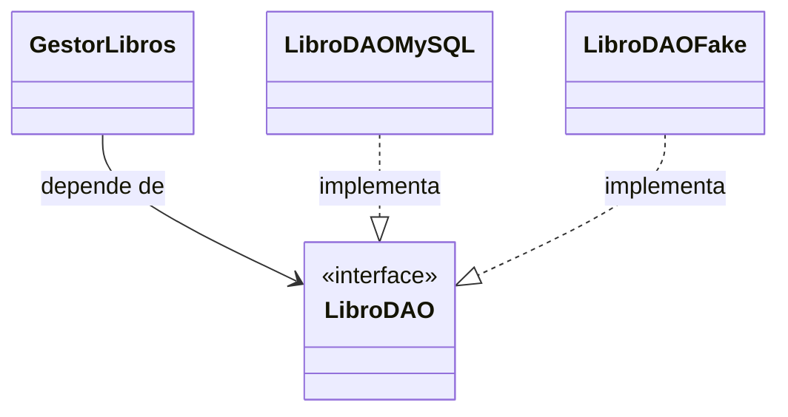

**user**: En el DTO la entidad libro no es la que tiene la relacion con LibroDTO , sino que el gestor de libro lo tendria
[Timestamp: 2026/11/04 23:01:56]

**ai**: Corregí la sección 4 de [[U5 - Práctica DAO y DTO]]:

- **Diagrama de capas:** el DTO ahora es su propio nodo. **Gestor → DTO** dice "crea / arma" y **UI → DTO** dice "recibe / envía". La flecha **Gestor → Entidades** ahora dice solo "usa (lee sus datos)", así que ya no hay nada que una a la entidad con el DTO.
- **Diagrama de clases nuevo:**
  - `GestorLibros` usa `LibroDAO` y `Libro`.
  - `GestorLibros` crea y arma `LibroDTO` (es una dependencia, con línea punteada).
  - `LibroDAO` devuelve `Libro`.
  - `Libro` no tiene ninguna relación con `LibroDTO`.
- **Callout nuevo:** dice explícitamente que la entidad no conoce al DTO. No tiene `toDTO()` ni lo recibe como parámetro: es el gestor el que arma el DTO con los datos de la entidad.
- **Regla para recordar:** ahora dice "ni el DAO ni la entidad conocen a los DTO, solo el gestor".

En la sección 7 (Candidato) ya estaba bien ("el gestor arma cada DTO"), así que no la toqué.
[Timestamp: 2026/11/04 23:01:56]

**user**: Un DAO es una interfaz por que son los metodos CRUD para que cada tipo de Base de datos realize esos metodos
[Timestamp: 2026/11/04 23:10:16]

**ai**: Sí, la idea es esa. Le agrego dos precisiones:

- **La interfaz declara los métodos, no los implementa.** Dice *qué* operaciones hay (`buscarPorIsbn`, `guardar`, `eliminar`…), pero no tiene código. El *cómo* lo escribe cada clase concreta: `LibroDAOMySQL` con SQL, `LibroDAOMongo` con consultas de Mongo, `LibroDAOFake` con una lista en memoria.
- **No son solo CRUD.** Además de los CRUD, la interfaz incluye las búsquedas que pidan los casos de uso, como `buscarPorDocumento` o `buscarPorFiltros` en el ejercicio de Candidato.

Lo que más importa para el parcial es **para qué sirve que sea interfaz**: el gestor depende de `LibroDAO` (la abstracción) y nunca se entera de qué base hay detrás. Por eso se puede cambiar de motor o testear con el Fake sin tocar la lógica de negocio, y eso es **DIP**.

Lo dejo escrito así en la nota:Actualicé el callout "Es una **interfaz**, no una clase" de la sección 3 en [[U5 - Práctica DAO y DTO]]. Ahora dice que la interfaz declara los métodos sin implementarlos, que cada tipo de base tiene su propia clase con esos mismos métodos, y que el gestor solo conoce la interfaz. Debajo siguen los ejemplos `LibroDAOMySQL`, `LibroDAOMongo` y `LibroDAOFake`.

Para el parcial, podés responderlo así: *"El DAO es una interfaz porque declara las operaciones de acceso a datos sin atarse a un motor. Cada base tiene su clase que la implementa, y el gestor depende solo de la interfaz (DIP), así que se puede cambiar de base o testear con un Fake sin tocar la lógica de negocio."*
[Timestamp: 2026/11/04 23:10:16]

**user**: como seria un ejemplo de listarTodos si la clase fuese SQL
[Timestamp: 2026/11/04 23:11:42]

**ai**: Así quedaría `listarTodos()` en una implementación SQL con JDBC (Java), usando la tabla `libros` del ejemplo de la nota:

```java
public class LibroDAOMySQL implements LibroDAO {

    private final DataSource dataSource;   // da las conexiones a la BD

    public LibroDAOMySQL(DataSource dataSource) {
        this.dataSource = dataSource;
    }

    @Override
    public List<Libro> listarTodos() {
        String sql = "SELECT isbn, titulo, autor, stock, precio_costo FROM libros";
        List<Libro> libros = new ArrayList<>();

        try (Connection con = dataSource.getConnection();
             PreparedStatement ps = con.prepareStatement(sql);
             ResultSet rs = ps.executeQuery()) {

            while (rs.next()) {                    // una vuelta por cada fila
                Libro libro = new Libro(
                    rs.getString("isbn"),
                    rs.getString("titulo"),
                    rs.getString("autor"),
                    rs.getInt("stock"),
                    rs.getBigDecimal("precio_costo")
                );
                libros.add(libro);                 // fila → entidad
            }
        } catch (SQLException e) {
            throw new DAOException("Error al listar los libros", e);
        }
        return libros;                             // devuelve ENTIDADES, no DTO
    }
}
```

**Qué hace el código:**
- **Consulta la base** con un `SELECT` y recorre el `ResultSet` fila por fila.
- **Convierte cada fila en un `Libro`.** Ese paso, pasar de fila a entidad, es responsabilidad del DAO: nadie fuera de él sabe cómo se llaman las columnas.
- **Devuelve `List<Libro>`**, tal como dice la interfaz. Incluye `precio_costo` porque la entidad lo tiene. El filtro se aplica después, cuando el gestor arma el DTO.
- **No deja salir la `SQLException`.** La envuelve en una `DAOException` propia: si el gestor tuviera que atrapar `SQLException`, quedaría atado a SQL y se perdería la ventaja de la interfaz. `DAOException` no viene con Java: es una clase que creás vos (por ejemplo, `extends RuntimeException`).
- El `try (...)` cierra solo la conexión, el statement y el resultado al terminar.

**Así lo usa el gestor**, sin saber que hay SQL detrás:

```java
public List<LibroDTO> listarParaCatalogo() {
    List<LibroDTO> dtos = new ArrayList<>();
    for (Libro l : libroDAO.listarTodos()) {          // libroDAO es de tipo LibroDAO (la interfaz)
        dtos.add(new LibroDTO(l.getIsbn(), l.getTitulo(), l.getAutor(), l.getStock()));
    }                                                 // precio_costo no pasa al DTO
    return dtos;
}
```

**Para comparar**, el mismo método en `LibroDAOFake`, con los datos guardados en una lista en memoria:

```java
@Override
public List<Libro> listarTodos() {
    return new ArrayList<>(libros);
}
```

Las dos clases tienen la misma firma y devuelven lo mismo, pero lo implementan de forma totalmente distinta. El gestor funciona igual con cualquiera de las dos.

¿Querés que lo agregue a la nota como ejemplo desplegable en la sección 3?
[Timestamp: 2026/11/04 23:11:42]

**user**: que es inversion de dependencias
[Timestamp: 2026/11/04 23:15:14]

**ai**: La **Inversión de Dependencias (DIP)** es la "D" de SOLID. La definición del apunte, tal como la tenés en [[U5.4 - SOLID#D — DIP Inversión de Dependencias]], es:

> Los **módulos de alto nivel no deben depender de módulos de bajo nivel**. Ambos deben depender de **abstracciones**. Las abstracciones no dependen de los detalles: **los detalles dependen de las abstracciones**.

### Explicado con el DAO

- **Alto nivel:** `GestorLibros`. Contiene la lógica de negocio y decide *qué* hay que hacer.
- **Bajo nivel:** `LibroDAOMySQL`. Se ocupa del detalle técnico de *cómo* hablar con la base.
- **Abstracción:** `LibroDAO`, la interfaz. Es el contrato que dice qué métodos existen, sin implementarlos.

**Sin DIP**, el gestor depende directamente de la clase concreta:

```java
public class GestorLibros {
    private LibroDAOMySQL dao = new LibroDAOMySQL();   // ❌ atado a MySQL
}
```

Si mañana se cambia a Mongo, o querés testear sin base de datos, tenés que **modificar el gestor**. La lógica de negocio queda a merced de un detalle técnico.

**Con DIP**, el gestor depende de la interfaz y recibe la implementación desde afuera:

```java
public class GestorLibros {
    private final LibroDAO dao;                         // ✅ depende de la abstracción

    public GestorLibros(LibroDAO dao) {                 // inyección por constructor
        this.dao = dao;
    }
}

// Quien arma el sistema elige la implementación:
new GestorLibros(new LibroDAOMySQL(dataSource));       // producción
new GestorLibros(new LibroDAOFake());                  // tests
```

### ¿Por qué se llama "inversión"?



- **Sin DIP**, la flecha va del alto nivel al bajo nivel: el gestor apunta a MySQL.
- **Con DIP**, **las dos flechas apuntan a la interfaz**. El detalle (`LibroDAOMySQL`) ahora depende de un contrato que pide el alto nivel, cuando antes era el alto nivel el que dependía del detalle. El sentido de la dependencia se da vuelta.

### Qué se gana
- Se puede **cambiar de base de datos** sin tocar la lógica de negocio.
- Se puede **testear** el gestor con `LibroDAOFake`, sin una base real.
- Se puede **desarrollar en paralelo**: unos programan el gestor contra la interfaz mientras otros hacen la implementación.
- En términos de cátedra: **bajo acoplamiento**.

### No confundir con DI e IoC
- **DIP** es el **principio**: depender de abstracciones.
- **DI (Inyección de Dependencias)** es una **técnica** para cumplirlo: la clase no crea sus dependencias, las recibe (por constructor, por propiedad o por método).
- **IoC (Inversión de Control)** es la idea más general: un agente externo crea y maneja los objetos. Frase del apunte: *"Toda DI aplica IoC, pero no toda IoC usa DI."*

Para el parcial, podés responderlo así: *"DIP dice que el alto nivel y el bajo nivel dependen de abstracciones. En el DAO, el gestor depende de la interfaz `LibroDAO` y no de `LibroDAOMySQL`, así que se puede cambiar de base o usar un Fake para testear sin tocar la lógica de negocio."*
[Timestamp: 2026/11/04 23:15:14]