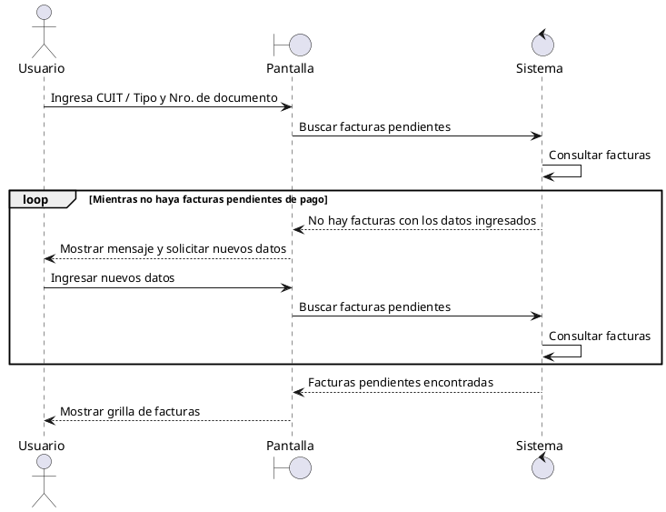
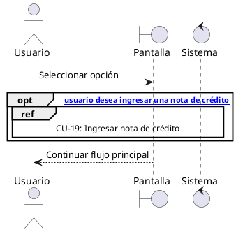
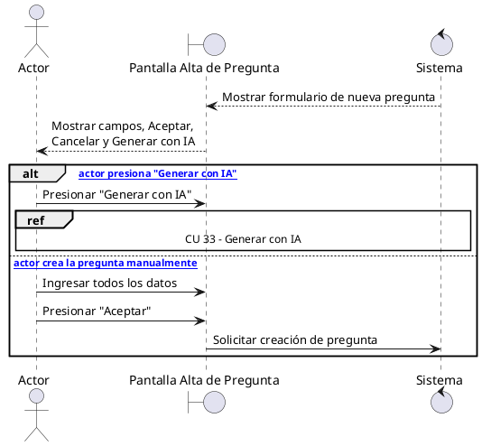
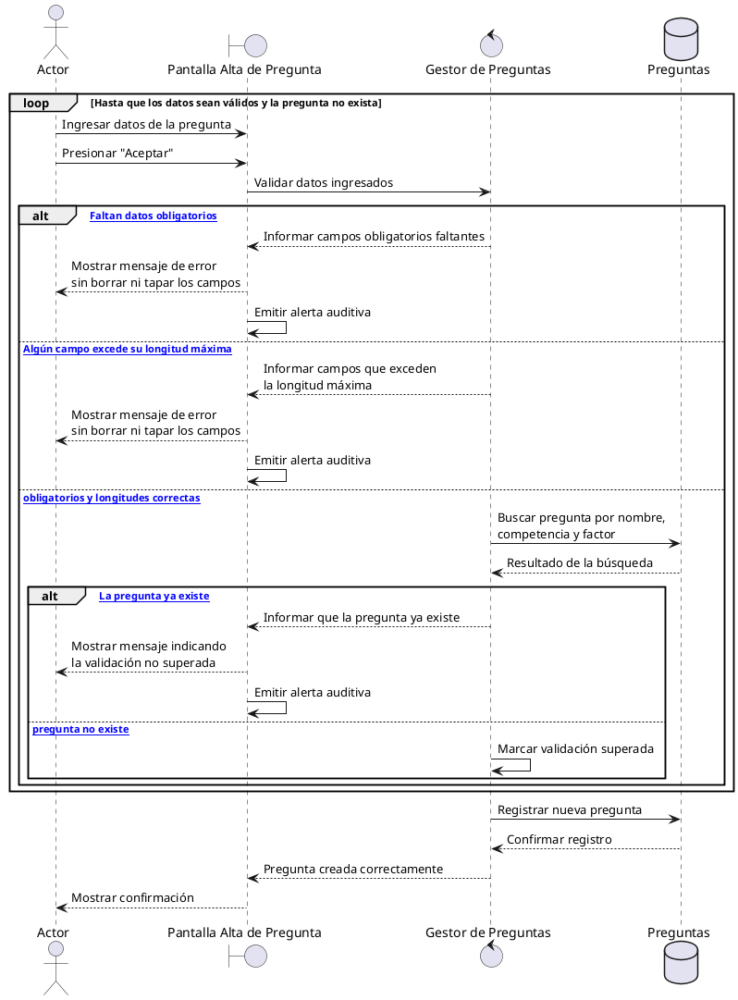

**user**: Podrias usar un loop para el 4.A Si no hay facturas pendientes de pago con ingresar datos
[Timestamp: 2026/09/25 17:07:31]

**ai**: Voy a revisar el caso de uso del PDF para proponerte el fragmento `loop` con una condición y mensajes coherentes con “Ingresar datos”. Uso la habilidad de lectura de PDF porque el contenido adjunto define el flujo que hay que modelar.La lectura integrada del PDF no está activa en esta sesión, así que aplico el método local de extracción como respaldo. Con la imagen ya se ve la lógica clave: el flujo 4.A vuelve al ingreso del paso 2, por lo que el `loop` debe abarcar búsqueda, validación y reingreso de datos.Sí. El punto 4.A puede representarse con un `loop` porque el usuario debe ingresar nuevos datos y repetir la búsqueda mientras no existan facturas pendientes.

```plantuml
Usuario -> Pantalla: Ingresa CUIT / Tipo y Nro. de documento
Pantalla -> Sistema: Buscar facturas pendientes
Sistema -> Sistema: Consultar facturas

loop [Mientras no haya facturas pendientes de pago]
    Sistema --> Pantalla: No hay facturas con los datos ingresados
    Pantalla --> Usuario: Mostrar mensaje y solicitar nuevos datos
    Usuario -> Pantalla: Ingresar datos
    Pantalla -> Sistema: Buscar facturas pendientes
    Sistema -> Sistema: Consultar facturas
end

Sistema --> Pantalla: Facturas pendientes encontradas
Pantalla --> Usuario: Mostrar grilla de facturas
```

La condición más clara sería:

`loop [Mientras no haya facturas pendientes de pago]`

Dentro del `loop` deben quedar:

- El mensaje del punto **4.A.1**.
- El regreso al ingreso de datos del paso **2**.
- La nueva búsqueda del paso **3**.

Cuando finalmente se encuentran facturas, se sale del `loop` y continúa el flujo principal con la presentación de la grilla y el paso 5. Esto refleja correctamente el flujo de [[Clase de práctica 11_09_26 - Diagrama de secuencia.pdf]].
[Timestamp: 2026/09/25 17:07:31]

**user**: en que codigo esta lo que enviaste asi lo represento como imagen para entenderl
[Timestamp: 2026/09/25 17:09:45]

**ai**: El código está escrito en **PlantUML**, un lenguaje para generar diagramas UML como imágenes.

Podés copiarlo y pegarlo en el editor online: [PlantUML Online Server](https://www.plantuml.com/plantuml/uml/)

Usá esta versión completa:



Al pegarlo, PlantUML generará automáticamente el diagrama de secuencia como imagen.
[Timestamp: 2026/09/25 17:09:45]

**user**: como represento que un opt crea o sigue el flujo a otro caso de uso
[Timestamp: 2026/09/25 17:23:04]

**ai**: En un diagrama de secuencia, un `opt` representa una acción opcional. Para indicar que, al cumplirse la condición, se ejecuta otro caso de uso, colocá un fragmento `ref` dentro del `opt`.



El recuadro `ref` significa: “La secuencia detallada está definida en otro diagrama”.

### Si después vuelve al flujo actual

Usá `opt`. Al terminar el `ref`, la secuencia continúa normalmente:

```plantuml
opt [Desea ingresar una nota de crédito]
    ref over Usuario, Pantalla, Sistema
        CU-19: Ingresar nota de crédito
    end ref
end

Sistema --> Usuario: Continuar con el flujo actual
```

### Si pasa al otro caso de uso y termina el actual

En ese caso conviene usar `break`:

```plantuml
break [Debe ejecutar otro caso de uso]
    ref over Usuario, Pantalla, Sistema
        CU-19: Ingresar nota de crédito
    end ref
end
```

La diferencia es:

- `opt`: ejecuta opcionalmente el otro caso de uso y después continúa.
- `break`: ejecuta el otro caso de uso e interrumpe el flujo actual.
- `ref`: referencia la secuencia definida en otro diagrama.

Además, en el **diagrama de casos de uso**, la relación se expresa de otra manera:

- `<<include>>`: el otro caso de uso se ejecuta obligatoriamente.
- `<<extend>>`: se ejecuta solamente bajo determinada condición.
[Timestamp: 2026/09/25 17:23:04]

**user**: estoy haciendo este caso de uso como quedaria esa parte 1.A
[Timestamp: 2026/09/25 17:26:08]

**ai**: Para el punto **1.A**, conviene usar `alt` porque el actor elige entre completar la pregunta manualmente o presionar **“Generar con IA”**. Dentro de esa rama se coloca un `ref` al **CU 33 – Generar con IA**.



Visualmente, la parte de **1.A** quedaría así:

```text
┌ alt [Presiona "Generar con IA"] ───────────────┐
│ Actor → Pantalla: Presionar "Generar con IA"   │
│                                                │
│ ┌────────────── ref ─────────────────────────┐ │
│ │          CU 33 - Generar con IA            │ │
│ └────────────────────────────────────────────┘ │
├ else [Creación manual] ─────────────────────────┤
│ Actor → Pantalla: Ingresar todos los datos     │
│ Actor → Pantalla: Presionar "Aceptar"           │
└────────────────────────────────────────────────┘
```

Si querés representar **únicamente** el flujo 1.A, también puede escribirse con `opt`:

```plantuml
opt [El actor presiona "Generar con IA"]
    Actor -> Pantalla: Presionar "Generar con IA"

    ref over Actor, Pantalla, Sistema
        CU 33 - Generar con IA
    end ref
end
```

Sin embargo, para el caso de uso completo, `alt` es más correcto: **“Generar con IA” reemplaza el ingreso manual**, mientras que `opt` indicaría que se ejecuta opcionalmente y después se continúa necesariamente con el paso 2.
[Timestamp: 2026/09/25 17:26:08]

**user**: ahora para lo que sigue el 2.A 2.B 2.C podria usar un alt para ingresa todos los datos y no ingresa todos los datos , otro si ingresa todos los datos pero exceden su capacidad maxima , y otro que si ingresa bien los datos y no exceden su capacidad pero luego de la busqueda ya existe esa pregunta que devuelva un mensaje . Y para todos esos casos vuelva al paso 2 con un loop ?
[Timestamp: 2026/09/25 17:36:41]

**ai**: Sí, podés usar un `loop`, pero conviene colocar **un solo `alt` con varias ramas `else`**, porque los resultados son excluyentes. La búsqueda de una pregunta existente debe realizarse únicamente después de superar las validaciones de campos obligatorios y longitud.



La estructura lógica sería:

```text
loop [Hasta que los datos sean correctos]
    Ingresar datos
    Presionar Aceptar

    alt [Faltan datos]
        Mostrar error 2.A
    else [Se excede una longitud]
        Mostrar error 2.B
    else [Los datos tienen formato correcto]
        Buscar si la pregunta existe

        alt [La pregunta ya existe]
            Mostrar error 2.C
        else [No existe]
            Validación superada
        end
    end
end

Registrar pregunta
```

Los retornos al paso 2 se entienden por el `loop`: después de cualquiera de los errores **2.A**, **2.B** o **2.C**, comienza una nueva iteración y el actor puede corregir los datos.

Es importante mantener este orden:

- Primero se comprueba si faltan datos.
- Después se validan las longitudes.
- Solamente si esas validaciones son correctas se busca si la pregunta ya existe.
- Si no existe, se sale del `loop` y se registra la pregunta según el paso 3.
[Timestamp: 2026/09/25 17:36:41]

**user**: te envio el diagrama de clases para que me realizes el diagrama de secuencia de forma completa y correcta @startuml Diagrama
skinparam classAttributeIconSize 0
skinparam linetype ortho
skinparam nodesep 50
skinparam ranksep 40

title Diagrama de Clases Corregido - Diseño de Sistemas 2026 (Entrega 3)

' =========================================================================
' 1. CAPA SUPERIOR: GESTORES DE LOGICA (CONTROLADORES)
' =========================================================================
package "Gestores de Logica" #FFF9C4 {
    class ServiciodeAutenticacion <<gestor>> {
        + validarCandidato(tipo: String, nroDocumento: String, clave: String): Candidato
        + autenticarConsultor(usuario: String, clave: String): boolean
    }
    class GestorCandidato <<gestor>> {
        + importarCandidatos(archivoCSV: String): EstadisticaImportacion
        + exportarResultados(nombre: String, empresa: String, fechaDesde: Date, fechaHasta: Date): FileCSV
    }
    class GestorPuesto <<gestor>> {
        + buscar(codigo: String, nombre: String, empresa: String): List<Puesto>
        + darAlta(dto: PuestoDTO): PuestoDTO
        + modificar(id: Long, dto: PuestoDTO): PuestoDTO
        + darBaja(id: Long): boolean
    }
    class GestorCompetencia <<gestor>> {
        + buscar(nombre: String): List<Competencia>
        + darAlta(dto: CompetenciaDTO): CompetenciaDTO
        + modificar(id: Long, dto: CompetenciaDTO): CompetenciaDTO
        + darBaja(id: Long): boolean
    }
    class GestorFactor <<gestor>> {
        + buscar(competenciaId: Long, nombreFactor: String): List<Factor>
        + darAlta(dto: FactorDTO): FactorDTO
        + modificar(id: Long, dto: FactorDTO): FactorDTO
        + darBaja(id: Long): void
    }
    class GestorPregunta <<gestor>> {
        + buscar(competenciaId: Long, factorId: Long, nombrePregunta: String): List<Pregunta>
        + darAlta(dto: PreguntaDTO): PreguntaDTO
        + modificar(id: Long, dto: PreguntaDTO): PreguntaDTO
        + darBaja(id: Long): boolean
        + generarPreguntaConIA(competenciaId: Long, factorId: Long): Pregunta
    }
    class GestorOpciones <<gestor>> {
        + buscar(nombre: String): List<OpcionRespuesta>
        + darAlta(dto: OpcionRespuestaDTO): OpcionRespuestaDTO
        + modificar(id: Long, dto: OpcionRespuestaDTO): OpcionRespuestaDTO
        + darBaja(id: Long): boolean
    }
    class GestorEvaluaciones <<gestor>> {
        + buscarCandidatos(dto: CandidatoDTO): List<CandidatoDTO>
        + evaluarCandidato(dto: evaluarCandidatoDTO): List<evaluarCandidatoDTO>
        + completarCuestionario(cuestionarioId: Long, bloqueId: Long, respuestas: List<RespuestaCandidato>): void
        + consultarRespuestas(cuestionarioId: Long): List<RespuestaCandidato>
        + finalizarCuestionariosPendientes(): void
        + emitirInformeComparativo(candidatoId: Long, puestoId: Long): void
        + emitirOrdenMerito(puestoId: Long, cuestionarioIds: List<Long>): void
    }
}

interface Autenticacion <<interface>> {
    + validarCandidato(tipo: String, nroDocumento: String, clave: String): Candidato
    + autenticarConsultor(usuario: String, clave: String): boolean
}

ServiciodeAutenticacion ..|> Autenticacion

GestorPuesto ..|> ABM
GestorCompetencia ..|> ABM
GestorFactor ..|> ABM
GestorPregunta ..|> ABM
GestorOpciones ..|> ABM

interface ABM <<interface>> {
    + darAlta()
    + darBaja()
    + modificar()
}

' =========================================================================
' 2. OBJETOS DE TRANSFERENCIA (DTO)
' =========================================================================
package "Transferencia de Datos (DTO)" #F3E5F5 {
    class PuestoDTO <<DTO>> {
        + id: Long
        + codigo: String
        + nombre: String
        + descripcion: String
        + empresaNombre: String
    }
    class CompetenciaDTO <<DTO>> {
        + id: Long
        + nombre: String
        + descripcion: String
    }
    class FactorDTO <<DTO>> {
        + id: Long
        + competenciaId: Long
        + nombre: String
        + descripcion: String
        + nroOrden: Integer
    }
    class PreguntaDTO <<DTO>> {
        + id: Long
        + factorId: Long
        + nombre: String
        + enunciado: String
        + descripcion: String
        + tipo: TipoPregunta
        + opciones: List<OpcionRespuestaDTO>
    }
    class OpcionRespuestaDTO <<DTO>> {
        + id: Long
        + preguntaId: Long
        + texto: String
        + puntaje: Double
        + orden: Integer
    }

    class CandidatoDTO <<DTO>> {
        + nombre: String
        + apellido: String
        + tipoDni: String
        + dni: String
    }

' La clave candidato la saca de cuestionario 
    class ClaveCandidatoDTO <<DTO>> {
        - claveIngreso: String
    } 

    class CuestionarioDTO <<DTO>> {
        + estado: String
        + fechaInicio: Date
        + fechaFin: Date
        + ultimoIngreso: Date
        + cantidadAccesos: Integer
    }
   
    class OrdenMeritoDTO <<DTO>> {
        + candidato: CandidatoDTO
        + cuestionario: CuestionarioDTO
        + puntajeObtenido: Double
        + cumplePonderacionesMinimas: Boolean
    }

    class EvaluarCandidatoDTO <<DTO>> {
        + candidatoEvaluado: CandidatoDTO
        + nombrePuesto: String
        + nombreEmpresa: String
        + claveIngreso: ClaveCandidatoDTO
    }
    class importarCandidatoDTO <<DTO>> {
        - infocandidatoDTO : CandidatoDTO
        - fechanacimiento : Date
        -genero : Char
        -nacionalidad : String
        -escolaridad : String
        -eliminado : Boolean
    }
}


importarCandidatoDTO *--"1" CandidatoDTO : contiene
OrdenMeritoDTO *-- "1" CandidatoDTO : contiene
OrdenMeritoDTO *-- "1" CuestionarioDTO : contiene
EvaluarCandidatoDTO *-- "1" CandidatoDTO : contiene
EvaluarCandidatoDTO *-- "1" ClaveCandidatoDTO : contiene

GestorCandidato ..> importarCandidatoDTO : recibe
GestorEvaluaciones ..> ClaveCandidatoDTO : recibe
GestorEvaluaciones ..> EvaluarCandidatoDTO : recibe
GestorEvaluaciones ..> OrdenMeritoDTO : recibe
GestorEvaluaciones ..> CandidatoDTO : recibe
GestorEvaluaciones ..> CuestionarioDTO : recibe
GestorPuesto ..> PuestoDTO : recibe
GestorCompetencia ..> CompetenciaDTO : recibe
GestorFactor ..> FactorDTO : recibe
GestorPregunta ..> PreguntaDTO : recibe
GestorOpciones ..> OpcionRespuestaDTO : recibe

' =========================================================================
' 3. CAPA DE NEGOCIO PRINCIPAL: PUESTOS Y COMPETENCIAS
' =========================================================================
package "Gestion de Competencias" #E8F5E9 {
    class Empresa {
        - nombre: String
    }
    class Puesto {
        - id: Long
        - codigo: String
        - nombre: String
        - descripcion: String
    }
    class CompetenciaRequerida {
        - puntajeMinimo: Double
    }
    abstract class Competencia <<abstract>> {
        - id: Long
        - nombre: String
        - descripcion: String
        + getTipo(): String
    }
    class CompetenciaActitudinal {
        - comportamiento: String
    }
    class CompetenciaTecnica {
        - tecnologia: String
    }
    class Factor {
        - id: Long
        - nombre: String
        - descripcion: String
        - nroOrden: Integer
    }

    Puesto "1..*" -up-> "1" Empresa : en >
    Puesto "1" *-- "1..*" CompetenciaRequerida : define >
    CompetenciaRequerida "1..*" -right-> "1" Competencia : refiere a >
    Competencia <|-- CompetenciaActitudinal
    Competencia <|-- CompetenciaTecnica
    Competencia "1" *-- "2..*" Factor : se compone de >
}

' =========================================================================
' 4. CAPA DE CONTENIDO: PREGUNTAS Y OPCIONES
' =========================================================================
package "Gestion de Preguntas" #E3F2FD {
    class Pregunta {
        - id: Long
        - nombre: String
        - enunciado: String
        - descripcion: String
        - tipo: TipoPregunta
        + crearConGenAI(): void
    }
    class OpcionRespuesta {
        - id: Long
        - texto: String
        - puntaje: Double
        - orden: Integer
    }
    enum TipoPregunta {
        OPCION_MULTIPLE
        VERDADERO_FALSO
        ESCALA
    }

    Pregunta "1" *-- "2..*" OpcionRespuesta : tiene >
    Pregunta -right-> TipoPregunta
}

Factor "1" *-- "0..*" Pregunta : contiene >

' =========================================================================
' CAPA DE AUTENTICACION DE USUARIOS
' =========================================================================
package "Autenticacion de Usuarios" #FFEBEE {
    abstract class Usuario {
        - apellido: String
        - nombre: String
        - email: String
        - contrasenia: String
    }

    class Candidato {
        - nroCandidato: Long
        - tipoDocumento: String
        - nroDocumento: String
        - fechaNacimiento: Date
        - genero: Char
        - nacionalidad: String
        - escolaridad: String
        - eliminado: Boolean
        
    }

    class Consultor {
        - nombreUsuario: String
    }

    Usuario <|-- Candidato
    Usuario <|-- Consultor
}

' =========================================================================
' 5. CAPA DE PROCESO Y CANDIDATOS: EVALUACIONES
' =========================================================================
package "Evaluacion de Candidatos" #FAFAFA {

    class Cuestionario {
        - id: Long
        - clave: String
        - fechaCreacion: Date
        - fechaInicio: Date
        - estado: EstadoCuestionario
        - cantidadPreguntasPorFactor: Integer
        - cantidadPreguntasPorBloque: Integer
        - tiempoMaximoActivo: Integer
        - tiempoMaximoCompletar: Integer
    }
    class BloqueCuestionario {
        - id: Long
        - numero: Integer
        - completado: Boolean
    }
    class RespuestaCandidato {
        - id: Long
        - fechaRespuesta: Date
    }
    class Resultado {
        - id: Long
        - puntajeObtenido: Double
        - puntajeRequerido: Double
        - fechaCalculo: Date
    }
    enum EstadoCuestionario <<enumeration>> {
        ACTIVO
        SIN_CONTESTAR
        EN_PROCESO
        INCOMPLETO
        COMPLETO
    }

    Cuestionario --> EstadoCuestionario
    Cuestionario "1" -- "1..*" BloqueCuestionario : divide en >
    Cuestionario "1" -- "0..*" Resultado : genera >
    Resultado "1..*" --> "1" Competencia : corresponde a >
    BloqueCuestionario "1" -- "1..*" RespuestaCandidato : tiene >
    RespuestaCandidato "*" --> "1" OpcionRespuesta : selecciona >
    Resultado "*" --> "1" Candidato : de >
    BloqueCuestionario "1" -- "1..*" Pregunta : contiene >
}

Cuestionario "0..*" -up-> "1" Candidato : rinde >
Cuestionario "0..*" -up-> "1" Puesto : asociado a >
RespuestaCandidato "*" -up-> "1" Pregunta : evalúa >

' =========================================================================
' DEPENDENCIAS DE USO: DE GESTORES A ENTIDADES
' =========================================================================
ServiciodeAutenticacion ..> Usuario
GestorCandidato ..> Candidato
GestorCandidato ..> Puesto
GestorCandidato ..> Resultado
GestorPuesto ..> Puesto
GestorCompetencia ..> Competencia
GestorFactor ..> Factor
GestorPregunta ..> Pregunta
GestorPregunta ..> OpcionRespuesta
GestorOpciones ..> OpcionRespuesta
GestorEvaluaciones ..> Cuestionario
GestorEvaluaciones ..> Candidato
GestorEvaluaciones ..> Puesto
GestorEvaluaciones ..> Resultado
GestorEvaluaciones ..> RespuestaCandidato

' =========================================================================
' 6. CAPA DE ACCESO A DATOS (DAO)
' =========================================================================
package "Acceso a Datos (DAO)" #EDE7F6 {
    interface "DAO<T, ID>" as DAO <<interface>> {
        + guardar(entidad: T): T
        + buscar(id: ID): T
        + actualizar(entidad: T): T
        + eliminar(id: ID): void
    }
    class CandidatosDAOSQL <<DAO de Candidato>>
    class PuestoDAOSQL <<DAO de Puesto>>
    class CompetenciaDAOSQL <<DAO de Competencia>>
    class FactorDAOSQL <<DAO de Factor>>
    class PreguntaDAOSQL <<DAO de Pregunta>>
    class OpcionRespuestaDAOSQL <<DAO de OpcionRespuesta>>

    CandidatosDAOSQL --|> DAO : <Candidato, Long>
    PuestoDAOSQL ..|> DAO : <Puesto, Long>
    CompetenciaDAOSQL ..|> DAO : <Competencia, Long>
    FactorDAOSQL ..|> DAO : <Factor, Long>
    PreguntaDAOSQL ..|> DAO : <Pregunta, Long>
    OpcionRespuestaDAOSQL ..|> DAO : <OpcionRespuesta, Long>

    'Depedencias del DAO con sus Dominios
    DAO ..> Candidato : usa
    DAO ..> Puesto : usa
    DAO ..> Competencia : usa
    DAO ..> Factor : usa
    DAO ..> Pregunta : usa
    DAO ..> OpcionRespuesta : usa

}

GestorPuesto ..> DAO : usa
GestorCompetencia ..> DAO : usa
GestorFactor ..> DAO : usa
GestorPregunta ..> DAO : usa
GestorOpciones ..> DAO : usa

' =========================================================================
' DEPENDENCIAS DE USO: DE GESTORES A INTERFACES
' =========================================================================
interface IServicioIA {
    + generarPreguntaConIA(competencia: String, factor: String): String
}

class Claude implements IServicioIA {
    + generarPreguntaConIA(competencia: String, factor: String): String
}
class Gemini implements IServicioIA {
    + generarPreguntaConIA(competencia: String, factor: String): String
}

interface GeneradorReporte {
    + generarReporte(): void
    + imprimirReporte(): void
}

class ReeporteComparativo implements GeneradorReporte {
    + generarReporte(): void
    + imprimirReporte(): void
}
class ReporteOrdenMerito implements GeneradorReporte {
    + generarReporte(): void
    + imprimirReporte(): void
}


GestorEvaluaciones ..> GeneradorReporte : usa
GestorPregunta ..> IServicioIA : usa

[[agent__me_pierdo_un_poco_con_los_nombres_a_los_mensajes@20260923_202246]]
[Timestamp: 2026/09/25 17:40:12]

**ai**: Voy a armar el diagrama completo del CU **Crear una nueva pregunta**, haciendo coincidir los mensajes con las operaciones reales del diagrama de clases (`GestorPregunta`, `GestorCompetencia`, `GestorFactor`, `PreguntaDAOSQL` y `OpcionRespuestaDAOSQL`). También revisaré la nota adjunta para mantener el criterio de nombres que venían trabajando.Hay una decisión importante para que quede consistente: `PreguntaDAOSQL` no define una búsqueda por competencia, factor y nombre; solo hereda `buscar(id)`. Por eso la comprobación de duplicados irá mediante `GestorPregunta.buscar(...)`, que sí existe. Los DAO se usarán para `guardar(...)`, operación que también existe en la interfaz genérica. Añadiré además la validación de ponderaciones indicada en las observaciones del caso de uso.Tomando el caso de uso, el diagrama de clases y las reglas de nombres de [[agent__me_pierdo_un_poco_con_los_nombres_a_los_mensajes@20260923_202246]], el diagrama de secuencia completo podría quedar así:

```plantuml
@startuml
title CU - Crear una nueva pregunta

autonumber
hide footbox

skinparam sequenceMessageAlign center
skinparam responseMessageBelowArrow true
skinparam maxMessageSize 100

actor Consultor
boundary "Pantalla Alta de Pregunta" as Pantalla
control GestorCompetencia
control GestorFactor
control GestorPregunta
database PreguntaDAOSQL
database OpcionRespuestaDAOSQL

note over Consultor
Precondición:
Consultor autenticado
end note

Consultor -> Pantalla: Selecciona "Crear nueva pregunta"

loop Primera creación o respuesta anterior = "SÍ"

    group Paso 1: Presentar pantalla de alta

        Pantalla -> GestorCompetencia: buscar("")
        activate GestorCompetencia
        GestorCompetencia --> Pantalla: competencias: List<Competencia>
        deactivate GestorCompetencia

        Pantalla --> Consultor: Mostrar formulario de alta,\ncompetencias y botones disponibles

        Consultor -> Pantalla: Selecciona una competencia

        Pantalla -> GestorFactor: buscar(competenciaId, "")
        activate GestorFactor
        GestorFactor --> Pantalla: factores: List<Factor>
        deactivate GestorFactor

        Pantalla --> Consultor: Mostrar factores correspondientes\na la competencia seleccionada

        opt Selecciona una opción de respuesta
            Pantalla --> Consultor: Mostrar grilla de opciones:\nOrden, Descripción y Ponderación
        end
    end

    break 1.A: Presiona "Generar con IA"

        Consultor -> Pantalla: Presiona "Generar con IA"

        ref over Consultor, Pantalla, GestorPregunta
            CU 33 - Generar con IA
        end ref

        note over Consultor, GestorPregunta
        Se transfiere el control al CU 33.
        Finaliza este flujo.
        end note
    end

    loop Paso 2: Reingresar mientras la pregunta no se registre

        Consultor -> Pantalla: Completa los datos de la pregunta
        Consultor -> Pantalla: Presiona "Aceptar"

        Pantalla -> GestorPregunta: darAlta(preguntaDTO)
        activate GestorPregunta

        alt 2.A: Faltan datos obligatorios

            GestorPregunta --> Pantalla: datosObligatoriosFaltantes
            Pantalla --> Consultor: Mostrar todos los campos obligatorios faltantes
            Pantalla --> Consultor: Emitir suave alerta auditiva

            note over Consultor, Pantalla
            Se conservan visibles los datos ingresados.
            Se vuelve al paso 2.
            end note

        else 2.B: Algún campo excede su longitud máxima

            GestorPregunta --> Pantalla: camposConLongitudExcedida
            Pantalla --> Consultor: Mostrar todos los campos que exceden\nsu longitud máxima
            Pantalla --> Consultor: Emitir suave alerta auditiva

            note over Consultor, Pantalla
            Se conservan visibles los datos ingresados.
            Se vuelve al paso 2.
            end note

        else Las ponderaciones no suman 10 o existe una ponderación negativa

            GestorPregunta --> Pantalla: ponderacionesInvalidas
            Pantalla --> Consultor: Mostrar mensaje de ponderaciones inválidas
            Pantalla --> Consultor: Emitir suave alerta auditiva

            note over Consultor, Pantalla
            Se vuelve al paso 2.
            end note

        else Datos y ponderaciones válidos

            GestorPregunta -> GestorPregunta: buscar(competenciaId,\nfactorId, nombrePregunta)
            activate GestorPregunta
            GestorPregunta --> GestorPregunta: preguntasCoincidentes: List<Pregunta>
            deactivate GestorPregunta

            alt 2.C: La pregunta ya existe

                GestorPregunta --> Pantalla: preguntaExistente
                Pantalla --> Consultor: Mostrar que la pregunta ya existe\ny cuál validación no fue superada
                Pantalla --> Consultor: Emitir suave alerta auditiva

                note over Consultor, Pantalla
                Se vuelve al paso 2.
                end note

            else La pregunta no existe

                note over GestorPregunta
                Construye la entidad Pregunta y sus
                OpcionRespuesta desde preguntaDTO
                end note

                GestorPregunta -> PreguntaDAOSQL: guardar(pregunta)
                activate PreguntaDAOSQL
                PreguntaDAOSQL --> GestorPregunta: preguntaGuardada
                deactivate PreguntaDAOSQL

                loop Por cada opción de respuesta

                    GestorPregunta -> OpcionRespuestaDAOSQL: guardar(opcionRespuesta)
                    activate OpcionRespuestaDAOSQL
                    OpcionRespuestaDAOSQL --> GestorPregunta: opcionGuardada
                    deactivate OpcionRespuestaDAOSQL

                end

                GestorPregunta --> Pantalla: preguntaCreada: PreguntaDTO

                note over Pantalla, GestorPregunta
                La pregunta fue registrada correctamente.
                Finaliza el loop del paso 2.
                end note
            end
        end

        deactivate GestorPregunta
    end

    group Pasos 3 y 4: Confirmar creación

        Pantalla --> Consultor: Mostrar "Nombre Pregunta se ha creado\ncorrectamente. ¿Desea cargar otra?"
        Pantalla --> Consultor: Mostrar botones "SÍ" y "NO"

    end

    Consultor -> Pantalla: Selecciona "SÍ" o "NO"

    alt 5: Selecciona "NO"

        Pantalla --> Consultor: Cerrar pantalla de alta

        note over Consultor, Pantalla
        Finaliza el caso de uso.
        end note

    else 5.A: Selecciona "SÍ"

        note over Consultor, Pantalla
        Se inicia una nueva iteración.
        Se vuelve al paso 1.
        end note

    end
end

@enduml
```



La organización principal es:

- Un `loop` exterior representa la creación de otra pregunta cuando se elige **“SÍ”**.
- Un `loop` interior representa los regresos al paso 2 por los errores **2.A**, **2.B**, **2.C** o por ponderaciones inválidas.
- Un `alt` separa todos los posibles resultados de `darAlta(preguntaDTO)`.
- La búsqueda de duplicados ocurre solamente después de superar las validaciones anteriores.
- El `break` de **1.A** transfiere el control al **CU 33 – Generar con IA**.
- Los DTO aparecen como parámetros y retornos, no como líneas de vida.
- Los mensajes entre objetos coinciden con métodos del diagrama de clases.

Hay dos detalles para corregir o precisar en el modelo:

- `GestorPregunta.buscar(...)` solo recibe `nombrePregunta`. Si también se debe detectar un enunciado repetido, como dice la observación, convendría modificarlo a:

```plantuml
+ buscar(
    competenciaId: Long,
    factorId: Long,
    nombrePregunta: String,
    enunciado: String
): List<Pregunta>
```

- El botón **“Cancelar”** aparece en el paso 1, pero el caso de uso no define su flujo alternativo. Para incorporarlo correctamente debería añadirse algo como: “1.B. El actor presiona Cancelar; 1.B.1. El sistema cierra la pantalla; 1.B.2. El caso de uso finaliza”.
[Timestamp: 2026/09/25 17:40:12]

**user**: ahora quiero que a ese mismo lo orientes con el estilo y mensajes como en este otro @startuml CU020_GestionarPregunta

title Diagrama de Secuencia: CU020 - Gestionar Preguntas

actor "Consultor" as actor
boundary "PantallaGestionarPreguntaUI" as wframe <<boundary>>
control "GestorPregunta" as gestorP <<gestor>>
control "PreguntaDAOSQL" as pregDAO <<DAO>>

break El actor puede salir cuando lo desee presionando el boton Salir
    actor -> wframe : 1. El Actor selecciona la pantalla de preguntas
    activate wframe

    wframe -->> actor : 2. Se muestra la pantalla con los filtros de busqueda (Competencia, Factor, Nombre de Pregunta) y creacion de preguntas

    loop Sale del loop cuando presiona Buscar
        actor -> wframe : 3. Ingresa al menos uno de los 3 datos solicitados y presiona en Buscar

        wframe -> gestorP : buscar(competenciaId, factorId, nombrePregunta)
        activate gestorP

        gestorP -> pregDAO : buscar(competenciaId, factorId, nombrePregunta)
        activate pregDAO
        pregDAO -->> gestorP : List<Pregunta>
        deactivate pregDAO

        gestorP -->> wframe : List<Pregunta>
        deactivate gestorP

        alt 3.A El actor presiona el boton Nuevo
            wframe -> gestorP : darAlta(dto: PreguntaDTO)
            activate gestorP
            note right of gestorP : << incluye "CU021 - Dar de alta Pregunta" >>
            gestorP -> pregDAO : guardar(entidad: Pregunta)
            activate pregDAO
            pregDAO -->> gestorP : Pregunta
            deactivate pregDAO
            gestorP -->> wframe : PreguntaDTO
            deactivate gestorP
        end
    end

    wframe -->> actor : 4. Muestra una grilla con List<Pregunta>

    loop Mientras el actor seleccione preguntas para Modificar o Eliminar
        actor -> wframe : 5. El actor selecciona una pregunta

        alt 5.A El actor presiona el boton Modificar
            wframe -> gestorP : modificar(id: Long, dto: PreguntaDTO)
            activate gestorP
            note right of gestorP : << incluye "CU022 - Modificar una Pregunta" >>
            gestorP -> pregDAO : actualizar(entidad: Pregunta)
            activate pregDAO
            pregDAO -->> gestorP : Pregunta
            deactivate pregDAO
            gestorP -->> wframe : PreguntaDTO
            deactivate gestorP
        end
        alt 5.B El actor presiona el boton Eliminar
            wframe -> gestorP : darBaja(id: Long)
            activate gestorP
            note right of gestorP : << incluye "CU023 - Dar de baja Pregunta" >>
            gestorP -> pregDAO : eliminar(id: Long)
            activate pregDAO
            pregDAO -->> gestorP
            deactivate pregDAO
            gestorP -->> wframe : boolean
            deactivate gestorP
        end
    end

    wframe -->> actor : El actor presiona el boton Salir
    deactivate wframe
    destroy wframe
end

@enduml
[Timestamp: 2026/09/25 17:48:20]

**ai**: Manteniendo el estilo de `CU020_GestionarPregunta` —nombres de participantes, estereotipos, activaciones, retornos con tipos y mensajes numerados— el alta quedaría así:

```plantuml
@startuml CU021_DarAltaPregunta

title Diagrama de Secuencia: CU021 - Dar de Alta una Pregunta

actor "Consultor" as actor
boundary "PantallaAltaPreguntaUI" as wframe <<boundary>>

control "GestorCompetencia" as gestorC <<gestor>>
control "GestorFactor" as gestorF <<gestor>>
control "GestorPregunta" as gestorP <<gestor>>

database "PreguntaDAOSQL" as pregDAO <<DAO>>
database "OpcionRespuestaDAOSQL" as opcionDAO <<DAO>>

loop Primera creación o mientras el actor seleccione "SÍ"

    actor -> wframe : 1. El Actor selecciona el botón Nuevo
    activate wframe

    wframe -> gestorC : buscar(nombre: String)
    activate gestorC
    gestorC -->> wframe : List<Competencia>
    deactivate gestorC

    wframe -->> actor : 2. Se muestra la pantalla de alta con las\nCompetencias y los campos de la Pregunta

    actor -> wframe : 3. Selecciona una Competencia

    wframe -> gestorF : buscar(competenciaId: Long, nombreFactor: String)
    activate gestorF
    gestorF -->> wframe : List<Factor>
    deactivate gestorF

    wframe -->> actor : 4. Se muestran los Factores correspondientes\na la Competencia seleccionada

    opt 4.A El Actor selecciona Opción de Respuesta
        wframe -->> actor : Se muestra la grilla de Opciones de Respuesta\n(Orden, Descripción y Ponderación)
    end

    opt 1.A El Actor presiona el botón "Generar con IA"

        actor -> wframe : Presiona el botón "Generar con IA"

        wframe -> gestorP : generarPreguntaConIA(competenciaId: Long,\nfactorId: Long)
        activate gestorP

        note right of gestorP
            << incluye "CU033 - Generar con IA" >>
        end note

        gestorP -->> wframe : Pregunta
        deactivate gestorP

        wframe -->> actor : Se muestran los datos de la Pregunta\ngenerada con IA
    end

    break El Actor presiona el botón "Cancelar"

        actor -> wframe : Presiona el botón "Cancelar"
        wframe -->> actor : Se cierra la pantalla de alta
        deactivate wframe
        destroy wframe
    end

    loop Vuelve al paso 5 mientras la Pregunta no se registre correctamente

        actor -> wframe : 5. Ingresa los datos de la Pregunta\ny presiona el botón "Aceptar"

        wframe -> gestorP : darAlta(dto: PreguntaDTO)
        activate gestorP

        alt 5.A No se ingresaron todos los datos obligatorios

            gestorP -->> wframe : camposObligatoriosFaltantes

            wframe -->> actor : Se muestra un mensaje detallando todos\nlos campos obligatorios faltantes
            wframe -->> actor : Se emite una suave alerta auditiva

            note over actor, wframe
                Los campos permanecen visibles.
                El flujo vuelve al paso 5.
            end note

        else 5.B Uno o más campos exceden su longitud máxima

            gestorP -->> wframe : camposConLongitudExcedida

            wframe -->> actor : Se muestra un mensaje detallando todos\nlos campos que exceden su longitud máxima
            wframe -->> actor : Se emite una suave alerta auditiva

            note over actor, wframe
                Los campos permanecen visibles.
                El flujo vuelve al paso 5.
            end note

        else Las ponderaciones no suman 10\no existe una ponderación negativa

            gestorP -->> wframe : ponderacionesInvalidas

            wframe -->> actor : Se muestra un mensaje indicando que las\nponderaciones deben sumar 10 y no ser negativas
            wframe -->> actor : Se emite una suave alerta auditiva

            note over actor, wframe
                El flujo vuelve al paso 5.
            end note

        else Los datos y las ponderaciones son válidos

            gestorP -> pregDAO : buscar(competenciaId: Long,\nfactorId: Long,\nnombrePregunta: String)
            activate pregDAO

            pregDAO -->> gestorP : List<Pregunta>
            deactivate pregDAO

            alt 5.C La Pregunta ya existe

                gestorP -->> wframe : preguntaExistente

                wframe -->> actor : Se muestra un mensaje indicando que la\nPregunta ya existe y la validación no superada
                wframe -->> actor : Se emite una suave alerta auditiva

                note over actor, wframe
                    El flujo vuelve al paso 5.
                end note

            else La Pregunta no existe

                note right of gestorP
                    Se construyen Pregunta y sus
                    OpcionRespuesta a partir
                    de PreguntaDTO
                end note

                gestorP -> pregDAO : guardar(entidad: Pregunta)
                activate pregDAO

                pregDAO -->> gestorP : Pregunta
                deactivate pregDAO

                loop Por cada OpcionRespuesta de la Pregunta

                    gestorP -> opcionDAO : guardar(entidad: OpcionRespuesta)
                    activate opcionDAO

                    opcionDAO -->> gestorP : OpcionRespuesta
                    deactivate opcionDAO
                end

                gestorP -->> wframe : PreguntaDTO

                note over wframe, gestorP
                    La Pregunta fue registrada correctamente.
                    Finaliza el loop de validación.
                end note
            end
        end

        deactivate gestorP
    end

    wframe -->> actor : 6. Se muestra el mensaje "Nombre Pregunta se ha\ncreado correctamente. ¿Desea cargar otra?"
    wframe -->> actor : 7. Se muestran los botones "SÍ" y "NO"

    actor -> wframe : 8. Selecciona "SÍ" o "NO"

    alt 8.A El Actor selecciona "NO"

        wframe -->> actor : Se cierra la pantalla de alta
        deactivate wframe
        destroy wframe

    else 8.B El Actor selecciona "SÍ"

        wframe -->> actor : Se muestra nuevamente la pantalla\nde alta de Pregunta

        note over actor, wframe
            El flujo vuelve al paso 1.
            Comienza una nueva iteración.
        end note
    end
end

@enduml
```



Cambios de estilo aplicados:

- Actor denominado `actor`.
- Interfaz denominada `wframe` con `<<boundary>>`.
- Gestores con `<<gestor>>`.
- DAO con `<<DAO>>`.
- Acciones del actor escritas en lenguaje natural.
- Mensajes entre objetos escritos como métodos del receptor.
- Retornos punteados indicando el tipo o resultado.
- Uso de `activate` y `deactivate`.
- `opt` para **Generar con IA**.
- `break` para **Cancelar**.
- `alt/else` para los resultados excluyentes de validación.
- `loop` interior para regresar al ingreso de datos.
- `loop` exterior para crear otra pregunta.

Para que este diagrama y el CU020 sean consistentes con el diagrama de clases, habría que agregar a `PreguntaDAOSQL`:

```plantuml
+ buscar(
    competenciaId: Long,
    factorId: Long,
    nombrePregunta: String
): List<Pregunta>
```

Ese método ya se utiliza en el CU020 que compartiste, pero todavía no está declarado en `PreguntaDAOSQL`.
[Timestamp: 2026/09/25 17:48:20]

**user**: explicame la primera parte hasta   wframe -->> actor : 4. Se muestran los Factores correspondientes\na la Competencia seleccionada . Eso lo sacaste de las observaciones ? explicame como funciona
[Timestamp: 2026/09/25 17:56:46]

**ai**: Sí, una parte sale directamente de las **observaciones** y otra parte es una inferencia necesaria para poder construir la pantalla.

La observación principal dice:

> Cuando se selecciona una Competencia, el sistema carga todos los Factores correspondientes a la Competencia.

Por eso se modela la selección de la competencia y la posterior búsqueda de sus factores.

### 1. El actor entra al alta

```plantuml
actor -> wframe : 1. El Actor selecciona el botón Nuevo
activate wframe
```

Esto no sale de las observaciones. Sale del CU020 que compartiste:

```text
3.A El actor presiona el botón Nuevo
```

El CU020 incluye al CU021, por lo que al presionar **Nuevo** se abre `PantallaAltaPreguntaUI`.

`activate wframe` indica que la pantalla comienza a participar activamente en la interacción.

### 2. La pantalla obtiene las competencias

```plantuml
wframe -> gestorC : buscar(nombre: String)
activate gestorC
```

La pantalla necesita cargar el selector de competencias. Por eso le solicita la información a `GestorCompetencia`.

Se utiliza `buscar(...)` porque en tu diagrama de clases existe:

```plantuml
GestorCompetencia
+ buscar(nombre: String): List<Competencia>
```

Sin embargo, conviene mejorar el mensaje del diagrama. `nombre: String` representa la firma del método, pero no indica qué valor se está enviando. Como se quieren recuperar todas las competencias, sería más claro escribir:

```plantuml
wframe -> gestorC : buscar(nombre: "")
```

El texto vacío indica que no se está filtrando por un nombre particular.

Otra posibilidad más clara sería crear en el diagrama de clases:

```plantuml
+ buscarTodas(): List<Competencia>
```

Y entonces utilizar:

```plantuml
wframe -> gestorC : buscarTodas()
```

Pero actualmente `buscarTodas()` no existe en tu diagrama de clases, por eso utilicé `buscar(...)`.

### 3. El gestor devuelve las competencias

```plantuml
gestorC -->> wframe : List<Competencia>
deactivate gestorC
```

La flecha punteada `-->>` es un retorno. No representa otro método.

Significa:

> `GestorCompetencia.buscar(...)` terminó y devolvió una lista de competencias.

Conceptualmente sería algo parecido a:

```java
List<Competencia> competencias = gestorCompetencia.buscar("");
```

En esta versión se omite cómo `GestorCompetencia` obtiene la información de `CompetenciaDAOSQL`. Se puede agregar ese detalle, pero requeriría definir en el DAO una búsqueda que no sea únicamente por `id`.

### 4. La pantalla presenta el formulario

```plantuml
wframe -->> actor : 2. Se muestra la pantalla de alta con las\nCompetencias y los campos de la Pregunta
```

Esto sale directamente del paso 1 del caso de uso, que dice que el sistema presenta:

- Competencia.
- Factor.
- Nombre de pregunta.
- Pregunta.
- Descripción.
- Opción de respuesta.
- Botones Aceptar y Cancelar.

Como el receptor es el actor, el mensaje está escrito en lenguaje natural. No es un método.

En ese momento, el selector de competencias ya puede mostrar la lista devuelta por `GestorCompetencia`.

### 5. El actor selecciona una competencia

```plantuml
actor -> wframe : 3. Selecciona una Competencia
```

Esta acción está implícita en el campo:

```text
Competencia (Selección)
```

Pero además es necesaria para cumplir la observación que indica que, al seleccionar una competencia, deben cargarse sus factores.

Como el emisor es el actor, se escribe en lenguaje natural.

La pantalla guarda el identificador de la competencia seleccionada:

```text
competenciaId
```

Por ejemplo, si el actor selecciona “Trabajo en equipo”, la pantalla podría conservar:

```text
competenciaId = 15
```

### 6. La pantalla busca los factores de esa competencia

```plantuml
wframe -> gestorF : buscar(competenciaId: Long, nombreFactor: String)
activate gestorF
```

Esta parte sí surge principalmente de la observación:

> Cuando se selecciona una Competencia, el sistema carga todos los Factores correspondientes a la Competencia.

La pantalla le pide a `GestorFactor` los factores relacionados con la competencia seleccionada.

El método existe en tu diagrama de clases:

```plantuml
GestorFactor
+ buscar(
    competenciaId: Long,
    nombreFactor: String
): List<Factor>
```

Nuevamente, conviene mostrar valores y no solamente tipos:

```plantuml
wframe -> gestorF : buscar(competenciaId, nombreFactor: "")
```

Esto significa:

- `competenciaId`: identificador real de la competencia elegida.
- `nombreFactor: ""`: no se filtra por nombre; se quieren todos sus factores.

Conceptualmente:

```java
List<Factor> factores =
    gestorFactor.buscar(competenciaId, "");
```

### 7. El gestor devuelve los factores

```plantuml
gestorF -->> wframe : List<Factor>
deactivate gestorF
```

`GestorFactor` devuelve la lista de factores correspondientes.

Por ejemplo:

```text
Competencia: Trabajo en equipo

Factores:
- Comunicación
- Cooperación
- Resolución de conflictos
```

Otra vez, `List<Factor>` es el dato retornado, no un método.

### 8. La pantalla muestra los factores

```plantuml
wframe -->> actor : 4. Se muestran los Factores correspondientes\na la Competencia seleccionada
```

La pantalla recibe la lista y actualiza el selector **Factor**.

El flujo completo es:

```text
Consultor
   ↓ selecciona “Nuevo”
PantallaAltaPreguntaUI
   ↓ buscar todas las competencias
GestorCompetencia
   ↑ List<Competencia>
PantallaAltaPreguntaUI
   ↓ muestra el formulario
Consultor
   ↓ selecciona una competencia
PantallaAltaPreguntaUI
   ↓ buscar factores de esa competencia
GestorFactor
   ↑ List<Factor>
PantallaAltaPreguntaUI
   ↓ muestra los factores
Consultor
```

Por lo tanto:

- La presentación inicial de los campos sale del **paso 1**.
- La selección de una competencia está implícita en `Competencia (Selección)`.
- La carga de los factores sale explícitamente de las **observaciones**.
- Los nombres `buscar(...)` y los tipos retornados salen del **diagrama de clases**.

Yo ajustaría ese fragmento así para que muestre argumentos concretos:

```plantuml
actor -> wframe : 1. El Actor selecciona el botón Nuevo
activate wframe

wframe -> gestorC : buscar(nombre: "")
activate gestorC
gestorC -->> wframe : List<Competencia>
deactivate gestorC

wframe -->> actor : 2. Se muestra la pantalla de alta con las\nCompetencias y los campos de la Pregunta

actor -> wframe : 3. Selecciona una Competencia

wframe -> gestorF : buscar(competenciaId, nombreFactor: "")
activate gestorF
gestorF -->> wframe : List<Factor>
deactivate gestorF

wframe -->> actor : 4. Se muestran los Factores correspondientes\na la Competencia seleccionada
```

Así queda claro que se recuperan **todas las competencias** y, después, **todos los factores de la competencia seleccionada**.
[Timestamp: 2026/09/25 17:56:46]

**user**: lo que no comprendo es te da el sistema los campos a completar pero tambien muestra las competencias ? y que serian las competencias
[Timestamp: 2026/09/25 17:59:56]

**ai**: Exactamente: el sistema muestra el formulario con un campo llamado **Competencia**, y ese campo contiene las competencias disponibles para seleccionar. No son dos pantallas ni una lista separada.

Por ejemplo, la pantalla podría verse así:

```text
Nueva pregunta

Competencia: [ Trabajo en equipo ▼ ]
Factor:      [ Cooperación ▼ ]

Nombre:      [_____________________]
Pregunta:    [_____________________]
Descripción: [_____________________]

Opción de respuesta: [ Escala ▼ ]

                  [Aceptar] [Cancelar]
```

## ¿Qué es una competencia?

Una **competencia** es una capacidad general que se desea evaluar en el candidato.

Ejemplos:

- Trabajo en equipo.
- Comunicación.
- Liderazgo.
- Resolución de problemas.
- Conocimientos de Java.
- Manejo de bases de datos.

En tu diagrama de clases, `Competencia` puede ser de dos tipos:

```text
Competencia
├── CompetenciaActitudinal
└── CompetenciaTecnica
```

Por ejemplo:

| Tipo | Competencia |
| --- | --- |
| Actitudinal | Trabajo en equipo |
| Actitudinal | Comunicación |
| Actitudinal | Liderazgo |
| Técnica | Programación Java |
| Técnica | Bases de datos |
| Técnica | Redes informáticas |

## ¿Qué es un factor?

Un **factor** es un aspecto más específico de una competencia.

Por ejemplo:

```text
Competencia: Comunicación
├── Factor: Comunicación oral
├── Factor: Comunicación escrita
└── Factor: Escucha activa
```

Otro ejemplo:

```text
Competencia: Trabajo en equipo
├── Factor: Cooperación
├── Factor: Resolución de conflictos
└── Factor: Participación
```

En tu diagrama de clases aparece esta relación:

```plantuml
Competencia "1" *-- "2..*" Factor
Factor "1" *-- "0..*" Pregunta
```

Esto significa:

- Una competencia tiene dos o más factores.
- Cada factor pertenece a una competencia.
- Un factor puede contener varias preguntas.
- La nueva pregunta se crea dentro del factor seleccionado.

Por ejemplo:

```text
Competencia: Trabajo en equipo
Factor: Cooperación
Pregunta: ¿Ayuda a sus compañeros cuando tienen dificultades?
```

## ¿Cómo funciona la pantalla?

Cuando se abre el formulario, el sistema obtiene las competencias existentes:

```plantuml
wframe -> gestorC : buscar(nombre: "")
gestorC -->> wframe : List<Competencia>
```

La pantalla utiliza esa lista para llenar el selector:

```text
Competencia: [Seleccione una competencia ▼]

Opciones:
- Comunicación
- Liderazgo
- Trabajo en equipo
- Programación Java
```

El selector de factores puede comenzar vacío o deshabilitado:

```text
Factor: [Seleccione primero una competencia ▼]
```

Cuando el actor selecciona una competencia:

```plantuml
actor -> wframe : 3. Selecciona una Competencia
```

La pantalla busca únicamente sus factores:

```plantuml
wframe -> gestorF : buscar(competenciaId, nombreFactor: "")
gestorF -->> wframe : List<Factor>
```

Finalmente, actualiza el selector de factores:

```text
Competencia: [Trabajo en equipo ▼]

Factor:
- Cooperación
- Participación
- Resolución de conflictos
```

Por lo tanto, no conviene decir simplemente:

```plantuml
wframe -->> actor : Se muestran las Competencias
```

Eso podría dar la impresión de que aparece una grilla aparte. Es más preciso escribir:

```plantuml
wframe -->> actor : 2. Se muestra el formulario con el selector\nde Competencia cargado y el selector de Factor vacío
```

Y después:

```plantuml
actor -> wframe : 3. Selecciona una Competencia

wframe -> gestorF : buscar(competenciaId, nombreFactor: "")
activate gestorF
gestorF -->> wframe : List<Factor>
deactivate gestorF

wframe -->> actor : 4. Se carga el selector de Factor con los\nFactores de la Competencia seleccionada
```

Así queda claro que:

- **Competencia** es uno de los campos del formulario.
- El sistema carga las opciones disponibles dentro de ese campo.
- **Factor** es otro campo de selección.
- Sus opciones dependen de la competencia elegida.
- Después, el actor completa los campos propios de la pregunta.
[Timestamp: 2026/09/25 17:59:56]

**user**: ok despues selecciona una competencia y le da a buscar() con el id competencia pero no tiene el nombre del factor o es el que carga el consultor
[Timestamp: 2026/09/25 18:02:13]

**ai**: El consultor no carga el nombre del factor. Al seleccionar una competencia, la pantalla conoce solamente su `competenciaId` y solicita todos los factores asociados.

Como el método de tu diagrama de clases exige dos parámetros:

```plantuml
buscar(competenciaId: Long, nombreFactor: String): List<Factor>
```

se envía el nombre vacío:

```plantuml
wframe -> gestorF : buscar(competenciaId, nombreFactor: "")
```

Esto significa:

> Buscar todos los factores de esta competencia, sin filtrar por nombre.

Después, el sistema devuelve los factores y el consultor elige uno:

```plantuml
actor -> wframe : 3. Selecciona una Competencia

wframe -> gestorF : buscar(competenciaId, nombreFactor: "")
activate gestorF

gestorF -->> wframe : List<Factor>
deactivate gestorF

wframe -->> actor : 4. Se carga el selector Factor con los\nFactores de la Competencia seleccionada

actor -> wframe : 5. Selecciona un Factor
```

Por ejemplo:

```text
El consultor selecciona:
Competencia = Trabajo en equipo
competenciaId = 10

La pantalla ejecuta:
buscar(10, "")

El gestor devuelve:
- Factor 21: Cooperación
- Factor 22: Participación
- Factor 23: Resolución de conflictos

El consultor selecciona:
Factor 21: Cooperación

La pantalla conserva:
factorId = 21
```

Luego, cuando el consultor presiona **Aceptar**, el DTO contiene el factor seleccionado:

```plantuml
wframe -> gestorP : darAlta(dto: PreguntaDTO)
```

Conceptualmente, el DTO tendría:

```text
PreguntaDTO
- factorId: 21
- nombre: "Colaboración con compañeros"
- enunciado: "¿Ayuda a sus compañeros cuando tienen dificultades?"
- descripcion: "Pregunta para medir cooperación"
- tipo: OPCION_MULTIPLE
- opciones: [...]
```

Una opción más clara de diseño sería agregar a `GestorFactor`:

```plantuml
+ buscarPorCompetencia(competenciaId: Long): List<Factor>
```

Así el mensaje quedaría más fácil de entender:

```plantuml
wframe -> gestorF : buscarPorCompetencia(competenciaId)
gestorF -->> wframe : List<Factor>
```

Pero con el diagrama de clases actual, la opción consistente es:

```plantuml
buscar(competenciaId, nombreFactor: "")
```

El `nombreFactor` vacío no lo completa el consultor: indica que no se quiere filtrar por nombre. El consultor selecciona posteriormente uno de los factores devueltos.
[Timestamp: 2026/09/25 18:02:13]