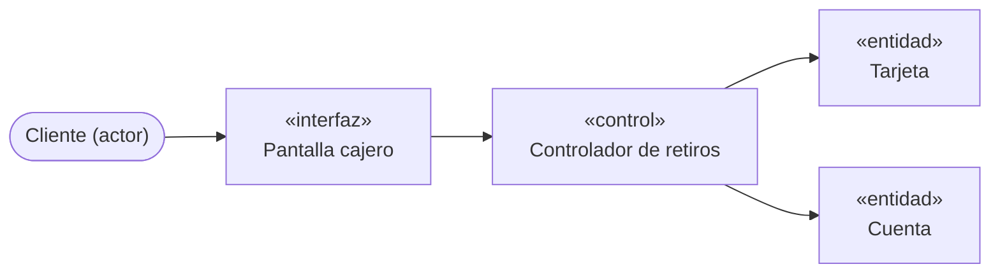
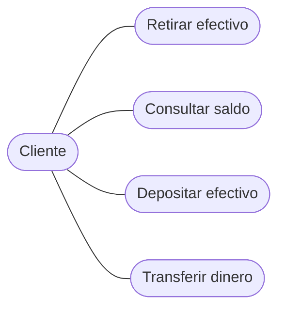
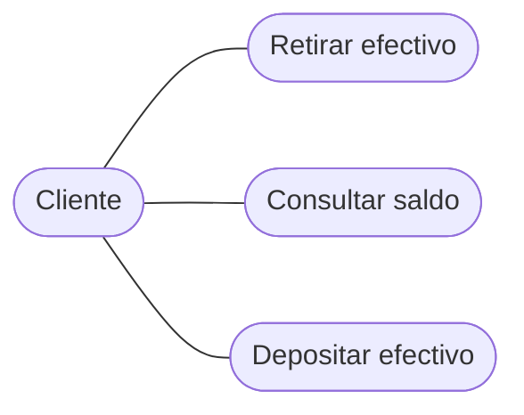
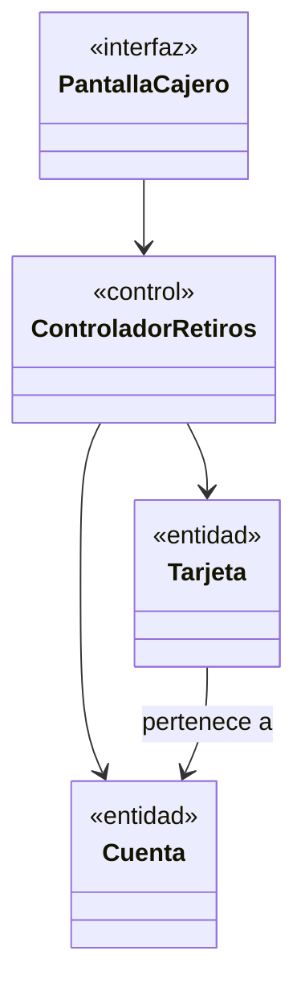
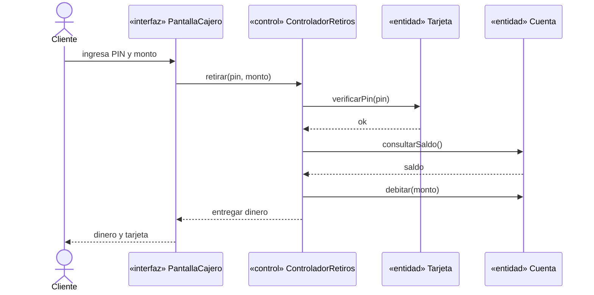
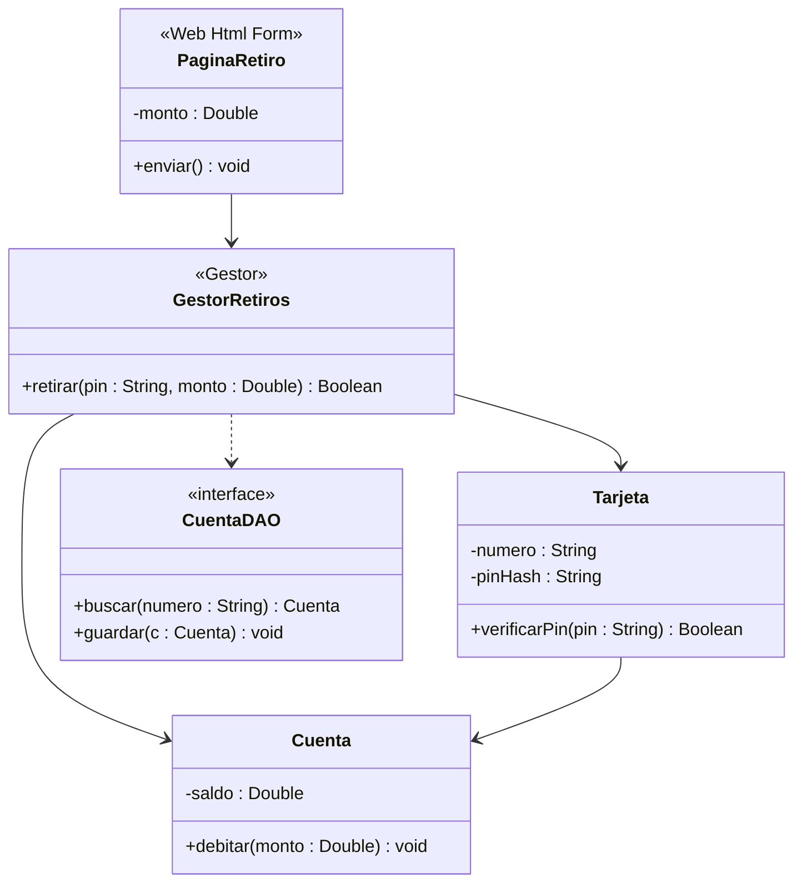

**user**: Que son los modelos UP
[Timestamp: 2026/11/02 23:10:07]

**ai**: Los **modelos UP** son las distintas representaciones simplificadas del sistema que se encadenan en el Proceso Unificado. Según tu resumen [[U4.1 - Modelos de UP y Diagrama de Clases]], un **modelo** es una **simplificación de la realidad** que sirve para comprender mejor el sistema. Permite describirlo, analizarlo, diseñarlo y documentarlo durante todo su ciclo de vida.

## Los tres modelos encadenados

- **Modelo de casos de uso (el QUÉ):**
  - Captura los **requerimientos funcionales** desde el punto de vista del usuario.
  - Los casos de uso son las funciones que el sistema le brinda a sus usuarios.
  - Está en el lenguaje del cliente y actúa como "contrato" entre el cliente y los desarrolladores.
- **Modelo de análisis (el CÓMO conceptual):**
  - Es una especificación detallada de los requerimientos y una primera aproximación al diseño.
  - Está en el lenguaje de los desarrolladores.
  - Usa **3 estereotipos**: **interfaz** (la relación con los actores), **control** (la lógica) y **entidad** (la información).
  - Para cada caso de uso se hace una **realización**, que muestra cómo se lleva a cabo.
- **Modelo de diseño (el CÓMO físico):**
  - Define la forma y la arquitectura del sistema.
  - Convierte la visión abstracta del análisis en una visión concreta, lista para implementar.
  - Es **físico**, **más formal** y admite **cualquier cantidad de estereotipos**.
  - **Debe mantenerse** durante todo el ciclo de vida.

El flujo es: casos de uso → se realizan en el análisis → se refinan en el diseño → implementación.

## Diferencia clave entre análisis y diseño

| Análisis | Diseño |
| --- | --- |
| Conceptual | Físico |
| Genérico | No genérico |
| 3 estereotipos | Cualquier número |
| Menos formal | Más formal |
| Bosquejo, surge de reuniones y talleres | Manifiesto, surge de "programación visual" |
| Puede no mantenerse | Debe mantenerse |

Esta comparación aparece mucho en los parciales. La trampa habitual es atribuirle al diseño los "3 estereotipos conceptuales" o el origen en "reuniones y talleres", que en realidad son del análisis.

## Cómo se conectan

Las clases de diseño se obtienen **trazando** (`<<traza>>`) las clases de análisis:

- La interfaz pasa a ser una pantalla concreta.
- El control pasa a ser un Gestor.
- La entidad pasa a ser una clase del dominio con atributos tipados.

Si querés, puedo armarte preguntas de práctica sobre este tema o profundizar en el diagrama de clases de diseño.
[Timestamp: 2026/11/02 23:10:07]

**user**: que significa UP
[Timestamp: 2026/11/02 23:10:31]

**ai**: **UP** significa **Unified Process**, en español **Proceso Unificado**. Se lo conoce también como **RUP** (*Rational Unified Process*) en la versión de Rational/IBM.

Es una metodología de desarrollo de software creada por Jacobson, Booch y Rumbaugh, los mismos autores de UML. Sus características principales son:

- **Dirigido por casos de uso:** los requerimientos funcionales guían todo el desarrollo.
- **Centrado en la arquitectura:** define la forma y estructura del sistema desde temprano.
- **Iterativo e incremental:** el sistema se construye en ciclos, no en un único paso.

Por eso "modelos de UP" son los modelos que este proceso usa para describir el sistema: casos de uso, análisis y diseño. Usan **UML** como lenguaje de notación. UML es el lenguaje para dibujar los modelos y UP es el proceso que dice cuándo y cómo construirlos.

Tu resumen no define la sigla de forma explícita, así que esta explicación sale de mi conocimiento general sobre UP y no de tus apuntes.
[Timestamp: 2026/11/02 23:10:31]

**user**: y esto TL;DR?
[Timestamp: 2026/11/02 23:11:12]

**ai**: **TL;DR** significa *"Too Long; Didn't Read"* (en español, "demasiado largo; no lo leí"). Se usa para un **resumen corto al inicio de un texto**, de modo que puedas captar lo esencial sin leer todo.

En tu nota [[U4.1 - Modelos de UP y Diagrama de Clases]] es el recuadro del principio (el callout `> [!abstract] TL;DR`). Resume en 5 puntos lo más importante de la unidad:

- Qué es un modelo.
- La cadena casos de uso → análisis → diseño.
- Las características del modelo de diseño.
- Los elementos del diagrama de clases.
- La trazabilidad entre clases de análisis y de diseño.

Es útil para un repaso rápido antes del parcial. Si necesitás el detalle, el desarrollo completo está en las secciones de abajo.
[Timestamp: 2026/11/02 23:11:12]

**user**: En los 3 modelos de UP el Analisis vendria a representar a los diagramas de clases por ejemplo?
[Timestamp: 2026/11/02 23:13:33]

**ai**: No exactamente. Los diagramas de clases aparecen en **los dos**, pero con distinto nivel de detalle. Lo que cambia de un modelo a otro es el tipo de clases que dibujás.

## Análisis

- Usa **diagramas de clases de análisis**, con clases **estereotipadas** (interfaz, control, entidad).
- Es conceptual, así que casi no hay detalles técnicos. Se muestran las responsabilidades y las relaciones básicas.
- También incluye las **realizaciones de casos de uso**, que muestran cómo colaboran esas clases para cumplir cada caso de uso.

## Diseño

- Usa **diagramas de clases de diseño**. Es el tema de tu nota.
- Las clases ya son físicas: atributos con tipo, operaciones con parámetros y retorno, y estereotipos de la tecnología (`<<Gestor>>`, `<<DAO>>`, `<<interface>>`).
- Además incluye diagramas de **secuencia**, **componentes**, **despliegue** y **máquinas de estado**.

## Casos de uso

- Usa el **diagrama de casos de uso**, con actores y casos de uso. No lleva clases.

## Resumen

| Modelo | Diagrama típico |
| --- | --- |
| Casos de uso | Diagrama de casos de uso |
| Análisis | Diagrama de clases de análisis y realizaciones |
| Diseño | Diagrama de clases de diseño, secuencia, componentes, despliegue |

Entonces, el análisis no equivale a "los diagramas de clases". Los diagramas de clases son una herramienta que se usa en análisis y en diseño. Las clases de diseño se obtienen **trazando** las de análisis (`<<traza>>`).

Los diagramas de casos de uso y de análisis los agrego desde mi conocimiento general de UP. Tu nota cubre sobre todo la parte de diseño.
[Timestamp: 2026/11/02 23:13:33]

**user**: Los casos de uso son las funciones que el sistema brinda a los usuarios dame un ejemplo de caso de uso
[Timestamp: 2026/11/02 23:25:48]

**ai**: Un ejemplo clásico es un **cajero automático**.

## Caso de uso: Retirar efectivo

- **Actor:** Cliente del banco.
- **Objetivo:** que el cliente retire dinero de su cuenta.
- **Precondición:** el cajero está operativo y el cliente tiene una tarjeta válida.

**Flujo principal:**

1. El cliente inserta la tarjeta.
2. El sistema pide el PIN.
3. El cliente ingresa el PIN.
4. El sistema valida el PIN.
5. El cliente elige "Retirar efectivo" e ingresa el monto.
6. El sistema verifica que haya saldo suficiente.
7. El sistema entrega el dinero y devuelve la tarjeta.

**Flujos alternativos:**

- PIN incorrecto: el sistema pide reingresarlo, y bloquea la tarjeta tras 3 intentos.
- Saldo insuficiente: el sistema informa el error y no entrega dinero.

**Postcondición:** el saldo de la cuenta queda descontado.

## Otros casos de uso del mismo sistema

El cajero tendría varios casos de uso, y cada uno es una función que el cliente usa para hacer su trabajo:

- Consultar saldo
- Depositar efectivo
- Transferir dinero
- Cambiar PIN

## Cómo se conecta con el resto

Fijate que el caso de uso está escrito **en el lenguaje del cliente** y describe **qué** hace el sistema, sin decir cómo. Después, en el análisis, "Retirar efectivo" se realiza con clases como:

- **Interfaz:** `Pantalla cajero`
- **Control:** `Controlador de retiros`
- **Entidad:** `Cuenta`, `Tarjeta`

Estas clases se refinan después en el diseño.

Este ejemplo lo armé yo para ilustrar, no sale de tus apuntes.
[Timestamp: 2026/11/02 23:25:48]

**user**: El modelo de Analaisis es la especificacion de los requerimientos , abarca los CUs y que mas?
[Timestamp: 2026/11/02 23:30:30]

**ai**: Un detalle importante: el modelo de análisis **no abarca** los casos de uso. Son modelos distintos. El modelo de casos de uso es la entrada, y el análisis parte de él para mostrar **cómo se realizan** esos casos de uso internamente.

## Qué contiene el modelo de análisis

- **Clases de análisis**, con los 3 estereotipos:
  - Interfaz (*boundary*)
  - Control (*control*)
  - Entidad (*entity*)
- **Realizaciones de casos de uso**, una por cada caso de uso. Muestran cómo colaboran las clases de análisis para cumplirlo. Se ligan al caso de uso con `<<realiza>>`, y las clases participan con `<<participa>>`.
- **Diagramas de clases de análisis**, con las relaciones básicas entre esas clases.
- **Diagramas de interacción** (colaboración o secuencia), con los mensajes entre objetos en cada realización.
- **Responsabilidades** de cada clase: las acciones que puede realizar y el conocimiento que mantiene y provee a otros objetos.

Según UP también suele incluir **paquetes de análisis**, que agrupan las clases, y a veces una **vista de la arquitectura** preliminar. Esto último sale de mi conocimiento general de UP, no de tu nota.

## Cómo encaja con tu nota

Tu nota lo define como una "especificación detallada de los requerimientos y una primera aproximación al diseño". Las dos partes de esa frase se reparten así:

| Parte de la definición | Qué aporta |
| --- | --- |
| Especificación de requerimientos | Refina y estructura lo que dicen los casos de uso, sin redundancias ni inconsistencias |
| Primera aproximación al diseño | Clases estereotipadas y realizaciones que después se trazan a clases de diseño |

## Diferencia con el modelo de casos de uso

- **Casos de uso:** vista externa, en lenguaje del cliente, define casos de uso. Puede tener redundancias.
- **Análisis:** vista interna, en lenguaje de desarrolladores, define realizaciones. No debería tener redundancias.

Entonces el análisis no incluye los CUs, sino que los toma como punto de partida y los **realiza**.
[Timestamp: 2026/11/02 23:30:30]

**user**: pero los CUs se realizan en el modelo de analisis
[Timestamp: 2026/11/02 23:31:03]

**ai**: Tenés razón, y eso es justo lo que dice tu nota: los casos de uso **se realizan en** el análisis. Mi frase anterior quedó confusa.

Hay que separar dos cosas:

- **Definir** el caso de uso (qué hace el sistema): pertenece al modelo de casos de uso.
- **Realizar** el caso de uso (cómo se lleva a cabo internamente): pertenece al modelo de análisis.

Entonces el análisis no contiene los casos de uso en sí, pero sí contiene **una realización por cada caso de uso**. Esa realización es lo que lo conecta con ellos:

- Se liga al caso de uso con `<<realiza>>`.
- Las clases de interfaz, control y entidad participan en ella con `<<participa>>`.

En la comparación de tu nota queda así:

| Modelo de casos de uso | Modelo de análisis |
| --- | --- |
| Define **casos de uso** | Define **realizaciones** de casos de uso |

Por eso, si en el parcial preguntan "¿qué abarca el análisis?", la respuesta correcta es que **realiza los casos de uso** mediante clases estereotipadas y sus colaboraciones. Los casos de uso en sí quedan en su propio modelo.
[Timestamp: 2026/11/02 23:31:03]

**user**: Son dos tipos de CUs distintos?
[Timestamp: 2026/11/02 23:32:53]

**ai**: No, es **el mismo caso de uso**, visto desde dos lados. Lo que cambia es qué se dice de él:

- **Caso de uso** (modelo de casos de uso): describe **qué** hace el sistema, en lenguaje del cliente. Ejemplo: "Retirar efectivo", con su flujo de pasos entre el actor y el sistema.
- **Realización del caso de uso** (modelo de análisis): describe **cómo** lo hace el sistema por dentro, con las clases de interfaz, control y entidad que colaboran. Ejemplo: `Pantalla cajero` → `Controlador de retiros` → `Cuenta`.

La relación es de uno a uno: cada caso de uso tiene su realización en el análisis, y la realización apunta al caso de uso con `<<realiza>>`.

Una analogía: el caso de uso es el **contrato** ("el sistema debe permitir retirar efectivo") y la realización es el **plano interno** de cómo se cumple ese contrato.

Más adelante, en el diseño, aparece otra versión: la **realización de caso de uso de diseño**, con diagramas de clases de diseño y de secuencia. Es el mismo caso de uso, cada vez con más detalle técnico:

| Modelo | Qué hay del caso de uso |
| --- | --- |
| Casos de uso | El caso de uso (qué) |
| Análisis | Su realización conceptual (cómo, en clases estereotipadas) |
| Diseño | Su realización física (cómo, en clases listas para implementar) |
[Timestamp: 2026/11/02 23:32:53]

**user**: como seria en clases estereotipadas el CUs en un ejemplo
[Timestamp: 2026/11/02 23:34:15]

**ai**: Tomo el caso de uso **Retirar efectivo** del cajero y lo realizo con clases estereotipadas.

## Clases de análisis

| Estereotipo | Clase | Responsabilidad |
| --- | --- | --- |
| Interfaz | `Pantalla cajero` | Mostrar mensajes, capturar PIN y monto, entregar el dinero |
| Control | `Controlador de retiros` | Coordinar la secuencia del caso de uso |
| Entidad | `Tarjeta` | Conocer el PIN y la cuenta asociada |
| Entidad | `Cuenta` | Conocer el saldo y permitir descontarlo |

## Realización (cómo colaboran)



Mensajes, siguiendo el flujo principal:

1. El cliente ingresa tarjeta y PIN en `Pantalla cajero`.
2. `Pantalla cajero` → `Controlador de retiros`: validar PIN.
3. `Controlador de retiros` → `Tarjeta`: verificar PIN.
4. El cliente ingresa el monto. `Pantalla cajero` → `Controlador de retiros`: retirar monto.
5. `Controlador de retiros` → `Cuenta`: consultar saldo y, si alcanza, descontar.
6. `Controlador de retiros` → `Pantalla cajero`: entregar dinero o mostrar error.

## Relación con el caso de uso

- La realización `Retirar efectivo` se liga al caso de uso con `<<realiza>>`.
- Las cuatro clases se ligan a la realización con `<<participa>>`.

## Qué pasa después en el diseño

Cada clase se traza (`<<traza>>`) a clases de diseño, como en tu nota:

- `Pantalla cajero` pasa a ser una pantalla concreta.
- `Controlador de retiros` pasa a ser un `<<Gestor>>`, por ejemplo `GestorRetiros`.
- `Cuenta` pasa a ser una clase con atributos tipados (`saldo : Double`) y operaciones (`debitar(monto : Double)`).

Este ejemplo lo armé yo siguiendo el patrón interfaz → control → entidad de tu nota. No es un ejemplo de tus apuntes.
[Timestamp: 2026/11/02 23:34:15]

**user**: Y un caso de uso normal?
[Timestamp: 2026/11/02 23:34:52]

**ai**: Un caso de uso "normal" es el que ya te mostré antes: **Retirar efectivo**, escrito en el lenguaje del cliente, sin clases. Te lo dejo en el formato típico, junto al diagrama que lo acompaña.

## Diagrama de casos de uso



Los óvalos son los casos de uso, el muñeco es el actor y las líneas indican quién usa qué. Acá solo ves **qué funciones ofrece el sistema**, sin ninguna clase.

## Especificación del caso de uso

**Nombre:** Retirar efectivo
**Actor:** Cliente
**Precondición:** el cajero está operativo y el cliente tiene una tarjeta válida.

**Flujo principal:**

1. El cliente inserta la tarjeta.
2. El sistema solicita el PIN.
3. El cliente ingresa el PIN.
4. El sistema valida el PIN.
5. El cliente elige "Retirar efectivo" e ingresa el monto.
6. El sistema verifica que haya saldo suficiente.
7. El sistema entrega el dinero y devuelve la tarjeta.

**Flujos alternativos:**

- PIN incorrecto: el sistema permite reingresarlo y bloquea la tarjeta tras 3 intentos.
- Saldo insuficiente: el sistema informa el error y no entrega dinero.

**Postcondición:** el saldo de la cuenta queda descontado.

## Diferencia con la versión estereotipada

| Caso de uso | Realización en análisis |
| --- | --- |
| "El sistema valida el PIN" | `Controlador de retiros` le pide a `Tarjeta` verificar el PIN |
| Habla de actor y sistema | Habla de interfaz, control y entidad |
| No dice quién hace qué por dentro | Reparte responsabilidades entre clases |

En el caso de uso, el sistema es una **caja negra**. En la realización, abrís esa caja y ves las clases que la componen.

Este ejemplo también es mío, no de tus apuntes.
[Timestamp: 2026/11/02 23:34:52]

**user**: Entonces el modelo de Analisis son como interactuan esos caso de uso
[Timestamp: 2026/11/02 23:36:12]

**ai**: Casi, pero con un ajuste: el análisis no muestra cómo interactúan **los casos de uso entre sí**, sino cómo se **lleva a cabo cada caso de uso por dentro**, es decir, cómo colaboran las **clases** (interfaz, control y entidad) para cumplirlo.

- **Modelo de casos de uso:** qué funciones ofrece el sistema (caja negra).
- **Modelo de análisis:** para cada caso de uso, qué clases participan y cómo se envían mensajes entre ellas (caja abierta).

La interacción que se ve en el análisis es **entre objetos**, no entre casos de uso. Por ejemplo, en "Retirar efectivo": `Pantalla cajero` → `Controlador de retiros` → `Cuenta`.

Las relaciones **entre casos de uso** (`<<include>>`, `<<extend>>`) existen, pero se definen en el modelo de casos de uso, no en el análisis. Esto último sale de mi conocimiento general de UML, no de tu nota.

Una forma corta de decirlo en el parcial: *el análisis muestra cómo se realiza cada caso de uso mediante la colaboración de clases estereotipadas.*
[Timestamp: 2026/11/02 23:36:12]

**user**: como seria la representacion grafica de interfez entidad y control
[Timestamp: 2026/11/02 23:39:04]

**ai**: Tu nota ([[U4.1 - Modelos de UP y Diagrama de Clases]]) los describe así:

| Estereotipo | Símbolo | Cómo dibujarlo |
| --- | --- | --- |
| **Interfaz** (*boundary*) | Círculo con una línea vertical a la izquierda | Una "T" acostada: un círculo unido por una línea horizontal a una barra vertical |
| **Control** (*control*) | Círculo con una flecha arriba | Un círculo con una pequeña flecha curva en la parte superior |
| **Entidad** (*entity*) | Círculo con una línea abajo | Un círculo apoyado sobre una línea horizontal |

## Esquema aproximado en ASCII

```text
 INTERFAZ         CONTROL          ENTIDAD

                    ↻
 |--( )            ( )              ( )
                                   ─────

 Pantalla      Controlador de     Cuenta
 cajero           retiros
```

El ASCII es solo una guía. Los símbolos reales son íconos de UML y se ven mejor en una herramienta de diagramas.

## Otra notación equivalente

Si la herramienta no tiene los íconos, se usa una clase común (rectángulo) con el estereotipo escrito arriba:

- `«boundary»` o `«interfaz»`
- `«control»`
- `«entity»` o `«entidad»`

Las dos notaciones significan lo mismo. En el parcial suele alcanzar con nombrar el estereotipo, pero conviene saber dibujar el ícono.

Los detalles de cómo se dibuja cada ícono son los del símbolo estándar de UML. Tu nota solo da la descripción de la tabla de la sección 3.
[Timestamp: 2026/11/02 23:39:04]

**user**: graficala
[Timestamp: 2026/11/02 23:39:12]

**ai**: Dibujé los tres símbolos y los guardé como imagen SVG, así que ya los podés ver en Obsidian:

![[Estereotipos de análisis.svg]]

El archivo está en `Parcial 2 - Contenido/Resumenes/Unidad 4/Estereotipos de análisis.svg`. Para mostrarlo en una nota, pegá la línea `![[Estereotipos de análisis.svg]]`. Podés agregarla a [[U4.1 - Modelos de UP y Diagrama de Clases]] en la sección 3, junto a la tabla de estereotipos.

No pude abrir ni renderizar la imagen desde acá, así que no revisé cómo se ve. Si algún símbolo queda mal, decime cuál y lo ajusto.

Cómo se dibuja cada uno:

- **Interfaz:** un círculo con una línea horizontal que sale hacia la izquierda y termina en una barra vertical.
- **Control:** un círculo con una flecha pequeña arriba, apuntando hacia la izquierda.
- **Entidad:** un círculo con una línea horizontal debajo.

Los dibujé a mano en el SVG siguiendo la descripción de tu nota. Los íconos oficiales de UML pueden diferir un poco, por ejemplo en la forma de la flecha del control.
[Timestamp: 2026/11/02 23:39:12]

**user**: Digamos que el modelod de analisis , mira los CUs de 3 perspectivas
[Timestamp: 2026/11/02 23:42:23]

**ai**: Sí, es una buena forma de decirlo. Tu nota dice que el análisis estudia el sistema desde **tres perspectivas**, una por estereotipo:

| Perspectiva | Pregunta que responde | Estereotipo |
| --- | --- | --- |
| La **interfaz** entre el sistema y sus actores | ¿Cómo se comunica el actor con el sistema? | Interfaz |
| La **información** que usa el sistema | ¿Qué datos maneja y guarda? | Entidad |
| La **lógica de control** | ¿Quién coordina los pasos? | Control |

Un matiz: lo que se mira desde esas tres perspectivas es **el sistema** (y cada caso de uso se realiza combinándolas), más que los casos de uso en sí. Cada realización de un caso de uso reparte su funcionalidad entre estas tres clases de objetos.

En "Retirar efectivo":

- **Interfaz:** `Pantalla cajero` (donde el cliente ingresa PIN y monto).
- **Control:** `Controlador de retiros` (coordina validar PIN, verificar saldo, entregar dinero).
- **Entidad:** `Cuenta` y `Tarjeta` (los datos).
[Timestamp: 2026/11/02 23:42:23]

**user**: Esto seria el como de un CUs?
[Timestamp: 2026/11/02 23:45:53]

**ai**: Sí, es el **cómo** de un caso de uso, probablemente el de crear usuarios. Es un **diagrama de clases de análisis**, parte de la realización del caso de uso. Muestra qué clases participan y cómo se relacionan, pero no es el caso de uso en sí.

## Qué se ve en el diagrama

| Clase | Estereotipo | Por qué |
| --- | --- | --- |
| `Interfaz creación usuarios` | Interfaz | Círculo con la barra vertical a la izquierda |
| `Controlador de usuarios` | Control | Círculo con la flecha arriba |
| `Usuario` | Entidad | Círculo con la línea abajo |
| `Notificación de pago pendiente` | Entidad | Misma notación |
| `Tarjeta de crédito` | Entidad | Misma notación |

Es justo el ejemplo que usa tu nota en la sección 3.

## Cómo leerlo

- **Interfaz → Control:** la pantalla de creación de usuarios le pasa lo ingresado al controlador. Multiplicidad `0..1` a `1`.
- **Control → Usuario:** el controlador **administra** al usuario (la relación está rotulada así).
- **Usuario ◆— Notificación de pago pendiente:** rombo lleno, es decir **composición**. Un usuario tiene `0..*` notificaciones, con rol `+pago pendiente`. Si el usuario desaparece, sus notificaciones también.
- **Usuario ◆— Tarjeta de crédito:** también composición, con rol `+tarjeta` y multiplicidad `0..1`.

## Dos detalles

- La aclaración "(from Interfaz con proveedores de tarjetas de crédito)" indica que `Tarjeta de crédito` está definida en **otro paquete de análisis**. Acá solo se la reutiliza.
- Este diagrama tiene las clases y sus relaciones, pero no los mensajes en orden. Para eso se usa un diagrama de interacción (secuencia o colaboración) dentro de la misma realización.

La lectura de la composición y de la nota "from" es mía a partir del dibujo. Si tu apunte dice otra cosa sobre estas relaciones, tomá la del apunte.
[Timestamp: 2026/11/02 23:45:53]

**user**: Entonces el Modelo de Analisis usa los CUs para representar el COMO desde esas 3 perspectivas
[Timestamp: 2026/11/02 23:48:06]

**ai**: Sí, esa frase es correcta. Resumida: el modelo de análisis toma cada caso de uso y muestra **cómo** se lleva a cabo, repartiendo el trabajo entre las tres perspectivas.

- **Interfaz:** cómo el actor interactúa con el sistema.
- **Control:** cómo se coordinan los pasos.
- **Entidad:** qué información se usa y se guarda.

Es la idea de tu nota: el caso de uso dice **qué** hace el sistema y su realización en el análisis dice **cómo**, de forma conceptual. Después, el diseño lo vuelve físico y listo para implementar.

Para el parcial, algo como: *"El modelo de análisis realiza cada caso de uso mediante clases de interfaz, control y entidad, mostrando cómo se lleva a cabo su funcionalidad."*
[Timestamp: 2026/11/02 23:48:06]

**user**: Entonces Analiza el sistema desde **tres perspectivas**, una por estereotipo: mas bien seria que analiza cada CUs
[Timestamp: 2026/11/02 23:49:48]

**ai**: Tu lectura es razonable y es más precisa que la mía. Cada caso de uso se realiza en el análisis, y esa realización lo descompone en las tres perspectivas: interfaz, control y entidad. Así que se puede decir que analiza cada caso de uso desde las tres perspectivas.

Tu nota dice textualmente "analiza el **sistema** desde tres perspectivas". No es incorrecto, porque el sistema completo es la suma de todos sus casos de uso. Pero en la práctica el trabajo se hace caso de uso por caso de uso, y por eso la frase de tu nota y la tuya describen lo mismo a distinta escala:

- **Por caso de uso:** cada realización reparte su funcionalidad entre interfaz, control y entidad.
- **Del sistema:** al juntar todas las realizaciones, el modelo de análisis cubre el sistema entero con esas tres perspectivas.

Para el parcial, podés usar la formulación de tu nota si te piden la definición, y la tuya para explicar cómo se aplica.
[Timestamp: 2026/11/02 23:49:48]

**user**: Entonces el modelo de analisis se representa asi
[Timestamp: 2026/11/02 23:50:42]

**ai**: Casi. Ese diagrama es **una parte** del modelo de análisis, no el modelo completo.

El modelo de análisis incluye varias cosas:

- **Diagramas de clases de análisis** como este, con clases estereotipadas y sus relaciones.
- **Una realización por cada caso de uso**, ligada con `<<realiza>>`.
- **Diagramas de interacción** (secuencia o colaboración) con los mensajes entre objetos.
- Las **responsabilidades** de cada clase.

Lo que mostrás es el **diagrama de clases de la realización** de un caso de uso, probablemente el de crear usuarios. Es la forma más típica de representar el análisis y la que tu nota usa de ejemplo, así que como regla práctica sirve:

- **Análisis = clases estereotipadas (interfaz, control, entidad) que colaboran para realizar un caso de uso.**

Pero para tener el modelo completo faltan las demás realizaciones (una por cada caso de uso) y los diagramas de interacción. Este diagrama es una de esas piezas, no el modelo entero.
[Timestamp: 2026/11/02 23:50:42]

**user**: Dame un diagrama de ejemplo de cada uno
[Timestamp: 2026/11/02 23:51:44]

**ai**: Uso el cajero automático para los tres modelos, así podés ver cómo evoluciona el mismo caso de uso, **Retirar efectivo**.

## 1. Modelo de casos de uso: diagrama de casos de uso



Solo hay actores y funciones. No aparecen clases.

## 2. Modelo de análisis

**Diagrama de clases de análisis** (la realización de "Retirar efectivo"):



**Diagrama de interacción** (los mensajes de la misma realización):



Son clases conceptuales, sin tipos de datos ni detalles técnicos.

## 3. Modelo de diseño: diagrama de clases de diseño



Las clases ya son físicas: atributos y operaciones tipados, estereotipos de tecnología (`<<Gestor>>`, `<<Web Html Form>>`, `<<interface>>`) y persistencia con DAO.

## Cómo se trazan entre sí

| Análisis | Diseño |
| --- | --- |
| `PantallaCajero` | `PaginaRetiro` |
| `ControladorRetiros` | `GestorRetiros` |
| `Tarjeta`, `Cuenta` | `Tarjeta`, `Cuenta` (más `CuentaDAO` para persistir) |

Mermaid no dibuja los íconos de interfaz, control y entidad. Por eso uso `<<estereotipos>>` en texto, que es la notación equivalente. Todos los ejemplos son armados por mí, no salen de tus apuntes.
[Timestamp: 2026/11/02 23:51:44]