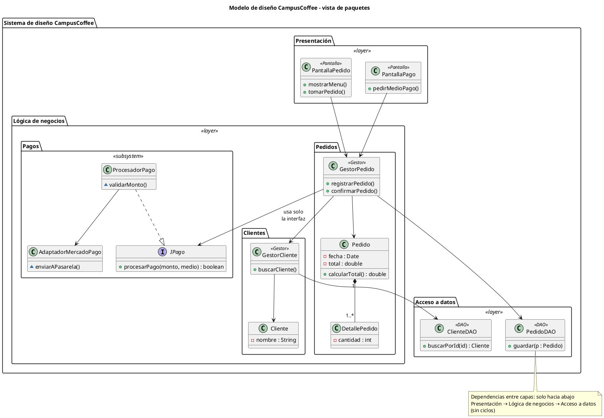
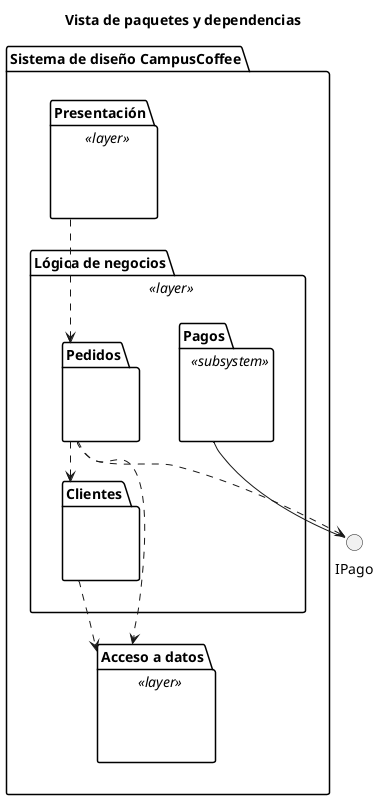

**user**: Un componente expone un conjunto de interfaces , se refiere a interfaces de pantalla no contratos
[Timestamp: 2026/11/03 21:00:09]

**ai**: No. En [[U4.2 - Componentes y Despliegue]], "interfaz" significa **contrato**: un conjunto de operaciones (servicios) que alguien ofrece o necesita. No tiene nada que ver con pantallas ni con la interfaz de usuario (UI).

**Por qué es un contrato y no una pantalla:**

- **Interfaz provista (lollipop ○—):** las operaciones que el componente **ofrece** a otros. Por ejemplo, `IPago` en el ejercicio de CampusCoffee declara algo como `procesarPago(monto, medio)`.
- **Interfaz requerida (socket —( ):** las operaciones que el componente **necesita** que otro le dé.
- El diagrama muestra cómo se **conectan los componentes entre sí** (el socket de uno encaja en el lollipop de otro). Las pantallas no aparecen en ningún lado.
- Esto es lo que hace al componente **reemplazable**: si otro componente cumple el mismo contrato, se puede cambiar uno por otro sin tocar a los que lo usan. Por eso el subsistema `Pagos` puede cambiar MercadoPago por otra pasarela sin que nadie lo note desde afuera.

Es la misma idea que una `interface` de Java o C#: declara operaciones sin decir cómo se implementan.

**Lo que puede confundir:**

- El ejemplo `Movimiento → Gráficos` usa una interfaz llamada "Interfaz gráfica". Aun así es un contrato: un conjunto de operaciones de dibujo que `Gráficos` le da a `Movimiento`, no una pantalla.
- En la línea 269, en "interfaz rápida" (ventajas de la arquitectura 2 capas), "interfaz" sí se refiere a la UI. Es otro uso de la palabra.

**Frase para el parcial:** *"Una interfaz es un conjunto de operaciones que especifica un servicio. El componente la provee si la implementa y la requiere si depende de ella."*

¿Querés que agregue un callout `> [!warning]` en la nota aclarando esta diferencia?
[Timestamp: 2026/11/03 21:00:09]

**user**: que significa cohesivo
[Timestamp: 2026/11/03 21:03:05]

**ai**: **Cohesivo** quiere decir que todo lo que hay dentro del componente apunta a **un mismo propósito**. Sus partes (clases, operaciones, datos) están ahí porque colaboran en la misma responsabilidad, no porque alguien las juntó al azar.

En la definición de [[U4.2 - Componentes y Despliegue]] (línea 61) significa que el componente representa **un bloque significativo de comportamiento o estructura**: algo que se puede nombrar con una sola idea, como "Pagos", "Gráficos" o "Email Management".

**Ejemplo:**

- ✅ **Cohesivo:** el componente `Pagos` contiene `IPago`, `ProcesadorPago`, `AdaptadorMercadoPago` y `Comprobante`. Todo tiene que ver con pagar.
- ❌ **No cohesivo:** un componente `Utilidades` que contiene `EnviarEmail`, `CalcularIVA`, `GenerarPDF` y `ValidarDNI`. Son cosas sin relación entre sí, metidas en la misma bolsa.

**Por qué importa en un componente:**

- **Reemplazable:** si el componente hace una sola cosa, se puede cambiar por otro que cumpla el mismo contrato. Si hace diez cosas sueltas, reemplazarlo afecta todo el sistema.
- **Desplegable:** tiene sentido desplegar como unidad algo que funciona como un todo.
- **Fácil de entender y mantener:** cuando un cambio en las reglas de pago llega, sabés exactamente dónde tocar.

**Cohesión y acoplamiento:**

| Concepto | Qué mide | Lo deseable |
| --- | --- | --- |
| **Cohesión** | Qué tan relacionadas están las partes **dentro** de un elemento | **Alta** |
| **Acoplamiento** | Qué tanto depende un elemento **de otros** | **Bajo** |

Es la misma idea que el principio de **Alta Cohesión** (GRASP) y el **Principio de Responsabilidad Única** de [[U5.4 - SOLID]], solo que aplicada a un componente en vez de a una clase.

**Frase para el parcial:** *"Un componente es cohesivo porque agrupa elementos que colaboran en una misma responsabilidad y forman un bloque significativo de comportamiento del sistema."*
[Timestamp: 2026/11/03 21:03:05]

**user**: agregame en el resumen como seria visualmente un componente nose si se podra en mermaid
[Timestamp: 2026/11/03 21:05:40]

**ai**: Primero miro cómo está armada esa sección de la nota, así el diagrama queda con el mismo estilo.Agregué en [[U4.2 - Componentes y Despliegue]] una subsección **"Cómo se dibuja un componente"**, dentro de "2. Componentes", entre la tabla de notación y el ejemplo de Movimiento y Gráficos. No lo abrí en Obsidian, así que conviene revisar que el diagrama Mermaid se dibuje bien.

Mermaid no tiene diagrama de componentes UML: no puede dibujar el lollipop ni el socket. Por eso lo armé en dos partes:

- **Dibujo de la notación UML real, en texto:** el componente `Pagos` con el rectángulo, el estereotipo `«component»` y el ícono. A la izquierda tiene la interfaz provista `IPago` (○—) y a la derecha la interfaz requerida `INotificacion` (—( ). Cada parte tiene una etiqueta que explica qué es. Esta es la forma que conviene dibujar en el parcial.
- **Aproximación en Mermaid**, con un callout de advertencia antes:
  - `Pedidos` requiere `IPago`, que provee `Pagos`.
  - `Pagos` requiere `INotificacion`, que provee `Notificaciones`.
  - Las interfaces son círculos. La línea sólida sale del componente que provee la interfaz y la flecha punteada sale del que la requiere.
  - Adentro de `Pagos` puse dos clases para mostrar la encapsulación. Debajo aclaro que en un diagrama de componentes normalmente no se dibujan.

Sigue el mismo ejemplo de Pagos y MercadoPago del ejercicio de CampusCoffee, así queda conectado con lo que ya tenías. La línea que agregaste vos sobre "cohesivo" quedó igual.
[Timestamp: 2026/11/03 21:05:40]

**user**: Me gusta que agregues los diagramas que no podes representar con mermaid con el mcp de excalidraw pero lo agregas como una imagen png
[Timestamp: 2026/11/03 21:19:10]

**ai**: Estoy armando el diagrama en Excalidraw. `npx` falló por un error de caché de npm, así que lo estoy resolviendo.Ya está instalado en la caché, así que lo ejecuto directamente.El socket quedó en punta. Lo corrijo para que sea un semicírculo y guardo el PNG.Ahora reemplazo el dibujo en texto de la nota por la imagen y guardo tu preferencia en memoria.La nota cambió desde mi última edición, así que releo la sección.Dibujé en Excalidraw el componente solo, con su notación UML, y lo agregué a [[U4.2 - Componentes y Despliegue]] como PNG.

![[U4.2 - Notacion componente.png]]

- **Qué muestra:** el componente `Pagos` con el estereotipo `«component»` y el ícono. A la izquierda está la interfaz provista `IPago` (lollipop, en verde) y a la derecha la interfaz requerida `INotificacion` (socket, en rojo). Cada una tiene una etiqueta abajo que dice qué es, y adentro del componente aclara que la implementación queda oculta.
- **Dónde está:** el archivo es `Assets/U4.2 - Notacion componente.png`. En la nota quedó debajo de la tabla de notación, con el título "Un componente solo, con sus dos tipos de interfaz".

Cuando fui a editar vi que habías borrado mi sección anterior (el dibujo en texto y el Mermaid aproximado) y la habías cambiado por tu imagen de Movimiento y Gráficos. No toqué eso. Mi imagen va antes que la tuya, y a la tuya le puse el título "Dos componentes conectados", así quedan como un par: primero un componente solo y después cómo se conectan dos.

No había un MCP de Excalidraw conectado, así que lo dibujé con la herramienta de línea de comandos de Excalidraw. El comando de siempre fallaba por un error de caché de npm, así que usé la copia que ya estaba descargada.

Me guardé la preferencia: de ahora en adelante, los diagramas que Mermaid no pueda dibujar bien los hago en Excalidraw y los agrego como PNG en `Assets/`.
[Timestamp: 2026/11/03 21:19:10]

**user**: Los paquetes de diseño son los "package"
[Timestamp: 2026/11/03 21:23:17]

**ai**: Sí. Un **paquete de diseño** es el elemento **`package`** de UML: la "carpetita" que agrupa clases, interfaces, otros paquetes o componentes relacionados.

**Cómo se dibuja:**
- Es un **rectángulo con una pestaña** arriba a la izquierda, con forma de carpeta.
- El nombre va en la pestaña o adentro del rectángulo.
- Se le puede poner un **estereotipo** según el uso: `<<layer>>`, `<<tier>>` o `<<subsystem>>`, como en tu resumen.
- Entre paquetes se dibujan **dependencias**, que son flechas punteadas. Por ejemplo, `Presentación ⇢ Lógica de negocios ⇢ Acceso a datos`.

**Cómo se ve en código:**
- **Java:** `package com.campuscoffee.pagos;`. Es literalmente una carpeta de clases.
- **PlantUML:** `package "Lógica de negocios" { class Pedido ... }`

**Para no confundirlo con un componente:**

| | Paquete (`package`) | Componente (`«component»`) |
| --- | --- | --- |
| Qué es | Una **agrupación lógica** para organizar el modelo | Una **pieza de software** desplegable y reemplazable |
| Expone interfaces | No: solo agrupa, y sus elementos públicos se usan directamente | Sí: tiene interfaces provistas y requeridas |
| Existe en ejecución | No: es organización del diseño o del código | Sí: se despliega, por ejemplo como un `.jar` o un servicio |

El **subsistema** está en el medio: es un `package` con el estereotipo `<<subsystem>>` que, igual que un componente, **solo se accede por sus interfaces**.

¿Querés que dibuje en Excalidraw un paquete con `<<layer>>` y sus dependencias y lo agregue como PNG en la sección 3?
[Timestamp: 2026/11/03 21:23:17]

**user**: El modelo de diseño entonces esta estructurado en paquetes?
[Timestamp: 2026/11/03 21:24:38]

**ai**: Sí, con un matiz. En UP el modelo de diseño **se organiza** en paquetes, pero el contenido que va adentro son las clases, las interfaces y las realizaciones de casos de uso.

**Cómo es la estructura**

UP describe el modelo de diseño como una **jerarquía**:

- Arriba de todo hay un único **sistema de diseño**, que es el paquete raíz.
- Ese paquete se divide en **subsistemas de diseño**, que son paquetes con el estereotipo `<<subsystem>>`, y en paquetes comunes como `<<layer>>`.
- Cada subsistema puede contener otros subsistemas, y así hasta llegar a los elementos concretos: **clases de diseño**, **interfaces** y **realizaciones de casos de uso de diseño**.

Por ejemplo, con CampusCoffee:

```text
Sistema de diseño CampusCoffee            ← paquete raíz
├── <<layer>> Presentación
│     └── PantallaPedido, PantallaPago...  ← clases de diseño
├── <<layer>> Lógica de negocios
│     ├── GestorPedido, Pedido...
│     └── <<subsystem>> Pagos   ○ IPago    ← subsistema con su interfaz
└── <<layer>> Acceso a datos
      └── PedidoDAO, ...
```

**Cómo encaja con lo que ya tenés**

- La "composición" que tenés en [[U4.1 - Modelos de UP y Diagrama de Clases]] (subsistemas de diseño, clases de diseño, interfaces, realizaciones y vista de arquitectura) es justamente lo que va **dentro** de esa jerarquía de paquetes.
- Es uno de los objetivos del modelo de diseño: **descomponer la implementación en partes más manejables**. Los paquetes son la herramienta para descomponer.
- En [[U4.2 - Componentes y Despliegue]] dice que los paquetes se usan para **reflejar la arquitectura** en layers, tiers o subsistemas. O sea: la arquitectura define cómo se cortan los paquetes, y el modelo de diseño queda organizado según ese corte.

**Frase para el parcial:** *"El modelo de diseño se estructura jerárquicamente en paquetes y subsistemas de diseño, que reflejan la arquitectura en capas, y contiene clases de diseño, interfaces y realizaciones de casos de uso."*

Ojo con un detalle: con el **modelo de análisis** pasa algo parecido, porque se organiza en **paquetes de análisis**. La diferencia es que en diseño aparecen los **subsistemas con interfaces**, que son más formales y tienen que ver con la implementación.
[Timestamp: 2026/11/03 21:24:38]

**user**: El modelo de diseño incluye los archivos java los diagramas y demas?
[Timestamp: 2026/11/03 21:26:42]

**ai**: No del todo. Los **diagramas sí** son parte del modelo de diseño. Los **archivos `.java` no**: el código pertenece al **modelo de implementación**, que es el modelo que viene después en UP.

**Qué incluye el modelo de diseño**

Es un **modelo**, o sea una **abstracción de la implementación**. Esa frase está en los objetivos que tenés en [[U4.1 - Modelos de UP y Diagrama de Clases]]. Incluye:

- Los **diagramas de clases de diseño**, con atributos, tipos, métodos y estereotipos como `<<DAO>>` o `<<Gestor>>`.
- Los **diagramas de secuencia**, que son las realizaciones de casos de uso de diseño.
- Los **paquetes y subsistemas**, con sus interfaces.
- Las **máquinas de estado** de las clases que las necesiten.
- La **vista de arquitectura**, que incluye el diagrama de despliegue.

**Qué es el modelo de implementación**

Es el que contiene el **código real**: los archivos `.java`, los `.jar`, los ejecutables, los scripts de la BD. En UP se llaman **componentes de implementación** o **artefactos**.

Cada elemento del modelo de diseño se **traza** a uno del modelo de implementación:

| Modelo de diseño | → | Modelo de implementación |
| --- | --- | --- |
| Clase de diseño `GestorPedido` | se implementa en | `GestorPedido.java` |
| Subsistema `<<subsystem>> Pagos` | se implementa en | `package com.campuscoffee.pagos` / `pagos.jar` |
| Nodo y artefacto en el despliegue | se materializa en | el `.jar` o `.war` real instalado en el servidor |

**Cómo recordarlo**

El modelo de diseño es el **plano** del sistema y el modelo de implementación es la **construcción**. El plano es tan detallado que ya dice cómo va a quedar el código (por eso se dice que el modelo de diseño es **físico**), pero sigue siendo un plano.

Hay una zona gris: si usás una herramienta que genera los diagramas a partir del código, o al revés (*ingeniería ida y vuelta*), los dos quedan muy pegados. Igual siguen siendo modelos distintos.

**Frase para el parcial:** *"El modelo de diseño es una abstracción de la implementación: contiene clases, subsistemas, interfaces y realizaciones de casos de uso de diseño. El código fuente forma parte del modelo de implementación, al que se traza cada elemento del diseño."*
[Timestamp: 2026/11/03 21:26:42]

**user**: Entonces que es lo que va en el modelo de diseño a nivel paquetes
[Timestamp: 2026/11/03 21:27:08]

**ai**: Al nivel de paquetes, el modelo de diseño define **cómo se divide el sistema**. No entra en el detalle de cada clase. Concretamente define cinco cosas.

**1. Qué paquetes hay y de qué tipo**

- **Capas lógicas** `<<layer>>`: Presentación, Lógica de negocios, Acceso a datos.
- **Capas físicas** `<<tier>>`, cuando importa en qué máquina corre cada parte.
- **Subsistemas** `<<subsystem>>`: bloques funcionales que se usan solo a través de una interfaz, como `Pagos` o `Firma digital`.
- **Paquetes anidados**: dentro de una capa puede haber paquetes por área, por ejemplo `Lógica de negocios` → `Pedidos`, `Clientes`, `Pagos`.

**2. Qué va adentro de cada paquete**

- Las **clases de diseño**: `GestorPedido`, `Pedido`, `PedidoDAO`, `PantallaPedido`…
- Las **interfaces**, como `IPago`.
- Las **realizaciones de casos de uso**, o sea los diagramas de secuencia y de clases de cada caso de uso, ubicadas en el paquete que corresponda.

**3. Las dependencias entre paquetes**

- Se dibujan con flechas punteadas: `Presentación ⇢ Lógica de negocios ⇢ Acceso a datos`.
- En una arquitectura en capas, cada capa depende solo de la de abajo. Nunca al revés.
- Hay que evitar los **ciclos** entre paquetes.

**4. La visibilidad**

- Qué elementos de cada paquete son **públicos**, porque otros paquetes los usan, y cuáles son **privados**, porque son internos.
- En un subsistema, desde afuera **solo se ven sus interfaces**.

**5. Con qué criterio se agrupa**

Es lo que tenés en la sección 5 de [[U4.2 - Componentes y Despliegue]]:
- **Alta cohesión** dentro de cada paquete y **bajo acoplamiento** entre paquetes.
- Los **principios de empaquetado** (REP, CCP y CRP): juntar lo que se reutiliza junto y lo que cambia junto, y no obligar a nadie a depender de clases que no usa.

**Cómo se ve todo junto**

```text
<<layer>> Presentación          (público: PantallaPedido, PantallaPago)
      ⇣ depende de
<<layer>> Lógica de negocios
   ├── Pedidos   → GestorPedido, Pedido
   ├── Clientes  → GestorCliente, Cliente
   └── <<subsystem>> Pagos  ○ IPago   (adentro: ProcesadorPago, AdaptadorMercadoPago, privados)
      ⇣ depende de
<<layer>> Acceso a datos        (PedidoDAO, ClienteDAO)
```

**Frase para el parcial:** *"A nivel de paquetes, el modelo de diseño define la descomposición del sistema: qué paquetes y subsistemas hay (según la arquitectura en capas), qué clases, interfaces y realizaciones contiene cada uno, la visibilidad de sus elementos y las dependencias entre paquetes, buscando alta cohesión y bajo acoplamiento."*

¿Querés que agregue esto a la sección 3 de la nota, con el ejemplo dibujado en Excalidraw como diagrama de paquetes UML?
[Timestamp: 2026/11/03 21:27:08]

**user**: Dame un ejemplo en mermaid o plant uml donde se vea todo esto
[Timestamp: 2026/11/03 21:28:11]

**ai**: Me quedan dos detalles de dibujo: en la vista simple aparecen los alias (P, LG, D) como si fueran nombres, y en la vista detallada la nota todavía cruza el diagrama.Lo hice en PlantUML porque dibuja los paquetes como carpetas, con estereotipos, visibilidad e interfaces. Mermaid no tiene diagrama de paquetes. Son dos vistas del mismo modelo de CampusCoffee. Las generé con PlantUML y revisé las imágenes una por una.

**Vista 1: el detalle, con todo lo que va adentro**

![[U4.2 - Paquetes detalle.png]]

Qué ver en el diagrama:

| Concepto | Dónde se ve |
| --- | --- |
| **Paquete raíz** | `Sistema de diseño CampusCoffee` envuelve todo |
| **Capas** `<<layer>>` | Presentación, Lógica de negocios, Acceso a datos |
| **Paquetes anidados** | `Pedidos` y `Clientes` dentro de Lógica de negocios |
| **Subsistema** | `Pagos <<subsystem>>`, que expone `IPago` |
| **Contenido** | Clases de diseño con atributos, métodos y estereotipos de diseño (`<<Pantalla>>`, `<<Gestor>>`, `<<DAO>>`) |
| **Visibilidad** | `+` público, `-` privado, `~` de paquete. `ProcesadorPago` y `AdaptadorMercadoPago` solo tienen métodos `~`, así que no se usan desde afuera |
| **Acceso por interfaz** | `GestorPedido` usa **solo** `IPago`, no `ProcesadorPago` |
| **Dependencias** | Siempre hacia abajo, Presentación → Lógica → Datos, y sin ciclos |

Usé `<<Gestor>>` y `<<Pantalla>>` a propósito, en vez de `boundary`, `control` y `entity`: esos tres son los estereotipos del **análisis**. En un modelo de diseño sería el error que marca el parcial.



**Vista 2: solo los paquetes y sus dependencias**

![[U4.2 - Paquetes dependencias.png]]

Es la vista de arquitectura. Muestra cómo está dividido el sistema y quién depende de quién, sin las clases. Las flechas punteadas `..>` son las dependencias entre paquetes. El círculo es la interfaz `IPago` del subsistema.



En esta segunda vista, las clases `" "` son relleno invisible para que PlantUML dibuje los paquetes como carpetas aunque estén vacíos. En el parcial no hace falta: dibujás las carpetas y listo.

Las dos imágenes están guardadas en `Assets/` como `U4.2 - Paquetes detalle.png` y `U4.2 - Paquetes dependencias.png`. Todavía no las agregué a la nota. Los bloques `plantuml` no se van a ver como diagrama en tu vault, porque no tenés instalado el plugin de PlantUML, así que conviene embeber los PNG. ¿Querés que los ponga en la sección 3 de [[U4.2 - Componentes y Despliegue]] con la tabla de "qué ver en el diagrama"?
[Timestamp: 2026/11/03 21:28:11]

**user**: ok me parece valioso que me agregues de forma resumida esto al U4.2 , donde se vea solo la imagen no el codigo y que representa cada cosa
[Timestamp: 2026/11/03 21:32:50]

**ai**: Agregué el ejemplo a [[U4.2 - Componentes y Despliegue]] en una subsección nueva, **"Ejemplo: el modelo de diseño organizado en paquetes"**. Está en la sección 3, después de "Subsistema", y también la sumé al índice de la nota.

La subsección tiene, en este orden:

- **Una frase de introducción:** el modelo de diseño se organiza en una jerarquía de paquetes y subsistemas que reflejan la arquitectura.
- **Las dos imágenes, sin el código:** primero la vista de paquetes y dependencias, después la vista de detalle con las clases.
- **Una tabla "qué se ve / dónde / qué representa"**, con una fila por concepto: paquete raíz, capas, paquetes anidados, subsistema, clases de diseño, visibilidad y dependencias. Donde corresponde, cada fila menciona la alta cohesión o el bajo acoplamiento.
- **Dos callouts cortos** con las trampas de las que hablamos:
  - En diseño no se usan `boundary`, `control` y `entity`, porque son los estereotipos del análisis.
  - El código (`.java`, `.jar`) pertenece al modelo de implementación, no al de diseño.

Las imágenes son las que ya estaban en `Assets/`: `U4.2 - Paquetes dependencias.png` y `U4.2 - Paquetes detalle.png`.
[Timestamp: 2026/11/03 21:32:50]

**user**: Un elemento representa un conjunto de clases o interfaces o demas
[Timestamp: 2026/11/03 21:48:27]

**ai**: No. Un **elemento** es **una sola cosa** del modelo, no un conjunto. El conjunto es el **paquete**, que es lo que agrupa elementos.

Cuando el apunte dice que los paquetes sirven para *"agrupar elementos relacionados"*, "elemento" es la palabra genérica de UML para **cualquier cosa que se pueda dibujar en el modelo**:

- una **clase**: `Pedido`
- una **interfaz**: `IPago`
- un **componente**: `«component» Pagos`
- un **caso de uso** o una **realización de caso de uso**
- un **diagrama**
- **otro paquete** o un **subsistema**

Cada uno de esos es **un** elemento. Se usa la palabra "elemento" justamente para no tener que enumerar "clases, interfaces, componentes…" cada vez.

**Lo que puede confundir:** un paquete también es un elemento. Por eso un paquete puede contener otros paquetes, y así se arma la jerarquía. En tu ejemplo de [[U4.2 - Componentes y Despliegue]]:

- `Pedido` es un elemento (una clase).
- `Pedidos` es un elemento (un paquete) que **contiene** a `Pedido`, `GestorPedido` y `DetallePedido`.
- `Lógica de negocios` es un elemento (un paquete) que **contiene** a los paquetes `Pedidos`, `Clientes` y `Pagos`.

O sea: un elemento puede **ser** un contenedor, pero en sí mismo es una sola unidad del modelo. Lo que representa un conjunto es el contenedor.

**Frase para el parcial:** *"Un paquete agrupa elementos del modelo (clases, interfaces, componentes, casos de uso u otros paquetes). Como un paquete también es un elemento, se pueden anidar."*
[Timestamp: 2026/11/03 21:48:27]

**user**: | `<<layer>>` (lógicas) | MVC | `<<tier>>` (físicas) |
| --- | --- | --- |
| Presentación → Lógica de negocios → Acceso a datos | Vista ↔ Controlador → Modelo | Presentación → Lógica de negocios → Acceso a datos |
 no entiendo lo de Presentacion -> Logica de negocios -> Acceso a datos
[Timestamp: 2026/11/03 21:49:45]

**ai**: Es la **arquitectura en 3 capas**. El sistema se divide en tres partes según **qué tipo de trabajo** hace cada una. La flecha `→` significa **"usa a"** o **"depende de"**: cada capa le pide cosas a la de abajo.

**Qué hace cada capa**

| Capa | Qué hace | Ejemplo en CampusCoffee |
| --- | --- | --- |
| **Presentación** | Lo que ve el usuario: pantallas, formularios, botones. Muestra datos y captura lo que el usuario ingresa. **No decide nada.** | `PantallaPedido`: muestra el menú y el botón "Confirmar" |
| **Lógica de negocios** | Las **reglas** del sistema: calcula, valida y decide. Es el "cerebro". | `GestorPedido`: calcula el total, aplica el descuento de estudiante y verifica que haya stock |
| **Acceso a datos** | Guarda y busca datos en la **base de datos**. No sabe de reglas, solo lee y escribe. | `PedidoDAO`: hace el `INSERT` del pedido en la BD |

**Cómo se recorre con un ejemplo**

Un alumno confirma un pedido:

1. **Presentación:** el alumno toca "Confirmar". `PantallaPedido` **no calcula nada**: le pasa el pedido a `GestorPedido`.
2. **Lógica de negocios:** `GestorPedido` calcula el total, aplica el descuento y valida. Si todo está bien, le pide a `PedidoDAO` que lo guarde.
3. **Acceso a datos:** `PedidoDAO` lo guarda en la BD.

La respuesta vuelve por el mismo camino, de abajo hacia arriba, hasta que la pantalla muestra "Pedido confirmado".

```text
 Usuario
   ↓
Presentación ──usa──→ Lógica de negocios ──usa──→ Acceso a datos ──→ BD
 (muestra)              (decide)                    (guarda)
```

**Por qué la flecha va en un solo sentido**

- La Presentación conoce a la Lógica, y la Lógica conoce al Acceso a datos.
- Nunca al revés: `PedidoDAO` no sabe que existe una pantalla.
- La Presentación **no salta** directo a la BD: siempre pasa por la Lógica.

Así podés **cambiar una capa sin romper las otras**. Si mañana hacés una app móvil, cambiás solo la Presentación. Si cambiás de MySQL a PostgreSQL, cambiás solo el Acceso a datos. Las reglas del negocio no se tocan.

**Por qué en la tabla la columna `<<layer>>` y la columna `<<tier>>` dicen lo mismo**

Tienen los mismos nombres, pero significan cosas distintas:

- **`<<layer>>` (lógica):** es cómo está **organizado el código**. Las tres capas pueden correr en la misma computadora.
- **`<<tier>>` (física):** es **en qué máquina corre** cada capa. Por ejemplo, el navegador del alumno, el servidor de la aplicación y el servidor de la base de datos.

O sea: con `layer` dividís el código en tres paquetes, y con `tier` además lo repartís en tres máquinas.

Sobre MVC: no es exactamente lo mismo. **Vista ↔ Controlador → Modelo** es un patrón para organizar sobre todo la parte de la interfaz. La Vista muestra, el Controlador recibe lo que hace el usuario y el Modelo tiene los datos y las reglas. Se parece a las 3 capas, pero la Vista y el Controlador se comunican en los dos sentidos (por eso la flecha `↔`).

¿Querés que agregue este ejemplo del recorrido "Confirmar pedido" debajo de la tabla, en la sección 3 de [[U4.2 - Componentes y Despliegue]]?
[Timestamp: 2026/11/03 21:49:45]

**user**: claro las <<layers>> dividen en 3 capas presentacion seria todas las clases de reglas del negocio y en <<tiers>> presentacion hace referencia en el equipo que corre
[Timestamp: 2026/11/03 21:52:33]

**ai**: Casi. La idea de layer contra tier la entendiste bien, pero hay un error en qué va en cada capa.

**La corrección:** las **reglas del negocio no van en Presentación**. Van en **Lógica de negocios**. Presentación tiene solo las clases de **interfaz de usuario**.

**Con `<<layer>>` (división del código)**

| Capa | Qué clases van |
| --- | --- |
| **Presentación** | Las clases de **pantalla**: `PantallaPedido`, `PantallaPago`. Solo muestran y capturan datos. |
| **Lógica de negocios** | Las clases con **reglas**: `GestorPedido`, `Pedido`, `Cliente`. Calculan, validan y deciden. |
| **Acceso a datos** | Las clases que hablan con la **BD**: `PedidoDAO`, `ClienteDAO`. |

**Con `<<tier>>` (división física)**

Esa parte la entendiste bien. Cada tier es **la máquina donde corre** esa parte:

| Tier | Qué es físicamente | Qué corre ahí |
| --- | --- | --- |
| **Presentación** | El **equipo del usuario**: su PC o celular, con el navegador o la app | La capa de Presentación |
| **Lógica de negocios** | El **servidor de aplicación** | La capa de Lógica de negocios |
| **Acceso a datos** | El **servidor de base de datos** | La BD (y a veces los DAO) |

**Las dos juntas**

- Las **layers** dicen **qué hace** cada grupo de clases: mostrar, decidir o guardar.
- Los **tiers** dicen **dónde corre** cada grupo: en el equipo del usuario, en el servidor de aplicación o en el servidor de BD.

Un sistema puede tener **3 layers en 1 solo tier**: todo el código separado en tres capas, pero corriendo en una sola PC. Lo contrario no se da, porque si separás en máquinas, el código ya tiene que estar separado en capas.

Por eso el **diagrama de despliegue** de la sección 6 es donde se ven los tiers: los nodos son las máquinas y adentro de cada una ponés qué capa corre.

**Frase para el parcial:** *"Las layers son la división lógica del sistema según responsabilidades (presentación, reglas de negocio, acceso a datos). Los tiers son la división física, según en qué nodo se ejecuta cada capa."*
[Timestamp: 2026/11/03 21:52:33]

**user**: Y como seria un ejemplo con <<tier>> osea por ejemplo si uso NoSQL podria estar contenido en <<tier>> que seria el servidor
[Timestamp: 2026/11/03 21:54:00]

**ai**: Sí. La base NoSQL (por ejemplo **MongoDB**) correría en el **tier de datos**, que es la máquina servidor de base de datos. Que sea NoSQL o SQL no cambia nada: el tier es **dónde corre**, no **qué tecnología** usás.

**CampusCoffee en 3 tiers con MongoDB**

```text
┌─────────────────────────┐      ┌──────────────────────────────┐      ┌──────────────────────────┐
│ <<tier>> Presentación   │      │ <<tier>> Lógica de negocios  │      │ <<tier>> Datos           │
│ Celular / PC del alumno │ HTTP │ Servidor de aplicación       │ TCP  │ Servidor de BD           │
│                         │ ───→ │                              │ ───→ │                          │
│ - App / navegador       │      │ - GestorPedido, Pedido...    │      │ - MongoDB (NoSQL)        │
│ - PantallaPedido        │      │ - PedidoDAO (habla con Mongo)│      │   colección "pedidos"    │
└─────────────────────────┘      └──────────────────────────────┘      └──────────────────────────┘
```

**Qué va en cada tier**

| Tier | Máquina | Qué corre ahí |
| --- | --- | --- |
| **Presentación** | El celular o la PC del alumno | La app o la página web con las pantallas |
| **Lógica de negocios** | El servidor de aplicación | Las clases con reglas **y los DAO** |
| **Datos** | El servidor de BD | El **motor de MongoDB** con los datos guardados |

**Ojo con un detalle:** los **DAO** (`PedidoDAO`) son código Java, así que normalmente corren en el **servidor de aplicación**, no en el de BD. Lo que corre en el tier de datos es el **motor de base de datos**: MongoDB, MySQL, etc. Los DAO son los que "cruzan" al tier de datos para leer y escribir.

**Variantes que también valen**

- **Dos bases en el mismo tier:** MongoDB para los pedidos y MySQL para los usuarios, las dos en el servidor de BD. Sigue siendo un solo tier de datos.
- **Dos bases en máquinas distintas:** MongoDB en un servidor y Redis (caché) en otro. Siguen siendo el tier de datos, pero repartido en dos **nodos**.
- **Todo en una sola máquina:** si MongoDB corre en el mismo servidor que la aplicación, tenés **2 tiers**: el cliente y un servidor que hace todo. Las 3 **layers** del código siguen existiendo igual.

**Dónde se dibuja esto**

- En un **diagrama de paquetes**, podés agrupar con `<<tier>>` para mostrar qué paquetes corren en cada nivel físico.
- Pero donde realmente se ve es en el **diagrama de despliegue** de la sección 6 de [[U4.2 - Componentes y Despliegue]]. Ahí cada tier es un **nodo** (`«device»` para el celular y `«server»` para cada servidor), y MongoDB aparece como `«executionEnvironment»` o como artefacto dentro del nodo de datos, con el protocolo en la conexión.

**Frase para el parcial:** *"El tier de datos es el nodo físico donde corre el motor de base de datos, sea relacional o NoSQL. Las clases de acceso a datos (DAO) suelen ejecutarse en el tier de lógica y se comunican con ese nodo por red."*

¿Querés que dibuje este ejemplo como diagrama de despliegue UML y lo agregue a la sección 6?
[Timestamp: 2026/11/03 21:54:00]

**user**: Digamos que layer si utiliza en el diagrama de clases y tier en diagrama de despliegue
[Timestamp: 2026/11/03 21:55:23]

**ai**: Como regla para acordarte sirve, pero no es exacto, y en el parcial conviene decirlo bien.

**Lo que es correcto**
- **Layer** es una idea de **organización del código**, así que se ve en los diagramas de **paquetes y clases**.
- **Tier** es una idea **física**, así que su lugar natural es el diagrama de **despliegue**, donde cada tier es un **nodo**.

**El matiz**

Según tu apunte, `<<layer>>` y `<<tier>>` son **estereotipos de paquete**. Los dos se usan en el **diagrama de paquetes**: es la tabla de la sección 3 de [[U4.2 - Componentes y Despliegue]], donde aparecen lado a lado. O sea, podés tener un diagrama de paquetes con `<<tier>>` para mostrar qué parte corre en cada nivel físico.

En cambio, en el **diagrama de despliegue** no se escribe `<<tier>>`. Los tiers aparecen como **nodos** con sus propios estereotipos: `«device»`, `«server»`, `«executionEnvironment»`.

| | Diagrama de paquetes / clases | Diagrama de despliegue |
| --- | --- | --- |
| **Layer** | ✅ Paquete `<<layer>>` con sus clases adentro | ❌ No aparece |
| **Tier** | ✅ Paquete `<<tier>>` (vista lógica de la división física) | ✅ Como **nodos** (`«device»`, `«server»`), sin escribir `<<tier>>` |

**Versión corregida de tu frase:** *"Layer y tier son estereotipos de paquete. Layer agrupa por responsabilidad lógica y tier por nivel físico. Los tiers se concretan en el diagrama de despliegue como nodos."*
[Timestamp: 2026/11/03 21:55:23]

**user**: por ejemplo aca no usaste tier
[Timestamp: 2026/11/03 21:56:47]

**ai**: Exacto: en ese diagrama solo usé `<<layer>>`. Fue a propósito, porque muestra **cómo está organizado el código**, es decir, qué responsabilidad tiene cada grupo de clases. No dice nada de en qué máquina corre cada cosa.

**Cómo quedaría con `<<tier>>`**

Los tiers **envuelven** a las layers según dónde se ejecuta cada una:

```text
<<tier>> Cliente (celular / PC del alumno)
   └── <<layer>> Presentación
         PantallaPedido, PantallaPago

<<tier>> Servidor de aplicación
   ├── <<layer>> Lógica de negocios
   │     Pedidos, Clientes, <<subsystem>> Pagos
   └── <<layer>> Acceso a datos
         PedidoDAO, ClienteDAO

<<tier>> Servidor de BD
   └── (MongoDB / MySQL: el motor, no hay clases nuestras)
```

**Qué muestra esto**

- **Las layers y los tiers no son lo mismo uno a uno.** Acá hay 3 layers repartidas en 3 tiers, pero `Acceso a datos` comparte tier con `Lógica de negocios`, porque los DAO corren en el servidor de aplicación (como vimos con el ejemplo de NoSQL).
- **El tier de BD queda sin clases**, porque ahí corre el motor de base de datos y no código nuestro. Por eso en un diagrama de paquetes o clases el `<<tier>>` se usa menos: es incómodo mostrar algo físico en un diagrama que es de código. Para eso está el **diagrama de despliegue**.

**Resumen**

| Diagrama | Qué estereotipo usar |
| --- | --- |
| Paquetes/clases para mostrar **organización del código** (el mío) | `<<layer>>` |
| Paquetes/clases para mostrar **qué parte corre dónde** | `<<tier>>`, con las layers adentro |
| Despliegue | Nodos (`«device»`, `«server»`), que **son** los tiers físicos |

¿Querés que genere esta versión con `<<tier>>` como imagen y la ponga en la nota al lado de la otra, para comparar las dos?
[Timestamp: 2026/11/03 21:56:47]

**user**: Dale si generalo
[Timestamp: 2026/11/03 21:57:37]

**ai**: Se ve bien. Lo copio a `Assets/` y lo agrego a la nota debajo del diagrama de detalle.Generé la versión con `<<tier>>` y la agregué a [[U4.2 - Componentes y Despliegue]], debajo del diagrama de detalle. Revisé cómo queda la imagen.

![[U4.2 - Paquetes tiers.png]]

**Qué muestra el diagrama:**
- **Tier Cliente** (el celular o la PC del alumno): adentro tiene la layer de Presentación con las pantallas.
- **Tier Servidor de aplicación**: adentro tiene **dos** layers, Lógica de negocios (con Pedidos, Clientes y el subsistema Pagos) y Acceso a datos (con los DAO).
- **Tier Servidor de BD**: tiene solo el motor de MongoDB, con una nota que aclara que ahí no hay clases nuestras.
- Las dependencias van hacia abajo. La última, de Acceso a datos a MongoDB, está marcada "red" porque cruza a otra máquina.

**Lo que agregué en la nota, después de la imagen:**
- Una **tabla que compara** cómo queda el sistema agrupado por `<<layer>>` y agrupado por `<<tier>>`: qué pregunta responde cada uno, cómo es la estructura y el detalle de que los DAO corren en el servidor de aplicación.
- Un callout **"Layer ≠ tier uno a uno"**. Dice que puede haber 3 layers en un solo tier, o 3 layers repartidas en 3 tiers sin que coincidan exactamente. También aclara que lo físico se ve mejor en el diagrama de despliegue.

El PNG quedó en `Assets/U4.2 - Paquetes tiers.png`. En la nota solo aparece la imagen, sin el código.
[Timestamp: 2026/11/03 21:57:37]

**user**: Digamos que en el modelo de diseño van lo svg de los .puml de diagrama de clases con paquetes layer o tier , diagramas secuencia , algunos de estado etc . Nada de codigo fuente
[Timestamp: 2026/11/03 22:07:03]

**ai**: Sí, la idea es esa. Le haría dos ajustes para que quede precisa.

**1. Lo que falta en tu lista.** Además de clases con paquetes, secuencia y estado, el modelo de diseño incluye:
- los **subsistemas con sus interfaces** (`IPago`);
- el **diagrama de componentes**, si lo usás;
- la **vista de arquitectura**, que incluye el **diagrama de despliegue** con nodos y tiers. Lo tenés en la "composición" de [[U4.1 - Modelos de UP y Diagrama de Clases]].

**2. El modelo no son los archivos.** Esto es más conceptual. El modelo de diseño es el **contenido**: las clases, interfaces, paquetes y realizaciones, con sus atributos, métodos y relaciones. Los `.svg` y los `.puml` son **formas de representarlo**:
- Los **diagramas son vistas** del modelo. Un mismo elemento, como `GestorPedido`, puede aparecer en el diagrama de clases, en el de secuencia y en el de paquetes, y sigue siendo **un** elemento del modelo.
- El `.puml` es "código", pero **código del diagrama**, no código fuente del sistema. No se compila ni se ejecuta. Por eso sí entra en el diseño.

**Con tu ejemplo del TP**

| ✅ Modelo de diseño | ❌ No es modelo de diseño |
| --- | --- |
| Diagrama de clases con paquetes `<<layer>>` o `<<tier>>` | Los `.java` (modelo de **implementación**) |
| Diagramas de secuencia de cada caso de uso (realizaciones) | Los `.jar` o `.war` que se instalan (**artefactos**) |
| Máquinas de estado de las clases que las necesitan | Los scripts SQL que se ejecutan contra la BD |
| Diagrama de despliegue y de componentes | Los casos de uso y el modelo de dominio (son **requisitos** y **análisis**) |

**Frase para el parcial:** *"El modelo de diseño contiene clases de diseño, interfaces, subsistemas y realizaciones de casos de uso, y se representa mediante diagramas de clases, paquetes, secuencia, estados, componentes y despliegue. El código fuente pertenece al modelo de implementación."*
[Timestamp: 2026/11/03 22:07:03]

**user**: Digamos que un subsitema es un paquete o varios pero con la posibilidad de aportar un comportamiento accesible atraves de una o mas interfaces . Pero desde afuera solo veo la firma de esa implementacion
[Timestamp: 2026/11/03 22:11:36]

**ai**: Sí, la idea es esa. Le haría dos ajustes para decirla exacta en el parcial.

**1. Es un paquete, no varios.** Un subsistema es **un** paquete con el estereotipo `<<subsystem>>`. Lo que pasa es que **adentro** puede tener clases y también otros paquetes. Por ejemplo, `Pagos` es un solo subsistema, y adentro podría tener los paquetes `Validaciones` y `Pasarelas`.

**2. No es "la posibilidad" de dar comportamiento: lo da.** Esa es justamente la diferencia con un paquete común. El paquete solo agrupa. El subsistema además **ofrece comportamiento**, y lo ofrece **únicamente** a través de sus interfaces.

**Lo de "desde afuera solo veo la firma": correcto.** Desde afuera ves la **interfaz**, o sea la **firma de las operaciones** (nombre, parámetros y tipo de retorno). No ves las clases que la implementan.

| Desde afuera **sí** ves | Desde afuera **no** ves |
| --- | --- |
| `IPago` | `ProcesadorPago` |
| `procesarPago(monto, medio) : boolean` | `AdaptadorMercadoPago` |
| | Que adentro se usa MercadoPago |

Ojo con la palabra "firma": en tu apunte el ejemplo es `<<subsystem>> Firma digital` con la interfaz `Firma`. Ahí "Firma" es el **nombre** de la interfaz (de firmar documentos), no la "firma de un método". Son dos usos distintos de la misma palabra.

**Tu frase, corregida:** *"Un subsistema es un paquete (que puede contener clases y otros paquetes) que ofrece comportamiento accesible solo a través de una o más interfaces. Desde afuera solo se ven las operaciones de esas interfaces, no las clases que las implementan."*
[Timestamp: 2026/11/03 22:11:36]

**user**: un paquete no posee interfaces dentro solo clases?
[Timestamp: 2026/11/03 22:43:46]

**ai**: No. Un paquete común **también puede tener interfaces adentro**. Puede contener cualquier elemento del modelo: clases, interfaces, otros paquetes, diagramas.

La diferencia con el subsistema no es **qué contiene**, sino **cómo se accede desde afuera**.

| | Paquete común | Subsistema |
| --- | --- | --- |
| ¿Puede tener interfaces adentro? | ✅ Sí | ✅ Sí |
| ¿Cómo se usa desde afuera? | Se usa **directamente cualquier elemento público**: clases o interfaces | **Solo** a través de sus interfaces. Las clases quedan ocultas |
| ¿Las interfaces son "la puerta"? | No: son un elemento más del paquete | Sí: son el **único punto de acceso** |

**Ejemplo con un paquete común**

```text
package Pedidos
 ├── IDescuento         (interfaz, pública)
 ├── DescuentoAlumno    (clase, pública, implementa IDescuento)
 └── GestorPedido       (clase, pública)
```

Desde otro paquete podés usar `IDescuento`, pero **también** `DescuentoAlumno` o `GestorPedido` directamente, porque son públicos. La interfaz está ahí, pero no es obligatorio pasar por ella.

**El mismo caso como subsistema**

```text
<<subsystem>> Pagos
 ├── IPago                 (interfaz → lo único visible)
 ├── ProcesadorPago        (oculta)
 └── AdaptadorMercadoPago  (oculta)
```

Desde afuera **solo** podés usar `IPago`. No podés llamar a `ProcesadorPago` aunque quieras.

**Frase para el parcial:** *"Tanto un paquete como un subsistema pueden contener interfaces. La diferencia es que en el subsistema las interfaces son el único medio de acceso a su comportamiento, mientras que en un paquete común se accede directamente a cualquier elemento público."*
[Timestamp: 2026/11/03 22:43:46]

**user**: Me estoy confundiendo mucho con esto de paquetes
[Timestamp: 2026/11/03 22:47:10]

**ai**: Es normal: en esta charla aparecieron muchas variantes juntas. Lo reduzco a **una sola idea base** y tres agregados.

**La idea base: un paquete es una carpeta**

Igual que en tu compu. Sirve para **ordenar**: metés adentro cosas relacionadas (clases, interfaces, otras carpetas). Nada más. No hace nada por sí mismo.

**1. Las carpetas pueden tener etiqueta**

A la carpeta le pegás una etiqueta (el estereotipo) para decir **con qué criterio** la armaste:
- `<<layer>>`: "acá van las clases que hacen **lo mismo**" (mostrar, decidir o guardar).
- `<<tier>>`: "acá va lo que corre **en la misma máquina**".

La carpeta es la misma. Solo cambia el criterio con el que la llenaste.

**2. El subsistema es una carpeta con ventanilla**

- **Carpeta común:** cualquiera puede abrirla y agarrar lo que esté a la vista (lo público).
- **Subsistema:** la carpeta está **cerrada** y tiene una **ventanilla**, que es la interfaz. Desde afuera solo podés pedir cosas por la ventanilla. Lo que pasa adentro no lo ves.

```text
Carpeta común Pedidos        →  entrás y usás GestorPedido, Pedido... directamente
Subsistema Pagos  ○ IPago    →  solo pedís por IPago; adentro no ves nada
```

**3. Las carpetas pueden estar dentro de carpetas**

`Lógica de negocios` contiene `Pedidos`, `Clientes` y `Pagos`. Así se arma el modelo de diseño completo: una carpeta grande con carpetas adentro.

**Lo que podés olvidar por ahora**

Los detalles de "un paquete también es un elemento" o "un paquete común puede tener interfaces" son matices. Si te quedan estas cuatro frases, alcanza para el parcial:

1. **Paquete** = agrupa elementos relacionados para ordenar el modelo.
2. **`<<layer>>`** agrupa por responsabilidad. **`<<tier>>`** agrupa por máquina.
3. **Subsistema** = paquete al que solo se accede por sus interfaces. Lo de adentro queda oculto.
4. El **modelo de diseño** está organizado en paquetes y subsistemas.

¿Querés que te haga 4 o 5 preguntas cortas tipo parcial sobre esto, para ver si quedó claro?
[Timestamp: 2026/11/03 22:47:10]

**user**: Dale haceme las preguntas
[Timestamp: 2026/11/03 22:49:45]

**ai**: Van 5 preguntas, de menor a mayor dificultad. Respondé todas juntas en un mensaje (por ejemplo: "1. b, 2. F porque…") y después te corrijo con la explicación de cada una.

**1. Opción múltiple.** ¿Para qué sirve principalmente un paquete de diseño?
- a) Para ejecutar el código de un conjunto de clases
- b) Para agrupar elementos relacionados y ordenar el modelo
- c) Para ocultar siempre la implementación de sus clases
- d) Para representar una máquina física del sistema

**2. Verdadero o falso. Justificá.**
*"Si un paquete tiene una interfaz adentro, entonces es un subsistema."*

**3. Completá.**
En CampusCoffee, `PantallaPedido` y `PantallaPago` van en el paquete `<<______>>` llamado __________, porque las dos tienen la misma responsabilidad: __________.

**4. Situación.** Desde el paquete `Pedidos`, un programador quiere llamar directamente a `AdaptadorMercadoPago`, que está dentro de `<<subsystem>> Pagos`.
- ¿Puede hacerlo?
- ¿Por qué?
- ¿Qué debería usar en su lugar?

**5. Pregunta abierta corta.** Tenés un sistema con 3 layers (Presentación, Lógica, Acceso a datos), pero todo corre en **una sola PC**.
- ¿Cuántos tiers tiene?
- ¿Tiene sentido igual separarlo en 3 layers? ¿Por qué?
[Timestamp: 2026/11/03 22:49:45]

**user**: 1. b , 2F no necesariamente por que un paquete tambien puede tener una interfaz adentro , solo que <<subsystem>> actua como una ventanilla solo muestra la firma de la interfaz y no las clases que la implementan  , 3 . <<layer>> 4. No sabria que responder , 5. En teoria tendria un solo tier , no tendria sentido separarlo en varios tiers ya que existe una sola capa fisica
[Timestamp: 2026/11/03 22:54:57]

**ai**: **Resultado: 2 bien, 2 a medias y 1 sin responder.** Las bases las tenés. Lo que falla son dos detalles puntuales.

**1. b ✅ Correcto.**

**2. F ✅ Correcto, y bien justificado.** Lo explicaste con la idea clave: tener una interfaz adentro no alcanza. Lo que define al subsistema es que **solo se accede por** la interfaz. Para el parcial, agregale una frase: *"en un paquete común se puede usar directamente cualquier elemento público"*.

**3. ⚠️ A medias.** `<<layer>>` está bien, pero faltaron los otros dos huecos. La respuesta completa:

> Van en el paquete `<<layer>>` llamado **Presentación**, porque las dos tienen la misma responsabilidad: **mostrar información al usuario y capturar lo que ingresa** (la interfaz de usuario).

**4. ❌ Sin responder.** Es la aplicación directa de la idea de la "ventanilla":
- **¿Puede?** **No.**
- **¿Por qué?** `AdaptadorMercadoPago` está **dentro** de un subsistema, y lo de adentro de un subsistema está **oculto**. Desde afuera solo se ve la interfaz.
- **¿Qué debería usar?** La interfaz **`IPago`**, con su operación `procesarPago(monto, medio)`.

> Si `Pedidos` pudiera llamar directo al adaptador, quedaría atado a MercadoPago. Si mañana cambian de pasarela, habría que cambiar `Pedidos` también. Usando solo `IPago`, el cambio queda **adentro** de `Pagos` y nadie más se entera. Para eso existe el subsistema.

**5. ⚠️ La primera parte bien, la segunda no respondía lo que se preguntaba.**
- **¿Cuántos tiers?** **Uno** ✅.
- **¿Tiene sentido separarlo en 3 layers?** Acá contestaste sobre *tiers*, pero la pregunta era sobre *layers*. La respuesta es **sí, tiene sentido**:

> Las layers son una división **lógica** del código, y no dependen de cuántas máquinas haya. Aunque todo corra en una PC, separar en Presentación, Lógica y Datos sirve para **cambiar una capa sin romper las otras** (por ejemplo, cambiar la BD sin tocar las reglas del negocio) y deja el sistema listo para repartirlo en más máquinas en el futuro.

Fijate que en la 5 se te mezcló layer con tier: es la confusión más común con este tema. Una regla rápida para separarlos:
- **Layer** → ¿**qué hace** el código? Siempre conviene separarlo.
- **Tier** → ¿**en cuántas máquinas** corre? Depende de la infraestructura.

¿Querés otra ronda de preguntas enfocada en layer contra tier y en subsistemas, que es donde tuviste las dudas?
[Timestamp: 2026/11/03 22:54:57]

**user**: Bien entonces me quedo claro eso , y que los paquetes y modelo de diseño no son archivos dentro de una carpeta sino que la representacion de los CUs de dsitintas vistas , como interactuan y demas . Yo antes pensaba que los paquetes eran estructura de carpetas de windows por ejemplo que adentro tenian archvos
[Timestamp: 2026/11/03 23:04:12]

**ai**: Sí, ahora lo tenés bien. Le haría dos ajustes chicos para que no se te mezcle de nuevo.

**1. La analogía de la carpeta era solo para la idea de agrupar.** Cuando te dije "un paquete es una carpeta", era para explicar que agrupa y ordena. Pero el paquete de diseño **no es** una carpeta de Windows con archivos adentro. Es un elemento **del modelo** que agrupa otros elementos del modelo: clases, interfaces, otros paquetes. Vive en el diseño, no en el disco.

Lo que pensabas antes no estaba tan lejos, porque después ese paquete de diseño **se traza** a algo real en la implementación:

| Modelo de diseño | → | Modelo de implementación |
| --- | --- | --- |
| Paquete `Pedidos` (elemento del modelo) | se implementa como | `package com.campuscoffee.pedidos` → **ahí sí** es una carpeta con `.java` adentro |

O sea, la carpeta de archivos existe, pero en el **modelo de implementación**. En el diseño, el paquete es la **idea** de esa agrupación.

**2. El modelo de diseño no representa solo los CUs.** Representa **cómo está diseñado el sistema**: su estructura (clases, paquetes, subsistemas, interfaces) y su comportamiento. Los CUs entran a través de las **realizaciones de casos de uso**, que son los diagramas de secuencia que muestran cómo los objetos interactúan para cumplir cada CU. Es una parte importante, pero no la única.

**Tu frase, ajustada:** *"Los paquetes y el modelo de diseño no son archivos en carpetas: son una representación del diseño del sistema desde distintas vistas (estructura, interacción, estados, despliegue), incluida la realización de los casos de uso. Las carpetas con código aparecen recién en el modelo de implementación."*
[Timestamp: 2026/11/03 23:04:12]

**user**: Y ahora un componente a diferencia de los paquetes?
[Timestamp: 2026/11/03 23:05:46]

**ai**: Con la misma lógica de antes: el **paquete** es una agrupación para **ordenar el modelo**. El **componente** es una **pieza de software** que funciona sola, se puede instalar y se puede cambiar por otra.

**La diferencia en una frase**
- **Paquete:** "estas clases van juntas porque se relacionan". Es **organización**.
- **Componente:** "esta pieza del sistema **hace algo**, se **despliega** como unidad y se **reemplaza** por otra que cumpla el mismo contrato". Es una **parte funcional** del sistema.

**Comparación**

| | Paquete | Componente |
| --- | --- | --- |
| **Qué es** | Agrupación de elementos del modelo | Parte **modular, desplegable y reemplazable** del sistema |
| **Para qué sirve** | Ordenar el modelo | Construir el sistema con piezas intercambiables |
| **Interfaces** | No necesita: se usan sus elementos públicos directamente | **Siempre** se comunica por interfaces: **provistas** (○—) y **requeridas** (—( ) |
| **Encapsula** | No (salvo el subsistema) | Sí: la implementación queda oculta |
| **¿Existe en ejecución?** | No: es organización del diseño | Sí: se materializa en un **artefacto** que se instala (`pagos.jar`, un servicio) |
| **Dónde aparece** | Diagrama de paquetes y de clases | Diagrama de **componentes** y de **despliegue** |
| **Notación** | Carpeta con pestaña | Rectángulo con `«component»` o con el ícono |

**El mismo `Pagos` visto de las dos formas**
- **Como paquete:** "en el modelo, `IPago`, `ProcesadorPago` y `AdaptadorMercadoPago` van juntas en la carpeta `Pagos`". Solo dice cómo se ordena.
- **Como componente:** "`Pagos` es una pieza que **ofrece** `IPago` y **requiere** `INotificacion`. Se instala como `pagos.jar` en el servidor de aplicación y se puede reemplazar por otra pieza que ofrezca `IPago`". Dice qué hace, con qué se conecta y dónde se despliega.

**¿Y el subsistema?** Está en el medio, y por eso confunde:

```text
Paquete  ──────────→  Subsistema  ──────────→  Componente
solo agrupa           agrupa + se accede       pieza desplegable y reemplazable
                      solo por interfaces      con interfaces provistas/requeridas
```

El subsistema **se parece mucho** a un componente: los dos se usan solo por interfaces y ocultan lo de adentro. La diferencia es de enfoque. El subsistema es una forma de **organizar el diseño**: es un paquete con estereotipo. El componente es una **pieza de software** que se despliega. En la práctica, un subsistema de diseño muchas veces **se implementa como** un componente. Por ejemplo, `<<subsystem>> Pagos` en el diseño termina siendo el componente `Pagos` desplegado como `pagos.jar`.

**Frase para el parcial:** *"Un paquete es una agrupación lógica de elementos del modelo para organizarlo. Un componente es una parte modular, desplegable y reemplazable del sistema que encapsula su implementación y se comunica únicamente a través de interfaces provistas y requeridas."*

¿Querés que agregue esta comparación en [[U4.2 - Componentes y Despliegue]], al final de la sección 2 de Componentes?
[Timestamp: 2026/11/03 23:05:46]

**user**: Osea que un componente si es un .jar
[Timestamp: 2026/11/03 23:09:06]

**ai**: Casi, pero no exactamente. El componente **se materializa en** un `.jar`, pero no **es** el `.jar`. Es la misma relación que ya viste entre una clase de diseño y su archivo `.java`.

| Nivel | Qué es | Ejemplo |
| --- | --- | --- |
| **Componente** (diseño) | La **pieza lógica**: qué hace, qué interfaces ofrece y requiere | `«component» Pagos`, que ofrece `IPago` |
| **Artefacto** (físico) | El **archivo real** que se instala | `pagos.jar` |

En el **diagrama de despliegue** esto se dibuja con **`«manifest»`**: el artefacto **manifiesta** (materializa) al componente, y después el artefacto se **despliega** (`«deploy»`) en un nodo.

```text
«component» Pagos  ◄──«manifest»──  pagos.jar  ──«deploy»──►  «server» Servidor de aplicación
   (qué es)                         (el archivo)               (dónde corre)
```

Lo tenés en tu nota, en el ejercicio de CampusCoffee: ahí se piden nodos, artefactos, `«manifest»` y `«deploy»`.

**Por qué no son lo mismo**
- El mismo componente puede materializarse en **otro tipo de archivo**: un `.dll` en .NET, un `.war`, un contenedor Docker, un microservicio.
- Un componente puede necesitar **varios artefactos**, por ejemplo un `.jar` y un archivo de configuración.
- Si cambiás de tecnología, el componente `Pagos` sigue siendo el mismo, porque ofrece `IPago` igual. Lo que cambia es el artefacto.

**Frase para el parcial:** *"Un componente no es un archivo: es una parte lógica, desplegable y reemplazable del sistema. Se materializa en uno o más artefactos (por ejemplo, un `.jar`), y esa relación se modela con «manifest». Los artefactos se despliegan en los nodos con «deploy»."*
[Timestamp: 2026/11/03 23:09:06]

**user**: ckari es desplegable por que luego se materializa?
[Timestamp: 2026/11/03 23:10:13]

**ai**: Sí, exacto. Le sumaría un detalle para que la idea quede completa.

**Cómo se conectan**
- **Desplegable** quiere decir que el componente se puede **instalar como una unidad independiente** en un nodo (un servidor, un celular).
- Eso es posible porque se **materializa** en un artefacto (`pagos.jar`), y ese artefacto es lo que físicamente se copia e instala en el nodo.

```text
«component» Pagos  →  «manifest»  →  pagos.jar  →  «deploy»  →  Servidor
     se diseña                       se genera                    se instala
```

**El detalle que falta:** que se materialice en un archivo no alcanza. Para que el componente sea desplegable **como unidad**, además tiene que ser **independiente**: hace algo completo por sí mismo y se conecta con el resto **solo por interfaces**. Por eso podés instalar `pagos.jar` solo, o reemplazarlo por otro, sin recompilar el resto del sistema.

**Contraste con un paquete**

Un paquete **no es desplegable**, porque es solo una agrupación para ordenar el modelo. No se "instala" un paquete de diseño. Sus clases terminan dentro de algún artefacto, pero el paquete en sí no es una unidad que se despliegue.

**Frase para el parcial:** *"Un componente es desplegable porque es una unidad independiente que se materializa en artefactos (por ejemplo, un `.jar`), y esos artefactos se instalan en los nodos del sistema. Esto se modela con «manifest» y «deploy» en el diagrama de despliegue."*
[Timestamp: 2026/11/03 23:10:13]

**user**: y el componente no suele ir en el diagrama de clases
[Timestamp: 2026/11/03 23:11:24]

**ai**: Correcto: normalmente **no**. Cada elemento tiene su diagrama "natural".

| Diagrama | Qué muestra | ¿Aparece el componente? |
| --- | --- | --- |
| **Clases** (con paquetes) | Las clases, sus atributos, métodos y relaciones, ordenadas en paquetes | ❌ Normalmente no |
| **Componentes** | Las piezas del sistema y cómo se conectan por interfaces (○— / —( ) | ✅ Es su lugar principal |
| **Despliegue** | Los nodos, los artefactos y qué componente materializa cada artefacto (`«manifest»`) | ✅ Aparece a través de sus artefactos |

**Por qué se separan:** son **distintos niveles de detalle**.
- El diagrama de clases mira **hacia adentro**: cómo está hecho cada pedazo.
- El diagrama de componentes mira **desde más arriba**: qué piezas hay y cómo se enchufan, sin mostrar las clases de adentro (están encapsuladas).

Si mezclás los dos, el diagrama se llena de detalle y se pierde la idea principal.

**Matiz:** UML **permite** mostrar las clases que hay adentro de un componente (la vista "de caja blanca"). Lo hice en la aproximación con Mermaid que te mostré al principio, con `ProcesadorPago` dentro de `Pagos`. Pero es para explicar o detallar algo puntual. Lo habitual es:
- **Diagrama de componentes:** el componente como "caja negra", con sus interfaces.
- **Diagrama de clases:** las clases que lo implementan, agrupadas en un paquete o un subsistema.

Ahí se ve otra vez la conexión que vimos antes: en el diagrama de clases tenés `<<subsystem>> Pagos` con sus clases, y en el diagrama de componentes ese mismo `Pagos` aparece como `«component»`.

**Frase para el parcial:** *"Los componentes se modelan en el diagrama de componentes, como cajas negras conectadas por interfaces provistas y requeridas, y en el diagrama de despliegue, a través de los artefactos que los materializan. El diagrama de clases muestra las clases que los implementan."*
[Timestamp: 2026/11/03 23:11:24]

**user**: Por ejemplo el componente pagos no muestra dentro las clases sino que muestra sus interfaces  lollipop y socket
[Timestamp: 2026/11/03 23:13:05]

**ai**: Exacto. En el diagrama de componentes, `Pagos` se dibuja como una **caja negra**: muestra **qué ofrece y qué necesita**, no cómo está hecho por dentro.

```text
                ┌───────────────────────┐
   IPago  ○─────┤  «component»  Pagos   ├─────(  INotificacion
  (ofrece)      └───────────────────────┘      (necesita)
```

- **Lollipop ○ `IPago`:** lo que `Pagos` **provee**. `Pedidos` lo usa para cobrar.
- **Socket ( `INotificacion`:** lo que `Pagos` **requiere**. Se enchufa en el lollipop del componente `Notificaciones`, que manda el comprobante por mail.
- **Lo de adentro (`ProcesadorPago`, `AdaptadorMercadoPago`) no se dibuja:** está **encapsulado**. Para verlo, vas al diagrama de clases, donde aparece `<<subsystem>> Pagos` con esas clases.

Es la misma imagen que agregamos al principio en [[U4.2 - Componentes y Despliegue]]: ![[U4.2 - Notacion componente.png]]

**Por qué se dibuja así:** al que usa el componente solo le importa el **contrato** (qué operaciones hay y qué necesita para funcionar). Así cualquier otro componente que ofrezca `IPago` y requiera `INotificacion` puede **reemplazar** a `Pagos` sin que el resto del diagrama cambie. Es lo que significa que sea **reemplazable**.

**Frase para el parcial:** *"En el diagrama de componentes, cada componente se muestra como caja negra: solo se dibujan sus interfaces provistas (lollipop) y requeridas (socket), y su implementación queda encapsulada."*
[Timestamp: 2026/11/03 23:13:05]

**user**: como elemento de un paquete , un componente no seria uno como tal sino que lo que se encuentra dentro de el
[Timestamp: 2026/11/03 23:16:57]

**ai**: No: el componente **sí es un elemento** como tal, y un paquete puede contenerlo. Lo que tiene adentro le pertenece **al componente**, no directamente al paquete.

Es la misma lógica que vimos con "un paquete también es un elemento". Cualquier cosa que se dibuje en el modelo es un elemento: una clase, una interfaz, un paquete, **un componente**. Y los paquetes pueden agrupar cualquier elemento.

**Ejemplo:** un paquete que agrupa componentes

```text
package "Servicios de negocio"
 ├── «component» Pagos           ← elemento del paquete
 ├── «component» Notificaciones  ← elemento del paquete
 └── «component» Pedidos         ← elemento del paquete
```

**Quién contiene a quién**

| Nivel | Contiene |
| --- | --- |
| Paquete `Servicios de negocio` | Los componentes `Pagos`, `Notificaciones`, `Pedidos` |
| Componente `Pagos` | Sus interfaces (`IPago`, `INotificacion`) y, adentro y ocultas, las clases que lo implementan (`ProcesadorPago`, `AdaptadorMercadoPago`) |

O sea: el paquete "ve" al componente **entero**, como una caja negra. Las clases de adentro no son elementos sueltos del paquete: son parte de la implementación del componente, y por eso quedan encapsuladas.

**Matiz:** en la práctica es más común que los paquetes agrupen **clases** (en el diagrama de clases) y que los componentes aparezcan en su propio diagrama. Pero si te preguntan si un componente puede estar dentro de un paquete, la respuesta es **sí**, porque es un elemento del modelo como cualquier otro.

**Frase para el parcial:** *"Un componente es un elemento del modelo, así que puede estar contenido en un paquete. Las clases que lo implementan le pertenecen al componente y quedan encapsuladas, no son elementos sueltos del paquete."*
[Timestamp: 2026/11/03 23:16:57]

**user**: claro en un diagrama de componentes puedo englobar varios componentes en un mismo paquete
[Timestamp: 2026/11/03 23:17:57]

**ai**: Sí, exacto. Es una práctica común para **ordenar** el diagrama de componentes cuando hay muchas piezas.

**Ejemplo: componentes agrupados por capa**

```text
┌─ <<layer>> Presentación ─────────────────────┐
│   «component» AppAlumno                      │
└──────────────────────────────────────────────┘
          │ requiere IPedido
          ▼
┌─ <<layer>> Lógica de negocios ───────────────┐
│   «component» Pedidos  ○ IPedido             │
│   «component» Pagos    ○ IPago               │
│   «component» Notificaciones ○ INotificacion │
└──────────────────────────────────────────────┘
          │ requiere IPersistencia
          ▼
┌─ <<layer>> Acceso a datos ───────────────────┐
│   «component» Persistencia ○ IPersistencia   │
└──────────────────────────────────────────────┘
```

**Qué hace cada cosa**
- **El paquete** (`<<layer>>`) solo **ordena**: dice que esos componentes cumplen la misma responsabilidad. No agrega comportamiento ni interfaces propias.
- **Los componentes** siguen conectándose **entre sí por sus interfaces** (lollipop y socket), aunque estén en paquetes distintos. Por ejemplo, `Pedidos` requiere `IPago` de `Pagos`, en el mismo paquete, e `IPersistencia` de `Persistencia`, en otro paquete.

**Criterios para agrupar**, los mismos que ya viste:
- **por capa:** `<<layer>>`, como en el ejemplo;
- **por máquina:** `<<tier>>`, por ejemplo los componentes que corren en el servidor de aplicación;
- **por área funcional:** por ejemplo un paquete "Ventas" con `Pedidos` y `Pagos`, y otro "Usuarios" con `Clientes` y `Autenticación`.

Y siempre buscando lo de la sección 5 de [[U4.2 - Componentes y Despliegue]]: **alta cohesión** dentro de cada paquete y **bajo acoplamiento** entre paquetes.

**Frase para el parcial:** *"En un diagrama de componentes se pueden usar paquetes para agrupar componentes relacionados (por capa, por nodo o por área funcional). El paquete solo organiza; los componentes se siguen comunicando a través de sus interfaces provistas y requeridas."*
[Timestamp: 2026/11/03 23:17:57]

**user**: si tengo <<subsystem>> Pago tiene las firmas de Pago pero no ve su implementacion
[Timestamp: 2026/11/03 23:31:19]

**ai**: Sí, con un ajuste de quién "ve" qué. El subsistema `Pagos` **sí tiene adentro** su implementación. El que **no la ve** es el que está **afuera** y lo usa.

```text
<<subsystem>> Pagos
 ├── IPago                                  ← público: lo único que ve el de afuera
 │     + procesarPago(monto, medio) : boolean   (la firma)
 │
 ├── ProcesadorPago                         ← oculto: implementa IPago
 └── AdaptadorMercadoPago                   ← oculto: habla con MercadoPago
```

**Desde afuera** (por ejemplo, `GestorPedido`):
- ✅ Ve la interfaz **`IPago`** y la **firma** de su operación: `procesarPago(monto, medio) : boolean`. O sea, sabe **qué** puede pedir, qué tiene que pasarle y qué le devuelve.
- ❌ No ve **cómo** se resuelve: ni `ProcesadorPago`, ni `AdaptadorMercadoPago`, ni que adentro se usa MercadoPago.

**Desde adentro**, el subsistema tiene todo: la interfaz y las clases que la implementan.

Por eso, si mañana cambian MercadoPago por otra pasarela, solo cambia lo de adentro de `Pagos`. `GestorPedido` sigue llamando a `procesarPago(...)` igual, sin enterarse.

**Frase para el parcial:** *"Un subsistema expone su comportamiento a través de interfaces. Desde afuera solo se conocen las firmas de sus operaciones, mientras que las clases que las implementan quedan ocultas dentro del subsistema."*
[Timestamp: 2026/11/03 23:31:19]

**user**: SI el paquete organiza el modelo y el susbistema es una unidad del diseño que quiere decir
[Timestamp: 2026/11/03 23:32:35]

**ai**: Es la diferencia entre **ordenar** y **construir con piezas**.

**"El paquete organiza el modelo"**

El paquete es un **criterio de orden**, como separar los apuntes por materia. Si movés una clase de un paquete a otro, el sistema **funciona igual**: solo cambió dónde la guardaste en el modelo. El paquete no tiene contrato ni responsabilidad propia. Sirve para que el modelo sea más fácil de leer y manejar.

**"El subsistema es una unidad de diseño"**

El subsistema es una **pieza del diseño con identidad propia**:
- tiene una **responsabilidad** clara: `Pagos` cobra;
- tiene un **contrato**: la interfaz `IPago`;
- **oculta** cómo lo hace.

Que sea una "unidad" quiere decir que se puede tratar **como un todo**:

| Qué podés hacer con él | Ejemplo con `Pagos` |
| --- | --- |
| **Diseñarlo por separado** | Un equipo diseña `Pagos` sin saber cómo está hecho `Pedidos`, porque solo tiene que respetar `IPago` |
| **Reemplazarlo** | Cambiás MercadoPago por otra pasarela adentro de `Pagos`, y el resto del sistema no se entera |
| **Usarlo sin conocerlo** | `GestorPedido` llama a `procesarPago(...)` sin saber qué hay adentro |
| **Convertirlo en componente** | Al implementarlo, `<<subsystem>> Pagos` suele terminar siendo el componente `Pagos` (`pagos.jar`) |

**El contraste en una línea**
- **Paquete:** "estas clases van juntas" → **orden**.
- **Subsistema:** "esta pieza hace algo, tiene un contrato y se puede cambiar entera" → **pieza del diseño**.

Por eso en tu nota dice "Organiza el modelo" contra "Es una unidad de diseño reemplazable". La palabra clave es **reemplazable**: con un paquete común no tiene sentido hablar de reemplazarlo, porque no tiene un contrato que el reemplazo tenga que cumplir.

**Frase para el parcial:** *"El paquete solo organiza el modelo agrupando elementos relacionados. El subsistema es una unidad de diseño: tiene una responsabilidad definida y un contrato expresado en interfaces, y oculta su implementación, por lo que puede diseñarse por separado y reemplazarse sin afectar al resto del sistema."*
[Timestamp: 2026/11/03 23:32:35]

**user**: El diagrama de componentes 4 reemplazalo por un diagrama de componentes hecho en excalidraw tal cual como el que esta en la presentacion de la catedra
[Timestamp: 2026/11/03 23:37:43]

**ai**: Primero busco el diagrama original de la presentación de la cátedra, para copiarlo tal cual.El diagrama está como imagen dentro del PDF, así que convierto las páginas a imágenes para ubicarlo.Es la página 9. La convierto en alta resolución para copiar cada detalle.Ya lo tengo ubicado. Ahora lo armo en Excalidraw con la misma disposición: los tres componentes, los conectores ball-and-socket, los dos puertos, el actor y los números en rojo.Lo reviso: el texto de los componentes y los números no quedaron centrados, y la palabra "Use" queda encima de la línea punteada. Lo corrijo.Ya quedan centrados, pero esos textos tomaron la fuente manuscrita. Les pongo la misma fuente que al resto.La fuente de los textos centrados automáticamente no se puede cambiar, así que los vuelvo a poner como textos sueltos y los centro calculando la posición a mano.Ahora queda fiel al original. Corro un poco "Email Outbox" para centrarlo, lo exporto a `Assets/` y miro cómo está la sección 4.Reemplacé el diagrama Mermaid de la sección 4 de [[U4.2 - Componentes y Despliegue]] por una copia en Excalidraw del diagrama de la presentación de la cátedra (página 9 del PDF de la Unidad 4.2).

![[U4.2 - Diagrama de componentes email.png]]

Lo comparé con la diapositiva y tiene todo lo del original, en la misma disposición:

- **Los tres componentes** (Email Inbox, Email Outbox y Email Management), en beige, con `«component»`, el ícono de componente y los números 1, 2 y 3 en círculos rojos.
- **Los conectores *receive email* y *send email***, dibujados como en la diapositiva: un círculo (lollipop) encajado en un semicírculo (socket). Los dos llegan al puerto de servicio, el cuadrado grande a la izquierda de Email Management.
- **El *management port***, el cuadrado chico arriba del componente, con la interfaz *monitor operation*. El actor la usa con una flecha punteada etiquetada "Use".
- **La interfaz provista *collect email***, a la derecha.
- **La etiqueta "service ports"** en azul, con las dos líneas punteadas que señalan los dos puertos.

La imagen quedó en `Assets/U4.2 - Diagrama de componentes email.png`. En la nota, el texto explicativo y el callout sobre qué es un puerto siguen igual, debajo de la imagen.
[Timestamp: 2026/11/03 23:37:43]

**user**: lo hiciste con excalidraw?
[Timestamp: 2026/11/03 23:44:04]

**ai**: Sí. Lo dibujé en un lienzo de Excalidraw y lo exporté a PNG con el propio renderizador de Excalidraw. Por eso tiene ese estilo: es el mismo motor que usa el plugin de Excalidraw de Obsidian.

Un detalle: no lo hice con las herramientas MCP de Excalidraw, porque en esta sesión no hay ningún MCP de Excalidraw conectado. Usé la herramienta de línea de comandos del mismo servidor (`mcp-excalidraw-server`), que maneja el mismo lienzo con las mismas operaciones. Armé cada elemento (rectángulos, círculos, líneas, textos, el actor), saqué capturas para revisar cómo quedaba y corregí detalles hasta que se pareció al de la cátedra.

En tu vault solo quedó el PNG. Si querés poder editarlo después, puedo guardar también el dibujo como archivo `.excalidraw.md`. Lo abrirías con tu plugin de Excalidraw y podrías mover o cambiar lo que quieras. ¿Lo guardo?
[Timestamp: 2026/11/03 23:44:04]

**user**: que seria un flag de control Tipo	Extra: significado
De contenido	Un componente modifica datos internos de otro. Es el peor: viola el encapsulamiento.
De control	Un componente le pasa a otro un flag de control que decide su lógica interna (por ejemplo, procesar(tipo) con un switch adentro).
Externo	El componente depende de algo externo: SO, BD, dispositivo, servicio de terceros. Es inevitable, pero hay que limitarlo a pocos componentes.
[Timestamp: 2026/11/03 23:48:44]

**ai**: Un **flag de control** es un parámetro que **no le pasa datos** al otro componente, sino que le **dice qué hacer**: elige qué camino toma su lógica interna. Suele ser un `boolean`, un número, un `String` o un `enum`.

**La diferencia con un parámetro normal**
- **Parámetro de datos:** `calcularTotal(pedido)`. Le das **con qué trabajar**, y la función decide sola cómo hacerlo.
- **Flag de control:** `procesar(pedido, "efectivo")`. Le das **una orden** sobre qué rama ejecutar.

**Ejemplo con CampusCoffee**

```java
// GestorPedido llama:
pagos.procesar(pedido, 2);   // ¿qué es 2? hay que saber cómo está hecho Pagos por dentro

// Dentro de Pagos:
public void procesar(Pedido p, int tipo) {
    switch (tipo) {
        case 1: cobrarEfectivo(p); break;
        case 2: cobrarMercadoPago(p); break;
        case 3: cobrarTarjeta(p); break;
    }
}
```

Ese `tipo` es el flag de control. `GestorPedido` está **decidiendo la lógica interna** de `Pagos`.

**Por qué es acoplamiento (y por qué es malo)**
- **Quien llama tiene que conocer cómo funciona el otro por dentro:** que existe un `switch`, que 2 significa MercadoPago. Eso rompe la idea de caja negra.
- **Un cambio adentro obliga a cambiar afuera:** si `Pagos` agrega un medio nuevo o renumera los casos, hay que revisar a todos los que llaman.
- **El componente llamado pierde cohesión:** hace varias cosas distintas según el flag, en vez de una sola.

**Cómo se evita**
1. **Separar en operaciones distintas:** `cobrarEfectivo(p)`, `cobrarMercadoPago(p)`. Cada una hace una sola cosa, y no hay flag.
2. **Polimorfismo (patrón Strategy):** que cada medio de pago sea una clase que implementa una interfaz `MedioPago` con un método `cobrar(p)`. El que llama le pasa el objeto, y cada objeto sabe cobrarse a sí mismo. No queda ningún `switch` que conozcan los demás. Esto conecta con tus resúmenes de patrones de la Unidad 5.

**Para ubicarlo en la escala:** es menos grave que el **acoplamiento de contenido**, porque no toca datos internos del otro. Pero es peor que pasar solo datos, porque igual obliga a conocer la lógica interna del componente.

**Frase para el parcial:** *"Hay acoplamiento de control cuando un componente le pasa a otro un parámetro (flag) que determina qué lógica interna va a ejecutar. Obliga al que llama a conocer cómo funciona el otro por dentro. Se evita separando operaciones o usando polimorfismo."*
[Timestamp: 2026/11/03 23:48:44]

**user**: entonces estaria mejor sin flags directamente con metodos cobrarEfectivo(p) o cobrarMercadoPago(p)
[Timestamp: 2026/11/03 23:51:24]

**ai**: Sí, es mejor que el flag, porque se elimina el acoplamiento de control. Pero no es la mejor solución: tiene un límite.

**Qué mejora con los métodos separados**
- Cada método hace **una sola cosa**, así que hay más cohesión.
- El que llama ya no manda un "código mágico" (`2`) que tenga que entender: el nombre del método dice qué hace.
- `Pagos` puede cambiar cómo cobra en efectivo sin que nadie de afuera se entere.

**El límite**

Cada vez que se agrega un medio de pago nuevo, hay que **agregar un método** a la interfaz de `Pagos` (`cobrarTarjeta`, `cobrarTransferencia`…). Además, el que llama **sigue eligiendo** cuál usar, y eso muchas veces termina en un `if` o `switch` del lado de afuera:

```java
if (medio.equals("efectivo")) pagos.cobrarEfectivo(p);
else if (medio.equals("mp")) pagos.cobrarMercadoPago(p);
```

O sea, el `switch` no desapareció: **se mudó** al que llama.

**La mejor opción: polimorfismo (Strategy)**

```java
interface MedioPago {
    void cobrar(Pedido p);
}

class Efectivo    implements MedioPago { public void cobrar(Pedido p) { ... } }
class MercadoPago implements MedioPago { public void cobrar(Pedido p) { ... } }

// El que llama:
medio.cobrar(pedido);   // no pregunta cuál es: cada objeto sabe cobrarse
```

- **No hay flag** ni `switch` en ningún lado.
- Para agregar un medio nuevo, creás una **clase nueva** que implemente `MedioPago`. **No tocás** el código que ya existe. Esto es el principio **abierto/cerrado** de [[U5.4 - SOLID]].
- El que llama depende solo de la interfaz `MedioPago`, así que el acoplamiento queda bajo.

**Resumen**

| Opción | Acoplamiento de control | Agregar un medio nuevo |
| --- | --- | --- |
| `procesar(p, tipo)` con `switch` | ❌ Sí | Tocar el `switch` y a los que llaman |
| `cobrarEfectivo(p)`, `cobrarMercadoPago(p)` | ✅ No | Agregar un método y tocar al que elige |
| Polimorfismo (`medio.cobrar(p)`) | ✅ No | Solo crear una clase nueva |

Para el parcial: los métodos separados alcanzan para **sacar el acoplamiento de control**. Si te piden la solución "de diseño", la respuesta fuerte es el **polimorfismo** (patrón Strategy).
[Timestamp: 2026/11/03 23:51:24]

**user**: Me gustaria que modifiques esta unidad 4.2 en base a lo que hablamos lo que aprendi que te comente asi cuando vuelva a estudiar ya comprenda . Tambien me gustaria compactar mas la unidad
[Timestamp: 2026/11/04 00:00:36]

**ai**: Primero leo la nota completa como está ahora, para no pisar los cambios que hayas hecho vos.Antes de reorganizar, me fijo qué otras notas enlazan a secciones de esta, para no romper esos links.
[Timestamp: 2026/11/04 00:00:36]