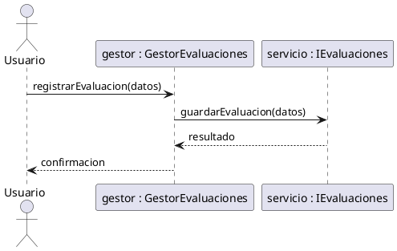
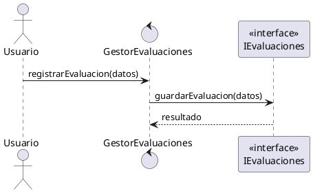
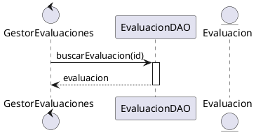
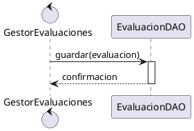

**user**: el texto que va encima de un mensaje sincrono que suele ser
[Timestamp: 2026/09/19 15:14:50]

**ai**: Voy a revisar la nota adjunta para responder con la misma terminología que estás usando.Encima de un **mensaje síncrono** suele escribirse el **nombre del método u operación invocada**, con sus parámetros si corresponde.

Ejemplo: `buscarFactura(numeroFactura)`

También puede incluir el valor de retorno asignado:

`factura := buscarFactura(numeroFactura)`
[Timestamp: 2026/09/19 15:14:50]

**user**: esto representa una entidad ?
[Timestamp: 2026/09/19 15:16:05]

**ai**: No. Representa un **objeto de control o gestor**, indicado por el estereotipo `«gestor»`.

`GestorEvaluaciones` se encarga de coordinar la lógica del caso de uso: recibe solicitudes, aplica reglas y se comunica con entidades o componentes de persistencia.

Una **entidad**, en cambio, representa información del dominio, por ejemplo: `Evaluación`, `Alumno` o `Resultado`, y suele llevar el estereotipo `«entidad»`.
[Timestamp: 2026/09/19 15:16:05]

**user**: en un diagrama de secuencia se modelan tambien las interfaces?
[Timestamp: 2026/09/19 15:26:03]

**ai**: Sí. En un diagrama de secuencia se pueden modelar las **interfaces de usuario** como participantes.

Normalmente se representan con el estereotipo `«interfaz»` o `«boundary»`. Su función es conectar al actor con la lógica del sistema:

**Actor → Interfaz → Gestor/Controlador → Entidad o DAO**

Por ejemplo:

- `Conserje` solicita buscar una factura.
- `«interfaz» PantallaBuscarFactura` recibe los filtros.
- `«gestor» GestorFactura` coordina la operación.
- `FacturaDAO` consulta los datos.

La interfaz muestra pantallas, recibe datos y presenta resultados; **no debería contener la lógica principal del negocio**.
[Timestamp: 2026/09/19 15:26:03]

**user**: me refiero a la interfaz que toma contrato
[Timestamp: 2026/09/19 15:26:24]

**ai**: Sí, aunque normalmente **no se representa el contrato como una pantalla o interfaz de usuario**.

En un diagrama de secuencia, una línea de vida puede estar tipada por una **interfaz UML**:

`servicioEvaluaciones : IEvaluaciones`

Los mensajes enviados a esa línea de vida deben corresponder a las operaciones definidas por el contrato, por ejemplo:

`registrarEvaluacion(datos)`

La clase concreta que implementa la interfaz puede omitirse si interesa mostrar la interacción según el contrato:

`GestorEvaluaciones ── registrarEvaluacion() ──> servicio : IEvaluaciones`

En síntesis:

- **Diagrama de clases/componentes:** muestra quién provee, requiere o implementa la interfaz.
- **Diagrama de secuencia:** muestra cómo se invocan, en el tiempo, las operaciones definidas por esa interfaz.

No es obligatorio incluir la interfaz como participante separado; puede indicarse como el **tipo de la línea de vida**.
[Timestamp: 2026/09/19 15:26:24]

**user**: como es el simbolo de la interfaz en un diagrama de secuencia dame el codigo asi lo pego en plantext
[Timestamp: 2026/09/19 15:27:33]

**ai**: En un diagrama de secuencia no se utiliza normalmente el símbolo circular de interfaz (“lollipop”). Se representa como una **línea de vida tipada por la interfaz**.

Código para pegar en PlantText:

Si querés remarcar explícitamente que es una interfaz:

La forma más UML sería:

`servicio : IEvaluaciones`

donde `servicio` es la instancia y `IEvaluaciones` es la interfaz o contrato que la tipa.
[Timestamp: 2026/09/19 15:27:33]

**user**: como se modela una peticion al DAO desde el gestor
[Timestamp: 2026/09/19 15:52:55]

**ai**: Se modela como un **mensaje síncrono** desde el gestor hacia el DAO, porque el gestor normalmente espera el resultado de la consulta.

Código para PlantText:

Si el DAO guarda información:

La estructura típica es:

`Gestor → DAO: operación(parámetros)`

`DAO ⇢ Gestor: resultado`

- La flecha continua `->` representa la llamada síncrona.
- La flecha discontinua `-->` representa la respuesta.
- El nombre del mensaje debe coincidir con una operación del DAO, como `buscarPorId(id)`, `guardar(evaluacion)`, `actualizar(evaluacion)` o `eliminar(id)`.
- No es necesario agregar la entidad como participante si solo querés mostrar que el DAO la devuelve como resultado.
[Timestamp: 2026/09/19 15:52:55]