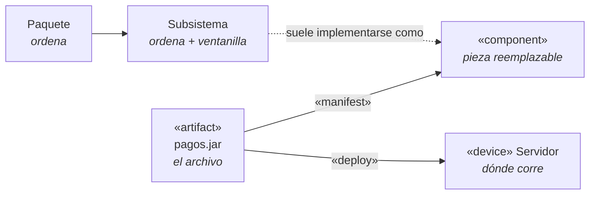
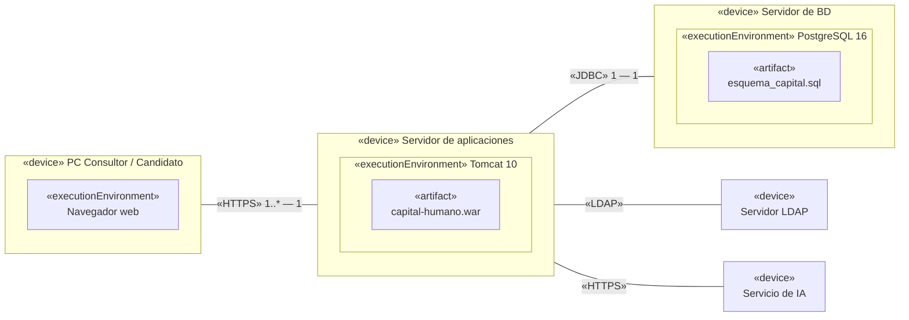

---
tags:
  - diseño-sistemas
  - parcial-2
  - unidad-4
  - uml
  - compactado
unidad: "4.2"
version_completa: "[[U4.2 - Componentes y Despliegue]]"
---
# U4.2 compactada — Componentes, Paquetes y Despliegue

Versión completa (con todos los ejemplos) → [[U4.2 - Componentes y Despliegue]] · [[U4 - Índice]]

> [!abstract] La 4.2 en 5 frases
> 1. **Paquete:** agrupa elementos del modelo para **ordenarlo**. No hace nada por sí mismo.
> 2. **Subsistema:** paquete con **ventanilla**. Solo se usa a través de sus **interfaces** y lo de adentro queda oculto.
> 3. **Componente:** pieza **modular, desplegable y reemplazable** que **encapsula** su implementación y se conecta por **interfaces provistas (○) y requeridas (◡)**.
> 4. **Artefacto:** el **archivo real** (`.jar`, `.war`, `.sql`) que **materializa** un componente (`«manifest»`).
> 5. **Nodo:** la **máquina o entorno** donde se instala el artefacto (`«deploy»`). Eso es el **diagrama de despliegue**.

---

## 1. El mapa completo

Del diseño a la máquina, en una línea:

| | Qué es | ¿Existe al ejecutar? | ¿Interfaces? | Dónde se dibuja |
| --- | --- | --- | --- | --- |
| **Paquete** | Agrupación de elementos del modelo | ❌ Es organización | Puede tener adentro, pero no son obligatorias | Paquetes / clases |
| **Subsistema** | Paquete `<<subsystem>>` con comportamiento | ❌ Es diseño | ✅ Son la **única** puerta | Paquetes / clases |
| **Componente** | Pieza de software desplegable y reemplazable | ✅ A través de su artefacto | ✅ Provistas y requeridas | Componentes / despliegue |
| **Artefacto** | Archivo concreto que se instala | ✅ Es el archivo | — | Despliegue |
| **Nodo** | Hardware (`«device»`) o software que aloja (`«executionEnvironment»`) | ✅ Es la máquina | — | Despliegue |

---

## 2. Lo que me confundió (y la respuesta)

| Yo pensaba… | En realidad… |
| --- | --- |
| "Interfaz" = **pantalla** | Interfaz = **contrato**: un conjunto de operaciones (como una `interface` de Java). Las pantallas no aparecen en el diagrama de componentes. |
| Un paquete es una **carpeta de Windows** con archivos | El paquete vive en el **modelo**, no en el disco. La carpeta con `.java` aparece recién en el **modelo de implementación** (`package com.campuscoffee.pedidos`). |
| Un paquete solo tiene **clases** | Puede tener **cualquier elemento**: clases, interfaces, componentes, otros paquetes. |
| Si un paquete tiene una interfaz, es un subsistema | **No.** Lo que define al subsistema es que **solo** se accede por la interfaz. En un paquete común se usa directo cualquier elemento público. |
| Un **elemento** es un conjunto de cosas | Un elemento es **una sola cosa** del modelo (una clase, una interfaz, un componente, un paquete). El conjunto es el paquete. Como el paquete también es un elemento, se pueden anidar. |
| Un componente **es** un `.jar` | El componente **se materializa en** un `.jar` (`«manifest»`), pero no es el archivo. Si cambio de tecnología (`.dll`, Docker) el componente sigue siendo el mismo. |
| Layer va en el diagrama de clases y tier en el de despliegue | Casi. Los dos son **estereotipos de paquete**. Pero en el despliegue no se escribe `<<tier>>`: los tiers aparecen como **nodos**. |
| Si todo corre en 1 PC, no tiene sentido separar en layers | **Sí tiene sentido.** Layer es división **lógica**: permite cambiar una capa sin romper las otras. 3 layers en 1 tier es válido. |
| En la capa de Presentación van las reglas del negocio | No. Presentación = **pantallas** (muestra y captura). Las reglas van en **Lógica de negocios**. |
| El modelo de diseño incluye el código | **No.** Incluye diagramas y elementos (clases, secuencia, estados, paquetes, componentes, despliegue). El código es del **modelo de implementación**. |

---

## 3. Componente

> [!quote] Definición
> Parte **modular, desplegable y reemplazable** de un sistema que **encapsula su implementación** y **expone un conjunto de interfaces**. Es **cohesivo**.

| Característica | Qué significa en criollo |
| --- | --- |
| **Cohesivo** | Todo lo de adentro apunta a **un mismo propósito**. ✅ `Pagos` (todo es de pagar). ❌ `Utilidades` con `EnviarEmail`, `CalcularIVA` y `GenerarPDF`. |
| **Encapsula** | No se ven sus clases: es una **caja negra**. |
| **Expone interfaces** | Contratos: **provista** ○ (lo que ofrece) y **requerida** ◡ (lo que necesita). |
| **Desplegable** | Se instala como unidad, porque se **materializa** en un artefacto **y** es independiente (se conecta solo por interfaces). |
| **Reemplazable** | Otro componente que cumpla el **mismo contrato** lo puede reemplazar sin que el resto se entere. |

![[U4.2 - Notacion componente.png]]

> [!tip] Caja negra
> En el diagrama de componentes, `Pagos` muestra **solo** su lollipop `IPago` y su socket `INotificacion`. Las clases de adentro (`ProcesadorPago`, `AdaptadorMercadoPago`) **no se dibujan**: se ven en el **diagrama de clases**, dentro de `<<subsystem>> Pagos`. Por eso el componente **normalmente no va** en el diagrama de clases.

- Un componente **es un elemento**, así que **puede estar dentro de un paquete**. Es común agrupar componentes por `<<layer>>`, por `<<tier>>` o por área funcional. El paquete solo ordena; los componentes se siguen conectando por sus interfaces.
- **Puerto:** cuadradito en el borde del componente que agrupa interfaces (ejemplo del email en la versión completa).

---

## 4. Paquetes, layers y tiers

**Paquete** = rectángulo con **pestaña** (forma de carpeta). Sirve para agrupar elementos relacionados y **reflejar la arquitectura**. Visibilidad: **pública** (`+`, se usa desde cualquier lado) o **privada** (`-`, solo dentro del paquete).

La etiqueta (estereotipo) dice **con qué criterio** se armó:

| Estereotipo | Pregunta que responde | Ejemplo |
| --- | --- | --- |
| `<<layer>>` | ¿**Qué hace** este código? (división lógica) | Presentación, Lógica de negocios, Acceso a datos |
| `<<tier>>` | ¿**En qué máquina** corre? (división física) | Cliente, Servidor de aplicación, Servidor de BD |
| `<<subsystem>>` | ¿Qué bloque se usa **solo por su interfaz**? | `Pagos` con `IPago` |

**Las 3 layers** (la flecha `→` significa "usa a" y va siempre hacia abajo, sin ciclos):

| Layer | Hace | Ejemplo CampusCoffee |
| --- | --- | --- |
| **Presentación** | Muestra y captura. **No decide nada.** | `PantallaPedido` |
| **Lógica de negocios** | Las **reglas**: calcula, valida y decide | `GestorPedido`, `Pedido` |
| **Acceso a datos** | Lee y escribe en la BD | `PedidoDAO` |

> [!important] Layer ≠ tier
> - Puede haber **3 layers en 1 tier** (todo en una PC).
> - Los **DAO corren en el servidor de aplicación**, no en el de BD. En el tier de BD solo corre el **motor** (PostgreSQL, MongoDB…): no hay clases nuestras.
> - SQL o NoSQL da igual: el tier es **dónde** corre, no **qué tecnología**.
> - Regla rápida: **layer → qué hace** (conviene siempre separar) · **tier → en cuántas máquinas** (depende de la infraestructura).

**El mismo sistema, agrupado por `<<layer>>` y por `<<tier>>`:**

![[U4.2 - Paquetes detalle.png]]

![[U4.2 - Paquetes tiers.png]]

### Subsistema = paquete con ventanilla

> [!quote] Definición
> Un **paquete** (que puede contener clases y otros paquetes) que **ofrece comportamiento** accesible **solo a través de una o más interfaces**. Lo de adentro no es accesible desde afuera.

| Desde afuera **sí** veo | Desde afuera **no** veo |
| --- | --- |
| La interfaz `IPago` | `ProcesadorPago`, `AdaptadorMercadoPago` |
| Su firma: `procesarPago(monto, medio) : boolean` | Que adentro se usa MercadoPago |

> [!example] Por qué existe
> Si `Pedidos` llamara directo a `AdaptadorMercadoPago`, quedaría atado a MercadoPago. Usando solo `IPago`, si se cambia de pasarela el cambio queda **adentro** de `Pagos`. Ejemplo del apunte: `<<subsystem>> Firma digital` con la interfaz `Firma` (acá "Firma" es el **nombre** de la interfaz, no la firma de un método).

> [!note] Paquete → subsistema → componente
> El subsistema se parece mucho al componente (los dos se usan por interfaces y ocultan lo de adentro). La diferencia: el subsistema **organiza el diseño**; el componente es una **pieza que se despliega**. En la práctica, `<<subsystem>> Pagos` termina implementado como el componente `Pagos` en `pagos.jar`.

### Qué es (y qué no es) el modelo de diseño

El modelo de diseño se **estructura jerárquicamente en paquetes y subsistemas** que reflejan la arquitectura. Es el **plano**; la implementación es la **construcción**.

| ✅ Modelo de diseño | ❌ No es modelo de diseño |
| --- | --- |
| Clases de diseño en paquetes `<<layer>>` / `<<tier>>` | Los `.java` (modelo de **implementación**) |
| Secuencias de cada CU (realizaciones) | Los `.jar` / `.war` (**artefactos**) |
| Máquinas de estado | Los scripts SQL |
| Subsistemas e interfaces | Casos de uso y modelo de dominio (**requisitos** y **análisis**) |
| Diagramas de componentes y despliegue | |

Los `.puml` / `.svg` son **representaciones** (vistas) del modelo, no el modelo en sí. En diseño se usan estereotipos de diseño (`<<Pantalla>>`, `<<Gestor>>`, `<<DAO>>`), **no** `boundary` / `control` / `entity` (esos son de análisis).

---

## 5. Cómo organizar componentes

| Buscar **alta cohesión** | Buscar **bajo acoplamiento** |
| --- | --- |
| **Funcional:** hace una sola función (la mejor) | **De contenido:** modifica datos internos de otro (el peor) |
| **De capa:** la capa de arriba usa a la de abajo, no al revés | **De control:** le pasa un *flag* que decide su lógica interna |
| **De comunicación:** todas las operaciones usan los mismos datos | **Externo:** depende de SO, BD o servicios de terceros (aislarlo con DAO o fachada) |

| Principio de empaquetado                        | Idea                                                     |
| ----------------------------------------------- | -------------------------------------------------------- |
| **PER** — Equivalencia reutilización/liberación | Lo que se reutiliza junto se **libera junto**            |
| **PCC** — Cierre común                          | Lo que **cambia junto va junto** (SRP de paquetes)       |
| **PRC** — Reutilización común                   | Lo que **no se usa junto no va junto** (ISP de paquetes) |
|                                                 |                                                          |

---

## 6. Diagrama de despliegue

Muestra **dónde corre cada pieza**: en qué **nodos** se instala cada **artefacto** y cómo se comunican. Es **estructural** (arquitectura física). Sirve para planificar la instalación, comunicar la arquitectura y detectar dependencias.

| Elemento | Notación | Ejemplo |
| --- | --- | --- |
| **Nodo** | Caja 3D `«device»` | PC, servidor, celular, impresora |
| **Entorno de ejecución** | Caja 3D **anidada** `«executionEnvironment»` | JVM, Tomcat, PostgreSQL, navegador |
| **Artefacto** | Rectángulo `«artifact»` | `.jar`, `.war`, `.sql`, `.apk` |
| **Despliegue** | Anidado o flecha `«deploy»` | `.war` dentro de Tomcat |
| **Manifestación** | Flecha `«manifest»` | `pagos.jar` → componente `Pagos` |
| **Comunicación** | Línea continua con **protocolo** y multiplicidad | `«HTTPS»`, `«JDBC»`, `«LDAP»` |

- **Descriptor** (tipos de nodo, el que se usa en el TP) vs. **instancia** (nodos concretos con nombre subrayado).
- **Pasos:** nodos → entornos → artefactos → comunicaciones con protocolo → sistemas externos (revisar contra los CU).

> [!danger] Errores comunes
> Confundirlo con el de componentes · poner **clases** en lugar de artefactos · olvidar **sistemas externos** (LDAP, IA, CV) · detallar la red (routers, IPs).

**Ejemplo: web en 3 capas (TP)**

| | Escritorio (2 capas) | Web (3 capas) |
| --- | --- | --- |
| Lógica corre en | Cada PC | El servidor |
| Actualizar | En **todas** las PCs | **Una vez** |
| Acceso a la BD | Cada cliente | Solo el servidor (BD protegida) |
| Clave en el TP | El candidato **no** puede responder desde su casa | Accede desde cualquier lugar |

> [!info] TP Capit@l Humano
> Nodos: PC del Consultor, navegador del Candidato, servidor de aplicaciones, BD, **LDAP** (CU001), **Sistema de Candidatos y CV** (CU006/007), **Servicio de IA** (CU033), **Impresora** (CU027/028). Abarca **todos** los CU y debe ser coherente con el lenguaje y la BD elegidos.

> [!example]- Ejercicio CampusCoffee (resolución resumida)
> - **Componentes:** `AppMovil` requiere `IPedidos` · `GestionPedidos` provee `IPedidos` y requiere `IPago`, `IMenu`, `ICocina`, `INotificacion`, `IPersistencia` · `Pagos` *(subsistema)* provee `IPago`.
> - **`Pagos` es subsistema** porque expone su **propia interfaz** sin mostrar la integración con MercadoPago.
> - **Despliegue:** `Celular` (`.apk`) —`«HTTPS»`→ `Servidor` / Tomcat 11 (`campuscoffee.war`, con `«manifest»` a los componentes) —`«JDBC»`→ `Servidor de BD` / PostgreSQL 18. Externo: **pasarela de pago** por `«HTTPS»`.

---

## 7. Preguntas tipo parcial

> [!question]- ¿Qué es un componente? Características.
> Parte **modular, desplegable y reemplazable** que **encapsula** su implementación y **expone interfaces** (contratos). Es **cohesivo**.

> [!question]- 📝 ¿Qué es un subsistema? Ejemplifique. (Final 2012)
> Un **paquete** que ofrece comportamiento accesible **solo a través de interfaces**; su contenido queda oculto. Ej.: `<<subsystem>> Firma digital` con `Firma`, o `Pagos` con `IPago`.

> [!question]- V/F: "Si un paquete tiene una interfaz adentro, es un subsistema."
> **Falso.** Un paquete común también puede tener interfaces. En el subsistema la interfaz es el **único** acceso; en un paquete común se usa directo cualquier elemento público.

> [!question]- Desde `Pedidos` quiero llamar a `AdaptadorMercadoPago`, dentro de `<<subsystem>> Pagos`. ¿Puedo?
> **No.** Está oculto. Hay que usar **`IPago`** (`procesarPago(monto, medio)`). Así, si se cambia de pasarela, `Pedidos` no se entera.

> [!question]- Sistema con 3 layers que corre en 1 PC. ¿Cuántos tiers? ¿Sirve separar en layers?
> **1 tier.** Sí sirve: las layers son división **lógica**; permiten cambiar una capa sin romper las otras y dejan listo el sistema para repartirlo en más máquinas.

> [!question]- 📝 Ejemplo de componentes lógicos divididos en tiers. (Final 2012)
> **Navegador** (presentación) —`«HTTPS»`→ **Tomcat** con el `.war` (lógica + DAO) —`«JDBC»`→ **PostgreSQL** (datos).

> [!question]- ¿Un componente es un `.jar`?
> **No.** El `.jar` es el **artefacto** que lo **materializa** (`«manifest»`), y ese artefacto se **despliega** en un nodo (`«deploy»`).

> [!question]- V/F: "En el diagrama de despliegue van las clases dentro de cada nodo."
> **Falso.** Van **artefactos** (`.jar`, `.war`, `.sql`).

> [!question]- `«device»` vs `«executionEnvironment»`
> `«device»` = **hardware**. `«executionEnvironment»` = **software que aloja software** (JVM, Tomcat, PostgreSQL), dibujado **anidado** dentro del device.

> [!question]- Tipos de cohesión y acoplamiento del apunte + PER, PCC, PRC.
> **Cohesión:** funcional, de capa, de comunicación. **Acoplamiento:** de contenido, de control, externo. **PER:** se reutiliza junto → se libera junto. **PCC:** cambia junto → va junto. **PRC:** no se usa junto → no va junto.
