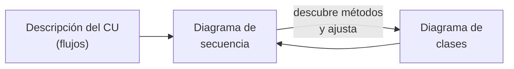
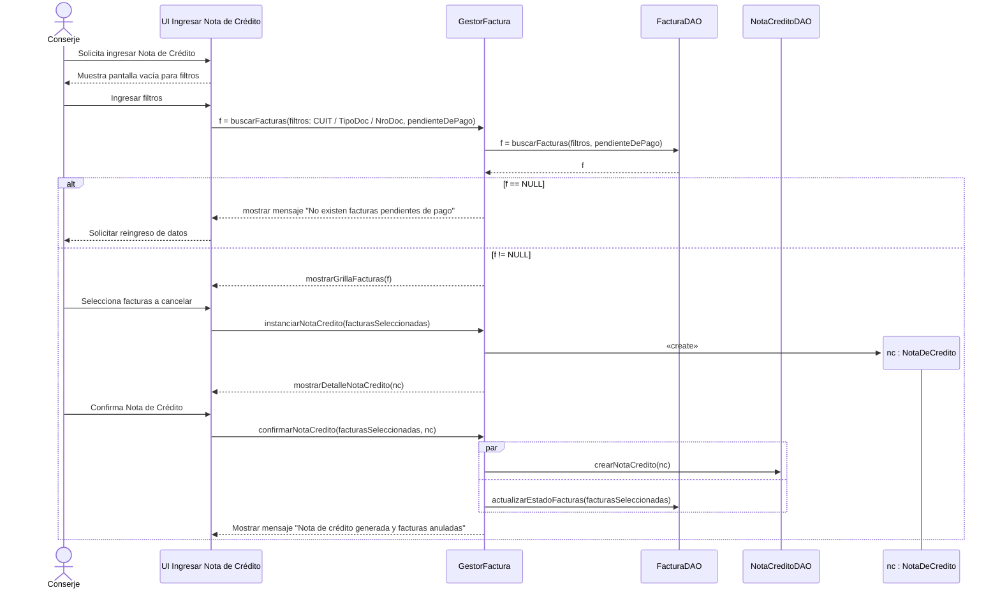

---
tags:
  - diseño-sistemas
  - parcial-2
  - unidad-4
  - uml
unidad: "4 (práctica)"
fuente: "Diagrama de Secuencia y GIT/Clase de práctica 11_09_26 - Diagrama de secuencia.pdf"
estado: en-progreso
---
# U4 — Diagrama de Secuencia

← [[U4.3 - Máquinas de Estado]] · [[U4 - Índice]]

> [!abstract] TL;DR
> - Modela **cómo interactúan los objetos y actores a lo largo del tiempo** para resolver **un caso de uso**: qué **mensajes** se envían y qué **operaciones** se invocan.
> - Es una **línea de tiempo**: el tiempo corre **hacia abajo**.
> - Tiene **5 componentes**: **objetos/actores**, **líneas de vida**, **mensajes**, **barras de activación** y **fragmentos**.
> - **Mensajes:** síncrono, asíncrono, de creación, de destrucción y de respuesta.
> - **Fragmentos:** `alt` (if/else), `opt` (if), `loop` (repetición) y `par` (paralelo).
> - Se arma a partir de la **descripción del caso de uso** y del **diagrama de clases**.

> [!note] Fuente
> No hay presentación teórica de secuencia en `Unidad 4/`. El programa del parcial incluye la **"Clase de práctica 11/09/26"**, que es la fuente de esta nota. Lo agregado por mí va en callouts **`Extra`**.

## Índice
- [[#1. Qué es y para qué sirve]]
- [[#2. Componentes]]
- [[#3. Tipos de mensajes]]
- [[#4. Fragmentos combinados]]
- [[#5. Cómo se vincula con los otros diagramas]]
- [[#6. Ejemplo de la práctica - CU-19 Ingresar Nota de crédito]]
- [[#7. Secuencia vs. colaboración]]
- [[#8. Cómo armarlo paso a paso]]
- [[#9. Preguntas tipo parcial]]

---

## 1. Qué es y para qué sirve

- Representa el **comportamiento** de un sistema.
- Modela la **interacción entre objetos y actores**: identifica los **mensajes** entre ellos y las **operaciones (métodos)** de las clases para **resolver un caso de uso**.
- Da una **línea de tiempo visual** de los eventos.

**¿Para qué se usa?**
- **Mapear el flujo de control** entre objetos.
- Mostrar **cómo interactúan** los objetos a lo largo del tiempo.
- Ayudar a **diseñar, comprender y solucionar problemas** de la arquitectura.
- Entender interacciones **complejas** y hacer más **eficiente** el diseño.
- **Modelar casos de uso:** dar un **desglose paso a paso** de los mensajes que se intercambian durante su ejecución.

> [!tip] Ubicación en UP
> Es la herramienta principal del **diseño de casos de uso**: la **realización de diseño** de un CU. Pertenece a la **vista de interacciones** (dinámica). Ver [[U4.3 - Máquinas de Estado#1. La vista dinámica de un sistema]].

---

## 2. Componentes

| Componente | Qué es | Cómo se dibuja |
| --- | --- | --- |
| **Objetos o actores** | Entidades que participan: usuarios, sistemas u objetos | Rectángulo (`nombre : Clase`) o muñequito arriba |
| **Líneas de vida** | Representan un objeto a lo largo del tiempo | **Línea vertical punteada** bajo el objeto. **Bajar es avanzar en el tiempo.** |
| **Mensajes** | Las interacciones entre líneas de vida. **El orden importa.** | Flechas horizontales |
| **Barras de activación** | El período en que un objeto está **activo** procesando algo | **Rectángulo angosto** sobre la línea de vida |
| **Fragmentos** | Estructuras de control: bucles, condicionales, paralelismo | **Caja** con una etiqueta arriba a la izquierda (`alt`, `loop`…) |

> [!info] Barras de activación
> Cuando un objeto **recibe un mensaje**, empieza su barra de activación, que dura hasta que **completa** la actividad. Si mientras tanto envía un mensaje a otro objeto, la flecha **sale desde esa barra** hacia la línea de vida del receptor.

> [!example] Líneas de vida con actores
> En una tienda online puede haber líneas de vida para el **cliente** (actor), el **carrito de compras** y el **procesador de pagos**.

---

## 3. Tipos de mensajes

| Mensaje | Notación | Significado |
| --- | --- | --- |
| **Síncrono** | Flecha continua con **punta llena** → | **Llamada a un método**: el emisor **espera** a que el receptor termine |
| **Asíncrono** | Flecha continua con **punta abierta** ⇀ | El emisor **no espera**: sigue con su flujo |
| **De creación** | Flecha **punteada** con `«create»` hacia el objeto nuevo | Un objeto **crea** otro: la flecha apunta a la cabecera del objeto recién creado |
| **De destrucción** | **X** al final de la línea de vida | El objeto **deja de existir** |
| **De respuesta** | Flecha **punteada** de vuelta | **Retorno** de información del receptor al emisor |

---

## 4. Fragmentos combinados

| Fragmento | Equivale a | Uso |
| --- | --- | --- |
| **`alt`** (alternativo) | `if / else` | **Dos o más** secuencias alternativas separadas por una línea punteada, cada una con su **guarda** `[condición]`. **Se ejecuta solo una.** |
| **`opt`** (opcional) | `if` sin `else` | Una secuencia que se ejecuta **solo si** se cumple la condición |
| **`loop`** (bucle) | `for` / `while` | Una secuencia que se **repite** |
| **`par`** (paralelo) | Hilos | Operaciones que ocurren **simultáneamente** |

> [!tip] Extra: alt vs. opt
> Si hay un "si no" (dos caminos), es **`alt`**. Si es "si pasa X, además hacer Y" (un camino que puede no ejecutarse), es **`opt`**. Los **flujos alternativos** de un CU suelen terminar en `alt`.

---

## 5. Cómo se vincula con los otros diagramas

- **Con el diagrama de clases:** indica **qué objetos** van a interactuar y los **caminos** para obtener la información (las asociaciones). Cada mensaje síncrono a un objeto debería ser una **operación** de su clase.
- **Con el caso de uso:** el flujo de mensajes **sigue la narración del CU**. Antes de dibujar hay que **revisar el diagrama de casos de uso** y tener una **descripción exhaustiva** del CU (flujo principal y alternativos).

> [!tip] Extra: ida y vuelta
> Al hacer la secuencia **aparecen métodos que faltaban** en el diagrama de clases. Por eso se trabajan juntos y se van ajustando entre sí.

---

## 6. Ejemplo de la práctica - CU-19 Ingresar Nota de crédito

Es un ejemplo del **TP 2025** que mostró la cátedra.

**Clases participantes** (del diagrama de clases del ejemplo): `UI – Ingresar Nota de Crédito`, `GestorFactura`, `FacturaDAO`, `NotaDeCreditoDAO` y `nc : NotaDeCredito`.

**Narración resumida del CU:** el conserje busca las facturas pendientes de una persona (por CUIT o por tipo y número de documento). El sistema lista las facturas, el conserje selecciona las que quiere cancelar y el sistema arma la nota de crédito. El conserje la confirma, el sistema la guarda y actualiza el estado de las facturas.

**Qué mirar en el ejemplo:**
- **`alt [f == NULL]`:** modela el **flujo alternativo 4.A** del CU (no hay facturas pendientes).
- **`«create»`:** el gestor **crea** el objeto `nc : NotaDeCredito`.
- **`par`:** guardar la nota de crédito y actualizar las facturas se modelan **en paralelo**.
- **Capas:** `UI → Gestor → DAO`. La UI **nunca** habla directo con el DAO.

> [!warning] Ojo: inconsistencia con la práctica de DAO/DTO
> En el diagrama de clases de este ejemplo (TP 2025), `FacturaDAO.generarFactura(...)` **devuelve un `FacturaDTO`**. La práctica de DAO/DTO de 2026 marca justamente eso como **error** ("el DAO no debe devolver un DTO"). Ver [[U5 - Práctica DAO y DTO#5. Error típico - el DAO devuelve un DTO]]. Para el TP y el parcial, seguí el criterio de 2026: **el DAO devuelve entidades**.

> [!info] Segundo ejemplo de la práctica
> **CU-03 Buscar Responsable de Pago:** búsqueda por razón social o CUIT. Si no hay concordancias, se ejecuta el CU12 *Dar alta de Responsable de pago* (extensión). Si se selecciona uno, se ejecuta el CU13 *Modificar Responsable de Pago* (inclusión). Sirve para ver cómo las **inclusiones y extensiones** del CU aparecen como llamadas a otros flujos en la secuencia.

---

## 7. Secuencia vs. colaboración

> [!tip] Extra: preguntado en el Final 03/2012 ("diferencias y coincidencias, con un ejemplo")
> | | Diagrama de **secuencia** | Diagrama de **colaboración** (comunicación) |
> | --- | --- | --- |
> | **Énfasis** | El **orden temporal** de los mensajes | La **estructura**: qué objetos están **vinculados** |
> | **Tiempo** | Eje **vertical** explícito | Se indica con **números de secuencia** (1, 2, 2.1…) |
> | **Disposición** | Objetos en una fila arriba, con líneas de vida | Objetos libres en el plano, unidos por **enlaces** |
> | **Fortaleza** | Ver flujos largos, fragmentos (`alt`, `loop`) y activaciones | Ver de un vistazo **quién colabora con quién** |
>
> **Coincidencias:** los dos son **diagramas de interacción**, muestran los **mismos objetos y mensajes**, sirven para **realizar casos de uso** y son **semánticamente equivalentes** (uno se puede convertir en el otro).
>
> **Ejemplo:** la realización de análisis de [[U4.1 - Modelos de UP y Diagrama de Clases#8. Identificación de clases de diseño|U4.1]] (*Usuario → Interfaz clientes → Controlador clientes → Cliente*, con mensajes numerados 1 a 4) es un **diagrama de colaboración**. Dibujada en columnas con el tiempo hacia abajo, sería uno de secuencia.

---

## 8. Cómo armarlo paso a paso

> [!tip] Extra: receta para el TP y para ejercicios del parcial
> 1. **Leer el CU completo:** flujo principal, alternativos, inclusiones y extensiones.
> 2. **Ubicar las líneas de vida**, de izquierda a derecha: **Actor → UI (pantalla) → Gestor → DAO / entidades**.
> 3. **Seguir el flujo principal** paso a paso: cada paso del CU es uno o más mensajes.
> 4. **Agregar los flujos alternativos** con `alt` (o `opt`). Agregar los **recorridos de listas** con `loop`.
> 5. Marcar las **creaciones** (`«create»`) y los **retornos** de información importantes.
> 6. **Verificar contra el diagrama de clases:** cada mensaje debe ser un método que exista. Si falta, agregarlo.
> 7. **Revisar las capas:** la UI no llama al DAO, y el DAO no conoce a la UI.

> [!important] Etapas del TP 2026 que usan esto
> - **Etapa 5:** secuencias de **CU025** *Evaluar a Candidatos*, **CU020** *Gestionar Preguntas* y **CU023** *Dar de alta pregunta*.
> - **Etapa 6:** secuencias de **CU026** *Completar cuestionario* y **CU028** *Emitir orden de mérito*, más el **diagrama de despliegue** ([[U4.2 - Componentes y Despliegue]]).

---

## 9. Preguntas tipo parcial

> [!question]- ¿Qué modela un diagrama de secuencia?
> La **interacción entre objetos y actores a lo largo del tiempo** para resolver un caso de uso: los **mensajes** que intercambian y las **operaciones** que invocan.

> [!question]- Nombre los 5 componentes de un diagrama de secuencia.
> Objetos o actores, líneas de vida, mensajes, barras de activación y fragmentos.

> [!question]- Diferencie mensaje síncrono de asíncrono.
> **Síncrono:** el emisor **espera** a que el receptor termine (llamada a un método). **Asíncrono:** el emisor **sigue** sin esperar.

> [!question]- ¿Qué fragmento usaría para modelar "si no hay resultados, mostrar un mensaje; si hay, mostrar la grilla"?
> **`alt`**, con dos operandos: `[sin resultados]` y `[con resultados]`.

> [!question]- V/F: "El fragmento opt contiene dos o más secuencias alternativas de las que se ejecuta una."
> **Falso.** Eso es **`alt`**. `opt` tiene **una sola** secuencia que se ejecuta o no.

> [!question]- ¿Cómo se representa la creación y la destrucción de un objeto?
> **Creación:** flecha punteada `«create»` que apunta a la **cabecera** del objeto nuevo. **Destrucción:** una **X** al final de su línea de vida.

> [!question]- ¿Qué información se necesita antes de hacer un diagrama de secuencia?
> La **descripción completa del caso de uso** (para el flujo de mensajes) y el **diagrama de clases** (para saber qué objetos y métodos existen).

> [!question]- 📝 Indique diferencias y coincidencias entre secuencia y colaboración. (Final 2012)
> Ver la [[#7. Secuencia vs. colaboración|tabla]]. Secuencia enfatiza el **tiempo**, colaboración los **vínculos**. Los dos son diagramas de interacción equivalentes.
