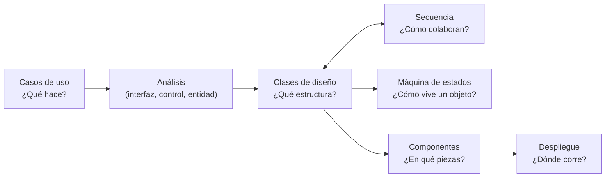

---
tags:
  - diseño-sistemas
  - parcial-2
  - unidad-4
  - indice
---
# Unidad 4 — Modelo de Diseño y Diagramas UML

← Volver a [[00 - Índice Parcial 2]]

> [!info] Programa oficial de la Unidad 4 (`Contenido Parcial 2.png`)
> **Temas:** Máquina de estados · Diagrama de componentes y despliegue · Diagrama de secuencias.
> **Material:** presentaciones "Máquina de Estados" y "Diagrama de Componentes y de Despliegue", presentaciones de práctica "Clases de práctica 11/09/26", libro *El lenguaje unificado de modelado* (Booch, Rumbaugh y Jacobson), caps. 19, 22, 25, 27 y 31, y Pressman, *Ingeniería de software*, 9ª ed., cap. 11.

| Subtema | Nota | Fuente | Estado |
| --- | --- | --- | --- |
| 4.1 Modelos de UP y diagrama de clases de diseño | [[U4.1 - Modelos de UP y Diagrama de Clases]] | `Unidad 4/Diseño de Sistemas - Unidad 4.1.pdf` | ✅ resumido |
| 4.2 Componentes y despliegue | [[U4.2 - Componentes y Despliegue]] | `Unidad 4.2 - Componentes y Despliegue.pdf` + práctica 16/10/26 | ✅ resumido |
| 4.3 Máquinas de estado | [[U4.3 - Máquinas de Estado]] | `Unidad 4.3 - Maquinas de estado.pdf` | ✅ resumido |
| Diagrama de secuencia (práctica) | [[U4 - Diagrama de Secuencia]] | `Diagrama de Secuencia y GIT/Clase de práctica 11_09_26 - Diagrama de secuencia.pdf` | ✅ resumido |

> [!note] Sobre la 4.1
> La 4.1 no figura como tema en el programa del parcial 2 (y el modelo de diseño ya entró en el parcial 1). Igual la resumí: es la **base** de todo lo demás y en los exámenes viejos aparecen **muchas preguntas** de relaciones, estereotipos y análisis vs. diseño.

## Cómo se conectan los diagramas

| Diagrama | Responde a… | Vista | Tipo UML |
| --- | --- | --- | --- |
| Casos de uso | ¿Qué hace el sistema? | Funcional | Comportamiento |
| Clases | ¿Qué estructura tiene? | Lógica | Estructural |
| Secuencia | ¿Cómo colaboran los objetos? | Dinámica (interacción) | Comportamiento |
| Máquina de estados | ¿Cómo evoluciona **un** objeto? | Dinámica (estados) | Comportamiento |
| Componentes | ¿En qué piezas se organiza? | Implementación | Estructural |
| Despliegue | ¿Dónde corre cada pieza? | Física | Estructural |

---

## ⚡ Repaso rápido

**Modelos (4.1)**
- Análisis = **conceptual**, genérico, **3 estereotipos** (interfaz, control, entidad), puede no mantenerse.
- Diseño = **físico**, no genérico, **cualquier número** de estereotipos, **debe mantenerse**.
- Relaciones: asociación, agregación (◇, débil), composición (◆, fuerte), generalización (▷), dependencia (⇢), realización (⇢▷).

**Componentes y despliegue (4.2)**
- Componente = modular, desplegable y reemplazable, con interfaces **provistas** (○) y **requeridas** (◡).
- Subsistema = paquete **con comportamiento accesible solo por interfaces**.
- Despliegue = `«device»` ⊃ `«executionEnvironment»` ⊃ `«artifact»`, más caminos con **protocolo**. **Sin clases, sin routers.**

**Máquinas de estado (4.3)**
- `evento [guarda] / acción`. **Siempre** hay estado inicial; finales, **0 o más**.
- Orden de acciones: **exit (origen) → acción de la transición → entry (destino)**.
- Diferido (encolar) · Super-estado · Historia **(H)** · Regiones **concurrentes**.

**Secuencia (práctica)**
- Líneas de vida, mensajes (síncrono, asíncrono, `«create»`, X, respuesta), activaciones.
- Fragmentos: **`alt`** (if/else) · **`opt`** (if) · **`loop`** · **`par`**.
- Capas: **Actor → UI → Gestor → DAO**.

---

## Práctica
- Las preguntas al final de cada nota (las marcadas con 📝 salieron en exámenes anteriores).
- [[Banco de preguntas - Exámenes anteriores#Unidad 4 — Modelo de Diseño y Diagramas UML]]
