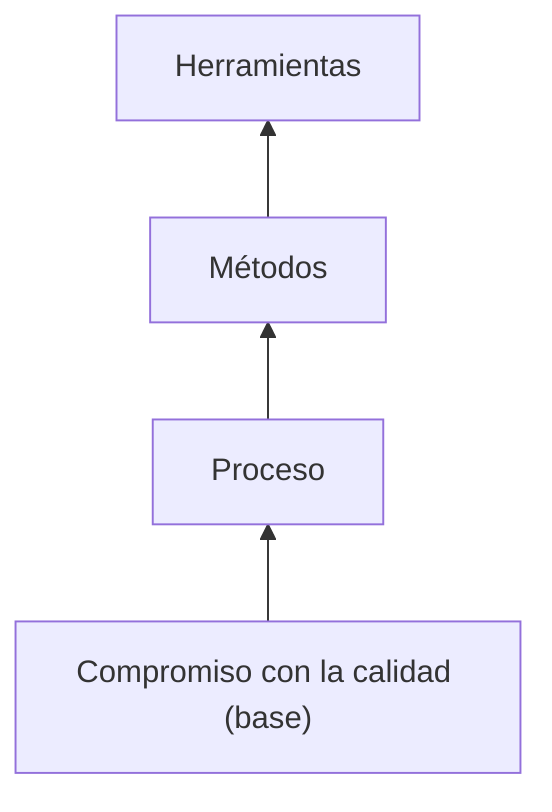
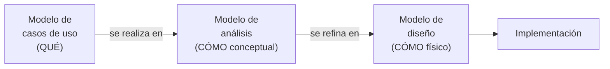
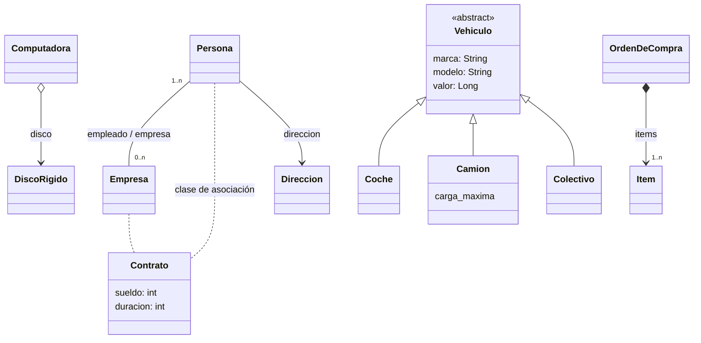

---
tags:
  - diseño-sistemas
  - parcial-2
  - unidad-4
  - uml
unidad: "4.1"
fuente: "Parcial 2 - Contenido/Unidad 4/Diseño de Sistemas - Unidad 4.1.pdf"
estado: en-progreso
---
# U4.1 — Modelos de UP(Unified Process) y Diagrama de Clases de Diseño

← [[U4 - Índice]] · Siguiente → [[U4.2 - Componentes y Despliegue]]

> [!abstract] TL;DR
> - Un **modelo** es una **simplificación de la realidad** para entender mejor el sistema.
> - En UP se encadenan tres modelos: **Casos de uso** (qué hace, visto desde el cliente) → **Análisis** (cómo, conceptual: interfaz, control y entidad) → **Diseño** (cómo, físico: listo para implementar).
> - El **modelo de diseño** es **físico, formal, con cualquier cantidad de estereotipos**, y **se mantiene durante todo el ciclo de vida**.
> - En el diagrama de clases de diseño hay **asociaciones** (con roles, multiplicidad y navegabilidad), **clases de asociación**, **agregación y composición**, **generalización**, **dependencia**, **clases abstractas** e **interfaces**.
> - Las clases de diseño se obtienen **trazando** (`<<traza>>`) las clases de análisis.

> [!note] Convención
> El contenido principal sale del apunte. Lo agregado por mí va en callouts **`Extra`**. Esta unidad tiene **muchas preguntas en exámenes anteriores**: están marcadas con 📝.

## Índice
- [[#1. Ingeniería de software y modelos]]
- [[#2. Modelo de casos de uso]]
- [[#3. Modelo de análisis]]
- [[#4. Modelo de diseño]]
- [[#5. Comparaciones (muy preguntadas)]]
- [[#6. Clases de diseño y relaciones]]
- [[#7. Clases abstractas e interfaces]]
- [[#8. Identificación de clases de diseño]]
- [[#9. Preguntas tipo parcial]]

---

## 1. Ingeniería de software y modelos

La ingeniería de software es una **tecnología en capas**. De abajo hacia arriba:



**Modelo:**
- Es una **simplificación de la realidad** creada para **comprender mejor** el sistema que se construye.
- Permite **describir, analizar, diseñar y documentar** el sistema a lo largo de todo su ciclo de vida.



---

## 2. Modelo de casos de uso

- Sirve para **capturar los requerimientos funcionales**, desde el **punto de vista del usuario**.
- Los casos de uso son las **funciones que el sistema brinda a sus usuarios**. Cada usuario usa uno o más casos de uso para hacer su trabajo.
![[Pasted image 20261102235209.png]]

---

## 3. Modelo de análisis

- Es una **especificación detallada de los requerimientos** y una **primera aproximación al diseño**.
- Analiza el sistema (La suma de todos los CUS) desde **tres perspectivas**, una por estereotipo:

| Perspectiva | Estereotipo | Símbolo | Ejemplo |
| --- | --- | --- | --- |
| La **interfaz** entre el sistema y sus actores | **Interfaz** (*boundary*) | círculo con una línea vertical a la izquierda | `Interfaz creación usuarios` |
| La **información** que usa el sistema | **Entidad** (*entity*) | círculo con una línea abajo | `Usuario`, `Tarjeta de crédito` |
| La **lógica de control** | **Control** (*control*) | círculo con una flecha arriba | `Controlador de usuarios` |

- Para cada caso de uso se hace una **realización**, que muestra **CÓMO** se lleva a cabo su funcionalidad. La realización está ligada al caso de uso con `<<realiza>>`, y en ella **participan** (`<<participa>>`) las clases de interfaz, control y entidad.
- Las **responsabilidades** de un objeto son las **acciones** que puede realizar y el **conocimiento** que mantiene y provee a otros objetos.

> [!tip] Extra: qué tiene cada estereotipo (preguntado en P1 2011)
> - **Interfaz:** atributos de lo que se muestra o ingresa (campos de una pantalla). Métodos para mostrar y capturar datos.
> - **Control:** pocos atributos o ninguno, generalmente transitorios. Métodos que **coordinan** la secuencia del caso de uso.
> - **Entidad:** atributos **persistentes** (los datos del negocio). Métodos para acceder y modificar esos datos: crear, consultar, actualizar.
#### Los diagramas del modelo de Analisis
![[Pasted image 20261102235311.png]]

![[Pasted image 20261102235332.png]]

Es el "COMO" de un CUs
![[Pasted image 20261102234440.png]]
---

## 4. Modelo de diseño

- Define la **forma y la arquitectura** del sistema.
- Convierte la visión **abstracta** del modelo de análisis en una visión **concreta** de los componentes.

**Objetivos** (según el apunte):
1. Comprender en profundidad los **requisitos no funcionales** y las restricciones (lenguaje, BD, sistema operativo, concurrencia, distribución…).
2. Generar el **punto de partida** de la implementación.
3. **Descomponer** la implementación en partes más manejables.
4. Crear una **abstracción de la implementación** del sistema.

> [!tip] 📝 Extra: composición y actividades del modelo de diseño (Final 2012, P1 2017)
> El apunte no lo detalla, pero se preguntó varias veces. Según UP (Jacobson, Booch y Rumbaugh):
>
> **Composición:** subsistemas de diseño, clases de diseño, interfaces, **realizaciones de casos de uso de diseño** (diagramas de clases e interacción) y la **vista de arquitectura** (incluida la de despliegue).
>
> **Actividades:**
> 1. **Diseño de la arquitectura**: nodos, subsistemas, mecanismos y clases significativas. Ver [[U5.5 - Arquitectura#Diseñar la arquitectura - actividades]].
> 2. **Diseño de los casos de uso**: realización de diseño con diagramas de secuencia. Ver [[U4 - Diagrama de Secuencia]].
> 3. **Diseño de las clases**: atributos, operaciones, relaciones y estados. Ver [[U4.3 - Máquinas de Estado]].
> 4. **Diseño de los subsistemas**: interfaces y contenido. Ver [[U4.2 - Componentes y Despliegue#Subsistema]].

![[Pasted image 20261102235418.png]]

---

## 5. Comparaciones (muy preguntadas)

### Casos de uso vs. análisis

| Modelo de casos de uso | Modelo de análisis |
| --- | --- |
| En el **lenguaje del cliente** | En el **lenguaje de los desarrolladores** |
| **Vista externa** del sistema | **Vista interna** del sistema |
| Estructurado en **casos de uso** | Estructurado en **clases estereotipadas** (clases de análisis) |
| **"Contrato"** entre cliente y desarrolladores sobre qué debe y qué no debe hacer el sistema | Lo usan los desarrolladores para entender **cómo diseñar e implementar** |
| **Puede tener** redundancias e inconsistencias | **No debería tener** redundancias ni inconsistencias |
| **Captura** la funcionalidad | **Define cómo realizar** la funcionalidad (primera aproximación al diseño) |
| Define **casos de uso** | Define **realizaciones** de casos de uso |

### Análisis vs. diseño (P1 2017 y parcial 2026)

| Modelo de análisis | Modelo de diseño |
| --- | --- |
| Modelo **conceptual** | Modelo **físico** |
| **Genérico** (sirve para varios diseños) | **No genérico** (específico de la implementación) |
| **3 estereotipos conceptuales:** interfaz, control y entidad | **Cualquier número** de estereotipos |
| **Menos formal** | **Más formal** |
| **Menos capas** | **Más capas** |
| Un **bosquejo** del sistema | Un **manifiesto** del sistema |
| Surge de **reuniones y talleres** | Surge de **"programación visual"**, en ingeniería de ida y vuelta con la implementación |
| **Puede no mantenerse** durante todo el ciclo de vida | **Debe mantenerse** durante todo el ciclo de vida |

> [!warning] Trampa de los ejemplos de parcial 2026
> *"El modelo de diseño tiene tres estereotipos conceptuales: interfaz, control y entidad"* es **FALSO**: eso es el **análisis**.
> *"Se crea principalmente como resultado de reuniones y talleres"* es **FALSO** para diseño: eso también es el análisis.
> **Verdaderas:** *"es un modelo físico"* y *"debe mantenerse durante todo el ciclo de vida"*.

---

## 6. Clases de diseño y relaciones

**Clase de diseño:** nombre, **atributos** (con su tipo: `atributo1 : Integer`) y **operaciones** (con parámetros y tipo de retorno: `operacion1(argumento : Boolean) : Long`).

### Tipos de relaciones (P2 2011, Finales 2012)

| Relación                 | Notación                                | Significado                                                                                 | Ejemplo del apunte                             |
| ------------------------ | --------------------------------------- | ------------------------------------------------------------------------------------------- | ---------------------------------------------- |
| **Asociación**           | Línea continua                          | Conexión estructural: los objetos de una clase **se vinculan** con los de otra              | `Persona` — `Empresa`                          |
| **Asociación navegable** | Línea con **flecha**                    | Solo se puede navegar en un sentido                                                         | `Persona` → `Direccion` (+direccion)           |
| **Agregación**           | Rombo **vacío** del lado del todo       | Relación **todo-parte débil**: la parte **puede existir sin el todo**. Aporta **semantica** | `Computadora` ◇— `Disco rígido`                |
| **Composición**          | Rombo **lleno**                         | Relación **todo-parte fuerte**: la parte **nace y muere con el todo**                       | `Orden de compra` ◆— `Item` (1..n)             |
| **Generalización**       | Flecha con **triángulo vacío**          | Relación **"es un"** (herencia)                                                             | `Vehiculo` ← `Coche`, `Camión`, `Colectivo`    |
| **Dependencia**          | Flecha **punteada**                     | **"Usa"** temporalmente: un cambio en el proveedor puede afectar al cliente                 | `Cliente` ⇢ `Figura` (la recibe por parámetro) |
| **Realización**          | Flecha **punteada** con triángulo vacío | Una clase **implementa** una interfaz                                                       | `AutenticadorLDAP` ⇢▷ `ServicioAutenticacion`  |


> Mermaid no tiene notación nativa para la clase de asociación: en UML, `Contrato` se cuelga con una línea punteada **del medio de la asociación** Persona—Empresa.

### Características de las asociaciones (Final 2012)

| Característica | Qué es | Ejemplo |
| --- | --- | --- |
| **Nombre** | Describe la relación | "trabaja en" |
| **Roles** | El papel de cada extremo | `+empleado`, `+empresa` |
| **Multiplicidad** | Cuántos objetos participan | `1..n` personas, `0..n` empresas |
| **Navegabilidad** | En qué sentido se puede recorrer | `Persona → Direccion` |
| *Extra:* **Agregación / composición** | Si es todo-parte | ◇ / ◆ |

### Clase de asociación (Final 07/2012)

> [!example] `Contrato` entre `Persona` y `Empresa`
> Cuando la **relación misma tiene atributos**, se modela una **clase de asociación** unida con línea punteada a la asociación.
> El `sueldo` y la `duracion` no son de la persona ni de la empresa: son **del vínculo**. Una persona tiene un sueldo distinto en cada empresa.
>
> *Extra:* hay **una instancia de la clase de asociación por cada par** de objetos vinculados. Al implementarla suele convertirse en una clase intermedia común, con dos asociaciones.

> [!tip] Extra: agregación vs. composición en una frase
> **Agregación:** si tiro la computadora, el disco rígido lo puedo usar en otra. **Composición:** si borro la orden de compra, sus ítems no tienen sentido solos.

---

## 7. Clases abstractas e interfaces

### Clase abstracta + dependencia
- Una **clase abstracta** (nombre en *cursiva*) **no se puede instanciar**. Define operaciones **abstractas** que las subclases implementan.
- En el ejemplo, `Cliente` **depende** de `Figura` (la recibe por parámetro) y usa **polimorfismo**: no sabe si es un `Rectangulo` o un `Circulo`.

```java
abstract class Figura { public abstract void dibujar(); }
class Rectangulo extends Figura { public void dibujar() { System.out.println("Dibujando un rectángulo."); } }
class Circulo extends Figura { public void dibujar() { System.out.println("Dibujando un círculo."); } }

class Cliente {
    public void mostrar(Figura fig) { fig.dibujar(); }   // polimorfismo en acción
}
```

### Interfaz
- Define un **contrato** (operaciones sin implementación). Las clases la **realizan**.
- En UML se representa con el estereotipo `<<interface>>` o con un círculo (notación *lollipop*).

```java
public interface ServicioAutenticacion {
    boolean autenticar(String usuario, String contraseña);
}
public class AutenticadorLDAP implements ServicioAutenticacion {
    public boolean autenticar(String usuario, String contraseña) { /* consulta LDAP */ }
}
// Cliente
ServicioAutenticacion servicio = new AutenticadorLDAP();   // depende de la interfaz
```

> [!tip] Extra: abstracta vs. interfaz
> | | Clase abstracta | Interfaz |
> | --- | --- | --- |
> | ¿Tiene atributos o código? | Sí, puede tener | No (solo el contrato) |
> | Herencia | Una sola (en Java) | Una clase puede implementar varias |
> | Relación | "**es un**" | "**puede hacer**" |
>
> Esto es la base de [[U5.4 - SOLID#D — DIP Inversión de Dependencias|DIP]] y del [[U5 - Práctica DAO y DTO#3. DAO|DAO como interfaz]].

---

## 8. Identificación de clases de diseño

Se parte de la **realización del caso de uso en análisis**. Ejemplo: *Usuario → Interfaz clientes → Controlador clientes → Cliente*, con los mensajes "1: ingreso de datos", "2: crear nuevo cliente", "3: crear cliente (datos)", "4: crear (datos)".

Cada clase de análisis se **traza** (`<<traza>>`) hacia una o más clases de diseño:

| Clase de análisis | Estereotipo | Clase(s) de diseño | Comentario |
| --- | --- | --- | --- |
| `Interfaz clientes` | Interfaz | `<<Web Html Form>> PaginaCliente` | La interfaz se vuelve una pantalla concreta |
| `Controlador clientes` | Control | `HandlerCliente`, `EventoCliente` (paquete **Web**) y `ComandoCliente` (paquete **Middleware**) | **Un control de análisis puede dar varias clases de diseño**, en distintas capas |
| `Controlador Cliente` | Control | `<<Gestor>> Gestor Cliente` con `guardarCliente()`, `buscarCliente()`, `borrarCliente()` | Es el patrón que usan en el TP: **los controles se vuelven Gestores** |
| `Cliente` | Entidad | `Cliente` con `dni: int`, `apellido: string`, `nombres: string` | La entidad se vuelve una clase con atributos tipados y privados |

> [!example] Aplicado a tu TP
> Así nacen las clases del TP: `Interfaz` → pantallas, `Control` → **Gestores** (`GestorCandidatos`, `GestorCuestionario`), `Entidad` → clases del dominio (`Candidato`, `Cuestionario`), que después se persisten con **DAO**. Ver [[U5 - Práctica DAO y DTO#4. Cómo se combinan DAO, DTO y entidad]].

---

## 9. Preguntas tipo parcial

> [!question]- 📝 ¿Cuántos estereotipos existen en el modelo de diseño? Fundamente. (P2 2011)
> **Cualquier número.** A diferencia del modelo de análisis, que tiene **3 estereotipos conceptuales** (interfaz, control y entidad), el modelo de diseño es **físico** y **no genérico**: usa los estereotipos que necesite la tecnología concreta (`<<Gestor>>`, `<<Web Html Form>>`, `<<DAO>>`, `<<DTO>>`, `<<interface>>`…).

> [!question]- 📝 Compare el modelo de análisis con el de diseño. (P1 2017)
> Conceptual vs. físico, genérico vs. no genérico, 3 estereotipos vs. cualquier número, menos vs. más formal, menos vs. más capas, bosquejo vs. manifiesto, reuniones y talleres vs. programación visual, puede no mantenerse vs. debe mantenerse. Ver [[#Análisis vs. diseño (P1 2017 y parcial 2026)]].

> [!question]- Múltiple opción (parcial 2026): sobre el modelo de diseño, ¿cuáles son verdaderas? (a) tiene 3 estereotipos conceptuales (b) se crea en reuniones y talleres (c) es un modelo físico (d) debe mantenerse todo el ciclo de vida
> **(c) y (d).** (a) y (b) describen el modelo de **análisis**.

> [!question]- 📝 Describa todas las relaciones entre clases y sus características. (P2 2011, Finales 2012)
> Asociación (con nombre, roles, multiplicidad y navegabilidad), agregación (todo-parte débil), composición (todo-parte fuerte), generalización ("es un"), dependencia ("usa") y realización (implementa una interfaz). Ver la [[#Tipos de relaciones (P2 2011, Finales 2012)|tabla]].

> [!question]- 📝 ¿Qué es una clase de asociación? Ejemplifique. (Final 07/2012)
> Una clase que modela **atributos de la relación misma**. Ejemplo: `Contrato` (sueldo, duración) entre `Persona` y `Empresa`.

> [!question]- 📝 ¿Qué tipo de métodos se esperan en una clase entidad? ¿Y atributos en una clase de control? (P1 2011)
> **Entidad:** métodos para crear, consultar y modificar sus datos persistentes. **Control:** pocos atributos o ninguno, y transitorios; su función es coordinar.

> [!question]- V/F: "En la composición, la parte puede existir independientemente del todo."
> **Falso.** Eso es la **agregación**. En la composición la parte nace y muere con el todo.

> [!question]- ¿Qué significa la relación `<<traza>>` entre una clase de análisis y una de diseño?
> Indica que la clase de diseño **proviene** (se derivó) de esa clase de análisis. Permite la **trazabilidad** entre modelos. Una clase de análisis puede trazarse a varias de diseño.
