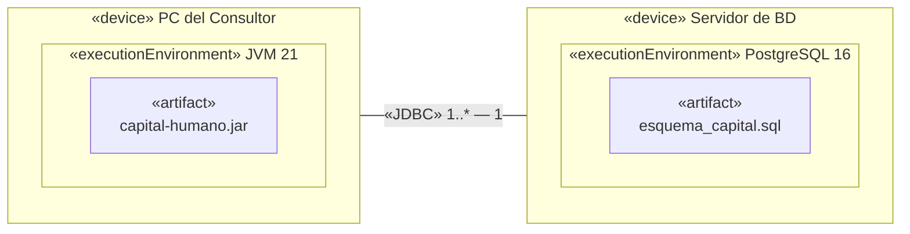
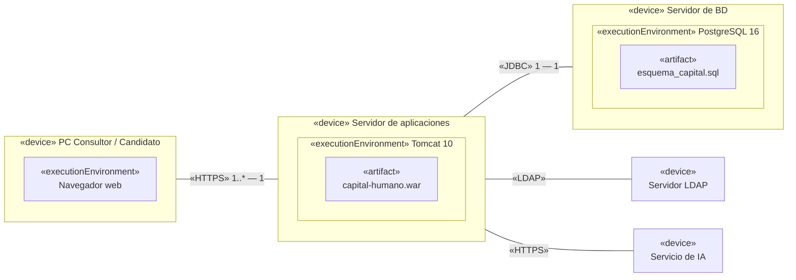

---
tags:
  - diseño-sistemas
  - parcial-2
  - unidad-4
  - uml
unidad: "4.2"
fuente:
  - "Parcial 2 - Contenido/Unidad 4/Diseño de Sistemas - Unidad 4.2 - Componentes y Despliegue.pdf"
  - "Diagrama de Despliegue/Clase de Practica 16-10-26 - Diagrama de Despliegue.pdf"
estado: en-progreso
---
# U4.2 — Diagrama de Componentes y de Despliegue

← [[U4.1 - Modelos de UP y Diagrama de Clases]] · [[U4 - Índice]] · Siguiente → [[U4.3 - Máquinas de Estado]]
Versión compactada → [[U4.2 - Componentes y Despliegue (compactado)]]

> [!abstract] TL;DR
> - **Componente:** parte **modular, desplegable y reemplazable** que **encapsula** su implementación y **expone interfaces** (provistas y requeridas).
> - **Paquete:** agrupa elementos relacionados. Refleja la arquitectura en **capas lógicas (layers)**, **físicas (tiers)** o **subsistemas**.
> - **Subsistema:** un paquete que además **exhibe comportamiento a través de interfaces** y oculta su contenido.
> - Los componentes se organizan con **alta cohesión** (funcional, de capa, de comunicación), **bajo acoplamiento** y los principios **PER, PCC y PRC**.
> - **Despliegue:** muestra **dónde corre cada pieza**: **nodos** (`«device»`, `«executionEnvironment»`), **artefactos** (`.jar`, `.war`, `.sql`) y **caminos de comunicación** con su protocolo.

> [!note] Fuentes
> Teoría de la 4.2 más la **clase práctica del 16/10/26** (despliegue aplicado al TP Capit@l Humano). Lo agregado por mí va en callouts **`Extra`**.

## Índice
- [[#1. Dónde encaja cada diagrama]]
- [[#2. Componentes]]
- [[#3. Paquetes de diseño]]
- [[#Subsistema]]
- [[#Ejemplo: el modelo de diseño organizado en paquetes]]
- [[#4. Diagrama de componentes]]
- [[#5. Cómo organizar componentes - cohesión, acoplamiento y principios]]
- [[#6. Diagrama de despliegue]]
- [[#7. Ejemplos de la práctica - 2 capas vs. 3 capas]]
- [[#8. Aplicación al TP Capit@l Humano]]
- [[#9. Ejercicio CampusCoffee]]
- [[#10. Preguntas tipo parcial]]

---

## 1. Dónde encaja cada diagrama

Tabla de la clase práctica:

| Diagrama | Responde a… | Vista |
| --- | --- | --- |
| Casos de uso | ¿Qué hace el sistema? | Funcional |
| Clases / DER | ¿Qué estructura tiene? | Lógica |
| Secuencia | ¿Cómo colaboran los objetos? | Dinámica |
| **Componentes** | **¿En qué piezas se organiza el software?** | **Implementación** |
| **Despliegue** | **¿Dónde corre cada pieza?** | **Física** |

---

## 2. Componentes

> [!quote] Definición
> Un **componente** es una parte **modular, desplegable y reemplazable** de un sistema que **encapsula la implementación** y **expone un conjunto de interfaces**.
> - Es **una parte** de un sistema.
> - Es **cohesivo**: representa un bloque significativo de comportamiento o de estructura de un sistema mayor.
> Cohesivo : que todo lo que hay dentro del componente apunta a un mismo proposito

**Notación:**

| Elemento | Símbolo | Significado |
| --- | --- | --- |
| Componente | Rectángulo con el ícono de componente (o `«component»`) | La pieza de software |
| **Interfaz provista** | Círculo (*lollipop*) ○— | Lo que el componente **ofrece** |
| **Interfaz requerida** | Semicírculo (*socket*) —( | Lo que el componente **necesita** |

**Un componente solo, con sus dos tipos de interfaz:**

![[U4.2 - Notacion componente.png]]

**Dos componentes conectados** (el socket de uno encaja en el lollipop del otro):

![[Pasted image 20261103210718.png]]

---

## 3. Paquetes de diseño

- Sirven para **agrupar elementos relacionados** y **estructurar mejor el modelo** en partes más manejables.
- Se usan para **reflejar la arquitectura**, estructurándola en **capas lógicas (layers)**, **capas físicas (tiers)** o **subsistemas**.

**Visibilidad de los elementos de un paquete:**
- **Pública:** el elemento se puede usar desde **cualquier clase**, dentro o fuera del paquete.
- **Privada:** el elemento **solo es visible** para las clases del **mismo paquete**.

**Capas lógicas y físicas** (los 3 ejemplos del apunte):

| `<<layer>>` (lógicas) | MVC | `<<tier>>` (físicas) |
| --- | --- | --- |
| Presentación → Lógica de negocios → Acceso a datos | Vista ↔ Controlador → Modelo | Presentación → Lógica de negocios → Acceso a datos |

> [!tip] Extra: layer vs. tier
> **Layer** es la separación **lógica** del código. **Tier** es la separación **física**: en qué máquina corre cada parte. Ver también [[U5.5 - Arquitectura#Diseñar la arquitectura - actividades|U5.5]].

### Subsistema

> [!quote] Definición
> Un **subsistema** es un **paquete** que, además de contener clases (y quizás otros paquetes), **exhibe comportamiento accesible a través de una o más interfaces**.
> El comportamiento lo implementan clases y paquetes internos, pero **esos elementos no son accesibles desde afuera** del subsistema.

> [!example] Ejemplo del apunte
> `<<subsystem>> Firma digital` expone la interfaz **`Firma`**. Desde afuera solo se ve `Firma`, no cómo está implementada.

> [!tip] Extra: paquete vs. subsistema
> | Paquete | Subsistema |
> | --- | --- |
> | Solo **agrupa** | Agrupa **y ofrece comportamiento** |
> | Sus elementos públicos se acceden directamente | Se accede **solo por sus interfaces** |
> | Organiza el modelo | Es una **unidad de diseño** reemplazable |
>
> Una [[U5.2 - Patrones de Diseño II#Facade (Fachada)|fachada]] es una forma típica de implementar la interfaz de un subsistema.

### Ejemplo: el modelo de diseño organizado en paquetes

El modelo de diseño se **estructura jerárquicamente en paquetes y subsistemas**. Esos paquetes reflejan la arquitectura y contienen las clases de diseño, las interfaces y las realizaciones de casos de uso. Ejemplo con CampusCoffee:

**Vista de paquetes** (la arquitectura: cómo se divide el sistema y quién depende de quién):

![[U4.2 - Paquetes dependencias.png]]

**Vista de detalle** (qué va adentro de cada paquete):

![[U4.2 - Paquetes detalle.png]]

| Qué se ve | Dónde | Qué representa |
| --- | --- | --- |
| **Paquete raíz** | `Sistema de diseño CampusCoffee` | Todo el modelo de diseño |
| **Capas** `<<layer>>` | Presentación, Lógica de negocios, Acceso a datos | La arquitectura en capas lógicas |
| **Paquetes anidados** | `Pedidos` y `Clientes` dentro de Lógica | La división por área funcional (**alta cohesión**) |
| **Subsistema** `<<subsystem>>` | `Pagos`, con la interfaz `IPago` (○) | Un bloque reemplazable al que se accede **solo por su interfaz** |
| **Clases de diseño** | `GestorPedido`, `Pedido`, `PedidoDAO`… | El contenido, con estereotipos **de diseño** (`<<Pantalla>>`, `<<Gestor>>`, `<<DAO>>`) |
| **Visibilidad** | `+` público, `-` privado, `~` de paquete | `ProcesadorPago` y `AdaptadorMercadoPago` quedan ocultos dentro de `Pagos` |
| **Dependencias** `..>` | Presentación → Lógica → Datos | Siempre hacia abajo y **sin ciclos** (**bajo acoplamiento**) |

**El mismo sistema agrupado por `<<tier>>`** (dónde corre cada capa):

![[U4.2 - Paquetes tiers.png]]

| | Agrupado por `<<layer>>` (arriba) | Agrupado por `<<tier>>` |
| --- | --- | --- |
| Responde a | **Qué hace** cada grupo de clases | **En qué máquina corre** cada capa |
| Estructura | 3 capas lógicas | 3 tiers, que **envuelven** a las capas |
| Detalle clave | Cada capa es un paquete con sus clases | `Lógica` y `Acceso a datos` comparten el servidor de aplicación (los DAO corren ahí), y en el servidor de BD no hay clases nuestras: solo corre el motor (MongoDB) |

> [!tip] Layer ≠ tier uno a uno
> Puede haber 3 layers en 1 solo tier (todo en una PC) o, como acá, 3 layers repartidas en 3 tiers sin que coincidan exactamente. Lo físico se muestra mejor en el **diagrama de despliegue**, donde los tiers son **nodos** (`«device»`, `«server»`).

> [!warning] Ojo con los estereotipos
> En diseño **no** se usan `boundary`, `control` y `entity`: esos son los 3 estereotipos del **análisis**. El modelo de diseño usa los estereotipos que pida la tecnología. Ver [[U4.1 - Modelos de UP y Diagrama de Clases]].

> [!note] El código no es parte del modelo de diseño
> Los `.java`, `.jar`, etc. pertenecen al **modelo de implementación**. Cada elemento del diseño se **traza** a uno de implementación: el subsistema `Pagos` se implementa, por ejemplo, en `package com.campuscoffee.pagos`.

---

## 4. Diagrama de componentes

Ejemplo del apunte, un sistema de email:

![[U4.2 - Diagrama de componentes email.png]]

- `Email Management` es el componente central. Se conecta con `Email Inbox` y `Email Outbox` por **puertos de servicio** e interfaces (*receive email*, *send email*).
- Ofrece la interfaz *collect email* y un **puerto de administración** (*management port*) con la interfaz *monitor operation*, que usa un actor.

> [!tip] Extra: ¿qué es un puerto?
> Un **puerto** (cuadradito en el borde del componente) es un **punto de interacción** que agrupa interfaces provistas y requeridas. Separa "por dónde" se comunica el componente de "qué" hace por dentro.

---

## 5. Cómo organizar componentes - cohesión, acoplamiento y principios

### Cohesión (que se busca **alta**)

| Tipo | Extra: significado (Pressman, cap. 11) |
| --- | --- |
| **Funcional** | El componente hace **una sola función** bien definida. Es la mejor. |
| **De capa** | Una capa superior accede a los servicios de la inferior, pero no al revés. |
| **De comunicación** | Todas las operaciones acceden a los **mismos datos**. |

### Acoplamiento (que se busca **bajo**)

| Tipo | Extra: significado |
| --- | --- |
| **De contenido** | Un componente **modifica datos internos** de otro. Es el peor: viola el encapsulamiento. |
| **De control** | Un componente le pasa a otro un **flag de control** que decide su lógica interna (por ejemplo, `procesar(tipo)` con un `switch` adentro). |
| **Externo** | El componente depende de algo **externo**: SO, BD, dispositivo, servicio de terceros. Es inevitable, pero hay que **limitarlo a pocos componentes**. |

> [!tip] Conexión con el Parcial 1 y SOLID
> Son los mismos conceptos de acoplamiento y cohesión del diseño estructurado, ahora aplicados a componentes. El acoplamiento **externo** se aísla con un [[U5 - Práctica DAO y DTO#3. DAO|DAO]] (para la BD) o una [[U5.2 - Patrones de Diseño II#Facade (Fachada)|fachada]] (para servicios externos).

### Principios de empaquetado

| Principio | Extra: idea |
| --- | --- |
| **PER — Equivalencia de reutilización / liberación** | *"La unidad de reutilización es la unidad de liberación."* Lo que se reutiliza junto se **versiona y libera junto**. |
| **PCC — Cierre común** | *"Las clases que cambian juntas van juntas."* Un cambio debería afectar a **un solo** paquete. (Es SRP a nivel de paquete.) |
| **PRC — Reutilización común** | *"Las clases que no se reutilizan juntas no deben ir juntas."* Si uso una clase del paquete, debería necesitar las demás. (Es ISP a nivel de paquete.) |

> [!info] Origen
> El apunte solo los **nombra**. Las explicaciones son de Robert C. Martin (*REP, CCP, CRP*) y de Pressman (cap. 11 de la 9ª edición, que figura en la bibliografía del parcial).

---

## 6. Diagrama de despliegue

> [!quote] Definición
> **Apunte:** muestra la **distribución de un sistema en distintos nodos de procesamiento**, los **enlaces** entre esos nodos y los **procesos** que corren en cada uno. Modela la **vista de despliegue estática**.
> **Práctica:** muestra **dónde se ejecuta el software**: en qué nodos se instala cada artefacto y cómo se comunican. Es un diagrama **estructural** (arquitectura física, no comportamiento). También se lo llama diagrama **de implementación** o **de distribución**.

**¿Para qué se usa?**
1. **Planificar la instalación:** qué hay que instalar en cada equipo.
2. **Comunicar la arquitectura:** un lenguaje común entre desarrollo, infraestructura y el cliente.
3. **Detectar dependencias:** servidores, sistemas externos y conexiones necesarias.

### Elementos y notación

| Elemento | Cómo se dibuja | Qué es | Ejemplo |
| --- | --- | --- | --- |
| **Nodo (hardware)** | Caja 3D con `«device»` | Equipo físico donde corre software | PC del Consultor, servidor, celular, impresora |
| **Entorno de ejecución** | Caja 3D **anidada**, `«executionEnvironment»` | Software que **aloja** a otro software | SO, JVM, .NET, Tomcat, IIS, Nginx, PostgreSQL, navegador |
| **Artefacto** | Rectángulo con `«artifact»` | **Archivo concreto** que se instala | `.exe`, `.jar`, `.war`, `.html`, `.js`, `.sql`, `.properties`, `.yml`, `.dll` |
| **Despliegue** | **Anidado** (lo más usado) o flecha punteada `«deploy»` | Qué artefacto va en qué nodo | `.jar` dentro de la PC |
| **Camino de comunicación** | **Línea continua** con el **protocolo** como estereotipo y **multiplicidad** | Conexión entre nodos | `«HTTPS»`, `«JDBC»`, `«TCP/IP»`, `«LDAP»` |
| **Manifestación** | Flecha punteada `«manifest»` | El artefacto es la **forma física** de un componente | `capital-humano.jar` → componente |
| **Especificación** | `«deployment spec»` | Parámetros de configuración del despliegue | `web.xml` |

**Descriptor vs. instancia:**
- **Descriptor:** muestra **tipos** de nodos y artefactos (`Servidor de BD`). Describe la arquitectura en general. **Es el que se usa en el TP.**
- **Instancia:** muestra nodos **concretos**, con nombre **subrayado** (`srv-bd01 : Servidor de BD`). Describe una instalación real.

### Cómo construirlo paso a paso
1. **Nodos de hardware:** ¿en qué equipos corre el sistema?
2. **Entornos de ejecución:** runtime, servidor web, motor de BD.
3. **Artefactos:** qué archivo se instala en cada nodo.
4. **Comunicación:** conectar los nodos y **nombrar el protocolo**.
5. **Sistemas externos:** agregarlos y **revisar contra los casos de uso**.

> [!danger] Errores comunes (práctica)
> - **Confundirlo con el de componentes:** acá van **máquinas y archivos**, no módulos lógicos.
> - **Poner clases dentro de los nodos** en lugar de artefactos.
> - **Olvidar sistemas externos:** LDAP, el sistema de Candidatos y CV, el servicio de IA.
> - **Detallar la red:** routers, switches o IPs no hacen falta.

> [!example] Ejemplos de la teoría
> - **Tomcat:** un `«device» Application Server` contiene `«JSP server» Tomcat`, que contiene el `«executionEnvironment» Catalina Servlet Container`. Adentro van los artefactos `book_club_app.war`, `user_services.jar` y `web-tools-lib.jar`, y el `«deployment spec» web.xml`. Los `.jar` se conectan con `«manifest»` a los componentes `OnlineOrders` y `UserServices`. Por `«protocol» TCP/IP` se llega al `«device» Database Server` con Oracle y los esquemas Users, Orders e Inventory.
> - **Docker:** un `«device» Docker Host` con varios `«container»`: una API Spring Boot (`app.jar`), una web en Node/Vue (`app-web.js`), un servicio Python con GraphQL y una BD MariaDB. Se comunican por `TCP/IP API REST`, `GraphQL` y `HTTP` con el `Web Client`.

---

## 7. Ejemplos de la práctica - 2 capas vs. 3 capas

**Ejemplo 1: cliente-servidor de escritorio (2 capas)**

**Ejemplo 2: aplicación web en 3 capas**

| Aspecto | Escritorio (2 capas) | Web (3 capas) |
| --- | --- | --- |
| **Dónde corre la lógica** | En cada PC | En el servidor de aplicaciones |
| **Qué tiene el cliente** | La aplicación instalada | Solo un navegador |
| **Actualizar una versión** | En **todas** las PCs | **Una vez**, en el servidor |
| **Quién accede a la BD** | Cada cliente | Solo el servidor |
| **Cantidad de nodos** | 2 | 3, más los externos |
| ✅ **Ventajas** | Simple de construir y probar, interfaz rápida, pocos nodos | Se actualiza una sola vez, acceso desde cualquier lugar, la BD queda protegida |
| ❌ **Desventajas** | Reinstalar en todas las PCs, cada PC accede a la BD, **el candidato no podría responder desde su casa** | Un nodo más para mantener, sin conexión no funciona, más piezas que configurar |

---

## 8. Aplicación al TP Capit@l Humano

| Lo que dice el enunciado | Nodo a considerar |
| --- | --- |
| El consultor trabaja en la consultora | PC del Consultor |
| El candidato responde vía web o en la oficina | PC / navegador del Candidato |
| CU001: validar usuario contra el LDAP | **Servidor LDAP** de la organización |
| CU006 / CU007: importar y exportar CSV | **Sistema de Gestión de Candidatos y CV** |
| CU033: invocar un servicio externo de IA | **Servicio de IA** |
| CU027 / CU028: imprimir reportes | **Impresora** |

Además están los nodos de su arquitectura: **servidor de aplicaciones** y **BD relacional**, según el lenguaje elegido.

> [!important] Alcance (Etapa 6 del TP)
> El diagrama de despliegue abarca el **sistema completo**, contemplando **todos los casos de uso**. Debe ser **coherente con el lenguaje y la BD** que van a usar en la implementación.

---

## 9. Ejercicio CampusCoffee

> [!info] Enunciado (teoría 4.2)
> - Los estudiantes piden desde una **app móvil**.
> - El pedido pasa a un **módulo de gestión de pedidos**, que **valida el pago** y **consulta el menú**.
> - El pago se procesa con una **pasarela externa** (por ejemplo, MercadoPago), pero el sistema **expone su propia interfaz de pago** sin mostrar los detalles de la integración.
> - Cuando el pedido está pagado, se envía a una **pantalla de cocina** y se **notifica** al cliente.
> - Todo se persiste en una **base de datos**.
> - Se despliega en **Tomcat 11** y **PostgreSQL 18**, y se comunica con la pasarela por **HTTPS**.
>
> **Se pide:** (1) componentes e interfaces provistas y requeridas, (2) paquetes por capas y qué componente es un subsistema y por qué, (3) diagrama de despliegue con nodos, artefactos, `«manifest»`, `«deploy»` y protocolos.

> [!example]- Propuesta de resolución (mía)
> **1. Componentes e interfaces**
>
> | Componente | Provee | Requiere |
> | --- | --- | --- |
> | `AppMovil` | — | `IPedidos` |
> | `GestionPedidos` | `IPedidos` | `IPago`, `IMenu`, `ICocina`, `INotificacion`, `IPersistencia` |
> | `Menu` | `IMenu` | `IPersistencia` |
> | `Pagos` *(subsistema)* | `IPago` | API de la pasarela externa |
> | `PantallaCocina` | `ICocina` | — |
> | `Notificaciones` | `INotificacion` | — |
> | `AccesoDatos` (DAOs) | `IPersistencia` | — |
>
> **2. Paquetes por capa**
> - `<<layer>> Presentación`: AppMovil, PantallaCocina
> - `<<layer>> Lógica de negocio`: GestionPedidos, Menu, Pagos, Notificaciones
> - `<<layer>> Acceso a datos`: AccesoDatos (DAOs)
>
> **`Pagos` es un subsistema** porque el enunciado pide exponer **una interfaz propia** (`IPago`) **sin mostrar los detalles** de la integración con MercadoPago. Es la definición de subsistema: comportamiento accesible solo por interfaces y contenido oculto. Si mañana se cambia de pasarela, solo cambia el interior de `Pagos`. *(Por dentro es una [[U5.2 - Patrones de Diseño II#Facade (Fachada)|fachada]] o un adaptador.)*
>
> **3. Despliegue**
> - `«device» Celular` → `«artifact» campuscoffee.apk` → `«HTTPS»` → servidor.
> - `«device» Servidor de aplicaciones` → `«executionEnvironment» Tomcat 11` → `«artifact» campuscoffee.war` (con `«manifest»` hacia GestionPedidos, Menu, Pagos y Notificaciones).
> - `«device» Servidor de BD` → `«executionEnvironment» PostgreSQL 18` → `«artifact» campuscoffee.sql`, conectado por `«JDBC»`.
> - `«device» Pantalla de cocina` (navegador) → `«HTTPS»` o `«WebSocket»` → servidor.
> - **Externo:** `«device» Pasarela de pago (MercadoPago)` ← `«HTTPS»` desde el servidor de aplicaciones.

---

## 10. Preguntas tipo parcial

> [!question]- ¿Qué es un componente? Mencione sus características.
> Una parte **modular, desplegable y reemplazable** que **encapsula** su implementación y **expone interfaces**. Es **cohesivo**: un bloque significativo de comportamiento o estructura.

> [!question]- Diferencie interfaz provista de interfaz requerida.
> **Provista** (lollipop ○): lo que el componente **ofrece**. **Requerida** (socket ◡): lo que **necesita** de otro.

> [!question]- 📝 ¿Qué es un subsistema? Ejemplifique. (Final 2012)
> Un **paquete** que, además de contener clases, **exhibe comportamiento a través de interfaces**, y su contenido no es accesible desde afuera. Ejemplo: `<<subsystem>> Firma digital` con la interfaz `Firma`, o `Pagos` en CampusCoffee.

> [!question]- 📝 Dé un ejemplo de división de componentes lógicos en capas físicas o tiers. (Final 2012)
> El TP en 3 tiers: **navegador** (presentación) → `«HTTPS»` → **servidor de aplicaciones Tomcat** con el `.war` (negocio y acceso a datos) → `«JDBC»` → **servidor PostgreSQL** (datos). Ver [[#7. Ejemplos de la práctica - 2 capas vs. 3 capas]].

> [!question]- V/F: "En el diagrama de despliegue se dibujan las clases dentro de cada nodo."
> **Falso.** Van **artefactos** (archivos como `.jar`, `.war`, `.sql`), no clases. Es uno de los errores comunes.

> [!question]- ¿Qué diferencia hay entre `«device»` y `«executionEnvironment»`?
> `«device»` es **hardware** físico (PC, servidor, celular). `«executionEnvironment»` es **software que aloja a otro software** (JVM, Tomcat, PostgreSQL, navegador) y se dibuja **anidado** dentro del device.

> [!question]- ¿Qué indica la relación `«manifest»`?
> Que un **artefacto** es la **forma física** de un **componente** lógico. Por ejemplo, `capital-humano.jar` manifiesta el componente de negocio.

> [!question]- Mencione los tipos de cohesión y de acoplamiento que nombra el apunte para componentes.
> **Cohesión:** funcional, de capa y de comunicación. **Acoplamiento:** de contenido, de control y externo.

> [!question]- ¿Qué dicen los principios PER, PCC y PRC?
> **PER:** lo que se reutiliza junto se libera junto. **PCC:** las clases que cambian juntas van en el mismo paquete. **PRC:** las clases que no se reutilizan juntas no deben ir juntas.

> [!question]- Compare el despliegue de escritorio en 2 capas con el web en 3 capas.
> Ver la [[#7. Ejemplos de la práctica - 2 capas vs. 3 capas|tabla]]. La diferencia clave: en la web, la lógica corre en el servidor, se actualiza una sola vez, la BD queda protegida y el candidato puede responder desde su casa.
