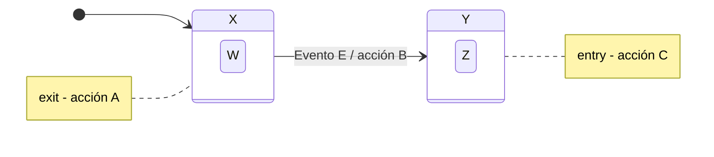
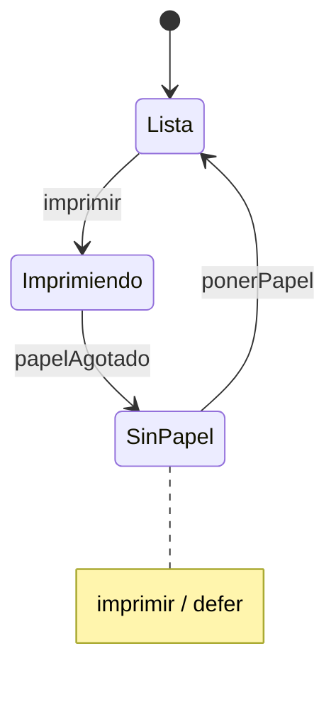
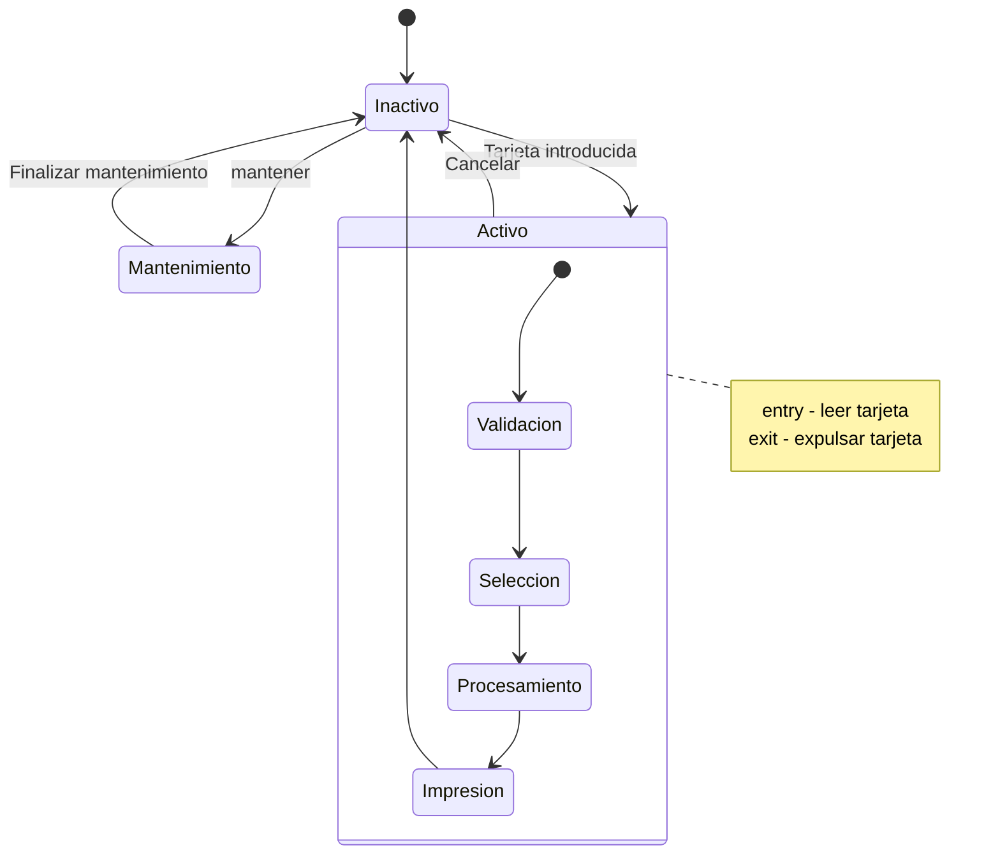
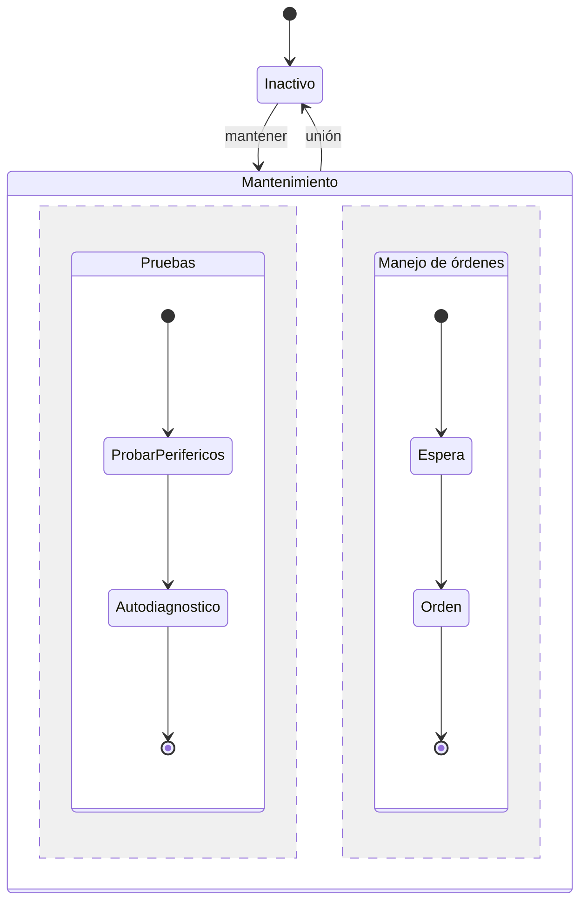

---
tags:
  - diseño-sistemas
  - parcial-2
  - unidad-4
  - uml
unidad: "4.3"
fuente: "Parcial 2 - Contenido/Unidad 4/Diseño de Sistemas - Unidad 4.3 - Maquinas de estado.pdf"
estado: en-progreso
---
# U4.3 — Máquinas de Estado (Diagrama de Estados)

← [[U4.2 - Componentes y Despliegue]] · [[U4 - Índice]] · Siguiente → [[U4 - Diagrama de Secuencia]]

> [!abstract] TL;DR
> - Un **diagrama de estados** modela el **ciclo de vida de un único objeto**: **estados**, **transiciones**, **eventos** y **acciones**.
> - **Transición:** `evento [condición] / acción`. Tiene **5 partes**: estado origen, evento, condición de guarda, acción y estado destino.
> - **Siempre hay estado inicial.** Puede haber **varios estados finales o ninguno**.
> - Las **condiciones de guarda** mantienen la máquina **determinística**.
> - Hay acciones **en la transición** (atómicas) y **en el estado** (`entry`, `exit`, `on evento`).
> - Elementos avanzados: **eventos diferidos**, **sub-estados y super-estados**, **historia (H)** y **regiones concurrentes**.
> - En código se implementa con el **[[U5.1 - Patrones de Diseño#State|patrón State]]**.

## Índice
- [[#1. La vista dinámica de un sistema]]
- [[#2. ¿Qué es una máquina de estados?]]
- [[#3. Partes de un estado]]
- [[#4. Estado inicial y final]]
- [[#5. Transiciones]]
- [[#6. Acciones en la transición y en el estado]]
- [[#7. Eventos diferidos]]
- [[#8. Sub-estados y super-estados]]
- [[#9. Estados con historia]]
- [[#10. Sub-estados concurrentes]]
- [[#11. Ejemplo integrador - el cuestionario del TP]]
- [[#12. Preguntas tipo parcial]]

---

## 1. La vista dinámica de un sistema

| # | Vista | Diagramas | Foco |
| --- | --- | --- | --- |
| 1 | **Interacciones** | Secuencia y colaboración | Cómo **colaboran varios objetos**. Ver [[U4 - Diagrama de Secuencia]]. |
| 2 | **Actividades** | Actividades | El **flujo de trabajo** entre acciones |
| 3 | **Máquina de estados** | Máquina de estados | **El ciclo de vida de un único objeto** ⬅ esta unidad |

---

## 2. ¿Qué es una máquina de estados?

**Diagrama de estados:**
- Muestra una máquina de estados: **estados, transiciones, eventos y acciones**.
- Sirve para modelar el comportamiento de una **interfaz, clase, colaboración o método**.
- Cada objeto se trata como una **entidad aislada** que se comunica con el resto del mundo **detectando eventos y respondiendo** a ellos.
- **Modela la vista de un único objeto.**

**Máquina de estados:** un **grafo** donde los **nodos son estados** y los **arcos son transiciones**, etiquetadas con los **eventos** ante los que reacciona el objeto.

**Estado:** una **condición o situación** en la vida de un objeto, durante la cual el objeto:
- **satisface** alguna condición,
- **realiza** alguna actividad, o
- **espera** algún evento.

---

## 3. Partes de un estado

| Parte | Descripción |
| --- | --- |
| **Nombre** | Puede ser **anónimo** (sin nombre) |
| **Acciones de entrada/salida** | Se ejecutan **al entrar** o **al salir** del estado |
| **Transiciones internas** | Responden a un evento **sin cambiar de estado** |
| **Sub-estados** | Estructura **anidada** de estados |
| **Eventos diferidos** | Eventos que **no se manejan** en este estado: se **encolan** para atenderlos después |

---

## 4. Estado inicial y final

| | Notación | Regla |
| --- | --- | --- |
| **Estado inicial** | ● Círculo negro | Indica el comienzo. **Siempre hay estado inicial.** |
| **Estado final** | ◉ Círculo negro dentro de un círculo blanco | La ejecución terminó. **Puede haber varios o ninguno.** |

> [!warning] Pregunta del parcial 1 de 2026
> *"Una máquina de estado siempre debe tener un estado inicial"* es **VERDADERO**.
> *"Las condiciones de guarda permiten modelar el aspecto determinístico"* es **VERDADERO**.
> *"Las máquinas de estado permiten modelar comportamiento **probabilístico**"* es **FALSO**: son **determinísticas**.
> *"Todo estado debe tener al menos una acción de entrada"* es **FALSO**: las acciones son **opcionales**.

---

## 5. Transiciones

- **Transición:** el paso de un estado a otro.
- El paso es **instantáneo**: el sistema **siempre está en un estado conocido**.
- **Transición λ (lambda):** **no necesita un evento**. Se dispara **automáticamente** cuando desaparece la condición que identifica al estado (por ejemplo, cuando termina la actividad del estado).

### Las 5 partes de una transición

```
Estado origen ──── evento [condición] / acción ────▶ Estado destino
```

| # | Parte | Qué es |
| --- | --- | --- |
| 1 | **Estado origen** | Donde está el objeto **antes** de la transición |
| 2 | **Evento de disparo** | El **estímulo** cuya ocurrencia **habilita** la transición |
| 3 | **Condición de guarda** | Expresión **booleana** que debe ser **verdadera** para que se dispare |
| 4 | **Acción** | Comportamiento que se **ejecuta** como consecuencia |
| 5 | **Estado destino** | Donde queda el objeto **después** |

### Evento
La **ocurrencia de un estímulo** que produce la transición. Hay 4 tipos:

| Tipo | Qué es | Ejemplo |
| --- | --- | --- |
| **Señal** | Recepción de una comunicación **asincrónica** | Llega una notificación |
| **Llamada** | Recepción de un requerimiento **sincrónico** | Se invoca `avanzarEstado()` |
| **Paso del tiempo** | Transcurre un tiempo | `after(30 min)` |
| **Cambio de estado** | Una condición se vuelve verdadera | `when(stock = 0)` |

### Condición de guarda
- Una **expresión lógica** que **valida o no** que se dispare la transición cuando ocurre el evento.
- Mantiene el aspecto **determinístico** de la máquina.
- Una transición **T** con condición **C** se dispara si **ocurre el evento E** y **C es verdadera**.

> [!example] Extra: guardas para que no haya ambigüedad
> Desde `Validación`, el evento `validar` puede llevar a dos estados:
> - `validar [pinCorrecto] → Selección`
> - `validar [!pinCorrecto] → Inactivo`
>
> Sin las guardas, ante `validar` no se sabría a cuál ir: la máquina sería **no determinística**.

---

## 6. Acciones en la transición y en el estado

| **En la transición** | **En el estado** |
| --- | --- |
| Se ejecuta cuando el evento **provoca la transición** | **`entry`**: al **entrar** al estado |
| Puede llamar a operaciones del propio objeto o de otros objetos visibles | **`exit`**: al **salir** del estado |
| Es **atómica**: **no se puede interrumpir** con un evento | **`on evento`**: al ocurrir un evento **mientras se está** en el estado (transición interna) |

> [!example] Ejemplo del apunte: ingreso de password
> `Ingresando usuario` ──**Enter**──▶ `Ingresando password`, con las acciones:
> - `entry: echo on`
> - `on digita: toma carácter`
> - `on escape: password.reset`
> - `exit: echo off`

### Orden de ejecución de las acciones



> [!important] Resultado neto: `Evento E / acción A ; acción B ; acción C`
> Primero el **exit** del estado origen (A), después la acción **de la transición** (B) y por último el **entry** del destino (C).

---

## 7. Eventos diferidos

Un evento que el estado actual **no procesa no se pierde**: **se encola** y se atiende en un estado posterior.



> [!example] Ejemplo de la impresora
> Si llega `imprimir` mientras está en `Sin papel`, el pedido **no se descarta**: queda en cola (`defer`). Al pasar a `Lista` con `ponerPapel`, se atiende y pasa a `Imprimiendo`.

---

## 8. Sub-estados y super-estados

- Un **super-estado** (estado compuesto) puede descomponerse en varios **sub-estados disyuntivos**: el objeto está en **uno solo** a la vez.
- Los sub-estados se conectan entre sí por transiciones, igual que los estados de primer nivel.

**Reglas:**
- Si el compuesto tiene un **sub-estado inicial**, una transición que **llega al super-estado** va al **sub-estado inicial**.
- Si el compuesto tiene un **sub-estado final**, llegar a él **dispara en cadena** la transición de salida del compuesto.

### Ejemplo del apunte - cajero automático



| Concepto del diagrama | Dónde aparece |
| --- | --- |
| **Estado compuesto** | `Activo` |
| **Sub-estado secuencial** | `Validación` → `Selección` → `Procesamiento` → `Impresión` |
| **Transición desde/hacia el compuesto** | `Tarjeta introducida` entra a `Activo` (y va a `Validación`). `Cancelar` sale de **cualquier** sub-estado. |
| **Transición desde un sub-estado** | De `Impresión` directo a `Inactivo` |
| **Acciones del compuesto** | `entry: leer tarjeta`, `exit: expulsar tarjeta`: se ejecutan **una sola vez** al entrar o salir de `Activo` |

> [!tip] Extra: ¿por qué sirven los super-estados?
> En lugar de dibujar 4 transiciones `Cancelar` (una por sub-estado), se dibuja **una sola** desde el compuesto. Reducen la cantidad de flechas y agrupan comportamiento común.

---

## 9. Estados con historia

- La notación especial **(H)** en un super-estado **memoriza el último sub-estado visitado** y lo **recupera** cuando vuelve a entrar una transición al super-estado.

> [!example] Ejemplo del apunte: copia de seguridad
> `Copia de seguridad` tiene los sub-estados `Recoger` → `Copiar` → … Si se sale con **`Consultar`** a `Orden` y después se vuelve, gracias a **(H)** **retoma donde había quedado** (por ejemplo, en `Copiar`) en lugar de empezar de nuevo en `Recoger`.

> [!tip] Extra: analogía
> Es como pausar una película: al volver, sigue desde donde la dejaste, no desde el principio.

---

## 10. Sub-estados concurrentes

- Permiten especificar **dos o más máquinas de estado que se ejecutan en paralelo** dentro de un mismo estado compuesto.
- Cada **región** evoluciona de forma **independiente**. El estado compuesto **solo se considera completo cuando todas las regiones llegan a su estado final**.



> [!example] Ejemplo del apunte: mantenimiento del cajero
> Mientras se hacen las **pruebas** (periféricos → autodiagnóstico), **en paralelo** se manejan **órdenes** del técnico (espera → orden). Se vuelve a `Inactivo` por la **unión** recién cuando **ambas regiones terminan**.

---

## 11. Ejemplo integrador - el cuestionario del TP

> [!example] Aplicado a tu TP (estados y reglas tomados del enunciado)
> ```mermaid
> stateDiagram-v2
>     [*] --> Activo : evaluar candidato (CU025) / generar clave
>     Activo --> EnProceso : ingresar y aceptar instrucciones (CU026) / registrar fecha y hora de inicio
>     EnProceso --> EnProceso : responder bloque de preguntas
>     EnProceso --> Completo : responder [último bloque] / registrar fin
>     Activo --> Incompleto : ingresar [accesos superan el máximo]
>     EnProceso --> Incompleto : ingresar [accesos superan el máximo]
>     EnProceso --> Incompleto : [tiempo máximo para completar superado] / registrar fecha y hora
>     Activo --> SinContestar : [tiempo máximo en estado activo superado] / registrar fecha y hora
>     Completo --> [*]
>     Incompleto --> [*]
>     SinContestar --> [*]
> ```
> Lo que dice el enunciado:
> - **CU026, paso 3:** al empezar, *"el sistema actualiza el estado del cuestionario a **En Proceso**"* y registra el día y la hora de comienzo.
> - **CU026, al responder lo último:** *"cambia el estado del cuestionario, pasándolo a **Completo**"*.
> - **CU026, precondición / 1.A.1:** si se **superó la cantidad máxima de accesos**, se coloca el cuestionario en **incompleto** y se registra la fecha y la hora.
> - **Proceso de vencimientos:** los cuestionarios que superaron el **tiempo máximo para completar** pasan a **incompleto**, y los que superaron el **tiempo máximo en estado activo** pasan a **Sin Contestar**.
>
> Lectura con la teoría:
> - Hay **3 estados finales** (Completo, Incompleto y Sin Contestar): **puede haber varios**.
> - `responder bloque` en `En Proceso` es una **transición interna o autotransición**: el estado no cambia.
> - Los vencimientos son eventos de **paso del tiempo**. Las condiciones entre corchetes son **guardas**.
> - Un candidato puede salir y volver a un cuestionario `En Proceso`: se retoma donde quedó, con sabor a **estado con historia**.
> - *Extra:* el disparador exacto de los vencimientos (un proceso programado u otro CU) depende de cómo lo modelen. Revisalo con tu grupo.
>
> En código, esta máquina se implementa con el **[[U5.1 - Patrones de Diseño#State|patrón State]]**: `EstadoActivo`, `EstadoEnProceso`, `EstadoCompleto`, `EstadoIncompleto` y `EstadoSinContestar`.

---

## 12. Preguntas tipo parcial

> [!question]- Múltiple opción (parcial 1 de 2026): en un diagrama de estados, ¿cuáles son verdaderas? (a) modela comportamiento probabilístico (b) siempre debe tener estado inicial (c) las guardas modelan el aspecto determinístico (d) todo estado tiene al menos una acción de entrada
> **(b) y (c).**

> [!question]- ¿Cuáles son las 5 partes de una transición?
> Estado origen, evento de disparo, condición de guarda, acción y estado destino. Sintaxis: `evento [condición] / acción`.

> [!question]- ¿Qué es una transición λ?
> Una transición que **no requiere un evento**: se dispara automáticamente cuando desaparece la condición que identifica al estado.

> [!question]- Se pasa de X (exit: A) a Y (entry: C) con `E / B`. ¿En qué orden se ejecutan las acciones?
> **A → B → C.** Primero el exit del origen, después la acción de la transición y por último el entry del destino.

> [!question]- ¿Qué es un evento diferido? Dé un ejemplo.
> Un evento que el estado actual no procesa: **se encola** y se atiende en un estado posterior. Ejemplo: `imprimir / defer` en el estado `Sin papel` de una impresora.

> [!question]- ¿Para qué sirve el estado de historia (H)?
> Para **recordar el último sub-estado visitado** de un super-estado y volver a él al reingresar.

> [!question]- ¿Cuándo se considera completo un estado con regiones concurrentes?
> Cuando **todas** sus regiones llegaron a su estado final.

> [!question]- V/F: "Una máquina de estados debe tener exactamente un estado final."
> **Falso.** Puede tener **varios o ninguno**. Lo obligatorio es el **estado inicial**.

> [!question]- Nombre los 4 tipos de eventos.
> **Señal** (asincrónica), **llamada** (sincrónica), **paso del tiempo** y **cambio de estado**.

> [!question]- ¿Qué diferencia hay entre una acción de transición y una actividad `on evento` del estado?
> La **acción de transición** se ejecuta al cambiar de estado y es **atómica**. **`on evento`** es una **transición interna**: responde al evento **sin salir del estado** (no ejecuta exit ni entry).
