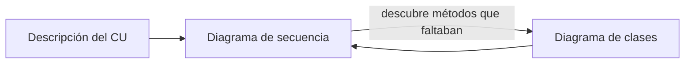
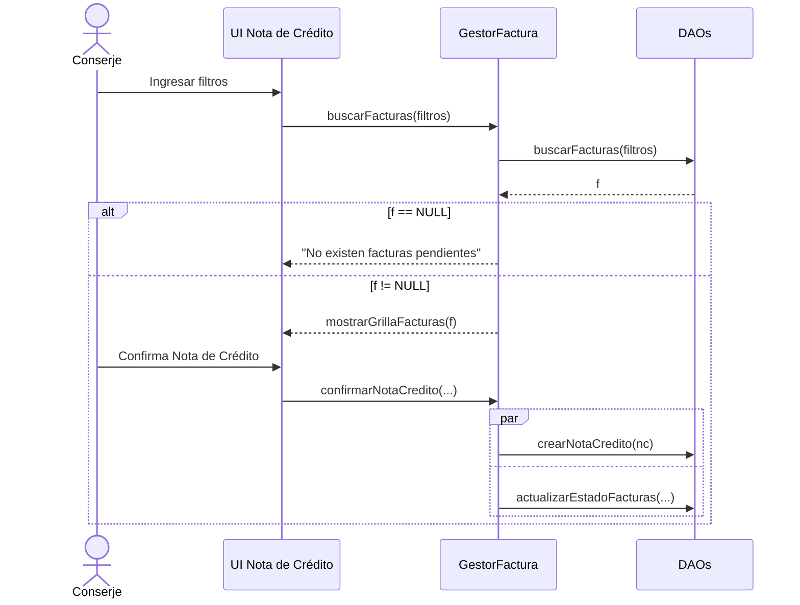

---
tags:
  - diseño-sistemas
  - parcial-2
  - unidad-4
  - uml
  - v2
unidad: "4 (práctica)"
fuente: "Diagrama de Secuencia y GIT/Clase de práctica 11_09_26 - Diagrama de secuencia.pdf"
version_anterior: "[[U4 - Diagrama de Secuencia]]"
---
# U4 — Diagrama de Secuencia

← [[U4.3 - Máquinas de Estado (V2)]] · [[U4 - Índice (V2)]]

> [!abstract] Secuencia en 4 frases
> 1. Modela cómo interactúan **objetos y actores a lo largo del tiempo** para **resolver un caso de uso**: qué **mensajes** se envían y qué **operaciones** se invocan.
> 2. Es una **línea de tiempo**: el tiempo corre **hacia abajo**.
> 3. Tiene **5 componentes**: objetos o actores, líneas de vida, mensajes, barras de activación y fragmentos.
> 4. Se arma a partir de la **descripción del caso de uso** y del **diagrama de clases**.

---

## 1. Qué es y para qué sirve

Representa el **comportamiento** del sistema. Identifica los **mensajes** entre objetos y actores y las **operaciones (métodos)** de las clases para resolver un caso de uso, en una **línea de tiempo visual**.

**Se usa para:** mapear el **flujo de control**, mostrar cómo interactúan los objetos en el tiempo, ayudar a **diseñar, comprender y solucionar problemas** de la arquitectura, entender interacciones complejas, hacer más eficiente el diseño y **modelar casos de uso** (desglose paso a paso de los mensajes durante su ejecución).

## 2. Componentes y mensajes

| Componente | Qué es | Cómo se dibuja |
| --- | --- | --- |
| **Objetos o actores** | Entidades que participan: usuarios, sistemas u objetos | Rectángulo o muñequito arriba |
| **Líneas de vida** | Un objeto o actor a lo largo del tiempo | **Línea vertical discontinua**. Bajar es avanzar en el tiempo |
| **Mensajes** | Las interacciones entre líneas de vida. **El orden importa** | Flechas |
| **Barras de activación** | Período en que el objeto está **activo** | **Rectángulo** sobre la línea de vida |
| **Fragmentos** | Estructuras de control: bucles, condicionales, paralelismo | **Caja** con etiqueta arriba a la izquierda |

![[U4v2 - Elementos de secuencia.png]]

**Barras de activación:** cuando un objeto recibe un mensaje, empieza su barra, que sigue hasta completar la actividad. Si mientras tanto le envía un mensaje a otro, la flecha **sale desde esa barra** hacia la línea de vida del receptor.

> [!note] Dos detalles de notación del apunte
> - La lámina de tipos de mensaje escribe `«crear»`, pero el ejemplo CU-19 usa `«create»`. Es lo mismo.
> - Esa lámina dibuja la respuesta como una flecha quebrada continua, pero la lámina de activación y los ejemplos la muestran **punteada**. Quedate con la punteada, que es la notación UML habitual.

## 3. Fragmentos

Encapsulan comportamientos más complejos. Son **cajas con una etiqueta** en la esquina superior izquierda.

![[U4v2 - Fragmentos.png]]

| Fragmento | Equivale a | Regla |
| --- | --- | --- |
| **`alt`** | `if / else` | **Dos o más** secuencias alternativas; se ejecuta **solo una** según las condiciones |
| **`opt`** | `if` sin `else` | Una secuencia que se ejecuta **solo si** se cumple la condición |
| **`loop`** | `for` / `while` | Una secuencia que se **repite** |
| **`par`** | Hilos | Operaciones **simultáneas** |

> [!tip] Extra: alt vs opt
> Si hay un "si no" (dos caminos), es **`alt`**. Si es "si pasa X, además hacer Y", es **`opt`**. Los **flujos alternativos** de un CU suelen terminar en `alt`.

## 4. Cómo se vincula con los otros diagramas

- **Diagrama de clases:** indica **qué objetos** interactúan y los **caminos** para recuperar la información.
- **Caso de uso:** el flujo de mensajes **sigue la narración del CU**. Antes de dibujar hay que **revisar el diagrama de CU** y tener una **descripción exhaustiva** del caso de uso.

> [!tip] Extra: cómo se arma
> 1. Leer el CU completo: flujo principal, alternativos, inclusiones y extensiones.
> 2. Ubicar las líneas de vida de izquierda a derecha: **Actor → UI → Gestor → DAO / entidades**.
> 3. Seguir el flujo principal: cada paso es uno o más mensajes.
> 4. Agregar alternativos con `alt` u `opt`, y recorridos con `loop`.
> 5. Marcar creaciones y retornos importantes.
> 6. Verificar contra el diagrama de clases: cada mensaje debe ser un **método que exista**.
> 7. Revisar las capas: **la UI no llama al DAO**.

## 5. Ejemplo de la cátedra - CU-19 Ingresar Nota de crédito

Simplificado respecto del original. Muestra el **flujo alternativo** del CU como `alt`, la grabación **en paralelo** con `par` y las capas **UI → Gestor → DAO**. En el original, además, el gestor crea el objeto con `«create»`.

> [!warning] Inconsistencia entre clases de la cátedra
> En ese ejemplo (TP 2025) el DAO devuelve un DTO. La práctica de 2026 marca eso como **error**: [[U5 - DAO y DTO (V2)|el DAO devuelve entidades]].

## 6. Secuencia vs colaboración

*(Extra: no está en la presentación, pero se relaciona con la vista de interacciones de la [[U4.3 - Máquinas de Estado (V2)|4.3]].)*

| | **Secuencia** | **Colaboración (comunicación)** |
| --- | --- | --- |
| **Énfasis** | El **orden temporal** de los mensajes | Qué objetos están **vinculados** |
| **Tiempo** | Eje **vertical** explícito | **Números de secuencia** (1, 2, 2.1…) |
| **Disposición** | Objetos en fila, con líneas de vida | Objetos libres, unidos por **enlaces** |
| **Fortaleza** | Flujos largos, fragmentos y activaciones | Ver quién colabora con quién |

**Coinciden en** que son **diagramas de interacción**, muestran los mismos objetos y mensajes, sirven para realizar casos de uso y son **equivalentes** (uno se convierte en el otro).

---

## Conceptos relacionados
- [[U4.1 - Modelos de UP y Diagrama de Clases (V2)]]: el diseño de casos de uso se hace con secuencia
- [[U4.3 - Máquinas de Estado (V2)]]: la otra vista dinámica
- [[U5 - DAO y DTO (V2)]]: las capas UI, Gestor y DAO
