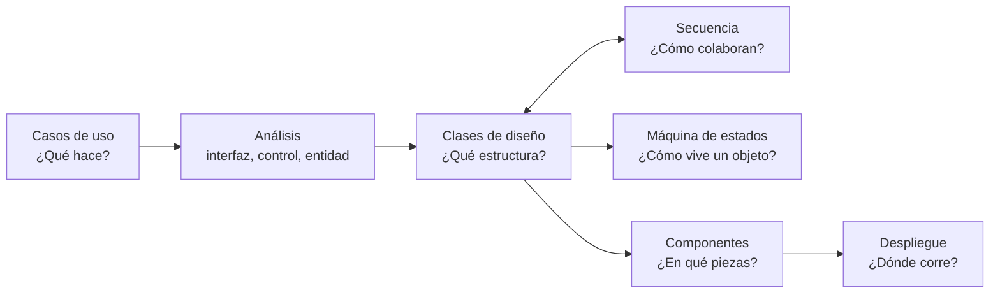

---
tags:
  - diseño-sistemas
  - parcial-2
  - unidad-4
  - indice
  - v2
version_anterior: "[[U4 - Índice]]"
---
# Unidad 4 — Modelo de Diseño y Diagramas UML (versión 2)

← [[00 - Índice Parcial 2]] · Versión completa anterior → [[U4 - Índice]]

> [!info] Qué es esta versión
> Resumen **compacto y solo teórico** de la unidad, corroborado contra las presentaciones de teoría y las dos clases prácticas. No tiene ejercicios ni preguntas de examen (siguen en la versión anterior y en [[Banco de preguntas - Exámenes anteriores]]).

| Subtema | Nota | Presentación |
| --- | --- | --- |
| 4.1 Modelos de UP y diagrama de clases de diseño | [[U4.1 - Modelos de UP y Diagrama de Clases (V2)]] | `Unidad 4.1.pdf` |
| 4.2 Componentes, paquetes y despliegue | [[U4.2 - Componentes y Despliegue (V2)]] | `Unidad 4.2 - Componentes y Despliegue.pdf` + práctica 16/10/26 |
| 4.3 Máquinas de estado | [[U4.3 - Máquinas de Estado (V2)]] | `Unidad 4.3 - Maquinas de estado.pdf` |
| Diagrama de secuencia | [[U4 - Diagrama de Secuencia (V2)]] | Práctica 11/09/26 |

> [!note] Sobre la 4.1
> No figura como tema del programa del parcial 2 (el modelo de diseño entró en el parcial 1), pero es la **base** de los demás diagramas.

## Cómo se conectan los diagramas

| Diagrama | Responde a… | Vista | Tipo UML |
| --- | --- | --- | --- |
| Casos de uso | ¿Qué hace el sistema? | Funcional | Comportamiento |
| Clases | ¿Qué estructura tiene? | Lógica | Estructural |
| Secuencia | ¿Cómo colaboran los objetos? | Dinámica (interacción) | Comportamiento |
| Máquina de estados | ¿Cómo evoluciona **un** objeto? | Dinámica (estados) | Comportamiento |
| Componentes | ¿En qué piezas se organiza? | Implementación | Estructural |
| Despliegue | ¿Dónde corre cada pieza? | Física | Estructural |

---

## Repaso rápido

**Modelos (4.1)**
- Análisis = **conceptual**, genérico, **3 estereotipos** (interfaz, control, entidad), puede no mantenerse.
- Diseño = **físico**, no genérico, **cualquier número** de estereotipos, **debe mantenerse**.
- Relaciones: asociación, agregación (◇ débil), composición (◆ fuerte), generalización (línea + ▷), dependencia (punteada + flecha), realización (punteada + ▷).

**Componentes y despliegue (4.2)**
- Componente = modular, desplegable y reemplazable, con interfaces **provistas** (○) y **requeridas** (◡).
- Subsistema = paquete **con comportamiento accesible solo por interfaces**.
- Despliegue = `«device»` ⊃ `«executionEnvironment»` ⊃ `«artifact»`, más caminos con **protocolo**. **Sin clases ni routers.**

**Máquinas de estado (4.3)**
- `evento [guarda] / acción`. **Siempre** hay estado inicial; finales, **0 o más**.
- Orden: **exit (origen) → acción de la transición → entry (destino)**.
- Diferido (se encola) · Super-estado · Historia **(H)** · Regiones **concurrentes**.

**Secuencia (práctica)**
- Líneas de vida, mensajes (síncrono, asíncrono, creación, destrucción X, respuesta), barras de activación.
- Fragmentos: **`alt`** (if/else) · **`opt`** (if) · **`loop`** · **`par`**.
- Capas: **Actor → UI → Gestor → DAO**.
