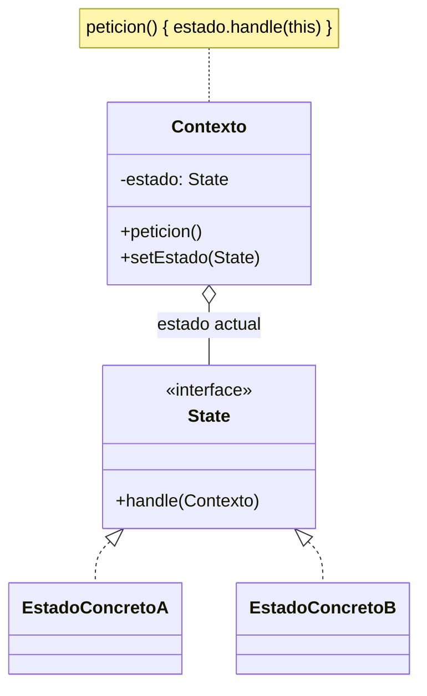

---
tags:
  - diseño-sistemas
  - parcial-2
  - unidad-5
  - patrones
  - v2
unidad: "5.1"
fuente: "Parcial 2 - Contenido/Unidad 5/Diseño de Sistemas - Unidad 5.1 - Patrones de Diseño.pdf"
version_anterior: "[[U5.1 - Patrones de Diseño]]"
---
# U5.1 — Patrones de Diseño

← [[U5 - Índice (V2)]] · Siguiente → [[U5.2 - Patrones de Diseño II (V2)]]

> [!abstract] La 5.1 en 4 frases
> 1. Un **patrón de diseño** es una solución **probada** y **reutilizable** a un problema de diseño que se repite.
> 2. Se clasifican por **propósito**: de **creación**, **estructurales** y de **comportamiento**.
> 3. **State** (comportamiento): cada estado es una clase y el objeto **delega** en su estado actual. Reemplaza los `if/else` gigantes.
> 4. **Singleton** (creación): **una única instancia** con un **punto de acceso global**.

---

## 1. Qué es un patrón

Es una **solución a un problema de diseño** que cumple dos condiciones:
- **Probada**: ya resolvió con éxito problemas similares.
- **Reutilizable**: sirve para distintos problemas y en distintas circunstancias.

Cada patrón se describe con la misma **ficha**: **nombre**, **clasificación**, **intención** (qué hace, en una frase), **motivación** (qué problema lo origina), **aplicabilidad** (cuándo usarlo) y **estructura** (diagrama de clases). Algunos agregan **participantes**, **colaboraciones** y **consecuencias**.

| ✅ Para qué sirven | ❌ Qué NO buscan |
| --- | --- |
| Dar elementos **reusables** de diseño → *una misma estructura se adapta a distintos problemas* | **Imponer** una alternativa sobre otras → *es **una** solución posible, no la única* |
| No volver a buscar soluciones ya conocidas → *no reinventar la rueda* | **Eliminar la creatividad** del diseño → *da el esqueleto; adaptarlo es trabajo del diseñador* |
| Formar un **vocabulario común** entre diseñadores → *"usé un Singleton" ya explica todo el diseño* | Ser de **uso obligatorio** → *solo se usa si tenés el problema que resuelve* |
| **Estandarizar** la forma de diseñar → *los diseños se vuelven predecibles y fáciles de leer* | |
| Facilitar el **aprendizaje** (condensan experiencia) → *resumen lo que a expertos les funcionó* | |

> [!warning] Frase clave
> **"Abusar o forzar el uso de los patrones puede ser un error."** Se usan solo si tenés el mismo problema (o uno parecido) al que resuelve el patrón, y aun así puede no aplicar a tu caso.

## 2. Categorías y clasificación

**Categorías** (según el nivel):

| Categoría | Qué expresa | Ejemplo |
| --- | --- | --- |
| **Patrones de arquitectura** | El esquema estructural **fundamental** de todo el sistema | Capas, MVC → [[U5.5 - Arquitectura (V2)]] |
| **Patrones de diseño** | Estructuras de diseño entre **clases y objetos** | State, Singleton, Facade |
| **Dialectos (idioms)** | Patrones de **bajo nivel**, propios de **un lenguaje** o entorno | Un modismo típico de Java |

**Clasificación de los patrones de diseño** (según su propósito):

| Tipo | Resuelve problemas de… | De la unidad |
| --- | --- | --- |
| **Creación** | Cómo se **crean** los objetos | Singleton |
| **Estructurales** | Cómo se **componen** clases y objetos | Facade, Bridge |
| **Comportamiento** | Cómo **interactúan** y se **reparten responsabilidades** | State, Mediator |

### Catálogo GoF (propósito × alcance)

- **Alcance de clase:** la relación se arma con **herencia** (fija al compilar).
- **Alcance de objeto:** la relación se arma con **composición** (puede cambiar en ejecución).

| Alcance \ Propósito | Creación | Estructura | Comportamiento |
| --- | --- | --- | --- |
| **Clase** | Factory Method | Adapter | Interpreter, Template Method |
| **Objeto** | Abstract Factory, Builder, Prototype, **Singleton** | Adapter, **Bridge**, Composite, Decorator, **Facade**, Proxy | Chain of Responsibility, Command, Iterator, **Mediator**, Memento, Flyweight, Observer, **State**, Strategy, Visitor |

> [!note] Ojo
> La diapositiva pone **Flyweight** en *comportamiento*; en el libro de GoF es **estructural**. **Adapter** aparece en las dos filas porque tiene versión de clase y de objeto.

---

## 3. State

> [!summary] Ficha
> - **Clasificación:** de **comportamiento**
> - **Intención:** permitir que un objeto **modifique su comportamiento cuando cambia su estado**. *Parecerá que el objeto cambia de clase.*
> - **Motivación:** objetos cuyo comportamiento ante los **mismos mensajes** varía **según su estado actual**.
> - **Aplicabilidad:** cuando hay "estados" con **operaciones comunes** que se comportan distinto según el estado, y el código que varía en cada operación **es mucho**.

**El problema que resuelve:** guardar el estado en un `String` y resolver cada operación con una cadena de `if/else`. Eso trae:
- **Lógica dispersa:** las reglas de un estado quedan repartidas en todos los métodos.
- **Crecimiento cuadrático:** cada estado nuevo obliga a tocar **todos** los métodos.
- **Bugs fáciles:** olvidar un estado o escribir mal un `String`, y el compilador no avisa.
- **Difícil de testear** y **viola Open/Closed** ([[U5.4 - SOLID (V2)#O — Abierto-Cerrado|OCP]]).

### Estructura



| Participante | Rol | En el ejemplo del Pedido |
| --- | --- | --- |
| **Contexto** | Lo usa el cliente. Guarda el estado actual y le **delega** las operaciones | `Pedido` |
| **State** | Interfaz con las operaciones que dependen del estado | `EstadoPedido` |
| **Estado concreto** | Implementa el comportamiento de **un** estado y decide la **transición** (`contexto.setEstado(...)`) | `EstadoRecibido`, `EstadoListo`… |

```java
public class Pedido {                       // Contexto: no tiene ningún if
    private EstadoPedido estado = new EstadoRecibido();
    public void avanzarEstado() { estado.avanzarEstado(this); }
    public void cancelar()      { estado.cancelar(this); }
    public void setEstado(EstadoPedido e) { this.estado = e; }
}
interface EstadoPedido {

}
```

> [!success] Qué se gana
> - Estado nuevo = **clase nueva** + cambiar la transición de un solo estado → cumple **OCP**.
> - Cada estado se lee y se testea **por separado** (alta cohesión).
> - El estado es un **tipo**, no un `String`: el compilador controla.
> - State es la **implementación en código de un diagrama de estados**: cada estado → una clase, cada transición → un `setEstado(...)`.

---

## 4. Singleton

> [!summary] Ficha
> - **Clasificación:** de **creación** (de objetos)
> - **Intención:** asegurar que una clase tenga **una única instancia** y dar un **punto de acceso global** a ella.
> - **Motivación:** clases que necesitan una sola instancia, por ejemplo porque controlan un **recurso físico único** o porque ciertos datos deben estar **disponibles para todos** los objetos.
> - **Aplicabilidad:** debe existir **una única instancia** y el acceso a ella debe ser un **punto bien conocido**.

### Las 3 piezas

```java
public final class Configurador {
    private static Configurador miConfigurador;              // 1. atributo static con la única instancia
    private String url, baseDatos;

    private Configurador(String url, String baseDatos) { … } // 2. constructor PRIVADO: nadie hace new

    public static synchronized Configurador getInstance() {  // 3. acceso global
        if (miConfigurador == null)
            miConfigurador = new Configurador(/* lee url y BD de un archivo */);
        return miConfigurador;                                // siempre la misma
    }
}
// Cliente:  Configurador c = Configurador.getInstance();
```

**Consideraciones del apunte:**
- **No debe ser clonable:** `clone()` lanza `CloneNotSupportedException`; si no, se podría crear una segunda instancia.
- **La clase o los métodos deben ser `final`:** una subclase podría romper la unicidad.
- `synchronized` (en la diapositiva está mal escrito como `syncronized`) evita que **dos hilos** creen dos instancias a la vez.

> [!tip] Extra (no está en el apunte)
> Singleton es **estado global**: todos dependen de `getInstance()`, eso **acopla** y complica los tests. Usarlo solo cuando la unicidad sea un requisito real (configuración, pool de conexiones, logger).

---

## Conceptos relacionados
- [[U5.2 - Patrones de Diseño II (V2)]]: Facade, Bridge y Mediator
- [[U5.4 - SOLID (V2)]]: por qué State cumple OCP
