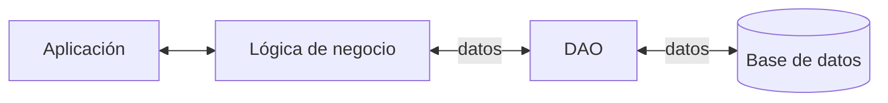
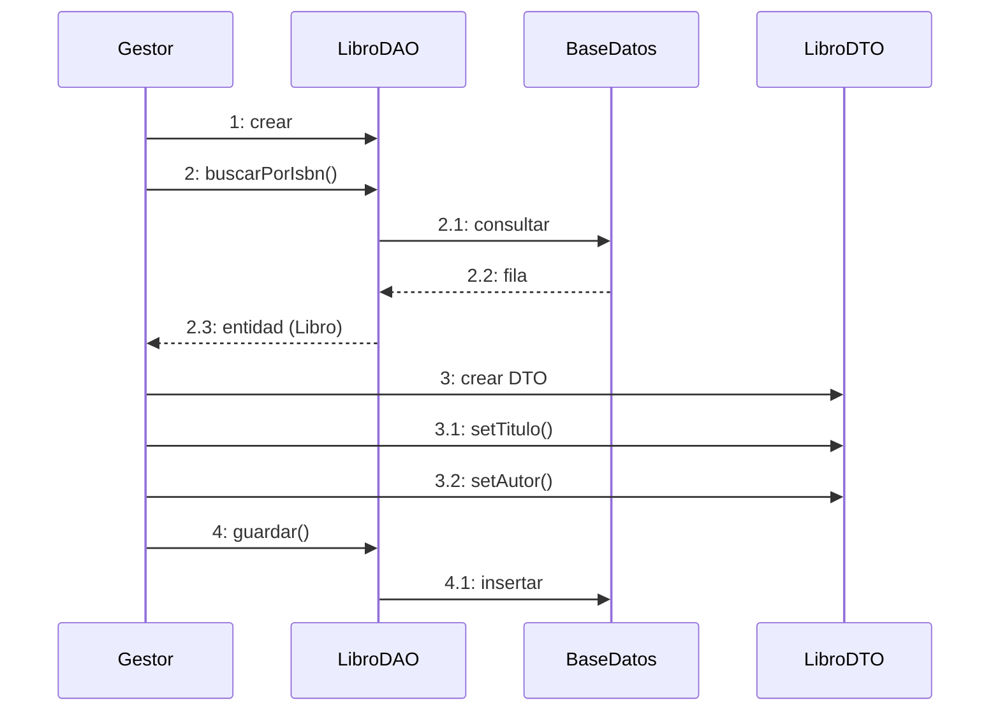
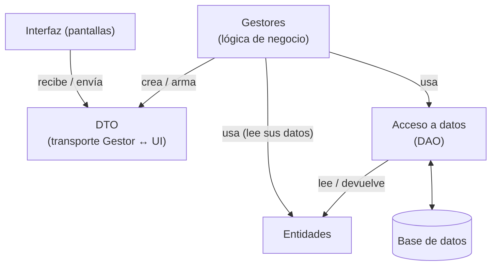
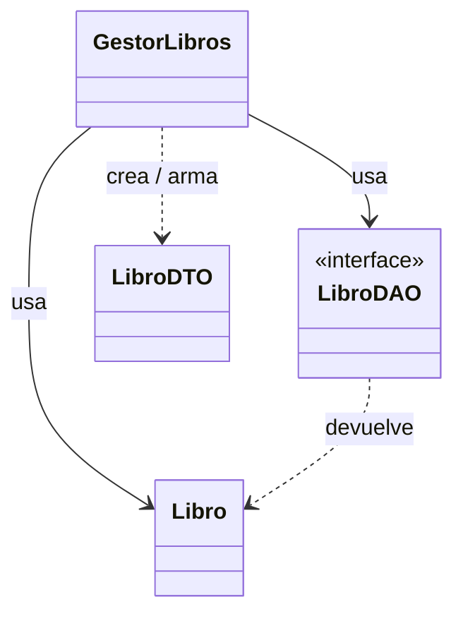

---
tags:
  - diseño-sistemas
  - parcial-2
  - unidad-5
  - patrones
  - persistencia
unidad: "5 (práctica)"
fuente: "Parcial 2 - Contenido/Unidad 5/Presentacion práctica DAO y DTO.pdf"
estado: en-progreso
---
# U5 — Práctica - Diagrama de clases, DAO y DTO

← [[U5.5 - Arquitectura]] · [[U5 - Índice]]

> [!abstract] TL;DR
> - **DTO (Data Transfer Object)** = **una valija**. Solo **transporta datos**: no piensa, no decide, no tiene lógica.
> - **DAO (Data Access Object)** = **el empleado del depósito**. Es el **único autorizado a hablar con la base de datos**.
> - El DAO se define como **interfaz**, y así se pueden tener varias implementaciones (MySQL, Mongo, Fake para tests). Eso es **Inversión de Dependencias** ([[U5.4 - SOLID#D — DIP Inversión de Dependencias|DIP]]).
> - **Error clásico:** que el DAO devuelva un DTO. **El DAO devuelve entidades** y el **gestor arma el DTO** que necesite cada pantalla.
> - Todo se apoya en **SRP**: *"cada clase debería tener una sola razón para cambiar"*.

## Índice
- [[#1. El problema - todo en la clase Libro]]
- [[#2. DTO]]
- [[#3. DAO]]
- [[#4. Cómo se combinan DAO, DTO y entidad]]
- [[#5. Error típico - el DAO devuelve un DTO]]
- [[#6. Pasos para implementar el patrón DAO]]
- [[#7. Ejercicio práctico del TP - Candidato]]
- [[#8. Preguntas tipo parcial]]

---

## 1. El problema - todo en la clase Libro

Un sistema de biblioteca necesita, para la entidad `Libro`: buscar por ISBN, guardar, actualizar stock, eliminar, mostrarlo en la web, enviarlo a una UI de escritorio y registrarlo en logs.

> [!question] ¿Qué pasa si todo eso vive en la misma clase?
> Si `Libro` cambia porque **cambió el modelo de la base de datos** y **también** porque **cambió el diseño de la pantalla**, esa clase tiene **dos responsabilidades**. Eso viola [[U5.4 - SOLID#S — SRP Responsabilidad Única|SRP]].

**La solución separa responsabilidades:**

| Responsabilidad | Quién se encarga |
| --- | --- |
| Datos y reglas del negocio | **Entidad** (`Libro`) |
| Hablar con la base de datos | **DAO** (`LibroDAO`) |
| Llevar datos a la pantalla | **DTO** (`LibroDTO`) |
| Orquestar el caso de uso | **Gestor** (`GestorLibros`) |

---

## 2. DTO

> [!quote] Data Transfer Object: objeto de transferencia de datos
> **Analogía: un DTO es una valija.**
> - No piensa.
> - No decide.
> - No tiene lógica.
> - Solo transporta cosas de un lado a otro.

```java
public class LibroDTO {
    private String isbn;
    private String titulo;
    private String autor;
    private int stockDisponible;
    // solo getters y setters
    // NO hay lógica de negocio
    // NO hay conexión a base de datos
}
```
*"Es casi aburrido. Ese es el punto."*

### ¿Por qué un DTO si ya tengo la entidad?
Supongamos que la tabla `libros` tiene la columna `precio_costo`, que es información interna y sensible. Si devolvés la **entidad completa** a la UI:
1. Ese dato viaja al frontend.
2. Queda expuesto en el navegador.
3. Cualquiera lo ve con el inspector.

> [!important] El DTO es el filtro
> Es la valija que armás **a propósito**, con solo lo que querés que viaje.

### Para qué más sirve el DTO (apunte)
- Transmitir información **entre cliente y servidor** con estructuras **independientes del modelo de datos**.
- Crear las **"vistas"** que necesita cada cliente: de un mismo objeto de negocio se pueden armar **distintos DTO**.
- Controlar el **formato, los nombres y los tipos** de los datos que se transmiten.
- Si el modelo cambia, **el cliente no se ve afectado** (**bajo acoplamiento**).

> [!example] Ejemplo del apunte: Candidato
> La entidad `Candidato` tiene id, nombre, apellido, fecha de nacimiento, promedio, universidad, dirección, fecha de egreso e historial académico. Cada caso de uso arma **su** DTO:
> - **CU1, búsqueda y listado** → `CandidatoResumenDTO`: id, nombre, apellido.
> - **CU2, orden de mérito** → `CandidatoOrdenDeMeritoDTO`: nombre, apellido, promedio, fecha de egreso.
>
> *"El DTO actúa como una **vista filtrada** del modelo de dominio y expone **solo** los datos necesarios para un caso de uso."*

> [!danger] Regla de oro del DTO
> Si un DTO tiene un método que **calcula, valida o llama a otra clase**… **dejó de ser un DTO.** Se convirtió en otra cosa, y probablemente mal diseñada.

---

## 3. DAO

> [!quote] Data Access Object: objeto de acceso a datos
> **Analogía: el DAO es el empleado de un depósito.**
> - Es el **único autorizado** a entrar al depósito (la base de datos).
> - **Nadie más** habla directo con la base.
> - **Todo pasa por él.**

**¿Por qué existe?** Hay una gran variedad de bases de datos (documentales como MongoDB, de grafos como Neo4j, clave-valor como Redis o DynamoDB, columnares como Cassandra, relacionales…). **Esa variedad no debe afectar a la lógica del software.** Objetivos:
- **Bajar el acoplamiento.**
- **Disminuir el impacto** de actualizaciones y cambios.

**Definición:** el DAO es un objeto que **encapsula la lógica** necesaria para llevar los datos desde las clases del dominio (**capa de negocio**) hacia la persistencia (**capa de datos**) y viceversa.



Suele ofrecer operaciones **CRUD**: **añadir, actualizar, buscar y borrar**.

```java
public interface LibroDAO {
    Libro buscarPorIsbn(String isbn);
    List<Libro> listarTodos();
    void guardar(Libro libro);
    void actualizarStock(String isbn, int nuevoStock);
    void eliminar(String isbn);
}
```

> [!important] Es una **interfaz**, no una clase
> La interfaz **declara** los métodos (los CRUD más las búsquedas que pidan los CU), pero **no los implementa**. **Cada tipo de base de datos** tiene su propia clase que **implementa esos mismos métodos** a su manera.
> Así puede haber **varias implementaciones**, y el gestor, que solo conoce la interfaz, **nunca se entera** de cuál se usa:
> ```java
> public class LibroDAOMySQL implements LibroDAO { /* consultas SQL */ }
> public class LibroDAOMongo implements LibroDAO { /* consultas Mongo */ }
> public class LibroDAOFake  implements LibroDAO { /* datos en memoria, para tests */ }
> ```

### Esto se llama Inversión de Dependencias
La lógica de negocio depende de una **abstracción** (la interfaz), no de una implementación concreta. Consecuencias:
1. Se **cambia la base de datos** sin tocar el resto del sistema.
2. Se **testea la lógica de negocio** sin necesitar una base real corriendo (con `LibroDAOFake`).
3. Se puede **desarrollar en paralelo** mientras infraestructura decide qué motor usar.

---

## 4. Cómo se combinan DAO, DTO y entidad

Diagrama de secuencia del apunte (buscar un libro y guardar uno nuevo):



**Las capas del diagrama de clases** (apunte, ejemplos Huésped/Persona jurídica y Candidato):



**Relaciones en el diagrama de clases:**



> [!important] La entidad NO se relaciona con el DTO
> `Libro` **no conoce** a `LibroDTO`: no tiene un `toDTO()` ni lo recibe como parámetro. El que tiene la relación con el DTO es el **gestor**: le pide la entidad al DAO, lee sus datos y con eso **arma el DTO** para la pantalla. Así la entidad no depende de cómo se muestra en cada UI, y eso respeta SRP.

> [!tip] La regla para recordar
> **DTO:** entre la **UI** y el **Gestor**. **Entidad:** entre el **Gestor** y el **DAO**. Ni el DAO ni la entidad **conocen** a los DTO: **solo el gestor** los arma.

---

## 5. Error típico - el DAO devuelve un DTO

```java
public class LibroDAOImpl implements LibroDAO {
    public LibroDTO buscarPorIsbn(String isbn) {   // ❌
        // conexión a la base ...
        return new LibroDTO(...);
    }
}
```

> [!bug] ¿Qué está mal?
> El DAO **devuelve un DTO directamente** y mezcla las dos responsabilidades que tanto costó separar.
> **¿Por qué duele?** El mismo libro se muestra distinto en 3 pantallas: una con precio, otra sin precio y otra solo con el título.
> - Si el DAO devuelve un **DTO fijo**, quedás atado a una sola pantalla.
> - Si el DAO devuelve la **entidad**, el gestor **arma el DTO que quiera** en cada caso.

---

## 6. Pasos para implementar el patrón DAO

Según el apunte:
1. Identificar las **clases de dominio** (*Business Objects*).
2. Implementar una **clase DTO por cada clase de dominio** a utilizar. El DTO solo tiene los atributos necesarios y **no tiene métodos con lógica de negocio**.
3. Definir **una interfaz DAO por cada clase de dominio**, con las operaciones **CRUD** (Create, Read, Update, Delete) más los métodos extra que hagan falta.
4. Implementar la **clase** que da el código de cada interfaz (por ejemplo, `CandidatoDAOPostgres`).

> [!warning] Ojo con el paso 2
> La diapositiva dice que el DTO tiene *"los atributos que quiero almacenar/acceder en la base de datos"* y que hay *"un DTO por clase de dominio"*. Eso parece contradecir la sección 5 y el ejemplo de Candidato, donde **hay varios DTO por entidad, uno por pantalla o caso de uso**, y **el DAO trabaja con entidades**.
> Para el TP y el parcial, conviene seguir el criterio de los diagramas de la clase: **DAO ↔ entidad** y **gestor ↔ DTO ↔ UI**. Si te lo preguntan, mencioná que se pueden tener **varios DTO por entidad**.

---

## 7. Ejercicio práctico del TP - Candidato

> [!info] Enunciado (diapositiva 22-23)
> El sistema **importa candidatos** desde otro sistema (**CU006**) con estos datos: número de candidato, apellido, nombre, tipo y número de documento, fecha de nacimiento, género, nacionalidad y email. Cuando un consultor **evalúa candidatos** (**CU025**), el sistema genera un **token de 8 caracteres** para que cada candidato entre a **completar su cuestionario** (**CU026**).
>
> 1. Diseñar la interfaz **`CandidatoDAO`** con al menos 4 métodos pensando en CU006, CU025 y CU026.
> 2. Diseñar dos DTO: **`CandidatoGestionDTO`** (pantalla del consultor: CU002 y CU025) y **`CandidatoCuestionarioDTO`** (lo que ve el candidato al completar el cuestionario: CU026).

> [!example]- Propuesta de resolución (mía, para comparar con la de tu grupo)
> **Primero, lo que dice el enunciado del TP** (CU025 y CU026):
> - En **CU025, paso 11**, el sistema muestra los *"Candidatos a evaluar (Apellido, Nombre, Tipo documento, Nro documento, **Clave de ingreso**)"* y ofrece **exportarlos a Excel con sus claves**. O sea, **el consultor sí ve la clave**.
> - En **CU026**, el candidato ingresa **tipo y número de documento y clave**. El sistema verifica que exista el candidato, que tenga un **cuestionario activo o en proceso** y que **la clave corresponda a ese cuestionario**.
> - Las claves son **aleatorias, con letras y dígitos, de 8 caracteres**.
>
> ```java
> public interface CandidatoDAO {
>     // CU006 - Importar candidatos
>     void guardar(Candidato candidato);
>     void guardarTodos(List<Candidato> candidatos);
>     boolean existe(int nroCandidato);               // nro de candidato = clave única al importar
>
>     // CU002 / CU025 - Buscar, seleccionar y evaluar
>     Candidato buscarPorNroCandidato(int nroCandidato);
>     List<Candidato> buscarPorFiltros(String apellido, String nombre, Integer nroCandidato);
>     void actualizar(Candidato candidato);           // persiste la clave generada en CU025
>
>     // CU026 - Ingreso del candidato
>     Candidato buscarPorDocumento(String tipoDoc, String nroDoc);
> }
> ```
> La **validación de la clave** contra el cuestionario activo o en proceso **no va en el DAO**: la hace el `GestorCuestionario`, que es lógica de negocio. El DAO solo busca.
>
> | `CandidatoGestionDTO` (consultor: CU002, CU025) | `CandidatoCuestionarioDTO` (candidato: CU026) |
> | --- | --- |
> | nroCandidato | nombre |
> | apellido | apellido |
> | nombre | *(más los datos del cuestionario a completar)* |
> | tipoDocumento | |
> | nroDocumento | |
> | email | |
> | claveIngreso *(solo se completa en el resultado del CU025)* | |
>
> **Criterios:**
> - **La clave aparece solo donde el CU la pide:** en la lista final del CU025 y en el Excel. En la búsqueda del CU002 queda vacía. Si preferís no mezclar, se puede separar en un `CandidatoClaveDTO` (apellido, nombre, documento y clave), pero el ejercicio pide quedarse con dos DTO.
> - **El candidato ve lo mínimo:** su nombre para el saludo y el cuestionario. No necesita su email, su documento, su número interno **ni su clave** (ya la ingresó).
> - Los DAO devuelven **`Candidato` (entidad)**. El **gestor** arma cada DTO.
> - **¿Dónde vive la clave?** La diapositiva pone `token` como atributo de `Candidato`. En el enunciado, la clave se valida **contra el cuestionario**. Para el diagrama de clases del TP conviene revisar con tu grupo cuál usan; las dos opciones se pueden defender si se justifican.
> - El diagrama de la diapositiva 24 (resolución de la cátedra) tiene la misma estructura: **Gestores** (`GestorCandidatos`, `GestorCuestionario`, `GestorReportes`), **DAO**, **DTOs de transporte Gestor ↔ UI** (`CandidatoGestionDTO`, `ResultadoImportacionDTO`, `CandidatoCuestionarioDTO`, `ResultadoComparativoDTO`) y la **entidad** `Candidato`. Se lee con dificultad, así que revisalo en el PDF.

---

## 8. Preguntas tipo parcial

> [!info] Origen
> Armadas por mí. DAO y DTO no aparecen en exámenes anteriores.

> [!question]- ¿Qué es un DTO y qué NO debe tener?
> Un objeto que **solo transporta datos** entre capas o entre cliente y servidor. **No debe tener lógica de negocio, validaciones, cálculos ni acceso a la BD.**

> [!question]- ¿Por qué usar un DTO en lugar de enviar la entidad a la UI?
> Para **no exponer datos sensibles o internos** (por ejemplo, `precio_costo`), armar **vistas a medida** de cada pantalla y **desacoplar** la UI del modelo de dominio.

> [!question]- ¿Por qué el DAO se define como interfaz? ¿Qué principio aplica?
> Para tener **varias implementaciones** (MySQL, Mongo, Fake) sin que el resto del sistema se entere. Aplica **DIP**: la lógica depende de una abstracción.

> [!question]- V/F: "Es correcto que el DAO devuelva directamente un DTO a la capa de negocio."
> **Falso.** El DAO devuelve **entidades**. El gestor arma el DTO que necesite cada pantalla. Si no, el DAO queda atado a una vista específica.

> [!question]- ¿Qué operaciones suele ofrecer un DAO?
> **CRUD:** añadir (Create), buscar (Read), actualizar (Update) y borrar (Delete), más los métodos de búsqueda específicos que se necesiten.

> [!question]- Múltiple opción: ¿Cuáles son beneficios del patrón DAO? (a) cambiar de BD sin tocar la lógica (b) testear sin BD real (c) agregar lógica de negocio a la persistencia (d) desarrollar en paralelo
> **(a), (b) y (d).**

> [!question]- ¿Qué tipo de patrón es el DAO y dónde encaja en la arquitectura?
> Es un patrón de **acceso a datos** (no está en el catálogo GoF). Encaja en la **capa de persistencia** de una arquitectura en capas y es un ejemplo de **mecanismo de persistencia** (ver [[U5.5 - Arquitectura#9. Preguntas de exámenes anteriores|mecanismos en U5.5]]).
