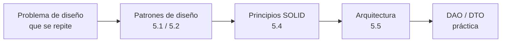

---
tags:
  - diseño-sistemas
  - parcial-2
  - unidad-5
  - indice
---
# Unidad 5 — Patrones, SOLID y Arquitectura

← Volver a [[00 - Índice Parcial 2]] · Versión compacta solo teórica → [[U5 - Índice (V2)]]

| Subtema | Nota | Fuente | Estado |
| --- | --- | --- | --- |
| 5.1 Patrones de Diseño (intro, State, Singleton) | [[U5.1 - Patrones de Diseño]] | `Unidad 5.1 - Patrones de Diseño.pdf` | ✅ resumido |
| 5.2 Patrones de Diseño II (Facade, Bridge, Mediator) | [[U5.2 - Patrones de Diseño II]] | `Unidad 5.2 - Patrones de Diseño.pdf` | ✅ resumido |
| 5.4 SOLID | [[U5.4 - SOLID]] | `Unidad 5.4 - Solid.pdf` | ✅ resumido |
| 5.5 Arquitectura | [[U5.5 - Arquitectura]] | `Unidad 5.5 - Arquitectura-2.pdf` | ✅ resumido |
| Práctica DAO y DTO | [[U5 - Práctica DAO y DTO]] | `Presentacion práctica DAO y DTO.pdf` | ✅ resumido |

> [!info] ¿Y la 5.3?
> Según el programa oficial (`Contenido Parcial 2.png`), la Unidad 5 tiene **5 presentaciones**: Patrones de Diseño clase 1 y clase 2, **Clase de Práctica DAO y DTO**, Solid y Arquitectura. **No falta ningún archivo**: el hueco en la numeración corresponde a la práctica de DAO y DTO.
> **Bibliografía:** GoF, *Patrones de Diseño* (solo los patrones de las presentaciones), Pressman cap. 10 y *Fundamentals of Software Architecture* (caps. 1, 4, 9, 10, 11, 12 y 13).

## Hilo conductor de la unidad

Todo apunta a lo mismo: **bajo acoplamiento, alta cohesión y código fácil de extender sin romper lo que ya funciona**.

---

## ⚡ Repaso rápido de patrones

| Patrón | Tipo | Problema que resuelve | Idea clave | Ejemplo del apunte |
| --- | --- | --- | --- | --- |
| [[U5.1 - Patrones de Diseño#State\|State]] | Comportamiento | Comportamiento que cambia según el estado, con muchos `if/else` | Cada estado es una clase y el contexto **delega** | Pedido de comida rápida |
| [[U5.1 - Patrones de Diseño#Singleton\|Singleton]] | Creación | Una sola instancia con acceso global | Constructor **privado** + `getInstance()` estático | `Configurador` |
| [[U5.2 - Patrones de Diseño II#Facade (Fachada)\|Facade]] | Estructura | Subsistema complejo de usar | **Una puerta de entrada** simple | Home Theater, apertura de cuenta |
| [[U5.2 - Patrones de Diseño II#Bridge (Puente)\|Bridge]] | Estructura | Explosión de clases por 2 dimensiones | **Composición**: abstracción + implementación | Reportes × formatos |
| [[U5.2 - Patrones de Diseño II#Mediator (Mediador)\|Mediator]] | Comportamiento | Objetos muy interconectados | **Intermediario central** | Torre de control, chat |
| [[U5 - Práctica DAO y DTO#3. DAO\|DAO]] | Acceso a datos (no es GoF) | La lógica de negocio atada a la BD | **Interfaz** que encapsula el acceso a la BD | `LibroDAO` |
| [[U5 - Práctica DAO y DTO#2. DTO\|DTO]] | Transferencia (no es GoF) | Exponer la entidad completa a la UI | **Valija** sin lógica, armada a medida | `LibroDTO`, `CandidatoResumenDTO` |

## ⚡ Repaso rápido de SOLID

| | Principio | Frase | Señal de violación |
| --- | --- | --- | --- |
| **S** | Responsabilidad Única | Una razón para cambiar | La clase "hace X **y** Y **y** Z" |
| **O** | Abierto-Cerrado | Extender sin modificar | `if (x is A) … else if (x is B)` |
| **L** | Sustitución de Liskov | La subclase no rompe el contrato | La subclase lanza `NotImplementedException` |
| **I** | Segregación de Interfaces | Interfaces chicas | Métodos vacíos o con `throw` "porque la interfaz lo pide" |
| **D** | Inversión de Dependencias | Depender de abstracciones | `new MySQLConnection()` dentro de la lógica de negocio |

## ⚡ Repaso rápido de arquitectura

| Estilo | Clave | Ejemplo |
| --- | --- | --- |
| Centrado en datos | Almacén central | ERP con BD única |
| Capas | Cada capa con su función; cerradas o abiertas | El TP: UI → Gestores → DAO → BD |
| MVC | Modelo, Vista, Controlador | Aplicación web |
| Flujo de datos | Tubos y filtros | Procesamiento de logs |
| Microkernel | Núcleo + plug-ins | Editor de código con extensiones |
| Servicios | Pocos servicios grandes + BD compartida | — |
| Eventos | Broker (sin coordinador) o mediador | Compra de un libro |
| Microservicios | Muchos servicios chicos, una BD por servicio | — |

Escalabilidad: **vertical** = máquina más grande (tiene un límite). **Horizontal** = más máquinas (cluster).

---

## Práctica
- Preguntas de cada nota (callouts plegables al final de cada una)
- [[Banco de preguntas - Exámenes anteriores#Unidad 5 — Patrones, SOLID, Arquitectura]]
