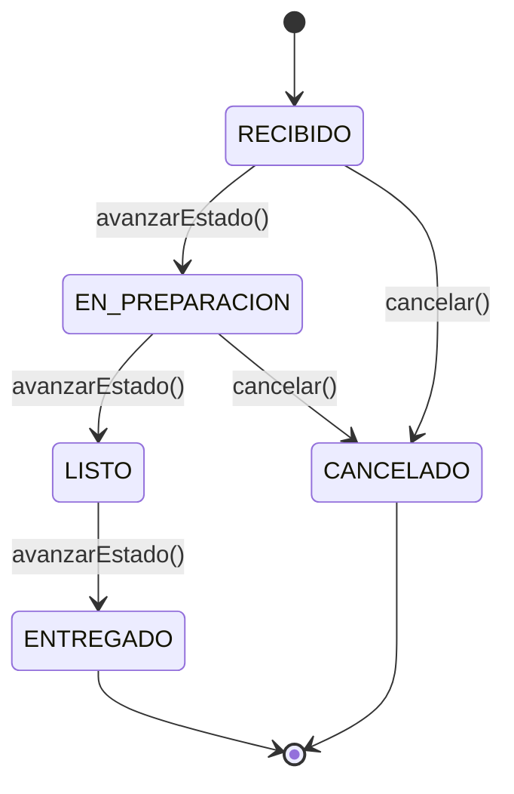
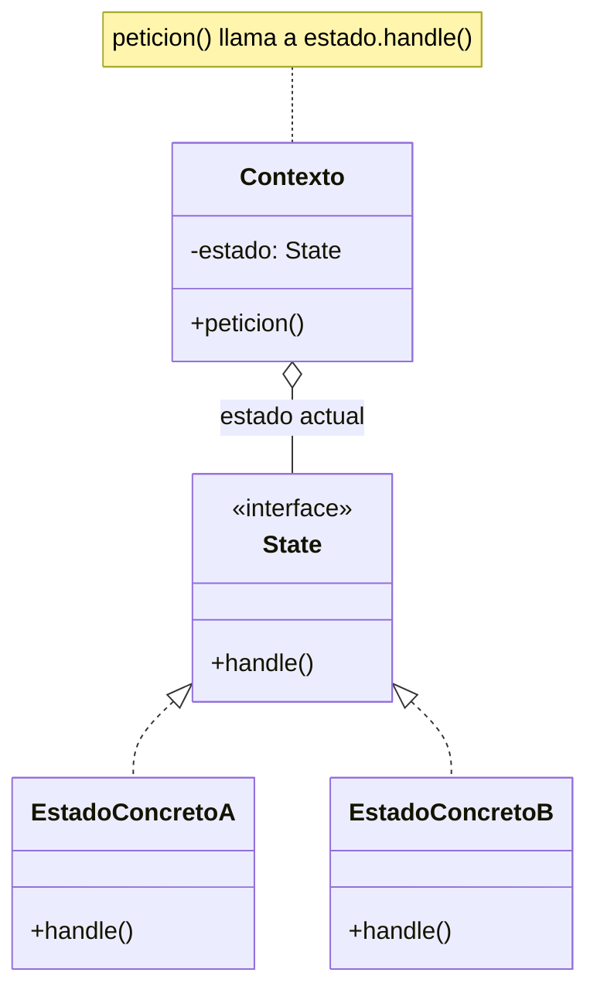
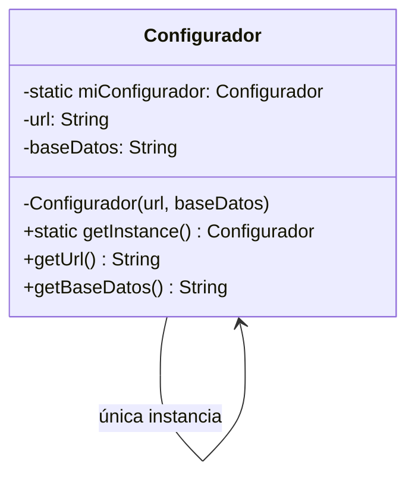

---
tags:
  - diseño-sistemas
  - parcial-2
  - unidad-5
  - patrones
unidad: "5.1"
fuente: "Parcial 2 - Contenido/Unidad 5/Diseño de Sistemas - Unidad 5.1 - Patrones de Diseño.pdf"
estado: en-progreso
---
# U5.1 — Patrones de Diseño

← [[U5 - Índice]] · Siguiente → [[U5.2 - Patrones de Diseño II]]

> [!abstract] TL;DR
> - Un **patrón de diseño** es una solución **probada** y **reutilizable** a un problema de diseño que se repite.
> - Hay 3 **categorías** (arquitectura, diseño, dialectos) y 3 **clasificaciones por propósito** (creación, estructurales, comportamiento).
> - **State** (de comportamiento): cada estado es una clase y el objeto delega en su estado actual. Así se eliminan los `if/else` gigantes.
> - **Singleton** (de creación): garantiza **una única instancia** con un **punto de acceso global**.
> - Usar un patrón **no es obligatorio**. Forzarlo es un error.

## Índice
- [[#1. ¿Qué es un patrón de diseño?]]
- [[#2. Para qué sirven y qué NO buscan]]
- [[#3. Categorías y clasificación]]
- [[#4. Ejercicio guía - el Pedido sin patrón]]
- [[#State]]
- [[#5. Catálogo de patrones (GoF)]]
- [[#Singleton]]
- [[#6. Preguntas tipo parcial]]

---

## 1. ¿Qué es un patrón de diseño?

Es una **solución a un problema de diseño** que cumple dos condiciones:

1. **Probada**: ya demostró ser efectiva en problemas similares.
2. **Reutilizable**: se puede aplicar a distintos problemas y en distintas circunstancias.

> [!tip] Analogía
> Es como una "receta" de arquitectura de casas: *"para un baño sin ventana, poné un extractor"*. No es la casa entera ni un ladrillo, es **una forma conocida de resolver un problema típico**.

Todo patrón se describe con una plantilla fija. Conviene memorizarla porque las diapositivas la usan:

| Campo | Qué responde |
| --- | --- |
| **Nombre** | Cómo lo llamamos (vocabulario común) |
| **Clasificación** | Creación, estructural o de comportamiento |
| **Intención** | Qué hace, en una frase |
| **Motivación** | Qué problema lo origina |
| **Aplicabilidad** | Cuándo conviene usarlo |
| **Estructura** | Diagrama de clases genérico |

## 2. Para qué sirven y qué NO buscan

| ✅ Buscan | ❌ No buscan |
| --- | --- |
| Dar elementos **reusables** de diseño | **Imponer** una alternativa sobre otras |
| No reinventar soluciones ya conocidas | **Eliminar la creatividad** del diseño |
| Formar un **vocabulario común** entre diseñadores | Ser de **uso obligatorio** |
| **Estandarizar** cómo se diseña | — |
| Facilitar el **aprendizaje** (condensar experiencia) | — |

> [!warning] Frase clave del apunte
> **"Abusar o forzar el uso de los patrones puede ser un error."** Solo se aplican si tenés el mismo problema (o uno similar) que el patrón resuelve. Aun así, en un caso particular puede no servir.

## 3. Categorías y clasificación

**Categorías según el nivel de abstracción:**

- **Patrones de arquitectura**: organización estructural *fundamental* de todo el sistema (ej.: capas, MVC). → Se ven en [[U5.5 - Arquitectura]].
- **Patrones de diseño**: estructuras de diseño entre clases y objetos para construir el sistema (ej.: State, Singleton).
- **Dialectos (idioms)**: patrones de **bajo nivel**, específicos de un lenguaje o entorno (ej.: `try-with-resources` en Java).

**Clasificación de los patrones de diseño según su propósito:**

| Tipo | Resuelve problemas de… | Pregunta guía | Ejemplos |
| --- | --- | --- | --- |
| **Creación** | Cómo se **crean** los objetos | *¿Quién y cómo instancia?* | Singleton, Factory Method, Builder |
| **Estructurales** | Cómo se **componen** clases y objetos | *¿Cómo encajan las piezas?* | Adapter, Composite, Facade |
| **Comportamiento** | Cómo **interactúan** y se **reparten responsabilidades** | *¿Quién hace qué y cómo se comunican?* | State, Strategy, Observer |

> [!example] Truco para recordar
> **C**rear → **E**structurar → **C**omportarse: primero nace el objeto, después se arma con otros, y al final actúa.

---

## 4. Ejercicio guía - el Pedido sin patrón

**Enunciado (resumido):** una cadena de comida rápida gestiona pedidos con este ciclo de vida:



Restricciones: ENTREGADO y CANCELADO no avanzan ni se cancelan. LISTO no se puede cancelar.

**Solución "ingenua"**: el estado es un `String` y cada método tiene una cadena de `if/else`:

```java
public void avanzarEstado() {
    if (estado.equals("RECIBIDO")) {
        estado = "EN_PREPARACION";
    } else if (estado.equals("EN_PREPARACION")) {
        estado = "LISTO";
    } else if (estado.equals("LISTO")) {
        estado = "ENTREGADO";
    } else if (estado.equals("ENTREGADO")) {
        System.out.println("❌ El pedido ya fue entregado.");
    } else if (estado.equals("CANCELADO")) {
        System.out.println("❌ El pedido está cancelado.");
    }
}
// cancelar() repite la misma cadena de if/else...
```

> [!question] La pregunta del profe
> *"¿Qué pasa si mañana el negocio pide agregar un estado **EN_CAMINO** entre LISTO y ENTREGADO?"*
> → Hay que abrir y modificar **todos** los métodos.

### Problemas de esta solución

| Problema | Explicación |
| --- | --- |
| 🔀 **Lógica dispersa** | Las reglas de un estado están repartidas entre `avanzarEstado()` y `cancelar()`. Para saber qué hace LISTO, hay que leer todo. |
| 📈 **Crecimiento cuadrático** | Cada estado nuevo toca **todos** los métodos: 3 métodos × 6 estados = 18 bloques. |
| 🐞 **Alto riesgo de bugs** | Es fácil olvidar un estado en algún método, y el compilador no avisa. |
| 🔓 **String como contrato** | Nada impide escribir `"RECIBIDOO"` por error. |
| 🧪 **Difícil de testear** | No se puede probar un estado de forma aislada. |
| 🚫 **Viola Open/Closed** | Para agregar un estado hay que *modificar* código en vez de *extenderlo*. → ver [[U5.4 - SOLID]] |

---

## State

> [!summary] Ficha del patrón
> - **Nombre:** State
> - **Clasificación:** De **comportamiento**
> - **Intención:** Permitir que un objeto **modifique su comportamiento cuando cambia su estado interno**. *Parecerá que el objeto cambia de clase.*
> - **Motivación:** Objetos cuyo comportamiento ante los mismos mensajes **varía según su estado actual**.
> - **Aplicabilidad:**
>     - Cuando hay "estados" con **operaciones comunes** cuyo comportamiento cambia según el estado.
>     - Cuando el código que varía en cada operación **es mucho** (muchos `if/else` o `switch`).

### Estructura



| Participante | Rol | En el ejercicio |
| --- | --- | --- |
| **Contexto** | Objeto que usa el cliente. Guarda una referencia al estado actual y **delega** en él. | `Pedido` |
| **State** (interfaz) | Declara las operaciones que dependen del estado. | `EstadoPedido` |
| **EstadoConcreto** | Implementa el comportamiento de **un** estado y decide la transición. | `EstadoRecibido`, `EstadoListo`… |

### Resolución del ejercicio con State

**1. Interfaz**

```java
public interface EstadoPedido {
    void avanzarEstado(Pedido pedido);
    void cancelar(Pedido pedido);
    String obtenerEstado();
}
```

**2. Estados concretos** (uno por estado; cada uno define *sus* reglas)

```java
public class EstadoRecibido implements EstadoPedido {
    public void avanzarEstado(Pedido pedido) {
        System.out.println("✅ Pedido en PREPARACIÓN.");
        pedido.setEstado(new EstadoEnPreparacion());   // ← transición
    }
    public void cancelar(Pedido pedido) {
        System.out.println("✅ Pedido CANCELADO.");
        pedido.setEstado(new EstadoCancelado());
    }
    public String obtenerEstado() { return "RECIBIDO"; }
}

public class EstadoListo implements EstadoPedido {
    public void avanzarEstado(Pedido pedido) {
        System.out.println("✅ Pedido ENTREGADO. ¡Buen provecho!");
        pedido.setEstado(new EstadoEntregado());
    }
    public void cancelar(Pedido pedido) {
        System.out.println("❌ No se puede cancelar, el pedido ya está listo.");
    }
    public String obtenerEstado() { return "LISTO"; }
}
// EstadoEnPreparacion, EstadoEntregado y EstadoCancelado siguen la misma idea
```

**3. Contexto** (ya no tiene ningún `if`, solo delega)

```java
public class Pedido {
    private int id;
    private EstadoPedido estado;

    public Pedido(int id) {
        this.id = id;
        this.estado = new EstadoRecibido();
    }
    public void avanzarEstado() { estado.avanzarEstado(this); }
    public void cancelar()      { estado.cancelar(this); }
    public void setEstado(EstadoPedido nuevoEstado) { this.estado = nuevoEstado; }
    public String obtenerEstado() { return estado.obtenerEstado(); }
}
```

> [!success] ¿Qué ganamos?
> - Agregar **EN_CAMINO** = crear `EstadoEnCamino` y cambiar **una** línea en `EstadoListo`. Lo demás no se toca → **Open/Closed** ✔.
> - Cada estado se lee y se **testea por separado** → alta **cohesión**.
> - Ya no hay `String` libres: el estado es un **tipo**, y el compilador controla los errores.
> - `Pedido` no conoce los detalles de cada estado → bajo **acoplamiento**.

> [!example] Aplicado a tu TP (Gestión de Evaluaciones de Perfiles)
> El **Cuestionario** del candidato pasa por estados: **Activo → En Proceso → Completo**, y puede quedar **Incompleto** o **Sin Contestar**. Operaciones como `responderPregunta()`, `retomar()` o `finalizar()` se comportan distinto según el estado. Es un caso típico para State: `Cuestionario` sería el contexto, y `EstadoActivo`, `EstadoEnProceso`, `EstadoCompleto`, `EstadoIncompleto` y `EstadoSinContestar` serían los estados concretos (ver la máquina completa en [[U4.3 - Máquinas de Estado#11. Ejemplo integrador - el cuestionario del TP]]).

> [!note] Conexión con el Parcial 1
> State es la **implementación en código de un diagrama de estados**: cada estado del diagrama se vuelve una clase, y cada transición, un `setEstado(...)` dentro de un método.

---

## 5. Catálogo de patrones (GoF)

Los patrones se ordenan en dos ejes: **propósito** (columnas) y **alcance** (filas).

- **A nivel de clase**: las relaciones se resuelven con **herencia** y quedan fijas en compilación.
- **A nivel de objeto**: las relaciones se resuelven con **composición** entre objetos y pueden cambiar en ejecución.

| Alcance \ Propósito | De creación | De estructura | De comportamiento |
| --- | --- | --- | --- |
| **Clase** | Factory Method | Adapter (de clase) | Interpreter, Template Method |
| **Objeto** | Abstract Factory, Builder, Prototype, **Singleton** | Adapter (de objeto), Bridge, Composite, Decorator, Facade, Proxy, Flyweight | Chain of Responsibility, Command, Iterator, Mediator, Memento, Observer, **State**, Strategy, Visitor |

> [!warning] Ojo con la diapositiva
> En el catálogo del apunte, **Flyweight** aparece en la columna de *comportamiento*. En el catálogo original de GoF (*Gamma et al., 1994*) es un patrón **estructural**. Si sale en el parcial, consultá con la cátedra cuál esperan.
> **Adapter** aparece en las dos filas porque tiene una versión de clase (herencia) y otra de objeto (composición).

---

## Singleton

> [!summary] Ficha del patrón
> - **Nombre:** Singleton
> - **Clasificación:** De **creación** (de objetos)
> - **Intención:** Asegurar que una clase tenga **una única instancia** y dar un **punto de acceso global** a ella.
> - **Motivación:** Clases que necesitan una sola instancia, por ejemplo porque controlan un **recurso físico único** o porque ciertos datos deben estar **disponibles para todos** los objetos de la aplicación.
> - **Aplicabilidad:** Cuando debe existir **una única instancia** y el acceso a ella debe ser un **punto bien conocido**.

### Las 3 piezas clave



1. **Atributo `static` privado** que guarda la única instancia.
2. **Constructor `private`**: nadie de afuera puede hacer `new Configurador(...)`.
3. **Método `static getInstance()`**: crea la instancia la primera vez (*lazy*) y después devuelve siempre la misma.

### Código del apunte (corregido)

```java
public final class Configurador {
    private String url;
    private String baseDatos;
    private static Configurador miConfigurador;          // 1. instancia única

    private Configurador(String url, String baseDatos) { // 2. constructor privado
        this.url = url;
        this.baseDatos = baseDatos;
    }

    public static synchronized Configurador getInstance() { // 3. acceso global
        if (miConfigurador == null) {
            // lee url y baseDatos de un archivo de configuración
            String url = "jdbc:...";        // valor leído del archivo
            String baseDatos = "miBase";    // valor leído del archivo
            miConfigurador = new Configurador(url, baseDatos);
        }
        return miConfigurador;
    }

    public String getUrl() { return url; }
    public String getBaseDatos() { return baseDatos; }
}
```

**Cliente:**

```java
Configurador c = Configurador.getInstance();   // siempre el mismo objeto
System.out.println(c.getUrl());
```

> [!info] Detalles del código de la diapositiva
> - Está escrito `syncronized`, pero la palabra correcta es **`synchronized`**. Sirve para que dos hilos no creen dos instancias al mismo tiempo.
> - En `clone()` falta el `()`: es `throw new CloneNotSupportedException();`.
> - Dentro de `getInstance()` (que es `static`) no se pueden usar los atributos de instancia `url` y `baseDatos`. Por eso acá los leo en variables locales antes de llamar al constructor.

### Consideraciones

- **No debe ser clonable**: si no, `clone()` crearía una segunda instancia.
  ```java
  public Object clone() throws CloneNotSupportedException {
      throw new CloneNotSupportedException();
  }
  ```
- **La clase o los métodos deben ser `final`**: así una subclase no puede romper la unicidad.
- **Thread-safety**: `synchronized` en `getInstance()` evita que haya dos instancias en entornos con varios hilos.

> [!example] Ejemplos típicos de Singleton
> - Configuración de la aplicación (URL y nombre de la BD), como en el apunte.
> - Pool o gestor de conexiones a la base de datos.
> - Logger del sistema.
> - En tu TP (idea propia, no está en el enunciado): un `GestorConfiguracion` que lea los parámetros del sistema **una sola vez**.

> [!warning] Críticas (para responder con criterio)
> Singleton es **estado global disfrazado**. Aumenta el **acoplamiento** (todos dependen de `getInstance()`) y complica el **testing**, porque no se puede reemplazar fácilmente por un objeto falso. Úsalo solo cuando la unicidad sea un requisito real.

---

## 6. Preguntas tipo parcial

> [!info] Origen de estas preguntas
> **Las armé yo** con el formato de los parciales de 2026 (múltiple opción, V/F y desarrollo). En los exámenes viejos (2001–2017) **no hay preguntas de patrones**: es contenido nuevo del programa. Ver [[Banco de preguntas - Exámenes anteriores]].

> [!question]- V/F: "Un patrón de diseño es de uso obligatorio cuando se presenta un problema conocido."
> **Falso.** Su uso es aconsejable, no obligatorio. Abusar o forzar un patrón puede ser un error.

> [!question]- ¿A qué clasificación pertenece State? ¿Y Singleton?
> State → **de comportamiento**. Singleton → **de creación**.

> [!question]- ¿Cuál es la intención del patrón State?
> Permitir que un objeto modifique su comportamiento cuando cambia su estado interno, de modo que parezca que cambia de clase.

> [!question]- Mencione 3 problemas de resolver estados con `if/else` y `String`.
> Lógica dispersa, crecimiento cuadrático del código, riesgo de bugs (estados olvidados o mal escritos), difícil de testear y violación del principio Open/Closed.

> [!question]- ¿Qué elementos garantizan que Singleton tenga una única instancia?
> Constructor **privado**, atributo **estático** con la instancia, método **estático** `getInstance()`, clase **no clonable**, clase o métodos **final** y `synchronized` para varios hilos.

> [!question]- Múltiple opción: ¿Cuáles NO son objetivos de los patrones? (a) vocabulario común (b) eliminar la creatividad (c) estandarizar el diseño (d) imponer alternativas
> **(b) y (d).**

> [!question]- Diferencia entre patrón de arquitectura, patrón de diseño y dialecto.
> Arquitectura: estructura fundamental de todo el sistema. Diseño: estructuras entre clases y objetos. Dialecto: patrón de bajo nivel específico de un lenguaje.

---

## Conceptos relacionados
- [[U5.2 - Patrones de Diseño II]]: más patrones del catálogo
- [[U5.4 - SOLID]]: Open/Closed explica por qué State es mejor que los `if/else`
- [[U5.5 - Arquitectura]]: patrones de arquitectura
