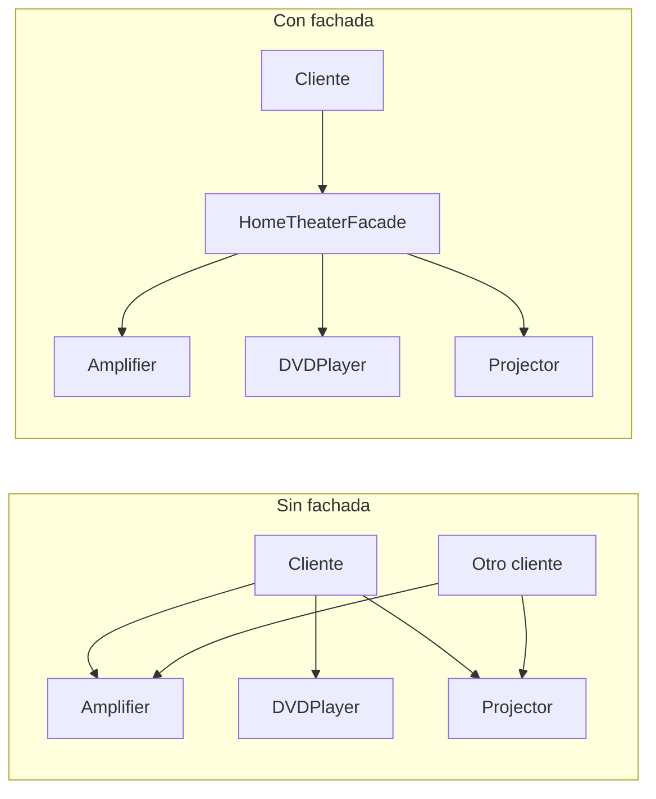
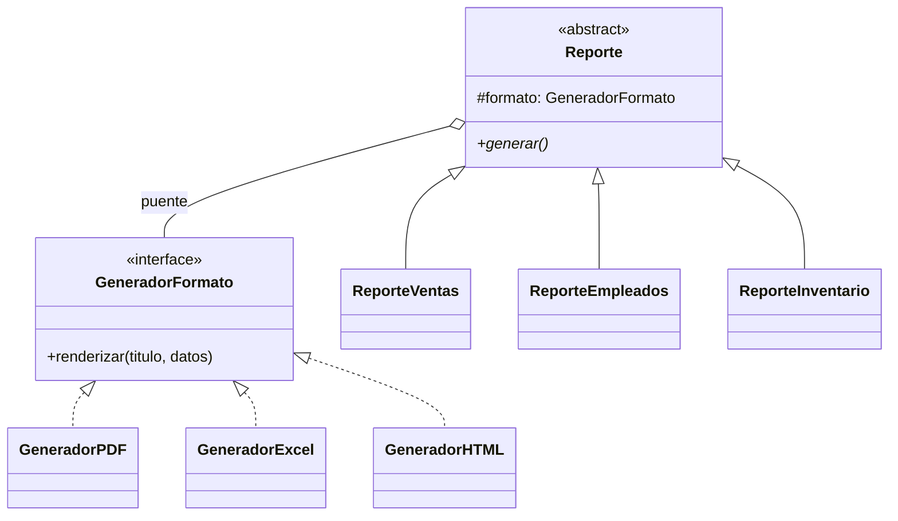
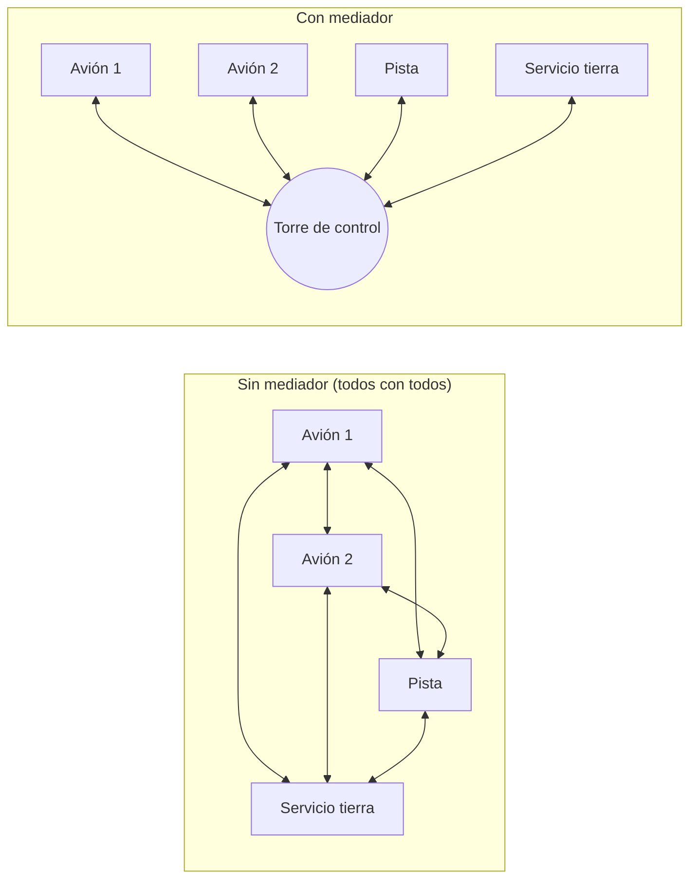

---
tags:
  - diseño-sistemas
  - parcial-2
  - unidad-5
  - patrones
unidad: "5.2"
fuente: "Parcial 2 - Contenido/Unidad 5/Diseño de Sistemas - Unidad 5.2 - Patrones de Diseño.pdf"
estado: en-progreso
---
# U5.2 — Patrones de Diseño II - Facade, Bridge y Mediator

← [[U5.1 - Patrones de Diseño]] · [[U5 - Índice]] · Siguiente → [[U5.4 - SOLID]]

> [!abstract] TL;DR
> - **Facade** (estructural): una **interfaz única y simple** delante de un subsistema complejo. El cliente habla con la fachada y la fachada orquesta.
> - **Bridge** (estructural): **separa la abstracción de su implementación** para que varíen por separado. Usa **composición en vez de herencia** y evita la explosión de clases N × M.
> - **Mediator** (comportamiento): los objetos **no se hablan entre sí**, se comunican a través de un **mediador central**. Reduce el acoplamiento de "todos con todos".
> - Los tres tienen el mismo objetivo: **bajar el acoplamiento**.

> [!note] Convención de esta nota
> El contenido principal sale del apunte. Lo que agregué yo va en callouts **`Extra`**.

## Índice
- [[#Facade (Fachada)]]
- [[#Bridge (Puente)]]
- [[#Mediator (Mediador)]]
- [[#Comparación rápida]]
- [[#Relación entre patrones]]
- [[#Preguntas tipo parcial]]

---

## Facade (Fachada)

> [!summary] Ficha del patrón
> - **Clasificación:** De **estructura**
> - **Intención:** Proporcionar una **interfaz unificada** para un conjunto de interfaces de un subsistema.
> - **Motivación:**
>     - Estructurar un sistema en subsistemas reduce la complejidad.
>     - Queremos **minimizar la comunicación y las dependencias** entre subsistemas.
>     - Para eso se introduce un objeto fachada que da **una única interfaz simplificada** a las funcionalidades del subsistema.
> - **Aplicabilidad:**
>     - Dar una interfaz única para un **subsistema complejo**.
>     - **Desacoplar** el subsistema de sus clientes y de otros subsistemas.
>     - **Dividir en capas** los subsistemas.

### Antes y después



### Participantes y colaboraciones

| Participante | Responsabilidad |
| --- | --- |
| **Fachada** | Sabe **qué clases del subsistema** atienden cada petición y **delega** en ellas. |
| **Clases del subsistema** | Implementan la funcionalidad. **No conocen a la fachada.** |

- Los clientes envían las peticiones a la fachada, y la fachada las reenvía a los objetos que corresponden.
- Los clientes **no necesitan** acceder directamente a los objetos del subsistema.

**Consecuencias:**
- ✅ Oculta los componentes del subsistema.
- ✅ Promueve un **acoplamiento débil** entre el subsistema y sus clientes.
- ⚠️ **No impide** que una aplicación use directamente las clases del subsistema si lo necesita.

### Ejemplo del apunte - Home Theater

```java
public interface HomeTheater { void watchMovie(String movie); }

public class HomeTheaterFacade implements HomeTheater {
    private Amplifier amp = new Amplifier();
    private DVDPlayer dvd = new DVDPlayer();
    private Projector projector = new Projector();

    @Override
    public void watchMovie(String movie) {   // operación de alto nivel: orquesta
        projector.on();
        projector.wideScreenMode();
        amp.on();
        amp.setVolume(10);
        dvd.on();
        dvd.play(movie);
    }
}

// Cliente: depende de la interfaz, no de la clase concreta
HomeTheater ht = new HomeTheaterFacade();
ht.watchMovie("Interstellar");
```

### Ejercicio - apertura de cuenta bancaria online

Un banco tiene 4 servicios que ya existen y funcionan por separado: `ServicioVerificacionIdentidad`, `ServicioRiesgoCredito`, `ServicioCreacionCuenta` y `ServicioNotificaciones`. La fachada `BancaFachada.abrirCuenta(dni, nombre, email, tipoCuenta)` hace estos pasos:

1. Verifica la identidad. Si falla, lanza una excepción.
2. Evalúa el riesgo crediticio. Si es **"ALTO"**, rechaza la solicitud.
3. Crea la cuenta y obtiene el **CBU**.
4. Notifica al cliente por email.
5. Retorna el CBU.

```java
// Cliente: solo conoce la fachada
BancaFachada banco = new BancaFachada();
try {
    String cbu = banco.abrirCuenta("28.456.789", "María García",
                                   "mgarcia@email.com", "Caja de Ahorro");
} catch (RuntimeException e) {
    System.out.println("Error: " + e.getMessage());
}
```

### Preguntas de la diapositiva (con respuesta)

> [!question]- ¿Qué conocimiento tiene el cliente sobre los subsistemas antes y después de la fachada?
> **Antes:** conoce los 4 servicios, sus métodos y el **orden** en que hay que llamarlos.
> **Después:** solo conoce `BancaFachada.abrirCuenta(...)`.

> [!question]- Si el banco agrega un `ServicioAntiFraude`, ¿dónde se hace el cambio?
> **Solo dentro de la fachada.** El cliente no se entera.

> [!question]- ¿La fachada oculta o elimina los subsistemas?
> **Los oculta, no los elimina.** Un cliente avanzado puede seguir usándolos directamente.

> [!question]- ¿Qué principio de diseño promueve Facade?
> **Bajo acoplamiento** entre el cliente y el subsistema.
> *Extra:* también se relaciona con la **Ley de Demeter** ("principio de mínimo conocimiento": hablá solo con tus amigos cercanos).

> [!example] Aplicado a tu TP
> Los **Gestores** del TP (por ejemplo, un `GestorCandidatos`) funcionan como fachada. La interfaz de usuario pide "evaluar candidatos" y el gestor coordina DAOs, validaciones y generación de claves.

---

## Bridge (Puente)

> [!summary] Ficha del patrón
> - **Clasificación:** De **estructura**
> - **Intención:** **Desacoplar una abstracción de su implementación** para que ambas puedan **variar independientemente**.
> - **Motivación:** Hay clases con **varias dimensiones de variación** (plataformas, formatos, dispositivos). Resolverlo con herencia es muy engorroso. Bridge usa **composición en lugar de herencia**.
> - **Aplicabilidad:**
>     - Evitar un **vínculo permanente** entre abstracción e implementación.
>     - Cuando abstracción e implementación pueden tener **múltiples variaciones**.
>     - Cuando los cambios en la implementación **no deberían afectar** a la abstracción, y viceversa.

### El problema - explosión de clases

Hay 3 tipos de reporte (Ventas, Empleados, Inventario) y 3 formatos (PDF, Excel, HTML). Con herencia salen `ReporteVentasPDF`, `ReporteVentasExcel`, `ReporteEmpleadosHTML`…

| Enfoque | Cantidad de clases | Al agregar un formato nuevo |
| --- | --- | --- |
| Herencia (cada combinación) | 3 × 3 = **9** | +3 clases (una por reporte) |
| Bridge | 3 + 3 = **6** | **+1 clase** |

### Estructura



| Participante | Rol | En el ejercicio |
| --- | --- | --- |
| **Abstraction** | Interfaz de alto nivel. Guarda una referencia al Implementor. | `Reporte` |
| **RefinedAbstraction** | Extiende o refina la abstracción. | `ReporteVentas`, `ReporteEmpleados`… |
| **Implementor** | Interfaz de las implementaciones. | `GeneradorFormato` |
| **ConcreteImplementor** | Implementa el Implementor. | `GeneradorPDF`, `GeneradorExcel`, `GeneradorHTML` |

**La idea clave:** la abstracción responde **"qué reporte es"** (qué datos junta) y la implementación responde **"en qué formato se genera"**.

### Código del apunte (resumido)

```java
interface GeneradorFormato { void renderizar(String titulo, String datos); }

class GeneradorPDF implements GeneradorFormato {
    public void renderizar(String titulo, String datos) {
        System.out.println("[PDF] Generando: " + titulo);
    }
}

abstract class Reporte {
    protected GeneradorFormato formato;          // ← el "puente"
    public Reporte(GeneradorFormato formato) { this.formato = formato; }
    public abstract void generar();
}

class ReporteVentas extends Reporte {
    public ReporteVentas(GeneradorFormato f) { super(f); }
    public void generar() {
        String datos = "Ventas Q1: $120.000 | Q2: $95.000";
        formato.renderizar("Reporte de Ventas", datos);
    }
}

// Cliente: se combina en tiempo de ejecución
Reporte r1 = new ReporteVentas(new GeneradorPDF());
Reporte r4 = new ReporteVentas(new GeneradorHTML()); // mismo reporte, otro formato, sin tocar ninguna clase
```

> [!example] Aplicado a tu TP
> El TP tiene reportes (por ejemplo, el comparativo de candidatos). Si te piden emitirlos en pantalla, PDF o Excel, Bridge evita tener `ReporteComparativoPDF`, `ReporteComparativoExcel`, etc.

---

## Mediator (Mediador)

> [!summary] Ficha del patrón
> - **Clasificación:** De **comportamiento**
> - **Intención:** **Reducir el acoplamiento directo** entre objetos. En lugar de comunicarse entre sí, lo hacen a través de un **objeto mediador central** que gestiona la interacción.
> - **Motivación:** Cuando hay muchas clases interconectadas, un cambio en una afecta a otras. El sistema se vuelve **frágil**, y la comunicación entre componentes se vuelve compleja y difícil de mantener.
> - **Aplicabilidad:**
>     - Hay **muchos objetos que interactúan** de forma compleja pero bien definida.
>     - Se quiere **centralizar el control** y la lógica de comunicación, para que ningún objeto necesite conocer cómo funcionan los demás.

### Antes y después



> [!tip] Extra: por qué escala mejor
> Con $n$ objetos que se hablan todos con todos hay $\frac{n(n-1)}{2}$ conexiones. Con un mediador hay solo $n$. Para 10 objetos son 45 conexiones contra 10.

### Participantes

| Participante | Rol | Torre de control | Sala de chat |
| --- | --- | --- | --- |
| **Mediator** | Interfaz para comunicarse con los colegas | `AirTrafficControlMediator` | `IChatMediator` |
| **ConcreteMediator** | Coordina la comunicación | `ControlTowerMediator` | `ChatMediator` |
| **Colleague** | Interfaz común de los que se comunican | `AirTrafficComponent` | `Usuario` (no hay interfaz aparte) |
| **ConcreteColleague** | Se comunican **a través** del mediador | `Airplane`, `Runway` | `Usuario` (no hay subclases: Alice, Bob y Charlie son instancias) |

### Ejemplo del apunte - control de tráfico aéreo

```java
interface AirTrafficControlMediator {
    void registerComponent(AirTrafficComponent component);
    void sendMessage(String message, AirTrafficComponent originator);
}

class ControlTowerMediator implements AirTrafficControlMediator {
    private List<AirTrafficComponent> components = new ArrayList<>();
    public void registerComponent(AirTrafficComponent c) { components.add(c); }
    public void sendMessage(String message, AirTrafficComponent originator) {
        for (AirTrafficComponent c : components)
            if (c != originator) c.receiveMessage(message);   // no se lo reenvía al emisor
    }
}

abstract class AirTrafficComponent {
    protected AirTrafficControlMediator mediator;   // el colega solo conoce al mediador
    public AirTrafficComponent(AirTrafficControlMediator m) { this.mediator = m; }
    public abstract void receiveMessage(String message);
}

class Airplane extends AirTrafficComponent {
    public Airplane(AirTrafficControlMediator m) { super(m); }
    public void receiveMessage(String msg) { System.out.println("Avión recibió: " + msg); }
    public void sendAlert(String msg) { mediator.sendMessage(msg, this); }
}

// Uso
AirTrafficControlMediator torre = new ControlTowerMediator();
Airplane avion = new Airplane(torre);
Runway pista = new Runway(torre);
torre.registerComponent(avion);
torre.registerComponent(pista);
avion.sendAlert("Solicitando aterrizaje.");   // → "Pista recibió: Solicitando aterrizaje."
```

> [!info] Segundo ejemplo: sala de chat (en C#)
> El ejemplo de la sala de chat del apunte está escrito en **C#** (`Console.WriteLine`, `var`, `Usuario?`), no en Java. La idea es la misma: `ChatMediator` tiene la lista de usuarios. `EnviarMensaje(mensaje, remitente, receptor = null)` manda el mensaje **a todos menos al remitente** si `receptor` es `null`, o como **mensaje privado** si se indica un receptor.

> [!warning] Riesgo del Mediator (Extra)
> El mediador puede convertirse en un **"objeto dios"** que concentra demasiada lógica. Se centraliza la complejidad, pero no desaparece.

---

## Comparación rápida

| | Facade | Bridge | Mediator |
| --- | --- | --- | --- |
| **Tipo** | Estructural | Estructural | Comportamiento |
| **Problema** | Subsistema complejo de usar | Explosión de clases por 2 dimensiones | Objetos muy interconectados |
| **Solución** | Una puerta de entrada simple | Composición: abstracción + implementación | Un intermediario central |
| **Dirección de la comunicación** | Unidireccional: cliente → fachada → subsistema | Abstracción → implementación | Bidireccional: colega ↔ mediador ↔ colega |
| **¿Los de adentro conocen al patrón?** | ❌ El subsistema **no conoce** a la fachada | — | ✅ Los colegas **sí conocen** al mediador |

> [!tip] Extra: Facade vs Mediator (pregunta típica)
> Los dos "centralizan", pero **Facade simplifica el acceso desde afuera** a un subsistema que no sabe que existe la fachada. **Mediator coordina la comunicación entre pares** que sí conocen al mediador y le hablan.

## Relación entre patrones

La última diapositiva muestra el mapa de relaciones del catálogo GoF. Estas son las flechas que tocan patrones que ya vimos:

| Relación | Significado |
| --- | --- |
| Facade → **Singleton** | *single instance*: la fachada suele ser única |
| Abstract Factory → **Singleton** | *single instance* |
| **State** → Flyweight | *sharing states*: los objetos estado se pueden compartir |
| **Mediator** ↔ Observer | *complex dependency management* |
| Strategy ↔ Decorator | *changing skin versus guts* (por fuera vs. por dentro) |
| Template Method → Strategy | *defining algorithm's steps* |

---

## Preguntas tipo parcial

> [!info] Origen
> Armadas por mí con el formato de 2026. En exámenes viejos no hay preguntas de patrones. Ver [[Banco de preguntas - Exámenes anteriores]].

> [!question]- ¿Cuál es la intención de Facade y qué consecuencias tiene?
> Dar una interfaz unificada a un conjunto de interfaces de un subsistema.
> Consecuencias: oculta los componentes, promueve el acoplamiento débil y no impide el uso directo del subsistema.

> [!question]- V/F: "Las clases del subsistema conocen a la fachada."
> **Falso.** La fachada conoce al subsistema, no al revés.

> [!question]- V/F: "Bridge resuelve la variación usando herencia múltiple."
> **Falso.** Usa **composición**: la abstracción tiene una referencia al implementor.

> [!question]- Tengo 4 tipos de notificación (alerta, recordatorio, promo, factura) y 3 canales (email, SMS, push). ¿Qué patrón uso y cuántas clases me ahorro?
> **Bridge.** Con herencia: $4 \times 3 = 12$ clases. Con Bridge: $4 + 3 = 7$ (más la abstracción y la interfaz).

> [!question]- Múltiple opción: ¿Qué patrones son estructurales? (a) Facade (b) Mediator (c) Bridge (d) State
> **(a) y (c).** Mediator y State son de comportamiento.

> [!question]- ¿Qué problema resuelve Mediator y qué riesgo tiene?
> Reduce el acoplamiento "todos con todos" centralizando la comunicación. El riesgo es que el mediador se convierta en un objeto demasiado grande y complejo.

> [!question]- Identifique los participantes del Mediator en el ejemplo del aeropuerto.
> Mediator: `AirTrafficControlMediator`. ConcreteMediator: `ControlTowerMediator`. Colleague: `AirTrafficComponent`. ConcreteColleague: `Airplane`, `Runway`.

---

## Conceptos relacionados
- [[U5.1 - Patrones de Diseño]]: definición, catálogo, State y Singleton
- [[U5.4 - SOLID]]: Bridge y Facade aplican OCP y DIP
- [[U5.5 - Arquitectura]]: Facade ayuda a "dividir en capas"; el estilo de eventos con mediador es Mediator a escala de arquitectura
