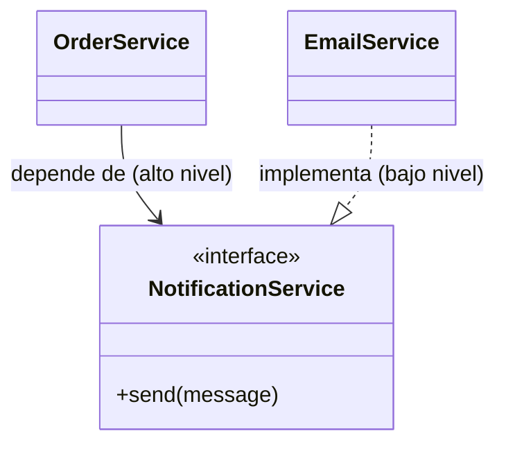

---
tags:
  - diseño-sistemas
  - parcial-2
  - unidad-5
  - solid
unidad: "5.4"
fuente: "Parcial 2 - Contenido/Unidad 5/Diseño de Sistemas - Unidad 5.4 - Solid.pdf"
estado: en-progreso
---
# U5.4 — Principios SOLID

← [[U5.2 - Patrones de Diseño II]] · [[U5 - Índice]] · Siguiente → [[U5.5 - Arquitectura]]

> [!abstract] TL;DR
> SOLID son **5 principios de diseño** propuestos por **Robert C. Martin** para lograr código **limpio, mantenible y extensible**.
>
> | Letra | Principio | En una frase (apunte) |
> | --- | --- | --- |
> | **S** | Single Responsibility (Responsabilidad Única) | Una clase, **una razón para cambiar**. |
> | **O** | Open/Closed (Abierto/Cerrado) | **Extender** sin **modificar** lo existente. |
> | **L** | Liskov Substitution (Sustitución de Liskov) | Una subclase **no debe romper el contrato**. |
> | **I** | Interface Segregation (Segregación de Interfaces) | Interfaces **chicas y específicas**. |
> | **D** | Dependency Inversion (Inversión de Dependencias) | Depender de **abstracciones**, no de detalles. |

> [!note] Convención
> El contenido principal sale del apunte. Lo agregado por mí va en callouts **`Extra`**. Los ejemplos del apunte están en **C#** (SRP, OCP, LSP, ISP, IoC) y en **Java** (DIP).

## Índice
- [[#¿Por qué importan?]]
- [[#S — SRP Responsabilidad Única]]
- [[#O — OCP Abierto-Cerrado]]
- [[#L — LSP Sustitución de Liskov]]
- [[#I — ISP Segregación de Interfaces]]
- [[#D — DIP Inversión de Dependencias]]
- [[#SOLID y los patrones vistos]]
- [[#Preguntas tipo parcial]]

---

## ¿Por qué importan?

- **Reducen el acoplamiento** entre componentes.
- Facilitan el **mantenimiento y la evolución** del software.
- Hacen el código más **testeable y reutilizable**.
- **Anticipan el cambio** en lugar de temerle.

> [!tip] Conexión con el Parcial 1
> SOLID es la versión orientada a objetos de dos ideas que ya viste: **alta cohesión** (SRP, ISP) y **bajo acoplamiento** (OCP, DIP). También mejora cualidades del software como **mantenibilidad** y **evolucionabilidad**.

---

## S — SRP Responsabilidad Única

> [!quote] Definición
> Cada clase o módulo debe encargarse de **una única responsabilidad** dentro del sistema. Una clase debe tener **una sola razón para cambiar**: si cambia por varios motivos, viola SRP.

- Se relaciona con un concepto que ya conocés: **COHESIÓN**.
- **Ventajas:** facilita el mantenimiento, evita errores colaterales, mejora la reutilización y favorece las pruebas unitarias.

**Ejemplo del apunte:**

| ❌ Sin SRP | ✅ Con SRP |
| --- | --- |
| `ReportManager` hace `GenerateReport()`, `SaveToFile()` y `SendEmail()` | `ReportGenerator`, `ReportSaver` y `EmailService`, cada uno con lo suyo |
| **3 razones para cambiar:** el formato del informe, el destino donde se guarda o el proveedor de email | Cada clase cambia por **un único motivo** |

```csharp
public class ReportManager {                 // ahora solo ORQUESTA
    private readonly ReportGenerator _generator = new ReportGenerator();
    private readonly ReportSaver _saver = new ReportSaver();
    private readonly EmailService _emailService = new EmailService();

    public void ProcessReport(string email) {
        var report = _generator.GenerateReport();
        _saver.SaveToFile(report);
        _emailService.SendEmail(email, report);
    }
}
```

> [!tip] Extra: cómo detectar una violación de SRP
> Describí la clase en una oración. Si necesitás usar **"y"** ("genera el informe **y** lo guarda **y** lo envía"), probablemente tiene más de una responsabilidad.

---

## O — OCP Abierto-Cerrado

> [!quote] Definición
> Las entidades de software (clases, módulos, etc.) deben estar **abiertas para la extensión** pero **cerradas para la modificación**. Se puede extender el comportamiento sin modificar el código existente.

- **Ventajas:** reduce el impacto de los cambios, evita romper funcionalidades ya probadas, favorece el uso de abstracciones e interfaces y fomenta la reutilización.

**Ejemplo del apunte: calculadora de áreas**

```csharp
// ❌ Sin OCP: cada figura nueva obliga a MODIFICAR este método
public double CalcularArea(object figura) {
    if (figura is Circulo c) return 3.14 * c.Radio * c.Radio;
    else if (figura is Rectangulo r) return r.Ancho * r.Alto;
    else throw new ArgumentException("Figura no soportada");
}
```

```csharp
// ✅ Con OCP: cada figura sabe calcular su área
public interface IFigura { double CalcularArea(); }

public class Circulo : IFigura {
    public double Radio { get; }
    public double CalcularArea() => Math.PI * Radio * Radio;
}
public class Rectangulo : IFigura {
    public double Ancho { get; } public double Alto { get; }
    public double CalcularArea() => Ancho * Alto;
}
// ¿Triángulo? Se crea una clase nueva. No se toca ninguna existente.
```

> [!example] Ya lo viste
> Es **exactamente** el problema del Pedido con `if/else` de [[U5.1 - Patrones de Diseño#4. Ejercicio guía - el Pedido sin patrón|U5.1]]. Ahí el patrón **State** resolvió la violación de OCP.

---

## L — LSP Sustitución de Liskov

> [!quote] Definición
> Los objetos de una clase derivada deben poder **sustituir** a los de la clase base **sin afectar la integridad del programa**. (Barbara Liskov, 1987)

> [!example] Analogía del apunte: el control remoto universal
> El control está diseñado para funcionar con **cualquier** televisor. Si un modelo nuevo no responde a los mismos comandos, el control deja de servir. LSP garantiza que cualquier "televisor" (clase derivada) funcione con el "control" (clase base).

- **Ventajas:** evita errores sutiles al usar herencia, mantiene el comportamiento coherente al sustituir objetos, fortalece el **polimorfismo seguro**, mejora la reutilización y fomenta un **contrato claro** entre superclase y subclases.

**Ejemplo del apunte: el pingüino**

```csharp
// ❌ Viola LSP
public class Ave { public virtual void Volar() { ... } }
public class Aguila : Ave { public override void Volar() { ... } }   // OK
public class Pinguino : Ave {
    public override void Volar() { throw new NotImplementedException("Penguins cannot fly"); }
}

Ave miPinguino = new Pinguino();
miPinguino.Volar();   // 💥 excepción: el pingüino "es un" Ave, pero rompe el contrato
```

```csharp
// ✅ Cumple LSP: separar la capacidad de volar en una interfaz
public interface IVolador { void Volar(); }
public class Ave { public void Comer() { ... } }
public class Aguila : Ave, IVolador { public void Volar() { ... } }
public class Pinguino : Ave { }   // solo Ave: no promete volar

// unPinguino.Volar();  → error de COMPILACIÓN: el método no existe
```

> [!tip] Extra: señales de que se viola LSP
> - Una subclase lanza `NotImplementedException` en un método heredado.
> - El código cliente pregunta `if (obj is Pinguino)` antes de llamar a un método.
> - Una subclase **pide más** (precondiciones más fuertes) o **garantiza menos** (postcondiciones más débiles) que la base.
>
> "Es un" en el mundo real **no alcanza**: tiene que "**comportarse como**" la clase base.

---

## I — ISP Segregación de Interfaces

> [!quote] Definición
> Diseñar interfaces **específicas y enfocadas**, evitando contratos innecesarios o pesados. **Una clase no debería verse obligada a depender de métodos que no usa.**
> *"Mejor muchas interfaces chicas y específicas que una sola grande y genérica."*

- **Ventajas:** alta cohesión y menor acoplamiento, más flexibilidad y mantenibilidad, y facilita los cambios y la evolución del sistema.

**Ejemplo del apunte: vehículos**

```csharp
// ❌ Sin ISP: Auto queda "obligado" a implementar Volar() y Navegar()
public interface IVehiculo { void Conducir(); void Volar(); void Navegar(); }
public class Auto : IVehiculo {
    public void Conducir() { Console.WriteLine("Conduciendo"); }
    public void Volar()    { throw new NotImplementedException(); }
    public void Navegar()  { throw new NotImplementedException(); }
}
```

```csharp
// ✅ Con ISP: cada clase implementa solo lo que necesita
public interface IConducible { void Conducir(); }
public interface IVolador    { void Volar(); }
public interface INavegable  { void Navegar(); }

public class Auto  : IConducible { public void Conducir() { ... } }
public class Avion : IVolador    { public void Volar()    { ... } }
public class Barco : INavegable  { public void Navegar()  { ... } }
```

> [!tip] Extra: LSP vs ISP (se confunden)
> - **LSP** mira la **herencia**: ¿la subclase cumple lo que promete la base?
> - **ISP** mira las **interfaces**: ¿la interfaz obliga a implementar cosas que no se usan?
>
> En la práctica van juntos: una interfaz gorda (violación de ISP) suele terminar en métodos con `throw` (violación de LSP).

---

## D — DIP Inversión de Dependencias

> [!quote] Definición
> Los **módulos de alto nivel no deben depender de módulos de bajo nivel**. Ambos deben depender de **abstracciones**. Las abstracciones no dependen de los detalles: **los detalles dependen de las abstracciones**.

| Concepto | Qué es | Ejemplo |
| --- | --- | --- |
| **Alto nivel** | Orquesta la lógica de negocio | Un controlador, `OrderService` |
| **Bajo nivel** | Ejecuta detalles concretos | Acceso a BD, envío de notificaciones (`EmailService`) |
| **Abstracción** | Interfaz o clase abstracta: un "contrato" sin implementación | `NotificationService` |



```java
interface NotificationService { void send(String message); }

class EmailService implements NotificationService {
    public void send(String message) { /* envía el email */ }
}

class OrderService {
    private NotificationService notifier;            // depende de la ABSTRACCIÓN
    public OrderService(NotificationService notifier) { this.notifier = notifier; } // DI por constructor
}
```

> [!tip] Extra: ¿por qué "inversión"?
> Sin DIP, la flecha va de `OrderService` a `EmailService` (alto → bajo). Con DIP, **las dos flechas apuntan a la interfaz**: el detalle (`EmailService`) pasa a depender de un contrato que define el alto nivel. La dependencia "se invierte".

### Cómo se implementa DIP - IoC y DI

| | **IoC (Inversión de Control)** | **DI (Inyección de Dependencias)** |
| --- | --- | --- |
| **Qué es** | El flujo de control ya no lo maneja tu código: se **delega** a un contenedor, framework o infraestructura externa. | Una **forma concreta** de aplicar IoC: las dependencias se **"inyectan" desde afuera**. |
| **Idea** | Una entidad externa crea y gestiona los objetos. | La clase **no crea** sus dependencias, **las recibe**. |

> [!important] Frase clave del apunte
> **Toda DI aplica IoC, pero no toda IoC usa DI.** Por ejemplo, los *callbacks* o los *eventos* son IoC sin DI.

**Tres formas de inyección:**

```csharp
// 1. Por constructor (la más común)
public class Car {
    private readonly IEngine engine;
    public Car(IEngine engine) { this.engine = engine; }  // el motor viene creado desde afuera
}

// 2. Por propiedad
public class Car { public IEngine Engine { get; set; } }

// 3. Por método
public void StartCar(IEngine engine) { engine.Ignite(); }
```

> [!example] Ya lo viste en la práctica
> El **DAO como interfaz** (`LibroDAO` con implementaciones MySQL, Mongo y Fake) es DIP aplicado. Ver [[U5 - Práctica DAO y DTO]].

---

## SOLID y los patrones vistos

| Patrón | Principio que aplica | Por qué |
| --- | --- | --- |
| [[U5.1 - Patrones de Diseño#State\|State]] | **OCP**, **SRP** | Un estado nuevo es una clase nueva. Cada estado tiene una sola responsabilidad. |
| [[U5.2 - Patrones de Diseño II#Bridge (Puente)\|Bridge]] | **OCP**, **DIP** | Formatos nuevos sin tocar los reportes. `Reporte` depende de la interfaz `GeneradorFormato`. |
| [[U5.2 - Patrones de Diseño II#Facade (Fachada)\|Facade]] | **SRP**, bajo acoplamiento | La fachada solo orquesta. El cliente no depende del subsistema. |
| [[U5.2 - Patrones de Diseño II#Mediator (Mediador)\|Mediator]] | **SRP**, bajo acoplamiento | La lógica de comunicación vive en un solo lugar. |
| [[U5 - Práctica DAO y DTO\|DAO]] | **DIP**, **SRP** | La lógica de negocio depende de la interfaz DAO. Solo el DAO accede a la BD. |
| [[U5 - Práctica DAO y DTO\|DTO]] | **SRP** | Solo transporta datos. |
| [[U5.1 - Patrones de Diseño#Singleton\|Singleton]] | ⚠️ tensiona **DIP** | Los clientes dependen de una clase concreta vía `getInstance()`. |

---

## Preguntas tipo parcial

> [!info] Origen
> Armadas por mí. SOLID no aparece en exámenes anteriores. Ver [[Banco de preguntas - Exámenes anteriores]].

> [!question]- ¿Qué significa cada letra de SOLID?
> **S**ingle Responsibility, **O**pen/Closed, **L**iskov Substitution, **I**nterface Segregation, **D**ependency Inversion.

> [!question]- ¿Con qué concepto conocido se relaciona SRP?
> Con la **cohesión**: una clase con una única responsabilidad tiene alta cohesión.

> [!question]- V/F: "OCP implica que nunca se puede modificar el código de una clase."
> **Falso.** Implica que, para **agregar comportamiento**, se extiende (clases nuevas, implementaciones nuevas) en lugar de modificar código ya probado. Corregir bugs sigue siendo modificar.

> [!question]- Una clase `Pinguino` hereda de `Ave` y su `Volar()` lanza una excepción. ¿Qué principio viola y cómo se corrige?
> Viola **LSP**. Se corrige sacando `Volar()` a una interfaz `IVolador` que solo implementan las aves que vuelan.

> [!question]- Una interfaz `IImpresora` tiene `imprimir()`, `escanear()` y `enviarFax()`, y una impresora básica solo imprime. ¿Qué principio se viola?
> **ISP.** Conviene separarla en `IImprimible`, `IEscaneable` e `IFax`.

> [!question]- Diferencie IoC de DI.
> IoC: el control de crear y gestionar objetos pasa a una entidad externa. DI: forma concreta de IoC donde las dependencias se reciben desde afuera (por constructor, propiedad o método). Toda DI es IoC, pero no toda IoC es DI (callbacks, eventos).

> [!question]- Múltiple opción: ¿Qué principio se aplica al definir el DAO como interfaz? (a) SRP (b) LSP (c) DIP (d) ISP
> **(c) DIP.** La lógica de negocio depende de la abstracción `LibroDAO`, no de `LibroDAOMySQL`.

> [!question]- ¿Qué principio viola este método? `if (pago is Tarjeta) ... else if (pago is Efectivo) ... else if (pago is Transferencia) ...`
> **OCP.** Cada medio de pago nuevo obliga a modificar el método. Solución: una interfaz `IMedioPago` con `procesar()`.
