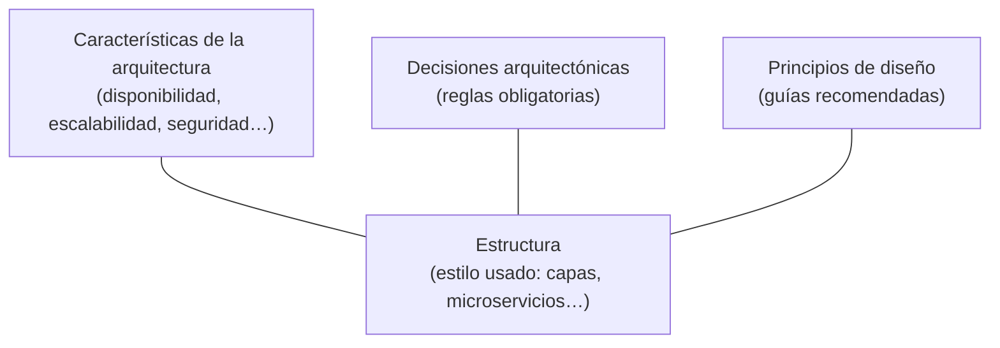
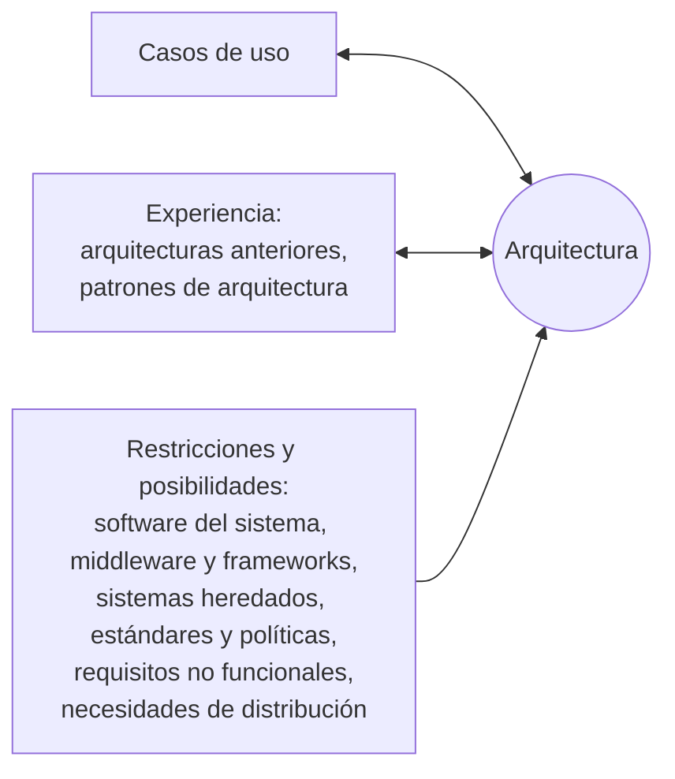

---
tags:
  - diseño-sistemas
  - parcial-2
  - unidad-5
  - arquitectura
unidad: "5.5"
fuente: "Parcial 2 - Contenido/Unidad 5/Diseño de Sistemas - Unidad 5.5 - Arquitectura-2.pdf"
estado: en-progreso
---
# U5.5 — Arquitectura de Software

← [[U5.4 - SOLID]] · [[U5 - Índice]] · Siguiente → [[U5 - Práctica DAO y DTO]]

> [!abstract] TL;DR
> - La **arquitectura** es la **estructura de organización de los componentes**, cómo **interactúan** y qué **datos** usan. Es el esqueleto sobre el que se hace el diseño detallado.
> - Una arquitectura se describe con 4 dimensiones: **estructura** (estilo), **características** (las "-ilidades"), **decisiones** (reglas) y **principios de diseño** (guías).
> - Primera gran elección: **monolítico vs. distribuido**. Si es distribuido, cuidado con las **8 falacias**.
> - **Estilos:** centrado en datos, capas, MVC, flujo de datos, microkernel, servicios, solicitud-respuesta, eventos (broker o mediador) y microservicios.
> - **Escalabilidad:** **vertical** (más hardware, tiene un límite) u **horizontal** (más nodos, más complejo).
> - En **UP**, la arquitectura se documenta con **vistas**: de casos de uso, lógica y de despliegue.

> [!warning] Sobre esta nota
> La mayoría de las diapositivas de **estilos arquitectónicos son solo diagramas, sin texto**. Las descripciones, ventajas y desventajas de cada estilo son **agregados míos** (marcados como `Extra`), basados en la bibliografía que usan los diagramas (*Fundamentals of Software Architecture*, Richards y Ford) y en Pressman. Si el profe explicó algo distinto en clase, priorizá eso.

## Índice
- [[#1. ¿Qué es la arquitectura?]]
- [[#2. Las 4 dimensiones de una arquitectura]]
- [[#3. Partición técnica vs. de dominio]]
- [[#4. Monolítico vs. distribuido]]
- [[#5. Estilos arquitectónicos]]
- [[#6. Escalabilidad]]
- [[#7. Arquitectura en el Proceso Unificado]]
- [[#8. Ejercicios del apunte (con respuesta)]]
- [[#9. Preguntas de exámenes anteriores]]

---

## 1. ¿Qué es la arquitectura?

> [!quote] Definición (apunte)
> - Es la **planificación basada en modelos, patrones y abstracciones teóricas** que se hace antes de implementar una pieza de software de cierta complejidad.
> - En su forma más sencilla, es la **estructura de organización de los componentes** de un programa, **la forma en que interactúan** y **la estructura de datos** que usan.
> - Sirve como **estructura base** a partir de la cual se hacen las actividades de diseño más detalladas.

**¿Para qué sirve representarla?**
1. **Analizar la efectividad del diseño** para cumplir los requerimientos.
2. **Considerar alternativas** cuando los cambios todavía son baratos.
3. **Reducir los riesgos** de la construcción del software.

> [!important] Clave
> En el nivel arquitectónico **no se especifican las propiedades internas de los componentes**. Se ve el "qué cajas hay y cómo se conectan", no el "cómo está hecha cada caja".

### Descripción o vista arquitectónica (AD)
- Es un **conjunto de productos de trabajo** que reflejan **distintos puntos de vista** del sistema.
- Cada perspectiva atiende la **preocupación de un participante específico** (el usuario, el desarrollador, el de infraestructura…).
- Muchas veces el **género arquitectónico** (el tipo de sistema) dicta qué estructura conviene.

### Estilo arquitectónico
Cada estilo describe una **categoría de sistemas** y tiene 4 elementos:

| Elemento | Qué es | Ejemplo en "capas" |
| --- | --- | --- |
| **Componentes** | Realizan una función del sistema | Capa de presentación, de negocio… |
| **Conectores** | Permiten la *"comunicación, coordinación y cooperación"* entre componentes | Llamadas entre capas |
| **Restricciones** | Definen cómo se integran los componentes | "Una capa solo llama a la de abajo" |
| **Modelos semánticos** | Permiten entender las propiedades generales del sistema | "Si cambio la BD, solo toco persistencia" |

---

## 2. Las 4 dimensiones de una arquitectura

El apunte usa el esquema de "edificio" de Richards y Ford: la **estructura** es la base, y las **características**, las **decisiones** y los **principios** la rodean.

| Dimensión | Qué define | Ejemplo del apunte |
| --- | --- | --- |
| **Estructura** | El o los **estilos** usados | Capas, microkernel, microservicios… |
| **Características** | Atributos de calidad que el sistema debe tener | ver tabla de abajo |
| **Decisiones** | **Reglas** de cómo se construye. Son **obligatorias**. | *"Solo las capas de negocio y de servicios pueden acceder a persistencia"*: capas **cerradas** y una capa de servicios **abierta** |
| **Principios de diseño** | **Guías** (no reglas estrictas) | *"Siempre que sea posible, usar mensajería asíncrona entre servicios para mejorar el rendimiento"* |

**Características de la arquitectura** (las "-ilidades" del diagrama):

| Inglés | Español | Inglés | Español |
| --- | --- | --- | --- |
| Availability | Disponibilidad | Fault tolerance | Tolerancia a fallos |
| Reliability | Confiabilidad | Elasticity | Elasticidad |
| Testability | Testeabilidad | Recoverability | Recuperabilidad |
| Scalability | Escalabilidad | Performance | Rendimiento |
| Security | Seguridad | Deployability | Facilidad de despliegue |
| Agility | Agilidad | Learnability | Facilidad de aprendizaje |

> [!tip] Conexión con el Parcial 1
> Estas características son las **cualidades del software** (ISO/IEC 25010) vistas desde la arquitectura: confiabilidad, rendimiento, seguridad, mantenibilidad…

> [!tip] Extra: decisión vs. principio
> Una **decisión** es una regla: si la rompés, está mal. Un **principio** es una recomendación: se puede romper si hay una buena razón.

---

## 3. Partición técnica vs. de dominio

| | **Partición técnica** | **Partición por dominio** |
| --- | --- | --- |
| **Cómo se divide** | Por **capa técnica**: Presentación, Reglas de negocio, Servicio, Persistencia | Por **área de negocio**: CatalogCheckout, UpdateInventory, ShipToCustomer, Reporting, Analytics, UpdateAccounts |
| **Pregunta que responde** | *¿Qué tipo de código es?* | *¿A qué parte del negocio pertenece?* |
| **Estilos típicos** | Capas, MVC | Microservicios, modular |
| **Extra: un cambio de negocio…** | …atraviesa **todas** las capas | …queda **dentro de un solo** módulo |

---

## 4. Monolítico vs. distribuido

| | **Monolítico** | **Distribuido** |
| --- | --- | --- |
| **Despliegue** | **Una única unidad** de despliegue | **Múltiples servicios independientes** |
| **Comunicación** | Interna (llamadas en memoria) | Por red: API/REST, gRPC, mensajería |
| **Base de datos** | Generalmente una sola | Puede haber una por servicio |
| **Extra: ventajas** | Simple, barato, fácil de probar y desplegar | Escala por partes, equipos independientes, tolerancia a fallos |
| **Extra: desventajas** | Escala "todo o nada"; un cambio obliga a redesplegar todo | Complejo: red, latencia, consistencia, monitoreo |
| **Estilos** | Capas, MVC, microkernel, flujo de datos | Servicios, eventos, microservicios |

### Las 8 falacias de la computación distribuida

Son suposiciones **falsas** que se hacen al diseñar sistemas distribuidos:

| # | Falacia | Extra: en la realidad… |
| --- | --- | --- |
| 1 | **La red es confiable** | Se cae. Hacen falta timeouts y reintentos. |
| 2 | **La latencia es cero** | Cada llamada remota tarda milisegundos. |
| 3 | **El ancho de banda es infinito** | Mandar mucha información satura la red. |
| 4 | **La red es segura** | Hay que cifrar y autenticar. |
| 5 | **La topología no cambia** | Servidores, IPs y rutas cambian. |
| 6 | **Existe un solo administrador** | Hay varios equipos y proveedores. |
| 7 | **El transporte no tiene costo** (no es latencia) | Infraestructura, serialización y dinero. |
| 8 | **La red es homogénea** | Distinto hardware, sistemas operativos y protocolos. |

---

## 5. Estilos arquitectónicos

### Resumen comparativo

| Estilo | Idea en una línea | Mono / Distr. | Partición |
| --- | --- | --- | --- |
| [[#Centrado en los datos]] | Todos los clientes giran alrededor de un **almacén central** | Mono | Técnica |
| [[#En capas]] | Capas apiladas, cada una con su responsabilidad | Mono | Técnica |
| [[#MVC]] | Separa **Modelo**, **Vista** y **Controlador** | Mono | Técnica |
| [[#Flujo de datos (tubos y filtros)]] | Datos que pasan por una cadena de **filtros** conectados por **tubos** | Mono | Técnica |
| [[#Microkernel]] | **Núcleo mínimo** + **plug-ins** | Mono | Técnica o dominio |
| [[#Basada en servicios]] | UI + pocos **servicios grandes** + **una BD compartida** | Distr. | Dominio |
| [[#Solicitud-respuesta (orquestada)]] | Un **orquestador** distribuye pedidos a procesadores | Distr. | — |
| [[#Basada en eventos]] | Componentes que reaccionan a **eventos** (broker o mediador) | Distr. | Técnica |
| [[#Microservicios]] | Muchos **servicios chicos**, cada uno con **su propia BD** | Distr. | Dominio |

### Centrado en los datos
- Un **almacén de datos** central (repositorio o pizarrón) al que acceden varios **software cliente**.
- **Extra:** los clientes no se comunican entre sí, solo a través de los datos. Es fácil agregar clientes, pero el almacén es un **punto único de falla** y el esquema de datos queda muy acoplado.
- **Extra, ejemplos:** sistemas ERP, el sistema de un banco con una BD central.

### En capas
- El apunte muestra dos representaciones: **anillos** (interfaz de usuario → aplicación → utilerías → núcleo) y **capas apiladas** (Presentación → Negocio → Persistencia → Base de datos).
- Las capas se pueden **distribuir en tiers** (niveles físicos) de distintas maneras. El apunte muestra 3 variantes:
    1. Presentación + Negocio + Persistencia en un tier, y la BD en otro.
    2. Presentación en un tier, Negocio + Persistencia en otro, y la BD en un tercero.
    3. Todo junto en un tier.

> [!tip] Extra: capas abiertas vs. cerradas
> - **Capa cerrada:** la petición **tiene que pasar** por ella; no se la puede saltear. Da **aislamiento**: si cambia una capa, solo se entera la de arriba.
> - **Capa abierta:** se la puede **saltear**. En el ejemplo de "decisiones", la capa de **servicios compartidos** es abierta, así que Negocio puede ir directo a Persistencia.
> - **Ventajas:** simple, conocido, barato y separación de responsabilidades.
> - **Desventajas:** escala mal, despliegue monolítico y el riesgo de que las capas solo "pasen la pelota" sin hacer nada (*sinkhole*).

> [!example] Aplicado a tu TP
> El diagrama de clases del TP ya está en capas: **Interfaz** (pantallas) → **Gestores** (lógica de negocio) → **DAO** (persistencia) → **BD**, con **DTOs** viajando entre la interfaz y los gestores. Ver [[U5 - Práctica DAO y DTO]].

### MVC
Según el diagrama del apunte (aplicación web):

| Componente | Responsabilidad |
| --- | --- |
| **Controlador** | Gestiona las **solicitudes del usuario**, selecciona el comportamiento del modelo y **elige la vista** a mostrar. |
| **Modelo** | **Encapsula la funcionalidad** y los objetos de contenido, e incorpora los **estados** de la aplicación. Accede a los datos externos (BD). |
| **Vista** | **Prepara los datos del modelo**, solicita actualizaciones al modelo y **presenta** la vista elegida por el controlador. |

Flujo: Navegador → (solicitud) → Controlador → (cambio de estado) → Modelo → (datos) → Vista → (HTML) → Navegador.

> [!tip] Extra: MVC y los estereotipos de UP
> Hay un paralelo con el **modelo de análisis**: Vista ≈ clase de **interfaz**, Controlador ≈ clase de **control**, Modelo ≈ clase **entidad**.

### Flujo de datos (tubos y filtros)
- Los datos de entrada pasan por una serie de **filtros** (transforman datos) conectados por **tubos** (transportan datos).
- **Extra:** cada filtro es **independiente** y no conoce a sus vecinos; solo recibe la salida del anterior. Es muy reutilizable, pero no sirve para sistemas interactivos.
- **Extra, ejemplos:** comandos de Unix (`cat log | grep ERROR | sort`), procesos ETL, compiladores.

### Microkernel
- Un **Core System** (núcleo con la funcionalidad mínima) más **componentes plug-in** que agregan funcionalidad.
- El núcleo puede estar organizado **en capas** (partición técnica) o **por módulos de dominio** (partición por dominio).
- **Extra:** es muy extensible y aplica **OCP** a nivel arquitectura. El núcleo tiene que estar muy bien diseñado porque todo depende de él.
- **Extra, ejemplos:** VS Code, Eclipse, navegadores con extensiones.

### Basada en servicios
- Una **interfaz de usuario**, varios **servicios** de grano grueso (cada uno con sus componentes) y **una base de datos compartida**.
- Variantes de UI: **una UI monolítica**, **una UI por dominio** o **una UI por servicio**.
- Se puede agregar una **capa API (proxy o gateway)** entre la UI y los servicios.
- **Extra:** es el "punto medio" entre el monolito y los microservicios. Es distribuida pero pragmática: pocos servicios (4 a 12) y BD compartida.

### Solicitud-respuesta (orquestada)
- Un **Request Orchestrator** recibe la solicitud y la reparte entre varios **Request Processors**, cada uno con sus componentes y su **Request State**. Todos comparten una **base de datos**.
- **Extra:** el orquestador coordina **de forma síncrona** quién hace qué y devuelve la respuesta al cliente.

### Basada en eventos
Los componentes **reaccionan a eventos** de forma **asíncrona**. Hay dos topologías:

| | **Broker** | **Mediador** |
| --- | --- | --- |
| **Coordinación** | **No hay** coordinador central: cada procesador publica un evento nuevo al terminar | Un **Event Mediator** recibe el evento inicial (por una cola) y **orquesta** los pasos |
| **Flujo** | Evento inicial → canal → procesador → *evento de procesamiento* → otros procesadores… | Evento inicial → cola → mediador → canales → procesadores |
| **Ejemplo del apunte** | Compra de un libro: `PlaceOrder` → OrderPlacement → `order-created` → Payment + Inventory → `payment-applied` → OrderFulfillment → Shipping… y Notification envía `email-sent` | Diagrama genérico |
| **Extra: ventaja** | Muy desacoplado, escalable y rápido | Control del flujo, manejo de errores, orden de los pasos |
| **Extra: desventaja** | Difícil seguir el flujo y manejar errores | El mediador puede ser cuello de botella |

> [!tip] Extra: es el patrón Mediator en grande
> La topología mediador es el [[U5.2 - Patrones de Diseño II#Mediator (Mediador)|patrón Mediator]] aplicado a la arquitectura. La topología broker se parece más a **Observer** (publicar y suscribirse).

### Microservicios
- **Client Requests** → **API Layer** → muchos **servicios chicos**, cada uno con sus módulos y **su propia base de datos**. Se comunican entre sí (por ejemplo, por mensajería).
- **Extra:** cada servicio se despliega y escala **por separado**, y cada equipo es dueño de su servicio. Es la máxima partición por dominio, pero trae **toda la complejidad de lo distribuido** (las 8 falacias, la consistencia de datos y el monitoreo).
- **Extra, ejemplos:** Netflix, Mercado Libre.

---

## 6. Escalabilidad

| | **Vertical (hacia arriba)** | **Horizontal** |
| --- | --- | --- |
| **Qué se hace** | Se agregan **recursos físicos** (CPU, RAM) al servidor | Se aumenta la **cantidad de servidores (nodos)** que trabajan como un todo |
| **Esfuerzo** | **Mínimo**: el software casi no se entera | **Más complicado**, pero más potente |
| **Cómo** | Un servidor más grande | Un **cluster**: el trabajo se reparte entre nodos y se agregan nodos a medida que crecen los usuarios |
| **Requiere** | — | Un **servidor primario** que administre el cluster |
| **Limitación** | El hardware **tiene un límite** | Complejidad de coordinación |

> [!tip] Extra: para recordar
> **Vertical:** comprar una computadora más grande. **Horizontal:** comprar más computadoras.

---

## 7. Arquitectura en el Proceso Unificado

### Qué influye en la arquitectura

### Vistas de la arquitectura en UP

| Modelo | Vista | Qué contiene |
| --- | --- | --- |
| **Casos de uso** | Vista de casos de uso | Los CU **más significativos arquitectónicamente**: los críticos, importantes o urgentes. Se muestran en un diagrama de CU con la descripción de cada uno. |
| **Análisis** | Vista lógica | **Paquetes de análisis** y sus dependencias (influyen en los subsistemas). **Clases de análisis clave**: entidades relevantes, interfaces con otros sistemas y controles de secuencias importantes. **Realizaciones** de los CU de la vista de casos de uso. |
| **Diseño** | Vista lógica | Estructura en **capas lógicas o físicas (layers, tiers)** y **subsistemas**, con diagramas de clases de paquetes. **Mecanismos generales** de funcionamiento, con diagramas de clases y de interacción. |
| **Diseño** | Vista de despliegue | **Distribución física**: nodos o procesadores, dispositivos y vínculos, en un **diagrama de despliegue**. |

### Diseñar la arquitectura - actividades

> [!important] Esto se preguntó en exámenes (P2 2011)
> 1. **Identificar los nodos de procesamiento** y sus configuraciones de red.
> 2. **Descomponer el sistema** en capas lógicas o físicas y en **subsistemas con sus interfaces**.
> 3. **Identificar los mecanismos generales** de funcionamiento: **persistencia, distribución, rendimiento**, etc.
> 4. **Identificar las clases de diseño significativas** para la arquitectura.
> 5. Evaluar la **reutilización** de partes de sistemas parecidos.
> 6. Evaluar el uso de **software de terceros**: librerías, APIs, frameworks o sistemas completos.

> [!tip] Extra: "layer" vs. "tier"
> - **Layer (capa lógica):** separación **conceptual** del código (presentación, negocio, datos).
> - **Tier (capa física, nivel):** separación **física**, es decir, en qué máquina corre cada cosa.
> - Se pueden tener 3 layers en 1 tier (todo en una PC) o 3 layers en 3 tiers (navegador, servidor de aplicaciones, servidor de BD).

---

## 8. Ejercicios del apunte (con respuesta)

> [!info] Las respuestas son mías
> El apunte trae las preguntas sin resolver.

> [!question]- Una panadería quiere vender online: 3 desarrolladores, presupuesto chico y lanzamiento en 3 meses. ¿Qué estilo es más razonable para empezar?
> **Monolítico en capas** (o un monolito modular). Es simple, barato y rápido de desarrollar con un equipo chico.
> Microservicios sería sobredimensionado: demasiada complejidad operativa (las 8 falacias) para 3 personas y 3 meses.

> [!question]- Un editor de código tiene una funcionalidad base mínima y permite que terceros instalen extensiones (lenguajes, temas, depuradores). ¿Qué estilo es?
> **Microkernel**: núcleo mínimo más plug-ins.

> [!question]- Un sistema recibe logs, los limpia, filtra errores, los transforma a JSON y los agrega en un reporte. Cada paso solo recibe la salida del anterior. ¿Qué estilo es?
> **Flujo de datos (tubos y filtros).** Cada paso es un filtro y la salida de uno es la entrada del siguiente.

> [!question]- En capas cerradas, un desarrollador quiere que la presentación consulte directo la persistencia para que un reporte cargue más rápido. ¿Qué problema genera?
> **Rompe el aislamiento de las capas.** La presentación queda acoplada a la persistencia: si cambia la BD o su esquema, hay que tocar la presentación. Además, se saltea las reglas de negocio y las validaciones de la capa intermedia.
> Si de verdad hace falta, la alternativa correcta es una **decisión arquitectónica explícita**: por ejemplo, abrir una capa o crear un servicio de reportes, no un atajo puntual.

> [!question]- En Black Friday el servidor llega al 100% de CPU y se reemplaza por uno con el doble de CPU y RAM. ¿Qué escalamiento es y cuál es su limitación?
> **Escalamiento vertical.** Su limitación es que **el hardware tiene un techo**. Además, sigue siendo un único servidor (punto único de falla).

> [!question]- El servicio de Pedidos llama a Pagos sin timeouts ni reintentos porque "siempre responde". Pagos se cae y Pedidos queda colgado. ¿Qué falacia cometieron?
> **"La red es confiable."**

---

## 9. Preguntas de exámenes anteriores

Ver [[Banco de preguntas - Exámenes anteriores#5.5 — Arquitectura]].

> [!question]- ¿Qué implica el diseño de arquitectura? (P2 2011)
> Definir la **estructura general** del sistema antes del diseño detallado. Implica identificar nodos y configuraciones de red, descomponer en capas y subsistemas con sus interfaces, identificar los mecanismos generales (persistencia, distribución, rendimiento), las clases de diseño significativas, las oportunidades de reutilización y el software de terceros. Ver [[#Diseñar la arquitectura - actividades]].

> [!question]- Describa la subactividad "Identificación de los mecanismos". (P2 2011)
> Consiste en identificar las **soluciones comunes a problemas técnicos** que atraviesan todo el sistema, como **persistencia**, **distribución**, **rendimiento**, seguridad, transacciones o manejo de errores. Se documentan en la vista lógica del modelo de diseño, con **diagramas de clases** (qué clases participan) y **diagramas de interacción** (cómo colaboran).
> *Extra:* el patrón **DAO** es un mecanismo de persistencia.

> [!question]- ¿En qué consisten las "clases de diseño significativas para la arquitectura"? (P2 2011)
> Son las clases que **definen o sostienen la estructura** del sistema. En el modelo de análisis se corresponden con las entidades más relevantes, las interfaces con otros sistemas y los controles de secuencias importantes. En diseño se suman las clases que implementan los **mecanismos** (por ejemplo, la interfaz DAO base o los gestores principales). No son todas las clases, solo las que impactan en la arquitectura.

> [!question]- Dé un ejemplo de división de componentes lógicos en capas físicas o tiers. (Final 2012)
> TP de evaluación de candidatos en **3 tiers**:
> - **Tier 1, cliente:** navegador o app de escritorio con las pantallas (presentación).
> - **Tier 2, servidor de aplicaciones:** gestores (negocio) y DAOs (persistencia).
> - **Tier 3, servidor de BD:** el motor de base de datos.
>
> Se representa con un **diagrama de despliegue**.

> [!question]- ¿Qué es un subsistema? Ejemplifique. (Final 2012)
> Es una **agrupación de elementos de diseño** (clases, interfaces) que **ofrece su comportamiento a través de interfaces bien definidas** y oculta su implementación. Surge de los paquetes de análisis.
> Ejemplo: en el TP, un subsistema de **Gestión de Candidatos** (importar, buscar, evaluar) y otro de **Cuestionarios** (generar, completar, calcular puntajes).
> *Extra:* una **fachada** es una forma típica de exponer la interfaz de un subsistema.

---

## Conceptos relacionados
- [[U5.2 - Patrones de Diseño II]]: Facade ("dividir en capas") y Mediator (topología de eventos con mediador)
- [[U5.4 - SOLID]]: Microkernel ≈ OCP; capas ≈ SRP a gran escala
- [[U5 - Práctica DAO y DTO]]: DAO y DTO dentro de una arquitectura en capas
