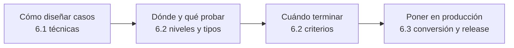

---
tags:
  - diseño-sistemas
  - parcial-2
  - unidad-6
  - indice
---
# Unidad 6 — Pruebas e Implementación

← Volver a [[00 - Índice Parcial 2]] · Versión compacta solo teórica → [[U6 - Índice (V2)]]

> [!info] Programa oficial de la Unidad 6 (`Contenido Parcial 2.png`)
> **Material:** presentaciones "Prueba de software", "Tipos de pruebas" e "Implementación", libro *Pruebas* (Myers, escrito "Meyer" en el programa), Pressman, *Ingeniería de software*, 9ª ed., caps. 19 y 20, y el libro *Implementación*.

| Subtema | Nota | Fuente | Estado |
| --- | --- | --- | --- |
| 6.1 Pruebas | [[U6.1 - Pruebas]] | `Unidad 6.1 - Pruebas v2.pdf` + resumen 2016 (debugging) | ✅ resumido |
| 6.2 Tipos de Pruebas | [[U6.2 - Tipos de Pruebas]] | `Unidad 6.2 - Tipos de Pruebas.pdf` + resumen 2016 | ✅ resumido |
| 6.3 Implementación | [[U6.3 - Implementación]] | `Unidad 6.3 - Implementación v2.pdf` | ✅ resumido |

> [!tip] Fuente extra
> `Exámenes/Parcial 2/Parcial 2 - 2016.pdf` es en realidad un **resumen de teoría de Pruebas y Debugging** (principios, caja blanca/negra, valores límite, integración, alfa/beta, terminación de pruebas). Está cruzado con los PDF de 6.1 y 6.2: de ahí salen la sección de **debugging** e **inspecciones** de [[U6.1 - Pruebas]] y varios matices de [[U6.2 - Tipos de Pruebas]].

> [!important] Unidad más preguntada
> Según el [[Banco de preguntas - Exámenes anteriores]], Pruebas es el tema que más se repite en parciales y finales: plan de pruebas, criterio de terminación, tipos con/sin usuarios, particiones de equivalencia y valores límite.

## Hilo conductor de la unidad

---

## ⚡ Repaso rápido de pruebas

| Concepto | Lo que hay que recordar | Nota |
| --- | --- | --- |
| Probar | Ejecutar con la **intención de encontrar errores**; caso exitoso = encuentra un error | [[U6.1 - Pruebas#2. ¿Qué significa probar?\|6.1]] |
| Caso de prueba | Entradas + condiciones + **resultado esperado** | [[U6.1 - Pruebas#3. Error, defecto y falla\|6.1]] |
| Error / defecto / falla | Persona / código / ejecución | [[U6.1 - Pruebas#3. Error, defecto y falla\|6.1]] |
| Particiones de equivalencia | Válidas **combinadas**, inválidas **de a una** | [[U6.1 - Pruebas#7. Caja negra - particiones de equivalencia\|6.1]] |
| Valores límite | Cada borde y **justo afuera**, en entrada **y salida** | [[U6.1 - Pruebas#8. Caja negra - análisis de valores límite\|6.1]] |
| Cobertura | Sentencias < decisiones; condiciones **no siempre** cubre decisiones; condición/decisión cubre ambas | [[U6.1 - Pruebas#10. Caja blanca - cobertura lógica\|6.1]] |
| Debugging | Después de una prueba exitosa; ubicar (95 %) + corregir; lo hace el autor | [[U6.1 - Pruebas#13. Debugging\|6.1]] |
| Integración | Incremental preferida; **descendente → stubs**, **ascendente → drivers** | [[U6.2 - Tipos de Pruebas#5. Pruebas de integración\|6.2]] |
| Humo / sanidad / regresión | ¿Arranca? / ¿anda el arreglo? / ¿se rompió algo? | [[U6.2 - Tipos de Pruebas#7. Humo, sanidad y regresión\|6.2]] |
| Sistema | Contra los **objetivos originales**; volumen = datos, esfuerzo = pico, performance = tiempos | [[U6.2 - Tipos de Pruebas#8. Pruebas de sistema\|6.2]] |
| Alfa / beta | Sitio del desarrollador, controlada / sitio del usuario, sin desarrollador | [[U6.2 - Tipos de Pruebas#9. Pruebas de aceptación\|6.2]] |
| Terminación | Combinar: métodos de diseño + cantidad de errores + **curva aplanada** | [[U6.2 - Tipos de Pruebas#10. ¿Cuándo terminar las pruebas?\|6.2]] |
| Plan de pruebas | Objetivos, criterios de terminación, cronograma, responsabilidades, recursos | [[U6.2 - Tipos de Pruebas#11. Planeamiento y control de la prueba\|6.2]] |

## ⚡ Repaso rápido de implementación

| Estrategia | Idea | Riesgo | Costo | Cuándo |
| --- | --- | --- | --- | --- |
| **Total** | Fecha de corte | Alto | Bajo | Sistema simple, colapso del viejo, fecha legal |
| **En paralelo** | Conviven y se comparan | Bajo | Alto | Error inaceptable (sueldos, bancos) |
| **Gradual** | Módulo a módulo | Medio | Medio | Sistema modular |
| **Por prototipado** | A demanda del usuario | Bajo en requisitos | Medio | Requerimientos difusos |
| **Distribuida** | Sede por sede, de chica a grande | Medio | Medio | Empresas con sucursales |

Las cinco etapas: conversión de **programas**, **datos** y **procedimientos**, **capacitación** (operativa y ejecutiva) y **evaluación final**. Releases: **major.minor.patch** y **alpha → beta → RC → GA**. Ver [[U6.3 - Implementación]].

> [!warning] Para revisar con la cátedra
> - **Debugging** e **inspecciones (detalle)** no están en las presentaciones actuales: salen del resumen 2016.
> - **Mantenimiento y rejuvenecimiento** se preguntaron en 2012 pero no están en la 6.3: van como `Extra` en [[U6.3 - Implementación#11. Mantenimiento y rejuvenecimiento]].
> - La presentación 6.2 y el resumen 2016 **no coinciden** sobre el criterio de terminación por valores límite y conjetura: ver [[U6.2 - Tipos de Pruebas#10. ¿Cuándo terminar las pruebas?]].
