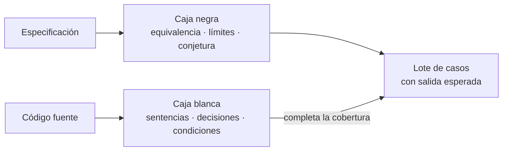
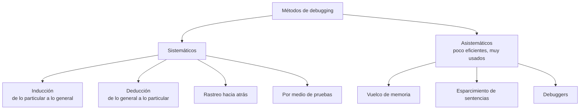

---
tags:
  - diseño-sistemas
  - parcial-2
  - unidad-6
  - pruebas
  - debugging
unidad: "6.1"
fuente:
  - "Parcial 2 - Contenido/Unidad 6/Diseño de Sistemas - Unidad 6.1 - Pruebas v2.pdf"
  - "Parcial 2 - Contenido/Exámenes/Parcial 2/Parcial 2 - 2016.pdf"
estado: en-progreso
---
# U6.1 — Pruebas de Software

← [[U6 - Índice]] · Siguiente → [[U6.2 - Tipos de Pruebas]]

> [!abstract] TL;DR
> - **Probar es ejecutar un programa con la intención de encontrar errores.** Es destructivo: un caso **exitoso** es el que **encuentra** un error.
> - Las pruebas muestran la **presencia** de errores, nunca su **ausencia** (Dijkstra). La prueba **exhaustiva es imposible**: hay que elegir bien los casos.
> - Un **caso de prueba** = entradas + condiciones de ejecución + **resultado esperado**. Sin resultado esperado no hay caso.
> - **Caja negra** (sale de la especificación): particiones de equivalencia, valores límite, conjetura de errores. **Caja blanca** (sale del código): cobertura de sentencias, decisiones y condiciones.
> - Equivalencia: **válidas combinadas, inválidas de a una**. Valores límite: probar **cada borde** y **justo afuera**, en la entrada y en la salida.
> - **Debugging** viene **después** de una prueba exitosa: ubicar el error (95 % del trabajo) y corregirlo. Lo hace el **propio programador**.

> [!note] Convención y fuentes
> El contenido principal sale de la presentación **6.1 Pruebas v2** (incluidas las diapositivas de código del triángulo, que son imagen). Las secciones de **inspecciones (detalle)**, **estrategia combinada** y **debugging** salen del resumen de teoría `Parcial 2 - 2016.pdf`, que no es un examen. Lo agregado por mí va en callouts **`Extra`**. Las preguntas que salieron en exámenes anteriores están marcadas con 📝.

## Índice
- [[#1. Caso de estudio - el triángulo]]
- [[#2. ¿Qué significa probar?]]
- [[#3. Error, defecto y falla]]
- [[#4. Principios de la prueba]]
- [[#5. Inspecciones y revisiones]]
- [[#6. Caja negra y caja blanca]]
- [[#7. Caja negra - particiones de equivalencia]]
- [[#8. Caja negra - análisis de valores límite]]
- [[#9. Caja negra - conjetura de errores]]
- [[#10. Caja blanca - cobertura lógica]]
- [[#11. Estrategia combinada]]
- [[#12. Práctica - cotizador de envíos]]
- [[#13. Debugging]]
- [[#14. Preguntas tipo parcial]]

---

## 1. Caso de estudio - el triángulo

> [!quote] El problema (Myers)
> El programa lee **tres números enteros** de un archivo, interpretados como las longitudes de los lados de un triángulo, y escribe un mensaje que informa si el triángulo es **escaleno, isósceles o equilátero**.

| Tipo | Condición |
| --- | --- |
| Equilátero | $a = b = c$ |
| Isósceles | Dos lados iguales ($a = b$) y el desigual menor que la suma de los iguales ($2a > c$) |
| Escaleno | $a \neq b \neq c$ |
| **Cualquier triángulo** | **Desigualdad triangular**: la suma de los dos lados menores es **mayor** que el lado mayor |

### Los 14 casos del apunte

| # | Entrada | Qué se prueba | Salida esperada |
| --- | --- | --- | --- |
| 1 | 3, 4, 5 | Escaleno válido | Escaleno |
| 2 | 3, 3, 3 | Equilátero válido | Equilátero |
| 3 | 3, 3, 4 | Isósceles válido | Isósceles |
| 4 | 3, 4, 3 · 4, 3, 3 | Permutaciones del isósceles | Isósceles |
| 5 | 1, 2, 3 | Suma de dos lados **=** tercero | No es triángulo |
| 6 | 1, 3, 2 · 2, 3, 1 | Permutaciones del caso 5 | No es triángulo |
| 7 | 12, 15, 30 | Suma de dos lados **<** tercero | No es triángulo |
| 8 | 15, 30, 12 · 30, 12, 15 | Permutaciones del caso 7 | No es triángulo |
| 9 | 2, 2, 4 | Isósceles degenerado ($2a = c$) | No es triángulo |
| 10 | 0, 4, 5 | Un lado cero | Error: lados > 0 |
| 11 | -3, 4, 5 | Un lado negativo | Error: lados > 0 |
| 12 | 0, 0, 0 | Todos cero | Error: lados > 0 |
| 13 | 3, 4.5, 5 | Valor no entero | Formato inválido |
| 14 | 3, 4 | Cantidad de valores errónea | Formato inválido |

Además hay que probar la **lectura del archivo**: que no exista, que esté vacío, separador distinto, letras u otros caracteres, números demasiado grandes y líneas en blanco.

> [!important] La pregunta del apunte
> "¿Especificaron la **salida esperada** de cada caso, además de los valores de entrada?" Si no, **no son casos de prueba**.

### El código bajo prueba (C#, diapositivas en imagen)

```csharp
// Lectura: si el archivo no existe, informa y termina; recorre las líneas;
// una línea en blanco se informa y se continúa.
string[] partes = linea.Split(' ', StringSplitOptions.RemoveEmptyEntries);

// Validación: 4 condiciones unidas con || → material para cobertura de condiciones
if (partes.Length != 3 ||
    !int.TryParse(partes[0], out int a) ||
    !int.TryParse(partes[1], out int b) ||
    !int.TryParse(partes[2], out int c))
{
    Console.WriteLine($"Línea {numeroLinea}: Formato inválido");
}

// Clasificación: 5 salidas posibles → un caso por rama es el mínimo para cobertura de decisiones
public static string TipoTriangulo(int a, int b, int c)
{
    if (a <= 0 || b <= 0 || c <= 0) return "Error: Todos los lados deben ser mayores que cero.";
    if ((a + b <= c) || (a + c <= b) || (b + c <= a)) return "Error: Los lados no forman un triángulo válido.";
    if (a == b && b == c) return "Triángulo equilátero";
    else if (a == b || b == c || a == c) return "Triángulo isósceles";
    else return "Triángulo escaleno";
}
```

> [!warning] Un defecto que los 14 casos no ven
> Entrada **2147483647, 2147483647, 1** → esperado **isósceles**, obtenido **error**.
> **Causa:** `a + b` **desborda** `int` y da -2, que es menor que `c`. La suma de dos valores válidos produce un resultado inválido.
> **Corrección:** promover a `long` antes de sumar (`(long)a + b <= c`) o comparar `a > c - b` con operandos positivos.
> Moraleja: los 14 casos "clásicos" pasan y el programa **igual falla**. Los valores extremos (máximo de `int`) son un caso de [[#8. Caja negra - análisis de valores límite|valores límite]] y de [[#9. Caja negra - conjetura de errores|conjetura de errores]].

---

## 2. ¿Qué significa probar?

| Definiciones **incorrectas** ✗ | Definición **correcta** ✓ |
| --- | --- |
| Probar es **demostrar que no hay errores** en el programa (imposible). | **Probar es el proceso de ejecutar un programa con la intención de encontrar errores.** |
| El propósito de probar es **mostrar que el programa realiza correctamente** las funciones esperadas. | Es una actividad **destructiva**: un caso exitoso es el que **descubre un error**. |
| Probar es el proceso que lleva a **confiar** en que el programa hará lo que se supone (incompleto: falta ver que **no haga lo que no debe**). | |

> [!quote] Definiciones
> - **Prueba:** proceso **destructivo** de tratar de encontrar errores en un programa. El **caso exitoso** de prueba es aquel que **encuentra un error** encubierto.
> - **Buen caso de prueba:** el que tiene una **elevada probabilidad** de encontrar un error aún no descubierto.
> - "Las pruebas pueden mostrar la **presencia** de errores, pero nunca su **ausencia**." (Dijkstra)

- **Meta imposible:** probar que no hay errores. Las personas rinden peor ante tareas imposibles.
- **Meta alcanzable:** descubrir errores. Orienta el trabajo de prueba.
- **Una inversión:** "Encontrar un error es una inversión, no hacerlo es un gasto." Cada error hallado ahora es un costo evitado después.

> [!important] La prueba exhaustiva es imposible
> ¿Se puede probar un programa para encontrar **todos** los errores? **No.** De ahí salen dos temas:
> - **Psicología de la prueba:** ¿quién debería probar?
> - **Economía de la prueba:** ¿cuántos casos y para qué? Hay que elegir el subconjunto de casos con más probabilidad de encontrar errores.

---

## 3. Error, defecto y falla

| Error (mistake) | Defecto (defect, bug, fault) | Falla (failure) |
| --- | --- | --- |
| **Equivocación de una persona** | Está **en el código o el diseño** | Se **observa al ejecutar** |
| Interpretar mal la especificación | `a + b` puede desbordar `int` | Un isósceles válido se rechaza |

> [!quote] Caso de prueba
> **Entradas + condiciones de ejecución + resultado esperado.** Sin resultado esperado no se puede decidir si hubo falla.

> [!important] Hay falla en los dos sentidos
> Si el programa **no hace lo que debe**, o si **hace lo que no debe**: declarar escaleno a (1, 2, 3) también es un error.

---

## 4. Principios de la prueba

| # | Principio | Por qué |
| --- | --- | --- |
| 1 | **El resultado esperado es parte del caso** | Se define **antes** de ejecutar; si no, se tiende a aceptar cualquier salida. |
| 2 | **Evitar que el autor pruebe su programa** | Sesgo psicológico (falta de actitud destructiva) y la **misma interpretación errónea** de la especificación. |
| 3 | **La independencia mejora la prueba** | Otra persona o equipo ve lo que el autor no ve. Vale también para empresas. |
| 4 | **Inspeccionar cada resultado a fondo** | Muchos errores se ven en la salida y se pasan por alto ("se camuflan"). |
| 5 | **Probar entradas inválidas e inesperadas** | No solo las válidas: ahí se esconden muchos errores. |
| 6 | **Verificar también lo que no debe hacer** | Probar que hace lo esperado es solo la mitad del problema. |
| 7 | **Evitar casos desechables** | Conservarlos y automatizarlos: son una inversión (**regresión**). |
| 8 | **No asumir que no habrá errores** | Planificar el esfuerzo esperando encontrarlos. |
| 9 | **Los errores se agrupan** | Cuantos más errores en una sección, más probable que queden otros. |
| 10 | **Probar es creativo** | Un desafío intelectual, no una tarea mecánica. |

> [!warning] Trampa típica
> "El programador no debe probar su programa" ≠ "el programador no debe hacer **debugging**". Según el resumen 2016, **el debugging sí lo hace el propio programador** (ver [[#13. Debugging]]).

---

## 5. Inspecciones y revisiones

> [!quote] Inspección
> **Lectura o inspección visual del programa, realizada por un equipo de personas.** El objetivo es **encontrar errores, no soluciones**: la corrección se decide después.

- **Cuándo sirven:** muy útiles en el **mantenimiento** de un programa.
- **Más allá de los errores:** feedback al programador y aprendizaje para todo el equipo.

### Detalle según el resumen 2016

La **prueba humana** (leer el programa sin computadora) es muy efectiva: cuanto antes se detecta un error, menos cuesta corregirlo, y es **complementaria** de la prueba con computadora. Se aplica entre que el módulo se codifica y empiezan las pruebas con computadora.

| Rol (idealmente 4 personas) | Tarea |
| --- | --- |
| **Moderador** | Programador experto, **no es el autor**. Distribuye el material, coordina horarios, dirige las sesiones, anota los errores y se asegura de que después se corrijan. |
| **Programador** | Describe la lógica sentencia por sentencia. |
| **Diseñador** del programa | |
| **Especialista en pruebas** | |

**Procedimiento:**
1. Con **varios días de anticipación**, el moderador reparte el programa y las especificaciones.
2. En la sesión, el **programador narra la lógica sentencia por sentencia** y le hacen preguntas. Leer el propio código en voz alta funciona: **el programador encuentra más errores que el resto**.
3. Se analiza el programa con una **lista ayuda-memoria** de errores frecuentes. El moderador cuida que se **busquen errores, no correcciones**.
4. Al final, el programador recibe la **lista de errores**. Si son muchos, se hace una **reinspección**. La lista se usa para afinar la ayuda-memoria.

> [!important] Actitud
> El programador **no debe tomarlo como un ataque personal**. Los resultados son **confidenciales**.

---

## 6. Caja negra y caja blanca

| | Caja negra | Caja blanca |
| --- | --- | --- |
| **De dónde salen los casos** | **Solo de la especificación** (entradas → ? → salidas) | De la **estructura interna** del programa (el código) |
| **Técnicas** | Particiones de equivalencia · Valores límite · Conjetura de errores | Cobertura de sentencias · de decisiones · de condiciones |

> [!quote] La pregunta del diseño de casos
> ¿Cuál es el **subconjunto** de todos los casos posibles con **mayor probabilidad de detectar el mayor número de errores**?

> [!warning] Diseñar al azar
> También es una metodología, aunque **muy pobre** en resultados.

---

## 7. Caja negra - particiones de equivalencia

Un **buen caso** tiene dos propiedades:
1. **Reduce** el número de otros casos de prueba que hay que idear.
2. **Cubre** un conjunto extenso de otros casos posibles.

> [!quote] Idea
> Partir el dominio de entrada en un **número finito de clases de equivalencia**, de modo que probar **un valor representativo** de cada clase equivalga a probar cualquier otro valor de esa clase.

Ejemplo: "la cantidad debe estar entre 1 y 999" → clase inválida `cant < 1` (representante **0**), válida `1 ≤ cant ≤ 999` (**500**), inválida `cant > 999` (**1200**). Si falla con 500, es razonable que falle con cualquier valor de su clase.

### Procedimiento paso a paso

1. **Identificar las condiciones externas de entrada** (se leen de la especificación).
2. **Partir cada condición en clases** válidas e inválidas.
3. **Asignar un número único** a cada clase.
4. **Casos válidos: combinar.** Cada nuevo caso cubre **tantas clases válidas** aún no cubiertas **como sea posible**, hasta cubrirlas todas.
5. **Casos inválidos: separar.** Cada caso cubre **una y solo una** clase inválida, hasta cubrirlas todas.

### Cómo identificar las clases

| Si la condición de entrada es… | Válidas | Inválidas | Ejemplo |
| --- | --- | --- | --- |
| Un **rango** de valores | 1 | 2 | Cantidad entre 1 y 999 |
| Una **cantidad específica** de valores | 1 | 2 | Tres lados (menos de 3 y más de 3) |
| Un **conjunto** de valores tratados distinto | **una por cada valor** | 1 | Tipo de libro: cartón, cartulina, tela |
| Una condición **"debe ser"** | 1 | 1 | El primer carácter debe ser una letra |

Si el programa trata distinto a algunos elementos de una clase, **se subdivide** la clase.

> [!danger] Una sola clase inválida por caso
> Especificación: tipo de libro (cartón, cartulina, tela) y cantidad (1–999).
> - ❌ **(XXX, 0)**: cubre **dos** clases inválidas. Si el programa valida primero el tipo y sale, el control de cantidad **nunca se ejecuta**.
> - ✅ **(XXX, 10)** y **(cartón, 0)**: un caso por clase inválida, con el resto de los datos válidos.
>
> **Para que un control sea probado, el resto de los datos debe ser válido.**

### Ejemplo - tabla de clases

| Condición externa | Clase válida | Clases inválidas |
| --- | --- | --- |
| Cantidad entre 1 y 999 | (1) $1 \le cant \le 999$ | (2) $cant < 1$ · (3) $cant > 999$ |
| El primer carácter debe ser una letra | (4) palabra que empieza con letra | (5) palabra que empieza con número |

- **Válido:** (500, "Ana") cubre (1) y (4) en **un solo** caso.
- **Inválidos:** (0, "Ana") → (2) · (1000, "Ana") → (3) · (500, "7up") → (5).

### Volvamos al triángulo

| Clases válidas | Clases inválidas |
| --- | --- |
| (1) Tres enteros > 0 que forman un **equilátero** | (4) Algún lado ≤ 0 |
| (2) … que forman un **isósceles** | (5) Dos lados suman **igual** que el tercero |
| (3) … que forman un **escaleno** | (6) Dos lados suman **menos** que el tercero |
| | (7) Valor no entero |
| | (8) Cantidad de valores distinta de 3 |

Cada una puede subdividirse, por ejemplo, en las **permutaciones** de los lados iguales.

---

## 8. Caja negra - análisis de valores límite

> [!quote] Valores límite
> Los casos que **exploran los límites** rinden más que los que no lo hacen. Los límites son los valores **justo encima y justo debajo** de los márgenes de cada clase, **de entrada y de salida**. **Cada margen de cada clase debe ser probado.**

Diferencias con particiones de equivalencia (resumen 2016):
1. En vez de elegir **cualquier** representante, se eligen elementos para que **cada margen** de la clase sea probado.
2. Los casos se derivan también del **espacio de resultados** (clases de equivalencia de **salida**).

| Dominio | Valores a probar | Regla |
| --- | --- | --- |
| Entero de 1 a 255 | **0**, 1, 255, **256** | Un entero: el valor de afuera es el borde ± 1 |
| Real de -1,0 a 1,0 | **-1,001**, -1,0, 1,0, **1,001** | Dos valores en el borde y dos inmediatamente fuera |
| Salida: contribución mensual de $0,00 a $500.000 | $0, $500.000, **negativa**, **mayor a $500.000** | Los límites también se buscan en la **salida calculada** |

Reglas del resumen 2016:
- **Rango de valores:** casos para los extremos y casos inválidos justo más allá.
- **Número de valores:** casos para el mínimo y el máximo, y uno por debajo y uno por encima.
- **Conjunto ordenado** (entrada o salida): atención al **primer** y al **último** elemento.

> [!example] 📝 Archivo de 1 a 10.000 registros
> **0** (archivo vacío, inválido) · **1** (mínimo) · **2** · **9.999** · **10.000** (máximo) · **10.001** (inválido), más un valor intermedio representativo. Ver la [[#14. Preguntas tipo parcial|pregunta]] y el [[Banco de preguntas - Exámenes anteriores|error del banco]].

---

## 9. Caja negra - conjetura de errores

> [!quote] Conjetura de errores
> Hay personas con **habilidad natural** para probar: **intuyen**, por **experiencia**, qué errores son probables y diseñan casos que los revelen. Se arma una **lista de posibles errores** (o de suposiciones que el programador pudo haber hecho al leer la especificación) y se escriben casos para ellos.

| Ejemplo: función que ordena una lista | Lista de sospechosos habituales |
| --- | --- |
| 1. La lista está **vacía** | Vacío, nulo o solo espacios |
| 2. Tiene **una sola** entrada | Cero, negativos y valores máximos |
| 3. Todos los datos tienen el **mismo valor** | Caracteres especiales y acentos |
| 4. **Ya está ordenada** | Fechas límite (29 de febrero) |
| | Duplicados y orden inverso |

---

## 10. Caja blanca - cobertura lógica

### Cobertura de sentencias

> [!quote] Sentencias
> Cada **línea (sentencia)** se ejecuta **al menos una vez**.

```csharp
void evaluar(int x) {
    if (x > 0) {
        Console.WriteLine("Positivo");
    }
    Console.WriteLine("Fin");
}
```

Con `x = 1` se ejecutan todas las líneas (100 %), pero **nunca se probó `x ≤ 0`**. En `if (usuario.IsAdmin || usuario.Id == 1)`, con `IsAdmin == true` se ejecuta la línea, pero no se prueba qué pasa con `Id == 1` e `IsAdmin == false`. **Es el criterio más débil.**

### Cobertura de decisiones (o de ramificación)

> [!quote] Decisiones
> Cada **decisión lógica** (`if`, `while`, `for`…) toma **ambos valores, verdadero y falso**, al menos una vez. Dicho de otra forma: cada dirección de cada rama se recorre al menos una vez.

- `evaluar(int x)`: `x = 1` (V → "Positivo, Fin") y `x = -1` (F → "Fin"). **2 casos = 100 %**, y con ellas todas las sentencias.
- `if (a > 0 && b > 0)`: (a=1, b=1) → V y (a=-1, b=1) → F. **2 casos = 100 %** (aunque `b > 0` nunca fue falsa).

### Cobertura de condiciones

> [!quote] Condiciones
> Cada **condición individual** de una expresión compuesta se evalúa en **verdadero y en falso**, sin importar el resultado final de la decisión.

En `if (a > 0 || b > 0)`:

| a | b | a > 0 | b > 0 | Decisión |
| --- | --- | --- | --- | --- |
| 1 | -1 | V | F | **V** |
| -1 | 1 | F | V | **V** |

Cada condición tomó V y F, pero **la decisión fue siempre verdadera**: nunca se probó la rama falsa.

### Comparando los criterios

| Criterio | Exige | ¿Garantiza lo anterior? |
| --- | --- | --- |
| **Sentencias** | Cada línea se ejecuta al menos una vez | Es el **más débil** |
| **Decisiones** | Cada decisión toma V y F | **Incluye** sentencias |
| **Condiciones** | Cada condición toma V y F | **No siempre** cubre decisiones |
| **Condición/decisión** | Ambos criterios a la vez | **Incluye** los dos anteriores |

En `(a > 0 || b > 0)`, los casos **(1, 1)** y **(-1, -1)** alcanzan condición/decisión.

> [!warning] Trampas de V/F
> - "Con cobertura de condiciones del 100 % se cubren todas las decisiones" → **Falso** (ejemplo de arriba).
> - "Una cobertura del 100 % prueba que el programa es correcto" → **Falso**: **no prueba que no falte funcionalidad**. Se combina con caja negra.
> - El resumen 2016 menciona además la **cobertura de condición múltiple** (todas las combinaciones de condiciones): es **la más completa**.

---

## 11. Estrategia combinada

Ninguna técnica sola da un conjunto perfecto de casos: **hay que combinarlas**. Según el resumen 2016, en general se hace **90 % caja negra y 10 % caja blanca**. Estrategia razonable:

1. **Siempre** usar **análisis de valores límite** (en la entrada y en la salida).
2. Identificar las **clases de equivalencia** válidas e inválidas de entrada y de salida, y completar con casos.
3. Agregar casos con **conjetura de errores**.
4. **Examinar la lógica** del programa: si no se cumple el criterio de cobertura elegido (decisión, condición, decisión/condición o condición múltiple), **agregar casos** hasta cumplirlo.

> [!important] Prueba por módulos: con qué información (resumen 2016)
> Para diseñar casos de una prueba de módulo hacen falta **el código fuente** (→ caja blanca primero) y **la especificación del módulo** (→ se complementa con caja negra).



---

## 12. Práctica - cotizador de envíos

> [!example] Especificación
> Recibe **peso**, **tipo de servicio** y **código postal** y devuelve el costo o un mensaje de error que indica el dato inválido.
> - **Peso (kg):** número con un decimal, de 0,1 a 30,0 inclusive.
> - **Servicio:** texto exacto `Estándar`, `Express` o `Económico`.
> - **Código postal:** entero de 4 dígitos, de 1000 a 9999.
> - **Tarifa:** base liviano (hasta 5,0 kg) $3.000 · pesado (más de 5,0 kg) $6.000. Multiplicador: Económico × 0,8 · Estándar × 1 · Express × 1,5.

### Clases de equivalencia

| Condición | Válidas | Inválidas |
| --- | --- | --- |
| Peso | (1) 0,1 ≤ peso ≤ 5,0 **liviano** · (2) 5,1 ≤ peso ≤ 30,0 **pesado** | (3) < 0,1 · (4) > 30,0 · (5) no numérico |
| Servicio | (6) Estándar · (7) Express · (8) Económico | (9) otro texto · (10) vacío |
| Código postal | (11) 1000 ≤ cp ≤ 9999 | (12) < 1000 · (13) > 9999 · (14) no numérico |

El peso se **subdivide** en liviano y pesado porque el programa los **trata distinto** (tarifa base).

### Casos

| Caso | Peso | Servicio | CP | Clases | Salida esperada |
| --- | --- | --- | --- | --- | --- |
| V1 | 2,5 | Estándar | 5000 | 1, 6, 11 | $3.000 |
| V2 | 12,0 | Express | 1425 | 2, 7, 11 | $9.000 |
| V3 | 20,0 | Económico | 2000 | 2, 8, 11 | $4.800 |
| I1 | 0,0 | Estándar | 5000 | 3 | Error: peso inválido |
| I2 | 35,0 | Estándar | 5000 | 4 | Error: peso inválido |
| I3 | abc | Estándar | 5000 | 5 | Error: peso inválido |
| I4 | 2,5 | Premium | 5000 | 9 | Error: servicio inválido |
| I5 | 2,5 | (vacío) | 5000 | 10 | Error: servicio inválido |
| I6 | 2,5 | Estándar | 999 | 12 | Error: código postal inválido |
| I7 | 2,5 | Estándar | 10000 | 13 | Error: código postal inválido |
| I8 | 2,5 | Estándar | ABCD | 14 | Error: código postal inválido |

**3 casos válidos son el mínimo** (hay 3 servicios y cada caso usa uno). Cualquier combinación que cubra las 6 clases válidas con 3 casos es correcta.

> [!danger] Errores frecuentes
> - Combinar dos clases inválidas en un caso.
> - Olvidar las clases "vacío" y "no numérico".
> - No subdividir el peso en liviano y pesado.
> - Usar siempre el mismo servicio en los casos válidos.
> - **No escribir la salida esperada.**

**Siguiente paso, valores límite:** peso 0,0 · 0,1 · 5,0 · 5,1 · 30,0 · 30,1 · CP 999 · 1000 · 9999 · 10000.
**Ambigüedad a detectar:** ¿"Express" acepta mayúsculas o minúsculas? La especificación no lo dice.

---

## 13. Debugging

> [!warning] Fuente de esta sección
> La presentación 6.1 **no tiene diapositivas de debugging**. Todo sale del resumen de teoría `Parcial 2 - 2016.pdf`. Lo incluyo porque el debugging salió **5 veces** en exámenes anteriores (ver el [[Banco de preguntas - Exámenes anteriores|banco]]), pero verificá con la cátedra si sigue en el programa.

> [!quote] Debugging
> Actividad que se realiza **después de ejecutar un caso de prueba exitoso** (es decir, que encontró un error). Tiene dos partes:
> 1. **Determinar la naturaleza exacta y la ubicación** del error: es el **95 %** del problema.
> 2. **Corregir** el error.

Es la tarea **más abrumadora** (presión de la organización, del cliente y propia; el error puede estar en cualquier sentencia) y **psicológicamente difícil** (corregir un error es un indicio de imperfección).

### Prueba vs. debugging

| | Prueba | Debugging |
| --- | --- | --- |
| **Objetivo** | **Exponer** errores no detectados | **Ubicar y corregir** un error ya detectado |
| **Quién** | Idealmente **otro** (no el autor) | El **propio programador** |
| **Casos** | **"Gordos"**: cubren tantas condiciones como sea posible con pocos casos | **"Delgados"**: cubren una o pocas condiciones cada uno |
| **Cuándo** | Antes | Después de una prueba exitosa |

### Métodos de debugging



| Método | Cómo funciona |
| --- | --- |
| **Inducción** | Parte de las **pistas** (síntomas) y busca relaciones: **ubicar los datos pertinentes** (qué hace bien y qué hace mal) → **organizarlos** → **formular una hipótesis** → **probarla** (que explique todos los síntomas). |
| **Deducción** | Parte de teorías generales y elimina: **enumerar causas posibles** → **usar los datos para eliminar** todas menos una → **refinar** la hipótesis restante → **probarla**. |
| **Rastreo hacia atrás** | Recorrer la lógica **hacia atrás** desde el síntoma hasta el punto donde se desvía. Efectivo en **programas pequeños**. |
| **Por medio de pruebas** | Escribir **variantes "delgadas"** del caso original para acotar la ubicación exacta del error. |
| **Vuelco de memoria** (asistemático) | Volcar la memoria en hexadecimal. **El más ineficiente.** |
| **Esparcimiento de sentencias** (asistemático) | Agregar `print` para mostrar mensajes o variables. |
| **Debuggers** (asistemático) | Herramienta del lenguaje: **puntos de detención** para examinar el programa sin modificarlo. |

> [!danger] Problemas del vuelco de memoria
> Cuesta relacionar direcciones con variables · la mayor parte de la información es irrelevante · es una imagen **estática** (y se necesita la dinámica) · puede enmascarar lo que se busca · no da un método para encontrar la causa.

> [!danger] 📝 Problemas del esparcimiento de sentencias
> - Es **prueba y error**: no obliga a pensar el problema.
> - Puede producir una **enorme cantidad de datos** para analizar.
> - **Modifica el programa**, lo que puede **enmascarar** el error.
> - En programas extensos es muy costoso, y en algunos, **imposible**.

Los métodos asistemáticos se usan solo **como suplemento** (no sustituto) de los sistemáticos o cuando estos fallan.

### Principios de debugging

| Para buscar el error | Para repararlo |
| --- | --- |
| **Pensar**: analizar los síntomas; ubicar la mayoría de los errores sin la computadora | **Donde hay un error, probablemente haya otro** (revisar la vecindad) |
| Ante un impasse, **descansar** | **Arreglar el error, no solo el síntoma** |
| Ante un impasse, **describir el problema a otra persona** | La corrección **no es 100 % segura**: probarla incluso más que el original |
| Herramientas de debugging **solo como segundo recurso** | La probabilidad de que la corrección esté bien **baja con el tamaño** del programa (1 de cada 6 errores nuevos viene de una corrección previa) |
| **Evitar experimentos** (último recurso: "esperanza ciega") | Cuidado con que la corrección **genere un error nuevo** → prueba de **deterioro** (regresión) |
| | Corregir **vuelve temporalmente a la etapa de diseño**: aplicar los mismos métodos que al diseñar |

> [!tip] Extra: "describir el problema a otra persona"
> Es lo que hoy se conoce como *rubber duck debugging*: explicarle el código a un patito de goma. Al verbalizarlo, muchas veces aparece la solución sola.

---

## 14. Preguntas tipo parcial

> [!info] Origen
> Las marcadas con 📝 son **reales** (fuente entre paréntesis, ver [[Banco de preguntas - Exámenes anteriores#Unidad 6 — Pruebas e Implementación|el banco]]). Las de V/F y múltiple opción las **armé yo** con el formato actual.

> [!question]- 📝 Explique el método de particiones de equivalencia y complételo con un ejemplo. (Final 03/2012)
> Es una técnica de **caja negra**. Se parte el dominio de entrada en un **número finito de clases** tales que probar un representante equivalga a probar cualquier valor de la clase. Pasos: (1) identificar las condiciones de entrada en la especificación; (2) partir cada una en clases **válidas e inválidas**; (3) numerarlas; (4) escribir casos que cubran **tantas clases válidas como se pueda**; (5) escribir **un caso por cada clase inválida**, con el resto de los datos válidos.
> **Ejemplo:** cantidad entre 1 y 999 y primer carácter letra → clases (1) 1–999, (2) < 1, (3) > 999, (4) empieza con letra, (5) empieza con número. Casos: (500, "Ana") → 1 y 4; (0, "Ana") → 2; (1000, "Ana") → 3; (500, "7up") → 5. Ver [[#7. Caja negra - particiones de equivalencia]].

> [!question]- 📝 Un programa clasifica triángulos en equiláteros, isósceles y escalenos. Formule el lote de pruebas e indique el criterio. (Final 03/2012, 15 pts)
> **Criterio:** particiones de equivalencia + valores límite + conjetura de errores (caja negra), cada caso **con su salida esperada**.
> - **Válidos:** (3, 4, 5) escaleno · (3, 3, 3) equilátero · (3, 3, 4) isósceles + **permutaciones** (3, 4, 3) y (4, 3, 3).
> - **Límite de la desigualdad:** (1, 2, 3) suma igual al tercero + permutaciones · (2, 2, 4) isósceles degenerado → no es triángulo.
> - **Suma menor:** (12, 15, 30) + permutaciones → no es triángulo.
> - **Inválidos de a uno:** (0, 4, 5), (-3, 4, 5), (0, 0, 0) → lados > 0 · (3, 4.5, 5) → no entero · (3, 4) → cantidad errónea.
> - **Conjetura:** valores máximos (2147483647, 2147483647, 1) → desborde; archivo inexistente, vacío, con letras o líneas en blanco.
> Ver [[#1. Caso de estudio - el triángulo]].

> [!question]- 📝 ¿Cuándo se usan las pruebas de caja blanca? (2004 y banco)
> Cuando se tiene acceso al **código fuente**, típicamente en la **prueba de unidad o de módulo**: se analiza la lógica del módulo (cobertura de sentencias, decisiones, condiciones) y después se complementa con caja negra contra la especificación. También al final de la estrategia combinada, para **completar la cobertura** que no alcanzaron los casos de caja negra. No sirve sola: no detecta **funcionalidad faltante**.

> [!question]- 📝 ¿Con qué criterio generaría un caso de prueba? (banco)
> Con el que tenga **mayor probabilidad de encontrar un error aún no descubierto** y que **cubra muchos otros casos posibles**. En la práctica: un representante de cada **clase de equivalencia**, los **valores límite** de cada clase (entrada y salida), casos de **conjetura de errores** y, mirando el código, los que falten para la **cobertura** elegida. Siempre con el **resultado esperado** definido de antemano.

> [!question]- 📝 Un módulo lee un archivo de 1 a 10.000 registros. ¿Cómo lo probaría? (banco)
> Con **valores límite** sobre la cantidad de registros: **0** (vacío, inválido), **1**, **2**, **9.999**, **10.000** y **10.001** (inválido), más un valor intermedio (por ejemplo, 5.000). Se suman casos de conjetura: archivo inexistente, registros con formato inválido, último registro sin salto de línea.
> ⚠️ El banco "Preguntas varias" responde 0, 1, 500, 1000 y 1001: **está mal** (son los límites de 1 a 1000).

> [!question]- 📝 Describa una inspección de software. (banco)
> Es la **lectura del programa por un equipo** (idealmente moderador, programador, diseñador y especialista en pruebas) para **encontrar errores, no corregirlos**. El moderador reparte el material días antes; en la sesión el programador **narra la lógica sentencia por sentencia** y se revisa con una **lista ayuda-memoria** de errores frecuentes. Al final el programador recibe la lista de errores; si son muchos, hay reinspección. Los resultados son confidenciales y no es un ataque personal. Ver [[#5. Inspecciones y revisiones]].

> [!question]- 📝 ¿Qué métodos de debugging conoce? (banco)
> **Sistemáticos:** inducción (de los síntomas a la hipótesis), deducción (de las causas posibles, eliminando), rastreo hacia atrás y por medio de pruebas (casos "delgados"). **Asistemáticos:** vuelco de memoria, esparcimiento de sentencias y debuggers. Ver [[#Métodos de debugging]].

> [!question]- 📝 ¿Qué inconvenientes tiene el debugging por esparcimiento de sentencias? (banco)
> Es prueba y error sin pensar el problema; genera muchísimos datos; **modifica el programa** (puede enmascarar el error); en programas grandes es carísimo o imposible.

> [!question]- 📝 ¿En qué se diferencia un caso de prueba para pruebas de uno para debugging? (banco)
> El de **prueba** busca **exponer errores nuevos** y es **"gordo"**: cubre muchas condiciones con pocos casos. El de **debugging** busca **información para ubicar un error ya detectado** y es **"delgado"**: cubre una o pocas condiciones, como variantes del caso original.

> [!question]- V/F: "Un caso de prueba exitoso es el que se ejecuta sin errores."
> **Falso.** Un caso exitoso es el que **encuentra** un error.

> [!question]- V/F: "En particiones de equivalencia, cada caso de prueba debe cubrir la mayor cantidad posible de clases inválidas."
> **Falso.** Las **válidas** se combinan; las **inválidas** van **de a una**, porque un error puede enmascarar el control del otro dato.

> [!question]- V/F: "La cobertura de decisiones incluye a la cobertura de sentencias."
> **Verdadero.** Si cada decisión toma V y F, todas las ramas (y sus sentencias) se ejecutan.

> [!question]- V/F: "Un error, un defecto y una falla son sinónimos."
> **Falso.** El **error** es la equivocación de la persona; el **defecto** queda en el código o el diseño; la **falla** se observa al ejecutar.

> [!question]- Múltiple opción: para un dominio entero de 1 a 255, ¿qué valores elige el análisis de valores límite?
> a) 1, 128, 255 · b) **0, 1, 255, 256** · c) -1, 0, 256, 257 · d) 1 y 255
> **Respuesta: b.** Los bordes y el valor inmediatamente afuera de cada uno.

> [!question]- Múltiple opción: ¿quién no debería participar como moderador de una inspección?
> a) Un programador experto · b) **El autor del programa** · c) Alguien que no conoce los detalles del programa
> **Respuesta: b.**

---

## Conceptos relacionados
- [[U6.2 - Tipos de Pruebas]]: dónde se aplican estas técnicas (unidad, integración, sistema, aceptación) y cuándo terminar de probar.
- [[U6.3 - Implementación]]: lo que pasa después de probar (conversión, capacitación, release).
- [[U5.4 - SOLID]]: el código con bajo acoplamiento (inversión de dependencias) es más fácil de probar de forma aislada.
- [[Banco de preguntas - Exámenes anteriores]]
