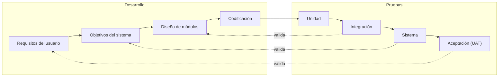
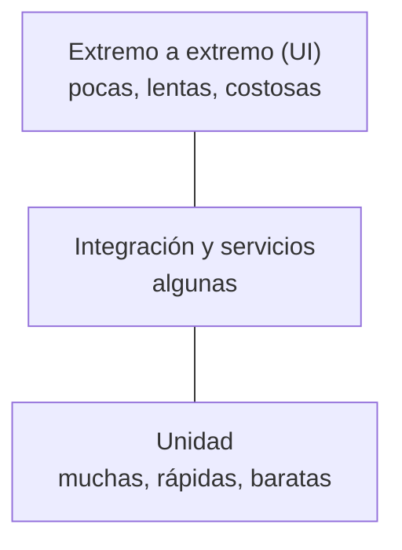
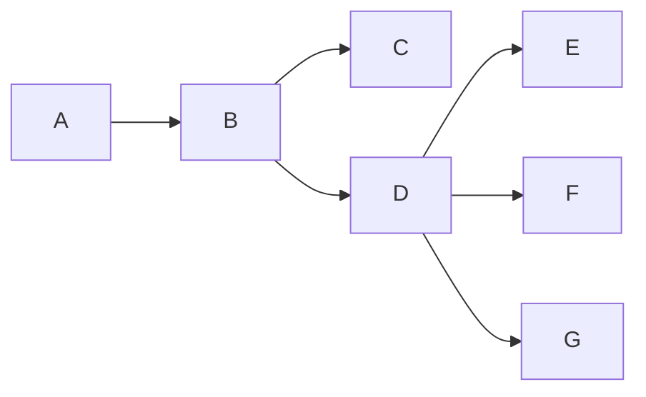

---
tags:
  - diseño-sistemas
  - parcial-2
  - unidad-6
  - pruebas
  - tipos-de-pruebas
unidad: "6.2"
fuente:
  - "Parcial 2 - Contenido/Unidad 6/Diseño de Sistemas - Unidad 6.2 - Tipos de Pruebas.pdf"
  - "Parcial 2 - Contenido/Exámenes/Parcial 2/Parcial 2 - 2016.pdf"
estado: en-progreso
---
# U6.2 — Tipos de Pruebas

← [[U6.1 - Pruebas]] · [[U6 - Índice]] · Siguiente → [[U6.3 - Implementación]]

> [!abstract] TL;DR
> - Toda prueba se describe con **tres miradas**: **nivel** (¿sobre qué alcance?), **tipo** (¿qué atributo?) y **técnica** (¿cómo se diseñan los casos?).
> - **Niveles:** unidad → integración → sistema → aceptación. En el **modelo en V**, cada nivel valida una etapa del desarrollo.
> - **Integración:** se prefiere la **incremental** (la falla apunta al último módulo agregado), descendente (con **stubs**) o ascendente (con **drivers**). La no incremental es *big-bang*.
> - **Humo** (¿arranca?), **sanidad** (¿anda el arreglo?) y **regresión** (¿se rompió algo que andaba?): rápidas y automatizadas.
> - **Sistema:** compara el sistema con sus **objetivos originales**: alcance, volumen, esfuerzo, performance, usabilidad, seguridad, configuración, recuperación…
> - **Aceptación (UAT):** la hace el **usuario final**; variantes **alfa** (en la organización, controlada) y **beta** (en el sitio del usuario, sin el desarrollador).
> - **Terminar las pruebas** con criterios **positivos y acordados de antemano**, nunca "cuando se acaba el tiempo".

> [!note] Convención y fuentes
> El contenido principal sale de la presentación **6.2 Tipos de Pruebas** (incluidos los diagramas de integración y la curva de errores). Lo que sale del resumen de teoría `Parcial 2 - 2016.pdf` está indicado como "resumen 2016". Lo agregado por mí va en callouts **`Extra`**. Las preguntas que salieron en exámenes anteriores están marcadas con 📝.

## Índice
- [[#1. Niveles, tipos y técnicas]]
- [[#2. El modelo en V]]
- [[#3. Pruebas de unidad]]
- [[#4. La pirámide de pruebas]]
- [[#5. Pruebas de integración]]
- [[#6. Pruebas de función]]
- [[#7. Humo, sanidad y regresión]]
- [[#8. Pruebas de sistema]]
- [[#9. Pruebas de aceptación]]
- [[#10. ¿Cuándo terminar las pruebas?]]
- [[#11. Planeamiento y control de la prueba]]
- [[#12. Práctica - ¿qué tipo de prueba es?]]
- [[#13. Preguntas tipo parcial]]

---

## 1. Niveles, tipos y técnicas

| Niveles | Tipos | Técnicas |
| --- | --- | --- |
| ¿Sobre **qué alcance** se prueba? | ¿**Qué atributo** se verifica? | ¿**Cómo** se diseñan los casos? |
| Unidad | Funcional | Partición de equivalencia |
| Integración | Humo y regresión | Valores límite |
| Sistema | Performance y esfuerzo | Conjetura de errores |
| Aceptación | Seguridad y usabilidad | Cobertura lógica |

> [!important] Las tres miradas a la vez
> Un mismo caso se describe con las tres: por ejemplo, una prueba **de integración** (nivel), **de regresión** (tipo), diseñada con **valores límite** (técnica). Las técnicas están en [[U6.1 - Pruebas]].

---

## 2. El modelo en V



**Cada nivel de prueba se contrasta con la etapa de desarrollo que le corresponde**: la aceptación contra los requisitos del usuario, el sistema contra sus objetivos, la integración contra el diseño de módulos y la unidad contra el código.

> [!tip] Extra: la espiral de Pressman (resumen 2016)
> El resumen 2016 describe la estrategia como una **espiral**: se empieza en el vértice con la prueba de **unidad** (código fuente), se sigue hacia afuera con **integración** (diseño y arquitectura), luego **validación** (requerimientos) y finalmente **sistema** (el software con los otros elementos del sistema como un todo). Es la misma idea que el modelo en V: de lo pequeño a lo grande, y cada vuelta contra un artefacto distinto.

---

## 3. Pruebas de unidad

> [!quote] Prueba de unidad (unit testing)
> Probar **clases, procedimientos, funciones o subrutinas** de forma particular, **aislada del resto**. Según el resumen 2016: **comparar la función de un módulo con la especificación funcional o la interfaz que lo define**.

| Ventaja | Por qué |
| --- | --- |
| **Foco en una porción pequeña** | La atención está en poco código (combinatoria manejable). |
| **Facilita el debugging** | Si falla, el sospechoso está acotado a un módulo. |
| **Permite paralelizar** | Varias personas prueban distintas unidades a la vez. |

Las pruebas de unidad se piensan como **caja blanca**, aunque sus datos de entrada pueden salir de técnicas de caja negra.

### Una buena prueba de unidad

- **Automatizable:** se ejecuta sola en cada cambio, dentro del pipeline de CI/CD.
- **Independiente:** no depende de bases de datos ni de sistemas externos (se usan **mocks o stubs**).
- **Documenta:** describe el comportamiento esperado con ejemplos ejecutables.

> [!summary] Regla mnemotécnica - FIRST
> **F**ast (rápidas) · **I**ndependent (independientes) · **R**epeatable (repetibles) · **S**elf-validating (se autoevalúan) · **T**imely (a tiempo).

### Ejemplos con xUnit (C#)

```csharp
public class CalculadoraTests
{
    [Fact]
    public void Sumar_DosNumeros_RetornaSumaCorrecta()
    {
        // Arrange: preparar el objeto y los datos
        var calc = new Calculadora();
        // Act: ejecutar la unidad bajo prueba
        var resultado = calc.Sumar(2, 3);
        // Assert: verificar el resultado esperado
        Assert.Equal(5, resultado);
    }
}
```

- Patrón **Arrange - Act - Assert**.
- Nombre **Método_Escenario_Resultado**: el nombre ya describe el caso.

```csharp
[Theory]
[InlineData("oso", true)]
[InlineData("Hola", false)]
public void EsPalindromo_PruebasVariosCasos(string palabra, bool esperado)
{
    var helper = new StringHelper();
    Assert.Equal(esperado, helper.EsPalindromo(palabra));
}
```

`[Theory]` corre **una prueba con varios casos**. El apunte pregunta qué casos faltan: `""` (vacío), `"Oso"` (mayúsculas), `"a"` (un carácter), `"anita lava la tina"` (con espacios) y `null` (entrada nula). Es [[U6.1 - Pruebas#9. Caja negra - conjetura de errores|conjetura de errores]] aplicada.

### Aislar la unidad - mocks y stubs

Se reemplaza la **dependencia real** (base de datos, API) por un **doble de prueba**:

| Stub | Mock |
| --- | --- |
| **Devuelve datos preparados.** | Además **verifica cómo fue usado** (qué métodos se llamaron y cuántas veces). |

```csharp
var repo = new Mock<IClienteRepository>();
repo.Setup(r => r.Obtener(1)).Returns(new Cliente { Id = 1, Nombre = "Ana" }); // stub
var servicio = new ClienteService(repo.Object);
Assert.Equal("Ana", servicio.NombreCompleto(1));
repo.Verify(r => r.Obtener(1), Times.Once); // mock
```

> [!tip] Extra: por qué esto conecta con SOLID
> Para poder pasarle un mock a `ClienteService`, el servicio tiene que depender de la **interfaz** `IClienteRepository` y recibirla por constructor: es la **inversión de dependencias** de [[U5.4 - SOLID]] y el [[U5 - Práctica DAO y DTO|DAO]] detrás de una interfaz.

> [!info] Unidad en orientación a objetos (resumen 2016)
> En OO, la **unidad es la clase**, no la operación suelta: una operación puede existir en varias clases (herencia) con distinto contexto (atributos privados), así que hay que probarla **como parte de cada clase**.

---

## 4. La pirámide de pruebas



- **Hacia arriba:** más costo, más tiempo de ejecución, más fragilidad.
- **Hacia abajo:** más velocidad y mejor ubicación de la falla.

> [!danger] Pirámide invertida
> Si casi todo se prueba a mano o por la interfaz, cada cambio se vuelve **lento y caro**.

---

## 5. Pruebas de integración

> [!quote] Prueba de integración
> Verifica que **módulos o componentes ya probados de forma aislada** funcionan correctamente **juntos**.

Qué suele fallar en la integración:
- **Contratos de datos:** formato, tipos y nombres de campos que no coinciden.
- **Orden y estado:** llamadas en secuencia incorrecta o con estado inesperado.
- **Manejo de errores:** timeouts, códigos de error y reintentos mal tratados.
- **Configuración:** permisos, versiones, zonas horarias, codificación.

Ejemplo del apunte: frontend Angular, API en C# y SharePoint vía Microsoft Graph. **Cada flecha entre ellos es un punto de integración.**

### Incremental vs. no incremental

El ejemplo del apunte usa este programa (A llama a B; B a C y D; D a E, F y G):



| | No incremental (*big-bang*) | Incremental |
| --- | --- | --- |
| **Cómo** | Se prueba **cada módulo solo** (con drivers y stubs) y después **se combinan todos** y se prueba el programa completo. | Se **combina el siguiente módulo con el conjunto ya probado** y recién entonces se prueba: A → AB → ABC → ABCD → ABCDE… |
| **Ventajas** | Permite probar los módulos **en paralelo**. Es sencilla, sin planificar el orden de integración (resumen 2016: para proyectos pequeños). | La falla **apunta al último módulo agregado**. Los **errores de interfaz aparecen antes**. Los primeros módulos se prueban **más veces** (prueba más profunda). |
| **Desventajas** | Si falla al combinar, **¿qué módulo es el culpable?** (¿D, E o su interfaz?). Los errores de interfaz aparecen **al final** y el debugging es difícil. No hay producto para mostrar hasta el final. | Más tiempo de máquina (se re-ejecutan los módulos ya probados). |

> [!important] Regla del apunte
> **En general se prefiere la prueba incremental.**

### Descendente y ascendente

| Driver (impulsor) | Módulo bajo prueba | Stub (auxiliar, ficticio) |
| --- | --- | --- |
| **Simula al llamador** | Lo que queremos probar | **Simula al módulo llamado** |

| | Descendente (*top-down*) | Ascendente (*bottom-up*) |
| --- | --- | --- |
| **Cómo** | Se empieza por **A** (arriba) y se bajan los niveles, usando **stubs** para los módulos aún no integrados. | Se empieza por las **hojas** (C, E, F, G) y se sube, usando **drivers** que las invocan. |
| **A favor** | Prueba **temprano la lógica de control**. No requiere drivers. | **No requiere stubs**; los módulos base quedan probados a fondo. |
| **En contra** | Los **stubs pueden ser complejos**. | El **programa completo recién existe al final**. |

> [!warning] Trampa típica
> **Descendente → stubs. Ascendente → drivers.** Se confunden seguido en V/F.

### Integración en orientación a objetos (resumen 2016)

Como el software OO no tiene una jerarquía de control obvia, descendente y ascendente pierden sentido. Hay dos estrategias:
- **Basada en hebra (*thread*):** se integra el conjunto de clases necesarias para responder a **una entrada o evento**. Cada hebra se integra y prueba por separado, con regresión.
- **Basada en uso:** primero las clases **independientes** (que usan pocas o ninguna clase servidora), después la capa de clases **dependientes** que las usan, y así hasta completar el sistema.
- **Prueba de grupo (*cluster*):** se ejercita un grupo de clases **colaboradoras** buscando errores en sus colaboraciones.

---

## 6. Pruebas de función

> [!quote] Prueba de función
> Verifica que el software **cumpla con las funcionalidades especificadas en los requisitos**. Según el resumen 2016, es el proceso de encontrar **discrepancias entre el sistema y su especificación externa** (el comportamiento desde el punto de vista del usuario).

1. **Entradas válidas:** cada función responde correctamente.
2. **Entradas inválidas:** cada función las maneja de forma adecuada.
3. **Requisitos:** cada función cumple con lo especificado.

Generalmente se hacen con **caja negra**, porque se enfocan en entradas y salidas.

> [!example] Carrito de compras
> | Precondición | Acción | Resultado esperado |
> | --- | --- | --- |
> | Carrito vacío | Agregar producto de $1.000 | Aparece; total $1.000 |
> | Carrito con 1 producto | Agregar el mismo producto | Cantidad 2; total $2.000 |
> | Carrito con 1 producto | Quitar el producto | Desaparece; total $0 |
> | Producto con stock 5 | Agregar 6 unidades | Rechaza: stock insuficiente |
> | Producto con stock 5 | Agregar 5 unidades | Acepta; total = 5 × precio |
>
> Agregar y eliminar son las dos pruebas mínimas; el resto sale de clases inválidas y valores límite.

### ¿Cómo documentamos las pruebas?

Checklist del apunte: ¿tiene **nombre**? · ¿está **vinculado a los casos de uso**? · ¿tiene **historial de cambios**? · ¿está claro el **objetivo**? · ¿tiene las **precondiciones**? · ¿**cada paso tiene resultado esperado**? · ¿se documenta el **resultado de la ejecución**? · ¿se registra **quién lo ejecutó**? · ¿se registran los **ciclos** ejecutados?

> [!important] Lo resaltado
> Sin **resultado esperado por paso** no hay caso de prueba, solo una secuencia de acciones.

---

## 7. Humo, sanidad y regresión

> [!quote] Prueba de humo (smoke testing)
> Un **conjunto mínimo de pruebas** que verifica rápido si la aplicación **funciona en lo básico** y es **estable** para seguir probándola. Detecta fallos graves muy temprano y evita perder tiempo probando en detalle un sistema que no arranca.
> Ejemplo, tienda online: abre la aplicación → inicia sesión → busca un producto → agrega al carrito.

> [!quote] Prueba de regresión (regression testing)
> Verifica que los **cambios** (correcciones, mejoras, funcionalidades nuevas) **no rompen lo que antes funcionaba**. Se ejecutan las pruebas existentes después de cada cambio.
> - **Objetivo:** mantener la estabilidad. **Cuándo:** después de cada corrección, mejora o integración. **Cómo:** automatizadas y priorizadas por riesgo.
> - Ejemplo: se corrige el cálculo del descuento y se vuelven a correr las pruebas del carrito y de la facturación.

| Tipo | Pregunta | Alcance | Cuándo |
| --- | --- | --- | --- |
| **Humo** | ¿Arranca y funciona lo básico? | Amplio y **superficial** | En cada versión o despliegue |
| **Sanidad** | ¿El cambio puntual anda? | **Acotado** a un área | Después de un arreglo |
| **Regresión** | ¿Se rompió algo que andaba? | Amplio y **profundo** | Después de cada cambio |

Las tres son candidatas a **automatizarse** en el pipeline de integración continua.

> [!info] Matices del resumen 2016
> - **Regresión** en integración: re-ejecutar un subconjunto de pruebas ya hechas para asegurar que **agregar un módulo** no propagó efectos colaterales. Conecta con el principio de "evitar casos desechables" de [[U6.1 - Pruebas#4. Principios de la prueba|U6.1]].
> - **Humo** (Pressman): enfoque de integración para proyectos **críticos en el tiempo**: el código se integra en una **construcción** (*build*), se diseñan pruebas para descubrir errores **"paralizantes"** y todo el producto se somete a prueba de humo **diariamente**.

---

## 8. Pruebas de sistema

> [!quote] Prueba de sistema
> **Comparar el sistema con sus objetivos originales.** Los casos se diseñan a partir del **análisis de los objetivos** (y de la documentación para el usuario), en un **entorno parecido a producción**, con el **sistema completo**. Incluye requisitos **funcionales y no funcionales**.

> [!warning] Lo que dice el apunte
> - Es **la más difícil**: no hay una técnica única, depende de los objetivos.
> - Es **la peor interpretada**: **no es repetir** las pruebas funcionales o de integración.
> - Resumen 2016: conviene que la haga **una organización distinta** de la que desarrolló.

| Tipo | Qué busca | Ejemplo o detalle |
| --- | --- | --- |
| **Alcance** | Que **cada funcionalidad** mencionada en los objetivos **esté implementada** | Se puede hacer **sin computadora**: es una revisión contra los objetivos |
| **Volumen** | Mostrar que **no puede manejar el volumen de datos** especificado | Millones de registros, diez años de historia, un archivo de varios GB |
| **Esfuerzo** (*stress*) | Qué pasa ante un **pico de carga en poco tiempo** | 5.000 usuarios en 1 minuto (JMeter) |
| **Performance** | Si cumple los **objetivos de tiempo** con la carga prevista | 500 usuarios, respuesta en menos de 2 s |
| **Facilidad de uso** | La **usabilidad** | Tiempo de aprendizaje, tiempo de ejecución, tasa de errores, satisfacción (encuestas SUS), retención |
| **Seguridad** | Burlar los controles: **identificar vulnerabilidades**, **vulnerar** autenticación, autorización, cifrado y auditoría, **verificar cumplimiento** | OWASP Top 10, PCI DSS, Ley 25.326 de datos personales |
| **Configuración** | Distintas configuraciones de hardware, software, navegadores y SO | Al menos la configuración **mínima y máxima** |
| **Compatibilidad y conversión** | Convivencia con versiones anteriores y **migración de datos** | Conecta con [[U6.3 - Implementación#4. Conversión de datos]] |
| **Recuperación** | Volver a operar tras una caída, con respaldos y tiempos acordados | Se **fuerza** al software a fallar |
| **Instalación** | Instalar, actualizar y desinstalar sin errores | Ver [[#Pruebas de instalación]] |
| **Documentación** | Que manuales y ayuda coincidan con lo que hace el sistema | |

El resumen 2016 suma: **almacenamiento** (memoria principal y secundaria, archivos temporales), **comportamiento** (eficiencia), **capacidad de servicio** y **procedimiento** (los procedimientos humanos).

### Volumen, esfuerzo y performance

| Tipo | ¿Qué se aumenta? | Pregunta |
| --- | --- | --- |
| **Volumen** | La **cantidad de datos** | ¿Aguanta el volumen especificado? |
| **Esfuerzo** | La **carga en poco tiempo** | ¿Qué pasa en un pico o más allá del límite? |
| **Performance** | La **carga prevista** | ¿Cumple los tiempos objetivo? |

En performance se mide **tiempo de respuesta** (promedio y percentiles), **rendimiento** (*throughput*, operaciones por segundo), **uso de recursos** (CPU, memoria, disco, red) y **estabilidad** con carga sostenida.

> [!warning] Trampa típica
> "5.000 usuarios en un minuto" es **esfuerzo**. Sería **performance** solo si hubiera un **tiempo de respuesta objetivo**. "20 millones de registros" es **volumen** (datos, no carga).

### Pentesting

Dentro de seguridad, el **pentesting** simula un **ataque real**. Etapas: reconocimiento → escaneo → explotación → post-explotación → informe.

| Caja negra | Caja gris | Caja blanca |
| --- | --- | --- |
| El auditor **no recibe información** previa | Recibe **información parcial**, como un usuario común | Recibe acceso al **código y la arquitectura** |

Requiere **autorización escrita** y un **alcance acordado** antes de empezar.

---

## 9. Pruebas de aceptación

> [!quote] Prueba de aceptación del usuario (UAT)
> Prueba realizada por el **usuario final o el cliente** para **verificar y aceptar** el sistema **antes de pasarlo a producción**. Se hace en un **entorno de prueba independiente**, con datos similares a los de producción, en la **fase final**: después de las funcionales, de integración y de sistema.
> Resumen 2016: compara el programa con sus **requerimientos iniciales** y con las **necesidades actuales** del usuario, que trata de mostrar que **no satisface el contrato**.

Variantes: **aceptación contractual**, **alfa** y **beta**.

| | Alfa | Beta |
| --- | --- | --- |
| **Dónde** | En el **sitio del desarrollador** (dentro de la organización) | En **uno o más sitios del usuario final** |
| **Quién** | Un grupo **representativo de usuarios finales** | **Usuarios reales** |
| **Desarrollador** | **Presente**, "mirando sobre el hombro" y registrando errores | **Generalmente ausente** |
| **Ambiente** | **Controlado** | **No controlado** ("en vivo") |
| **Reporte** | Lo registra el desarrollador | El cliente registra los problemas y los reporta periódicamente |

> [!warning] No confundir
> La **prueba alfa** (usuarios en el sitio del desarrollador) no es lo mismo que una **versión alpha** de [[U6.3 - Implementación#9. Tipos de release|release]] (versión interna, para desarrollo y QA).

### Criterios de aceptación

Se escriben **antes de construir**, **con el cliente** y **en lenguaje del negocio**, con el formato **Dado / Cuando / Entonces**:

> [!example] Alta de un huésped nuevo
> **Dado** un huésped que no está registrado
> **Cuando** el conserje completa el alta con datos válidos
> **Entonces** el sistema registra al huésped
> **Y** muestra el mensaje de alta exitosa

- **Dado:** el contexto inicial. **Cuando:** la acción del usuario. **Entonces:** el resultado observable.

### Pruebas de instalación

Buscan **errores de instalación, actualización y desinstalación**, no de programación. Es **la última prueba** y **no se asocia a una fase específica** del proceso. Se revisan: rutas de instalación (por defecto y personalizadas), permisos de usuario, dependencias (librerías, drivers, frameworks), mensajes de error claros, reinicio del sistema cuando haga falta y **rollback** si la instalación falla.

---

## 10. ¿Cuándo terminar las pruebas?

| Criterios de **poco sentido** ✗ | Criterios **en términos positivos** ✓ |
| --- | --- |
| Terminar cuando **se acaba el tiempo** | **Se hallaron X errores:** se estima cuántos errores hay y se termina al encontrar **cierta proporción** |
| Terminar cuando se ejecutan todos los casos **sin detectar errores** | **La curva se aplana:** los errores por unidad de tiempo bajan y se estabilizan |
| Terminar cuando los casos de **valores límite y conjetura de errores no encuentran nada** | **Objetivos de calidad:** cobertura alcanzada y **cero defectos críticos abiertos** |

### La curva de errores encontrados

Errores encontrados por semana en el gráfico del apunte:

| Semana | 1 | 2 | 3 | 4 | 5 | 6 | 7 | 8 | 9 | 10 |
| --- | --- | --- | --- | --- | --- | --- | --- | --- | --- | --- |
| Errores | 8 | 15 | 22 | **26** | 21 | 15 | 10 | 6 | 3 | **2** |

- **Sube:** se están preparando y ejecutando las pruebas.
- **Baja y se aplana:** cada vez cuesta más encontrar errores.
- **Ahí aparece el candidato a terminar.**

> [!warning] Contradicción entre las fuentes
> La presentación pone "terminar cuando los casos de **valores límite y conjetura** no encuentran nada" entre los criterios **de poco sentido**. El resumen 2016 (que sigue a Myers) lo presenta como **la primera de tres categorías válidas** (criterio basado en **métodos de diseño de casos**), con la crítica de que fija métodos en vez de una meta, y dice que **para la prueba de componentes es probablemente el mejor**.
> En el examen conviene decir: **ninguno sirve solo**; **el mejor criterio es una combinación** de (1) métodos de diseño de casos, (2) cantidad de errores a encontrar y (3) la curva de errores por unidad de tiempo.

> [!important] Regla del resumen 2016 para función y sistema
> Parar cuando se detecte un **número predeterminado de errores** o cuando haya pasado el **tiempo fijado**, **lo que ocurra más tarde**, siempre que la **curva** indique que la prueba se volvió **improductiva**.
> Para estimar cuántos errores buscar hace falta estimar: el **total de errores** del programa, qué **porcentaje** se puede encontrar con pruebas y qué **fracción** se origina en cada fase de diseño y en qué fase de prueba se detectaría.

---

## 11. Planeamiento y control de la prueba

> [!summary] Ficha - componentes de un buen plan de pruebas
> 1. **Objetivos:** qué se quiere lograr y qué se prueba en **cada fase**.
> 2. **Criterios de terminación:** cuándo se considera terminada cada fase (ver [[#10. ¿Cuándo terminar las pruebas?]]).
> 3. **Cronograma:** fechas, hitos y dependencias; cuándo se diseñan, escriben y ejecutan los casos.
> 4. **Responsabilidades:** quién diseña, escribe, ejecuta y verifica los casos, y **quién corrige** los errores.
> 5. **Asignación de recursos:** personas, entornos, datos y herramientas (resumen 2016: **configuración del equipo** y periféricos especiales).

> [!tip] Extra: aspectos estratégicos (resumen 2016, Pressman)
> Una estrategia de prueba triunfa cuando quienes prueban: especifican los requerimientos de forma **cuantificable** antes de probar; fijan **objetivos explícitos**; entienden a los usuarios (un **perfil por categoría**); planifican **ciclos rápidos**; construyen software **robusto** que se prueba a sí mismo; usan **revisiones técnicas** como filtro previo y para evaluar la estrategia; y buscan la **mejora continua** del proceso.

---

## 12. Práctica - ¿qué tipo de prueba es?

| # | Situación | Tipo | Por qué |
| --- | --- | --- | --- |
| 1 | Tras corregir el descuento, se vuelven a ejecutar las pruebas de todo el carrito | **Regresión** | Un cambio no rompió lo que funcionaba |
| 2 | En cada despliegue se verifica que la app abra, el login funcione y se pueda buscar | **Humo** | Verificación mínima de lo básico en cada versión |
| 3 | Con JMeter se simulan 5.000 usuarios iniciando sesión en un minuto | **Esfuerzo** | Pico de carga en poco tiempo (sería performance con un tiempo objetivo) |
| 4 | Se carga una base con 20 millones de huéspedes | **Volumen** | Gran cantidad de datos |
| 5 | Recepcionistas validan en un entorno de prueba que el sistema sirve, antes de producción | **Aceptación (UAT)** | Usuarios finales, antes de producción |
| 6 | Se prueba reservas junto con pagos, ya probados por separado | **Integración** | Módulos probados por separado, ahora juntos |

---

## 13. Preguntas tipo parcial

> [!info] Origen
> Las marcadas con 📝 son **reales** (ver [[Banco de preguntas - Exámenes anteriores#Unidad 6 — Pruebas e Implementación|el banco]]). Las de V/F y múltiple opción las **armé yo**. Los planes de prueba son una propuesta mía armada con los componentes del apunte: no hay una respuesta oficial.

> [!question]- 📝 Elabore un plan de pruebas considerando que cuenta con tres programadores. (P2 2011)
> Se arma con los **5 componentes** del plan, aplicando el principio de que **nadie prueba su propio código**:
> 1. **Objetivos:** por fase. Unidad: cada módulo cumple su especificación. Integración: las interfaces funcionan. Sistema: cumple los objetivos (incluidos los no funcionales). Aceptación: el usuario lo aprueba.
> 2. **Criterios de terminación:** unidad → todos los casos de valores límite, equivalencia y conjetura ejecutados y cobertura de decisiones del 100 %; integración y sistema → encontrar el número estimado de errores o cumplir el tiempo fijado (lo que pase más tarde), con la curva de errores aplanada y **cero defectos críticos abiertos**.
> 3. **Cronograma:** diseño de casos en paralelo al desarrollo; unidad al terminar cada módulo; integración **incremental**; sistema; aceptación.
> 4. **Responsabilidades (rotación cruzada):** el programador A prueba los módulos de B, B los de C y C los de A. El **debugging** lo hace el autor. Las **inspecciones** se hacen entre los tres (uno modera, uno es el autor y el tercero hace de especialista en pruebas). La prueba de sistema, idealmente, con alguien externo; la aceptación, con el usuario.
> 5. **Recursos:** entorno de prueba parecido a producción, datos de prueba, herramienta de pruebas automatizadas (xUnit) para **regresión** y registro de defectos.

> [!question]- 📝 Formule un plan de pruebas personal (aplicable a su organización) y explique en qué circunstancias lo daría por terminado. (P2 2017, 20 pts)
> Misma estructura que la anterior (**objetivos, criterios de terminación, cronograma, responsabilidades y recursos**), adaptada a un equipo real: pruebas de unidad automatizadas en CI, integración incremental, humo en cada despliegue, regresión automatizada después de cada cambio, pruebas de sistema según los objetivos (performance, seguridad, volumen) y UAT con usuarios clave.
> **Lo daría por terminado** con una **combinación** de criterios positivos, nunca "cuando se acabe el tiempo" ni "cuando los casos pasen sin errores":
> - Se ejecutaron los casos diseñados con valores límite, equivalencia y conjetura, y se alcanzó la **cobertura** acordada.
> - Se encontró la **proporción estimada de errores**.
> - La **curva de errores por semana** se **aplanó** (por ejemplo, de 26 en el pico a 2).
> - **Cero defectos críticos abiertos** y el usuario firmó la aceptación.
> Ver [[#10. ¿Cuándo terminar las pruebas?]] y [[#11. Planeamiento y control de la prueba]].

> [!question]- 📝 Defina y describa los tipos de prueba que conoce con y sin usuarios presentes. (P2 2017, 20 pts)
> **Con usuarios presentes:**
> - **Aceptación (UAT):** el usuario final valida el sistema en un entorno de prueba antes de producción, contra sus requerimientos y necesidades.
> - **Alfa:** usuarios representativos en el **sitio del desarrollador**, con el desarrollador presente, en ambiente controlado.
> - **Beta:** en el **sitio del usuario**, sin el desarrollador, en ambiente real; el cliente reporta los problemas.
> - **Facilidad de uso:** se mide aprendizaje, tiempos, errores y satisfacción de usuarios reales.
>
> **Sin usuarios presentes** (las hace el equipo técnico):
> - **Unidad:** cada clase o función aislada (caja blanca + negra).
> - **Integración:** módulos ya probados, juntos (incremental, descendente o ascendente).
> - **Función:** contra la especificación externa (caja negra).
> - **Humo y regresión:** lo básico, y que los cambios no rompan lo anterior.
> - **Sistema:** contra los objetivos: alcance, volumen, esfuerzo, performance, seguridad, configuración, recuperación, instalación, documentación.
> - *Extra:* las **inspecciones** también son sin usuarios (las hace el equipo de desarrollo).

> [!question]- 📝 Explique cuándo se da por finalizada una prueba. (Final 07/2012)
> No hay que terminar "cuando se acaba el tiempo" ni "cuando todos los casos pasan sin errores" (eso contradice la definición de prueba). Hay tres categorías de criterio: (1) **por métodos de diseño de casos** (se ejecutaron todos los casos de valores límite y conjetura y ya no encuentran errores; útil para componentes), (2) **en términos positivos**: encontrar un **número estimado de errores**, y (3) la **curva de errores por unidad de tiempo**: cuando se aplana, la prueba se volvió improductiva. **El mejor criterio es la combinación de los tres.** Para función y sistema: parar al llegar al número de errores o al tiempo fijado, **lo que ocurra más tarde**, si la curva muestra que ya rinde poco.

> [!question]- V/F: "En la integración descendente se necesitan drivers para simular a los módulos llamados."
> **Falso.** En la descendente se usan **stubs** (simulan a los módulos **llamados**). Los **drivers** simulan al **llamador** y se usan en la **ascendente**.

> [!question]- V/F: "La prueba de sistema consiste en volver a ejecutar las pruebas funcionales con el sistema completo."
> **Falso.** El apunte dice que es la **peor interpretada**: compara el sistema con sus **objetivos originales**, incluyendo los no funcionales.

> [!question]- V/F: "En la prueba beta el desarrollador observa a los usuarios mientras usan el sistema."
> **Falso.** Eso es la **alfa**. En la beta el desarrollador generalmente **no está presente**.

> [!question]- V/F: "En la integración incremental, si un paso falla, el sospechoso principal es el último módulo agregado."
> **Verdadero.**

> [!question]- Múltiple opción: con JMeter se simulan 5.000 usuarios iniciando sesión en un minuto, sin tiempo objetivo. ¿Qué tipo de prueba es?
> a) Volumen · b) **Esfuerzo** · c) Performance · d) Humo
> **Respuesta: b.** Pico de carga en poco tiempo.

> [!question]- Múltiple opción: ¿cuál de estos NO es un componente del plan de pruebas según el apunte?
> a) Objetivos · b) Criterios de terminación · c) **Lista de errores corregidos** · d) Responsabilidades
> **Respuesta: c.** Los componentes son objetivos, criterios de terminación, cronograma, responsabilidades y recursos.

---

## Conceptos relacionados
- [[U6.1 - Pruebas]]: las técnicas (equivalencia, valores límite, cobertura) con las que se diseñan los casos de cada nivel.
- [[U6.3 - Implementación]]: después de la aceptación viene la puesta en producción; la conversión en paralelo es, en el fondo, una prueba con datos reales.
- [[U4.2 - Componentes y Despliegue]]: los componentes y nodos son los puntos de integración.
- [[U5.4 - SOLID]]: inversión de dependencias para poder usar mocks.
- [[Banco de preguntas - Exámenes anteriores]]
