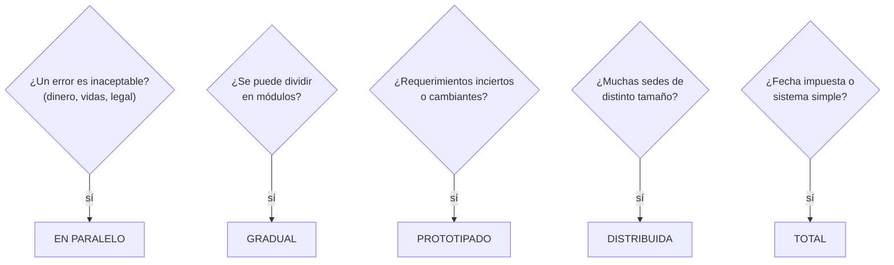
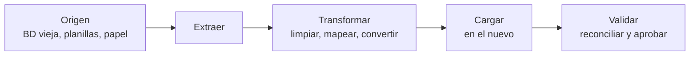
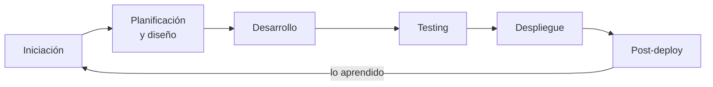

---
tags:
  - diseño-sistemas
  - parcial-2
  - unidad-6
  - implementacion
  - release
unidad: "6.3"
fuente: "Parcial 2 - Contenido/Unidad 6/Diseño de Sistemas - Unidad 6.3 - Implementación v2.pdf"
estado: en-progreso
---
# U6.3 — Implementación

← [[U6.2 - Tipos de Pruebas]] · [[U6 - Índice]]

> [!abstract] TL;DR
> - **Implementación:** poner en funcionamiento un sistema **ya probado**, reemplazando al anterior **sin interrumpir la operación**. Cinco etapas: conversión de **programas**, de **datos** y de **procedimientos**, **capacitación** y **evaluación final**.
> - **Cinco estrategias de conversión:** **total** (fecha de corte), **en paralelo** (conviven y se comparan), **gradual** (módulo a módulo), **por prototipado** (a demanda del usuario) y **distribuida** (sede por sede).
> - Total = más **riesgo** concentrado; en paralelo = más **costo** y complejidad. Se pueden **combinar**.
> - La **migración de datos** puede costar tanto como desarrollar el sistema: se planifica desde el inicio.
> - **Gestión de liberaciones:** cada versión recorre un ciclo (iniciación → planificación → construcción → testing → despliegue → post-deploy). Versiones **major.minor.patch**; madurez **alpha → beta → RC → GA**.

> [!note] Convención y fuentes
> El contenido sale de la presentación **6.3 Implementación v2**. La sección [[#11. Mantenimiento y rejuvenecimiento]] **no está en la presentación**: la agregué como `Extra` porque salió en finales anteriores. Las preguntas que salieron en exámenes anteriores están marcadas con 📝.

## Índice
- [[#1. Las cinco etapas]]
- [[#2. Conversión de programas]]
- [[#3. ¿Cómo elegir la estrategia?]]
- [[#4. Conversión de datos]]
- [[#5. Conversión de procedimientos]]
- [[#6. Capacitación a usuarios]]
- [[#7. Evaluación final]]
- [[#8. Gestión de liberaciones (release)]]
- [[#9. Tipos de release]]
- [[#10. Nota de release]]
- [[#11. Mantenimiento y rejuvenecimiento]]
- [[#12. Preguntas tipo parcial]]

---

## 1. Las cinco etapas

> [!quote] Implementación
> **Poner en funcionamiento un sistema ya probado, reemplazando al anterior sin interrumpir la operación.**

| # | Etapa | Pregunta o foco |
| --- | --- | --- |
| 1 | **Conversión de programas** | ¿Cómo pasamos del sistema viejo al nuevo? |
| 2 | **Conversión de datos** | Migrar la información existente |
| 3 | **Conversión de procedimientos** | Rediseñar cómo trabaja la gente |
| 4 | **Capacitación a usuarios** | Operativa y ejecutiva |
| 5 | **Evaluación final** | ¿Se lograron los objetivos? |

Todo esto ocurre **en paralelo a la gestión de liberaciones**: cada versión que llega a producción pasa por un ciclo de release (ver [[#8. Gestión de liberaciones (release)]]).

---

## 2. Conversión de programas

Cinco formas de reemplazar un sistema. Es un **continuo**: de más riesgo concentrado (total) a más costo y complejidad de convivencia (paralelo), y **se pueden combinar** (por ejemplo, distribuida + paralela en cada sede).

### Total (big bang)

> [!quote] Conversión total
> Reemplazo de un sistema por otro en una **fecha de corte**: al día siguiente solo se usa el nuevo.

| Ventajas | Riesgos y costos | Cuándo conviene |
| --- | --- | --- |
| **Simple y de menor costo** | **Todo el riesgo se concentra en un día** | Sistemas **triviales** |
| No hay que mantener ni sincronizar dos sistemas | Si falla, **volver atrás es difícil** | El sistema anterior **colapsó** |
| Todos pasan a trabajar igual el mismo día | Requiere **ensayo y plan de contingencia** | Lo impone **la ley** (fecha de vigencia) |

### En paralelo

> [!quote] Conversión en paralelo
> El sistema **viejo y el nuevo funcionan a la vez**; se **comparan sus resultados** hasta confiar en el nuevo.

| Ventajas | Riesgos y costos | Cuándo conviene |
| --- | --- | --- |
| **Red de seguridad**: el viejo sigue disponible | **Cara: doble operación y doble carga de datos** | Sistemas **críticos** donde un error es inaceptable: **sueldos, contabilidad, bancos** |
| Permite **comparar resultados** | Requiere **gran manejo del personal** | |
| **Baja el riesgo** operativo | Los **usuarios se cansan** de cargar todo dos veces | |

### Gradual

> [!quote] Conversión gradual
> Los **componentes** del sistema nuevo van **sustituyendo, uno a uno**, a los del viejo.

| Ventajas | Riesgos y costos | Cuándo conviene |
| --- | --- | --- |
| El riesgo **se reparte** módulo a módulo | **Problemas de acople** entre módulos viejos y nuevos | Sistemas **modulares**, que se pueden descomponer, donde el riesgo debe repartirse en el tiempo |
| Se **aprende** de cada etapa | Puede requerir **funciones de sincronización** que luego se **desechan** | |
| Los usuarios se adaptan **de a poco** | | |

### Por prototipado

> [!quote] Conversión por prototipado
> Las funcionalidades **surgen gradualmente, a demanda de los usuarios**, a partir de **prototipos evolutivos** (núcleo → + ajustes → + ajustes → sistema final).

| Ventajas | Riesgos y costos | Cuándo conviene |
| --- | --- | --- |
| Descubre problemas de **requerimientos** desde el inicio | **Alcance difuso** si no se controla | Requerimientos **poco claros o cambiantes** |
| Favorece la comunicación con usuarios **no técnicos** | | Usuarios no técnicos |
| Reduce el riesgo de desarrollar algo que **no satisface** | | Alto riesgo de construir algo que no sirva |
| Permite **ajustes rápidos** antes de la inversión total | | |

### Distribuida

> [!quote] Conversión distribuida
> Se implanta el sistema nuevo **sede por sede**, **empezando por las más pequeñas** (sede piloto → sedes medianas → casa central).

| Ventajas | Riesgos y costos | Cuándo conviene |
| --- | --- | --- |
| Se **estabiliza** en sucursales pequeñas | **Conviven versiones y procesos distintos** | Empresas o instituciones **con sucursales**: bancos, cadenas de comercio, organismos con delegaciones |
| Los errores aparecen donde el **impacto es menor** | Se necesita **soporte en cada etapa** | |
| Se escala en complejidad **con experiencia** | **Ciclo de implantación largo** | |

### Comparación de estrategias

| Estrategia | Riesgo | Costo | Duración | Vuelta atrás |
| --- | --- | --- | --- | --- |
| **Total** | 🟠 Alto | 🟢 Bajo | 🟢 Corta | 🟠 Difícil |
| **En paralelo** | 🟢 Bajo | 🟠 Alto | 🟡 Media | 🟢 Inmediata |
| **Gradual** | 🟡 Medio | 🟡 Medio | 🟠 Larga | 🟡 Por módulo |
| **Por prototipado** | 🟢 Bajo en requisitos | 🟡 Medio | 🟡 Iterativa | No aplica |
| **Distribuida** | 🟡 Medio | 🟡 Medio | 🟠 Larga | 🟡 Por sede |

🟢 favorable · 🟡 intermedio · 🟠 desfavorable. Es una valoración relativa y cualitativa.

> [!warning] Trampa típica
> "La conversión total es la más riesgosa **y** la más cara" → **Falso**: es la más **riesgosa** pero la más **barata**. La **más cara** es la **paralela**, que a cambio es la de **menor riesgo**.

---

## 3. ¿Cómo elegir la estrategia?

También pesan el **presupuesto**, la **capacidad del personal** y la **claridad de los requerimientos**.

> [!example] Ejercicio del apunte (con solución)
> | # | Escenario | Estrategia | Justificación |
> | --- | --- | --- | --- |
> | 1 | Sueldos de 3.000 empleados; un error genera pagos incorrectos | **En paralelo** | Un error es inaceptable: se comparan resultados antes de apagar el viejo |
> | 2 | Cadena de 120 farmacias, chicas y grandes, con nuevo sistema de stock | **Distribuida** | Se empieza por sucursales chicas y se escala con experiencia |
> | 3 | Facturación electrónica; el organismo deja de aceptar el formato viejo el 1 de enero | **Total** | Fecha impuesta: se ensaya el corte y se prepara contingencia |
> | 4 | Portal de trámites; los empleados no saben bien qué necesitan | **Prototipado** | Requerimientos difusos: versiones tempranas y ajustes |
> | 5 | ERP que reemplaza al viejo por módulos (compras, stock, ventas) | **Gradual** | Módulos separables; el riesgo se reparte, aunque haga falta sincronización temporal |

---

## 4. Conversión de datos

> [!quote] Conversión de datos (migración)
> La información **trasciende a las bases de datos**: **sobrevive a los sistemas** y hay que llevarla al nuevo.

> [!important] Tres ideas clave
> - **Conocer las tecnologías:** motores, formatos, codificaciones y modelos de datos de origen y destino.
> - **El costo puede ser enorme:** puede **igualar al de desarrollar el sistema nuevo**. No es una tarea menor.
> - **Es parte del proyecto:** se planifica, se estima y se le asigna presupuesto **desde el inicio**.

### Migrar sin perder información

1. **Inventariar fuentes:** qué datos existen, dónde están y quién es su dueño.
2. **Limpiar y depurar:** duplicados, nulos, formatos y valores inconsistentes.
3. **Mapear campos:** correspondencia origen → destino y reglas de transformación.
4. **Ensayar la migración:** corridas de prueba con datos reales, midiendo tiempos y errores.
5. **Reconciliar:** cantidad de registros y **totales de control**: origen = destino.
6. **Plan de corte y vuelta atrás:** ventana de migración y cómo se revierte si algo falla.

Si hay **datos en papel**: prever sistemas ágiles de carga (digitalización, formularios eficientes) y **personal dedicado**.

---

## 5. Conversión de procedimientos

> [!quote] Conversión de procedimientos
> Los procedimientos de trabajo **cambian o se rediseñan**: **reingeniería de procesos**.

Ejemplo: antes, pedido en papel → firma → carga manual → archivo. Después, pedido online → aprobación digital → registro.

- **Puede ser traumático:** cambia rutinas, roles y hasta puestos de trabajo.
- **Hay que adoptarlos:** si los empleados no se apegan a los nuevos procedimientos, el sistema no rinde.
- **Gestión del cambio:** explicar el porqué, involucrar a usuarios clave, acompañar y medir la adopción.

---

## 6. Capacitación a usuarios

| Operativa | Ejecutiva |
| --- | --- |
| Para **quienes usan el sistema día a día** | Para **quienes deciden y patrocinan** |
| **El qué y el cómo** | **El qué** |
| Qué hace el sistema y cada función | Qué problemas resuelve y qué **beneficios** aporta |
| Cómo se ejecuta cada tarea, paso a paso | Qué **indicadores y reportes** ofrece |
| Práctica con casos reales en un entorno de prueba | Qué **cambia en la organización** |
| Manuales, guías rápidas y tutoriales | **"Vender el producto"**: es una acción de **marketing** |

### Cómo y cuándo capacitar

- **Presencial o en línea:** talleres guiados, grabaciones y tutoriales.
- **Entorno de práctica:** un *sandbox* con datos de ejemplo donde equivocarse sin riesgo.
- **Capacitar capacitadores:** usuarios clave que después multiplican el conocimiento.
- **Soporte posterior:** mesa de ayuda y acompañamiento las primeras semanas.

| Antes del corte | Durante el corte | Después del corte |
| --- | --- | --- |
| Capacitación formal | Soporte en sitio | Refuerzo y consultas |

---

## 7. Evaluación final

> [!quote] Evaluación final
> Cierra la implementación: **¿el sistema hace lo que se prometió, al costo y en el plazo previstos?**

| Aspecto | Pregunta |
| --- | --- |
| **Requisitos** | ¿Cumple lo especificado y pasó la aceptación? |
| **Objetivos de negocio** | ¿Se logró el beneficio esperado? |
| **Datos** | ¿La migración fue íntegra y consistente? |
| **Usuarios** | ¿Adoptan el sistema? ¿Están satisfechos? |
| **Costo y plazo** | ¿Se respetó el presupuesto y el cronograma? |
| **Lecciones aprendidas** | ¿Qué haríamos distinto la próxima vez? |

---

## 8. Gestión de liberaciones (release)

Cada versión recorre el ciclo. **Es continuo**: lo aprendido en el post-deploy vuelve a la iniciación.

### Iniciación - qué entra al release

Las **solicitudes** (nuevas características, bugs detectados, cambios solicitados) se **evalúan** por impacto en el negocio, prioridad, factibilidad y costo, y se **aprueban, postergan o rechazan**. Las aprobadas pasan a la planificación.

### Planificación del release

Se definen objetivos, riesgos y estrategias. El **plan del release** contiene:

| Identificación | Alcance y responsables | Operación |
| --- | --- | --- |
| Nombre del release | Alcance y límites | QA y pruebas finales · aprobación final |
| Fecha prevista | Roles | Fecha de despliegue · entornos requeridos |
| Objetivos | Cronograma | Estrategia de despliegue · **plan de contingencia** · plan de monitoreo y soporte |

### Diseñar y construir, probar, desplegar

| 1. Diseñar y construir | 2. Testing | 3. Deployment |
| --- | --- | --- |
| De los requerimientos al código | Se valida la versión candidata | Se despliega en producción |
| Diseño técnico, codificación, **pruebas de unidad e integración** | **Pruebas de sistema y regresión**, **UAT**, aprobación final | Ejecutar el plan de despliegue, **capacitar** usuarios, comunicar la **nota de release** |

> [!important] Frase del apunte
> **Una versión no está terminada cuando el código funciona, sino cuando los usuarios pueden usarla.**

### Estrategias de despliegue

| Estrategia | Cómo | A favor | En contra |
| --- | --- | --- | --- |
| **Rolling** | Se actualiza **de a pocos servidores** por vez | Sin cortes | **Conviven dos versiones** |
| **Blue-green** | **Dos entornos idénticos**; se cambia el tráfico del azul al verde | **Vuelta atrás inmediata** | **Duplica infraestructura** |
| **Canary** | La versión nueva llega primero a un **pequeño porcentaje** de usuarios | Detecta problemas con **poco impacto** | |
| **Feature flags** | El código se despliega **apagado** y se enciende por funcionalidad | **Separa desplegar de liberar** | |

> [!important] Regla
> Toda estrategia de despliegue necesita un **rollback definido y probado antes** del despliegue.

> [!tip] Extra: paralelismo con la conversión de programas
> Las estrategias de despliegue son las "primas" modernas de las de conversión: **blue-green** se parece a la **total con red de seguridad**, **canary** y **rolling** a la **gradual** o **distribuida** (por porcentaje de usuarios o de servidores en vez de por módulo o sede).

### Post deployment

| Monitorear | Documentar |
| --- | --- |
| Errores, rendimiento y disponibilidad | ¿Qué salió bien y qué no? |
| Tickets y comentarios de los usuarios | Desvíos de plan, costo y calidad |
| **Hotfix** si hay fallas críticas | Mejoras al proceso y a la herramienta |
| Soporte reforzado los primeros días | Entradas para el próximo release |

---

## 9. Tipos de release

### Según el alcance - major, minor, patch

| Tipo | Ejemplo | Qué cambia | Casos |
| --- | --- | --- | --- |
| **Major** | v1.0 → v2.0 | Cambios grandes, con **posibles incompatibilidades** con versiones anteriores | Migraciones, rediseños, cambios de API |
| **Minor** | v2.1 → v2.2 | **Nuevas funcionalidades** que **mantienen la compatibilidad** | Nuevo reporte, nueva opción de pago |
| **Patch** | v2.2.1 → v2.2.2 | **Corrección de errores** sin cambiar la funcionalidad | Arreglo de un cálculo o de un mensaje |

### Según la madurez - de alpha a GA

| Alpha | Beta | Release Candidate (RC) | General Availability (GA) |
| --- | --- | --- | --- |
| Versión **interna**, incompleta e inestable | Funcionalidad **completa**, con errores conocidos | Candidata a final: **solo se corrigen bugs críticos** | Versión **estable**, para todos |
| Equipo de desarrollo y QA | Usuarios seleccionados, feedback | Pruebas finales y aceptación | Todos los usuarios |

Ejemplo de numeración: `3.0.0-alpha.1 → 3.0.0-beta.2 → 3.0.0-rc.1 → 3.0.0`.

> [!warning] No confundir
> La **versión alpha** (interna, desarrollo y QA) no es la **prueba alfa** de [[U6.2 - Tipos de Pruebas#9. Pruebas de aceptación|U6.2]], donde usuarios finales prueban en el sitio del desarrollador.

---

## 10. Nota de release

> [!summary] Ficha - contenido de una nota de release
> 1. **Información general:** nombre y versión, fecha, tipo de release y audiencia.
> 2. **Resumen ejecutivo:** en pocas líneas, qué trae la versión.
> 3. **Detalle de cambios:** nuevas funciones, mejoras y errores corregidos.
> 4. **Impacto para el usuario:** qué cambia en su trabajo diario.
> 5. **Instrucciones:** cómo actualizar o desplegar.
> 6. **Problemas conocidos:** errores abiertos y limitaciones.
> 7. **Contacto:** a quién consultar o reportar.
>
> **Buena práctica:** escribirla para la audiencia, en lenguaje claro y con números de versión consistentes.

> [!example] Ejemplo del apunte
> **Sistema de Gestión de Pedidos v2.3.0** · 14/11/2026 · **Minor** · todos los usuarios.
> - **Resumen:** incorpora el seguimiento de envíos y mejora los tiempos del listado de pedidos.
> - **Cambios:** nuevo seguimiento de envíos; listado 40 % más rápido; corrección de totales con descuento.
> - **Impacto:** aparece la pestaña Envíos; los pedidos antiguos no cambian.
> - **Instalación:** automática el sábado de 22:00 a 23:00; no requiere acción del usuario.
> - **Problemas conocidos:** la exportación a PDF puede tardar con más de 5.000 filas.
> - **Contacto:** mesa de soporte, interno 4500.
>
> Es **minor** porque agrega una funcionalidad (envíos) sin romper compatibilidad.

---

## 11. Mantenimiento y rejuvenecimiento

> [!warning] Sección Extra
> **Nada de esta sección está en la presentación 6.3.** La agregué porque en los finales de 2012 se preguntó por los **tipos de mantenimiento** y el **rejuvenecimiento del software** (ver el [[Banco de preguntas - Exámenes anteriores#Unidad 6 — Pruebas e Implementación|banco]]). Sale de la bibliografía general (Pressman y Sommerville). Preguntá a la cátedra si entra en el parcial: el programa menciona un libro *Implementación* que no está en las carpetas.

> [!tip] Extra: tipos de mantenimiento
> | Tipo | Qué hace | Ejemplo |
> | --- | --- | --- |
> | **Correctivo** | **Corrige errores** encontrados en producción | Un cálculo de descuento mal hecho (un *patch*) |
> | **Adaptativo** | **Adapta** el software a cambios del **entorno** (SO, hardware, leyes, otros sistemas) | Cambiar el formato de factura por una nueva norma |
> | **Perfectivo** | **Mejora o agrega** funcionalidades que pide el usuario, o mejora el rendimiento | Agregar un reporte nuevo (un *minor*) |
> | **Preventivo** | Cambia el software para **facilitar el mantenimiento futuro** y evitar problemas | Refactorizar, documentar, actualizar librerías |
>
> Dato clásico: el mantenimiento se lleva **la mayor parte del costo** del ciclo de vida, y la mayor parte del mantenimiento **no es correctivo** sino adaptativo y perfectivo.

> [!tip] Extra: rejuvenecimiento del software
> Es **mejorar la calidad de un sistema existente** (en general, un sistema heredado) para **extender su vida útil** y **bajar el costo de mantenerlo**, sin rehacerlo desde cero. Se hace con:
> - **Redocumentación:** generar documentación que falta o está desactualizada.
> - **Reestructuración:** reorganizar el código (o los datos) para hacerlo más entendible, **sin cambiar su funcionalidad**.
> - **Ingeniería inversa:** recuperar el diseño y las especificaciones a partir del código.
> - **Reingeniería:** con lo recuperado, **reconstruir** el sistema con una tecnología o diseño mejores.
>
> **Para qué sirve:** cuando el sistema todavía tiene **valor para el negocio** pero cada cambio es caro y riesgoso. Conecta con la **conversión de procedimientos** (reingeniería de procesos) y con la **conversión gradual** (reemplazar módulos viejos de a uno).

---

## 12. Preguntas tipo parcial

> [!info] Origen
> Las marcadas con 📝 son **reales** (ver [[Banco de preguntas - Exámenes anteriores#Unidad 6 — Pruebas e Implementación|el banco]]). Las de V/F y múltiple opción las **armé yo**. Las respuestas de mantenimiento y rejuvenecimiento son **Extra** (no están en la presentación).

> [!question]- 📝 Nombre las desventajas de la conversión en paralelo. (Final 07/2012)
> - Es la estrategia **más cara**: **doble operación** y **doble carga de datos**.
> - Requiere un **gran manejo del personal**.
> - **Los usuarios se cansan** de cargar todo dos veces.
> - *Extra:* si los resultados difieren, hay que investigar cuál de los dos sistemas tiene razón, y la convivencia puede estirarse.
>
> A cambio, es la de **menor riesgo** y con **vuelta atrás inmediata**; conviene en sistemas críticos (sueldos, contabilidad, bancos).

> [!question]- 📝 Explique los tipos de mantenimiento y cite ejemplos. (Final 03/2012, Final 07/2012) - Extra
> **Correctivo** (corregir errores: un cálculo mal hecho), **adaptativo** (adaptarse a cambios del entorno: una nueva ley de facturación o un nuevo SO), **perfectivo** (mejoras y funciones nuevas pedidas por el usuario: un reporte nuevo) y **preventivo** (facilitar el mantenimiento futuro: refactorizar, documentar). Ver [[#11. Mantenimiento y rejuvenecimiento]].

> [!question]- 📝 ¿En qué consiste el "rejuvenecimiento del software" y para qué sirve? (Final 03/2012, 10 pts) - Extra
> Consiste en **mejorar la calidad de un sistema existente** mediante **redocumentación**, **reestructuración**, **ingeniería inversa** y **reingeniería**, sin reescribirlo desde cero. Sirve para **extender la vida útil** de un sistema que todavía tiene valor para el negocio y **reducir el costo y el riesgo** de mantenerlo.

> [!question]- V/F: "La conversión total es la de menor costo."
> **Verdadero.** Pero concentra **todo el riesgo** en un día y la vuelta atrás es difícil.

> [!question]- V/F: "En la conversión distribuida se empieza por la casa central, porque es la que más usuarios tiene."
> **Falso.** Se empieza por las **sedes más pequeñas** (piloto), donde el impacto de los errores es menor, y se escala con experiencia.

> [!question]- V/F: "La migración de datos es una tarea menor que se resuelve al final del proyecto."
> **Falso.** Su costo **puede igualar al del desarrollo** y se planifica y presupuesta **desde el inicio**.

> [!question]- V/F: "La capacitación ejecutiva enseña paso a paso cómo se ejecuta cada tarea."
> **Falso.** Eso es la **operativa** (el qué y el cómo). La ejecutiva muestra **el qué**: problemas que resuelve, beneficios, indicadores; es "vender el producto".

> [!question]- Múltiple opción: un banco con 80 sucursales de distinto tamaño implanta un sistema nuevo. ¿Qué estrategia conviene?
> a) Total · b) Por prototipado · c) **Distribuida** · d) Gradual
> **Respuesta: c.** Sede por sede, empezando por las chicas. Se puede combinar con paralelo en cada sede si el error es inaceptable.

> [!question]- Múltiple opción: se pasa de la versión 2.2.1 a la 2.3.0. ¿Qué tipo de release es?
> a) Major · b) **Minor** · c) Patch · d) Release Candidate
> **Respuesta: b.** Nuevas funcionalidades compatibles.

> [!question]- Múltiple opción: ¿qué estrategia de despliegue separa desplegar de liberar?
> a) Rolling · b) Blue-green · c) Canary · d) **Feature flags**
> **Respuesta: d.**

---

## Conceptos relacionados
- [[U6.2 - Tipos de Pruebas]]: la aceptación (UAT) es el paso previo a la implementación; las pruebas de compatibilidad, conversión e instalación conectan con esta nota.
- [[U6.1 - Pruebas]]: los principios de la prueba también aplican al ensayo de la migración.
- [[U4.2 - Componentes y Despliegue]]: el diagrama de despliegue muestra en qué nodos se instala cada versión.
- [[U5.5 - Arquitectura]]: una arquitectura modular facilita la conversión gradual.
- [[Banco de preguntas - Exámenes anteriores]]
